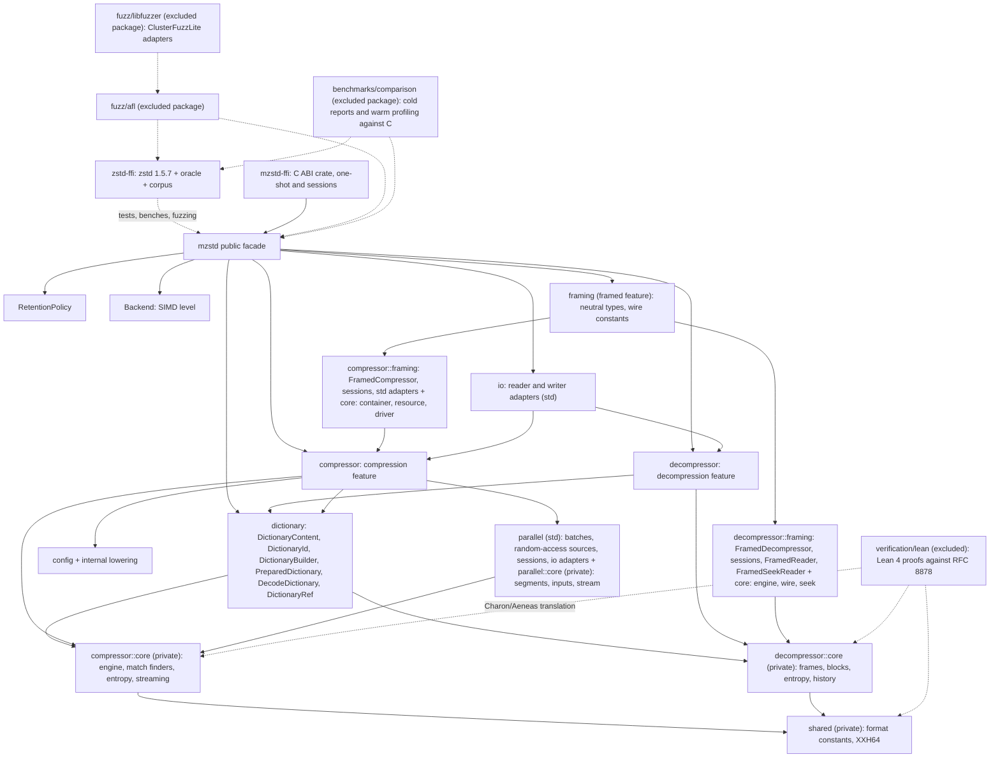

# Architecture

These specifications describe mzstd as it is implemented today: module and
ownership boundaries, public APIs, data flow, state machines, errors and known
gaps. `zstd-ffi/vendor/zstd` (zstd v1.5.7) is the reference implementation,
and [`doc/zstd_compression_format.md`](../zstd-ffi/vendor/zstd/doc/zstd_compression_format.md)
in that tree is the format specification.
To use the crate, read the [guides](../docs/README.md) instead; for checks and
repository layout, see [development](../docs/development.md).

## Where to start

| You want to understand | Read, in order |
| --- | --- |
| How a `compress` call becomes a frame | [Compressor](compressor.md) → [Encoder core](encoder-core.md) → [Optimal parser](optimal-parser.md) for the bt strategies |
| How a frame is decoded | [Decompressor](decompressor.md) → [Decoder fast paths](decoder-performance.md) → [Decoder uninitialized output](decoder-uninit-output.md) |
| How dictionaries are loaded and used | [Dictionaries](dictionaries.md) → [Decompressor](decompressor.md#dictionaries) |
| How one input is split across threads | [Parallel compression](parallel-compression.md) |
| How containers work | [Framed containers](framing.md) → [Framed decoder](framed-decoder.md) |
| How byte identity and correctness are established | [Encoder verification](encoder-verification.md) → [Decoder verification](decoder-verification.md) → [Fuzzing](fuzzing.md) → [Formal verification](formal-verification.md) |
| Which features compile which code | [Codec features](codec-features.md) |

Specifications share an outline: module and ownership boundaries, public
surface, control and data flow with Mermaid diagrams, and error propagation.
What is missing or slower than the reference is listed under
[known gaps](#known-gaps).

## Module map

Public modules own configuration, ownership, sessions and high-level errors.
Private `core` modules own algorithms and state machines. Their errors
(`CoreError`, the decoder's internal errors) never appear in public
signatures. Each codec compiles on its own, with or without `std`.

## Common boundaries

| Specification | Scope |
| --- | --- |
| [Codec features](codec-features.md) | Feature gates, `no_std`, std-only modules, hotpath anchors and the checked configurations. |

## Compression

From the public `Compressor` down to the engine, match finders and entropy coding.

| Specification | Scope |
| --- | --- |
| [Compressor](compressor.md) | Public encoder API, configuration lowering, one-shot calls, sessions, I/O adapters, errors and retention. |
| [Encoder core](encoder-core.md) | Parameter resolution, engine lifecycle, the window model, the block pipeline, backend dispatch, match finders, LDM, entropy coding and output destinations. |
| [Optimal parser](optimal-parser.md) | btopt/btultra/btultra2 and LDM: per-block SIMD dispatch, the shared binary-tree walk, match-length kernels, price tables. |
| [Target compressed block size](target-block-size.md) | `ZSTD_c_targetCBlockSize`: the superblock path that cuts a block into sub-blocks near a compressed size. |
| [Dictionaries](dictionaries.md) | Raw and Zstandard-format dictionaries on the encoder side: `PreparedDictionary`, parameter modes, attach / copy / load and entropy loading. |
| [Parallel compression](parallel-compression.md) | Frame plans, overlap-primed segments, scoped batches, windowed streaming sessions with task queues, the parallel `std::io` adapters, errors and panic safety. |
| [Encoder verification](encoder-verification.md) | Byte-identity oracles, test suites and the overflow-correction build mode. |

## Decompression

The independent decoder, its fast paths and its output contracts.

| Specification | Scope |
| --- | --- |
| [Decompressor](decompressor.md) | Public decoder API, dictionaries, streaming state machine, history, block regeneration and compatibility with the reference decoder. |
| [Decoder uninitialized output](decoder-uninit-output.md) | `process_uninit` and `decompress_to_uninit`: the write-only sink, the one-shot `BorrowedBuf`, the C ABI and their contract. |
| [Decoder fast paths](decoder-performance.md) | SIMD dispatch, bit containers, Huffman stream scheduling, FSE tables, sequence loops, wildcopies and measurements. |
| [Decoder verification](decoder-verification.md) | Differential, golden, corruption and API suites for the decoder. |

## Containers and integrations

The `framed` container format, the OpenZL-facing surface and the C ABI.

| Specification | Scope |
| --- | --- |
| [Framed containers](framing.md) | The `framed` wire format and the framed compressor: owner, sessions, structured input, std adapters, state and memory. |
| [Framed decoder](framed-decoder.md) | `FramedDecompressor`: detection, validation, events, dictionaries and budgets; the `FramedSeekReader` index and dependency plan. |
| [OpenZL integration](openzl-integration.md) | The zstd calls OpenZL's codec makes and their mzstd counterparts: magicless frames, `CParameter`, standalone dictionaries and `FrameHeaderInfo`. |
| [C ABI](c-abi.md) | `mzstd-ffi`: one-shot and session functions, handle lifecycle, validation, panic guard and status mapping. |

## Development tools

How the repository measures, tests, proves and publishes itself.

| Specification | Scope |
| --- | --- |
| [Fuzzing](fuzzing.md) | AFL targets, input layout, corpora, regressions and campaigns, and the libFuzzer adapters ClusterFuzzLite builds. |
| [Formal verification](formal-verification.md) | Charon/Aeneas translation to Lean 4, the RFC 8878 transcription, function specifications, round trips, trusted base and the RFC coverage checklist. |
| [CI](ci.md) | Workflows and the checks they run: fuzzing, Miri, AddressSanitizer and hotpath Cloud benchmarks. |
| [Benchmarking](benchmarking.md) | The cold C-versus-mzstd comparison harness: corpus, preflight validation, Criterion sampling and the report and chart generators. |
| [Documentation publishing](documentation.md) | Source staging, navigation, section pages, recipe execution, link validation and Pages deployment. |

## Known gaps

- **Scope.** Both codecs take raw and Zstandard-format dictionaries
  ([dictionaries](dictionaries.md), [decompressor](decompressor.md#dictionaries));
  the parallel compressor and the C ABI do not. Magicless frames are written by `Compressor` and read by the
  decoder (not by the parallel or framed compressors, nor the C ABI;
  [OpenZL integration](openzl-integration.md)). There are no external
  sequence producers, and no legacy (v0.x) frames.
- **Speed.** A `Backend` (`fearless_simd` level) is chosen once per codec
  and dispatched once per block. In the cold comparison against zstd 1.5.7
  ([benchmarks](../docs/benchmarks/README.md), Ryzen 9 7950X under KVM,
  AVX-512, 2026-11-12, host shared with other tenants) compression runs at
  a median 1.216x the reference's speed, faster in 174 of 192 dataset/level
  pairs, and decompression at 1.521x, faster in 152. These medians include
  empty and tiny inputs. The encoder still trails on Alice at nine levels
  (0.82-0.97x in that noisy run), and on the whole `silesia.tar` in
  lzbench by up to 2.4% at `--fast` 5 and 1 and at levels 1, 2, 5 and 8
  (2026-11-12, fastest of three rounds: 0.996x, 1.002x and 0.993x at
  `--fast` 5, 3 and 1, 0.979x, 0.989x and 1.011x at levels 1 to 3, 0.976x
  and 0.990x at levels 5 and 8, 1.05-1.25x at levels 11 to 22): the
  `fast` finder's path from a match to the next search still reloads and
  stores about 25 values ([encoder core](encoder-core.md#known-gaps)).
  The decoder trails on compressible text (Alice 0.911x and cyclic Alice
  0.963x in the median); in lzbench it is level with zstd at `--fast` 5
  and 3 (1.006x and 0.998x), at 0.987x at `--fast` 1 and behind from
  level 1 up (0.947-0.965x at levels 1 to 8, 0.936-0.966x at levels 11
  to 22): its four-stream Huffman loops, now in lockstep like the
  reference's assembly loops, still take about 15% more cycles than those
  ([decoder fast paths](decoder-performance.md#known-gaps)).
- **Parallel frames.** They decode anywhere, but they are not identical to
  the serial encoder's frames or to ZSTDMT's: segments are primed with their
  overlap the way ZSTDMT primes a job, but the overlap is capped at a
  quarter of a segment and LDM runs per segment.
- **Decoder memory.** Streaming history may reach twice the window plus a
  block. Allocation follows actual output.
