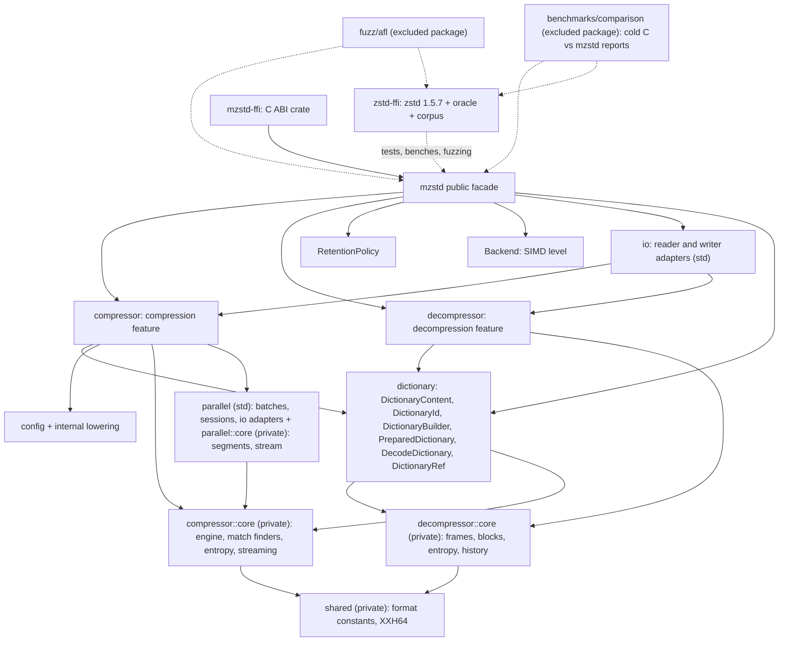

# Architecture

These specifications describe mzstd as it is implemented today: module and
ownership boundaries, public APIs, data flow, state machines, errors and known
gaps. `zstd-ffi/vendor/zstd` (zstd v1.5.7) is the reference implementation,
and [`doc/zstd_compression_format.md`](../zstd-ffi/vendor/zstd/doc/zstd_compression_format.md)
in that tree is the format specification.

## Module map

Public modules own configuration, ownership, sessions and high-level errors.
Private `core` modules own algorithms and state machines. Their errors
(`CoreError`, the decoder's internal errors) never appear in public
signatures. Each codec compiles on its own, with or without `std`.

## Specifications

| Specification | Scope |
| --- | --- |
| [Codec features](codec-features.md) | Feature gates, `no_std`, std-only modules, hotpath anchors and the checked configurations. |
| [Compressor](compressor.md) | Public encoder API, configuration lowering, one-shot calls, sessions, I/O adapters, errors and retention. |
| [Encoder core](encoder-core.md) | Parameter resolution, engine lifecycle and table reuse, the segment and address model of the window, the block pipeline, backend dispatch, match finders, LDM, entropy coding, streaming and output destinations (slice, Vec, uninitialized memory). |
| [Optimal parser](optimal-parser.md) | btopt/btultra/btultra2 and LDM: per-block SIMD dispatch, the shared binary-tree walk, match-length kernels, price tables. |
| [Dictionaries](dictionaries.md) | Raw and Zstandard-format dictionaries on the encoder side: `PreparedDictionary` (CDict), parameter modes, attach / copy / load at frame start, the dictionary segment, dictMatchState finders, entropy loading; the decoder side is in [decompressor](decompressor.md#dictionaries). |
| [Parallel compression](parallel-compression.md) | Frame plans, segments primed with their overlap as a ZSTDMT-style prefix, scoped batches, windowed streaming sessions (borrowed and owned, `process`/`process_uninit`/`wait`) with task queues, the parallel `std::io` adapters, errors and panic safety. |
| [Encoder verification](encoder-verification.md) | Byte-identity oracles, test suites and the overflow-correction build mode. |
| [Decompressor](decompressor.md) | Public decoder API, dictionaries (parsing, frame-start setup, dictionary history), streaming state machine, history, block regeneration and compatibility with the reference decoder. |
| [Decoder uninitialized output](decoder-uninit-output.md) | `process_uninit` and `decompress_to_uninit`: the write-only streaming `Sink`, the one-shot `BorrowedBuf` zeroed on demand a chunk at a time, the shared outcome mapping, the C ABI and their contract. |
| [Decoder fast paths](decoder-performance.md) | SIMD dispatch, bit containers, Huffman and sequence loops, wildcopies, direct slice output and measurements. |
| [Decoder verification](decoder-verification.md) | Differential, golden, corruption and API suites for the decoder. |
| [C ABI](c-abi.md) | `mzstd-ffi`: exported functions, validation, panic guard and status mapping. |
| [Fuzzing](fuzzing.md) | AFL targets, input layout, corpora, regressions and campaigns. |
| [CI](ci.md) | Workflows and the checks they run. |
| [Benchmarking](benchmarking.md) | The cold C-versus-mzstd comparison harness: corpus, preflight validation, Criterion sampling and the report and chart generators. |

## Known gaps

- **Scope.** Both codecs take raw and Zstandard-format dictionaries
  ([dictionaries](dictionaries.md), [decompressor](decompressor.md#dictionaries));
  the parallel compressor and the C ABI do not. There are no magicless frames, no `targetCBlockSize`, no external
  sequence producers, and no legacy (v0.x) frames.
- **Speed.** A `Backend` (`fearless_simd` level) is chosen once per codec
  and dispatched once per block. In the cold comparison against zstd 1.5.7
  ([benchmarks](../docs/benchmarks/README.md), i7-13700KF, AVX2, one core,
  2026-10-18, mzstd 0.2.7) compression runs at a median 1.112x the
  reference's speed, faster in 166 of 192 dataset/level pairs, and
  decompression at 1.111x, faster in 147. These medians include empty and
  tiny inputs. The encoder still trails on Alice at its fastest levels
  (0.92-0.94x at levels -5 to 1) and at the lazy levels 5 to 9
  (0.94-0.97x), and on 1 MiB of text at some lazy levels (0.96-0.99x);
  the fast and dfast kernels execute 1.3-1.5x the reference's instructions
  at equal or lower misprediction rates ([encoder core](encoder-core.md#known-gaps)).
  The decoder trails on literal-heavy text (Alice 0.92-0.97x, cyclic Alice
  0.95-0.99x at most levels): its Huffman loops execute about 15% more
  instructions per symbol than the reference's, and short sequences still
  need zeroed room ([decoder fast paths](decoder-performance.md#known-gaps)).
- **Parallel frames.** They decode anywhere, but they are not identical to
  the serial encoder's frames or to ZSTDMT's: segments are primed with their
  overlap the way ZSTDMT primes a job, but the overlap is capped at a
  quarter of a segment and LDM runs per segment.
- **Decoder memory.** Streaming history may reach twice the window plus a
  block. Allocation follows actual output.
