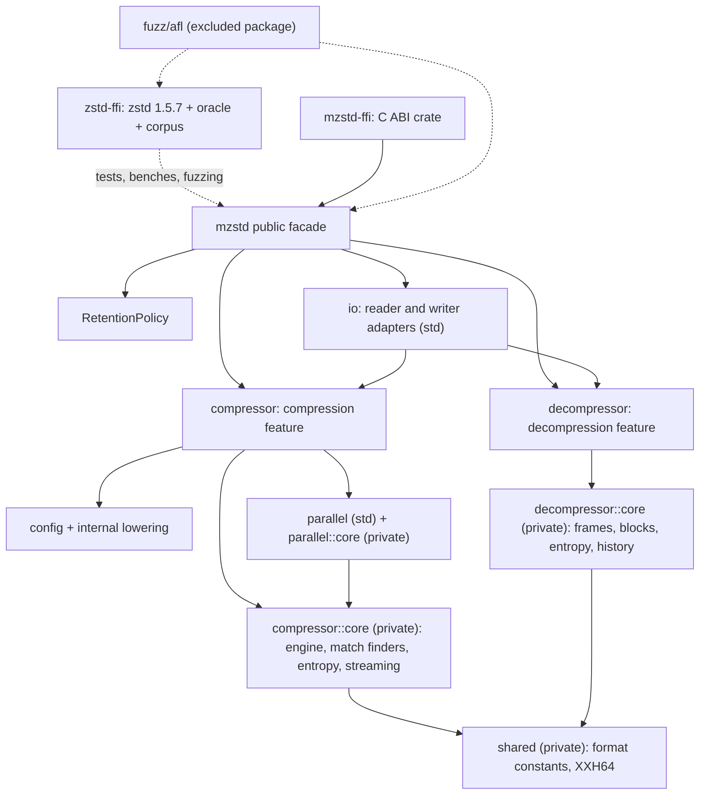

# Architecture

These specifications describe mzstd as it is implemented today: module and
ownership boundaries, public APIs, data flow, state machines, errors and known
gaps. `zstd-ffi/vendor/zstd` (zstd v1.5.7) is the reference implementation,
and [`doc/zstd_compression_format.md`](../zstd-ffi/vendor/zstd/doc/zstd_compression_format.md)
in that tree is the format specification.

## Module map

Public modules own configuration, ownership, sessions and high-level errors.
Private `core` modules own algorithms and state machines. Their errors
(`CoreError`, the decoder's internal errors) never appear in public
signatures. Each codec compiles on its own, with or without `std`.

## Specifications

| Specification | Scope |
| --- | --- |
| [Codec features](codec-features.md) | Feature gates, `no_std`, std-only modules, hotpath anchors and the checked configurations. |
| [Compressor](compressor.md) | Public encoder API, configuration lowering, one-shot calls, sessions, I/O adapters, errors and retention. |
| [Encoder core](encoder-core.md) | Parameter resolution, engine lifecycle, the segment and address model of the window, the block pipeline, match finders, LDM, entropy coding and streaming. |
| [Parallel compression](parallel-compression.md) | Frame plans, overlapped segments, scoped batches, streaming sessions with task queues, and panic safety. |
| [Encoder verification](encoder-verification.md) | Byte-identity oracles, test suites and the overflow-correction build mode. |
| [Decompressor](decompressor.md) | Public decoder API, streaming state machine, history, block regeneration and compatibility with the reference decoder. |
| [Decoder verification](decoder-verification.md) | Differential, golden, corruption and API suites for the decoder. |
| [C ABI](c-abi.md) | `mzstd-ffi`: exported functions, validation, panic guard and status mapping. |
| [Fuzzing](fuzzing.md) | AFL targets, input layout, corpora, regressions and campaigns. |
| [CI](ci.md) | Workflows and the checks they run. |

## Known gaps

- **Scope.** There are no dictionaries (encoding or decoding), no magicless
  frames, no `targetCBlockSize`, no external sequence producers, and no
  legacy (v0.x) frames.
- **Speed.** It was not a goal of this version. There is no SIMD and no
  runtime backend dispatch, and both codecs are scalar ports.
- **Parallel frames.** They decode anywhere, but they are not identical to
  the serial encoder's frames or to ZSTDMT's. Each segment re-compresses its
  overlap instead of loading it as a prefix.
- **Decoder memory.** Streaming history may reach twice the window plus a
  block. Allocation follows actual output.
