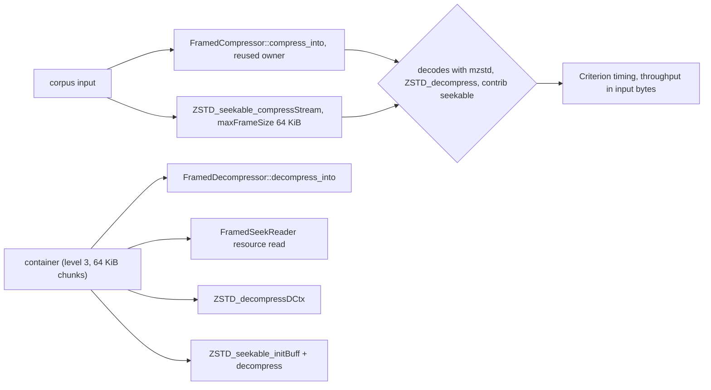
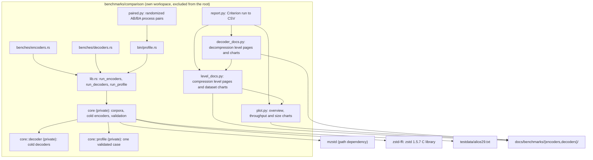
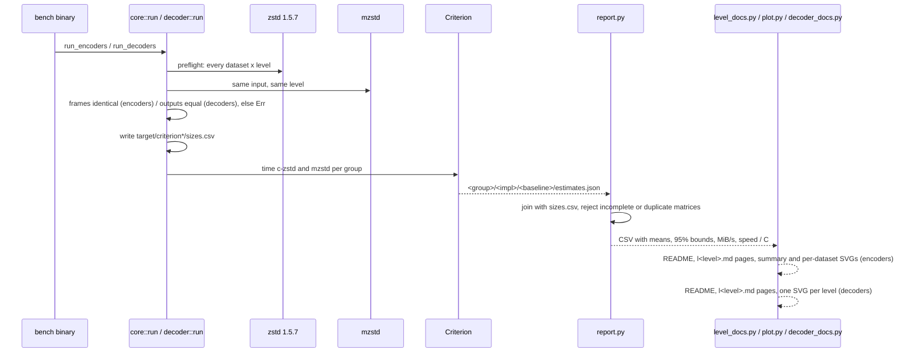
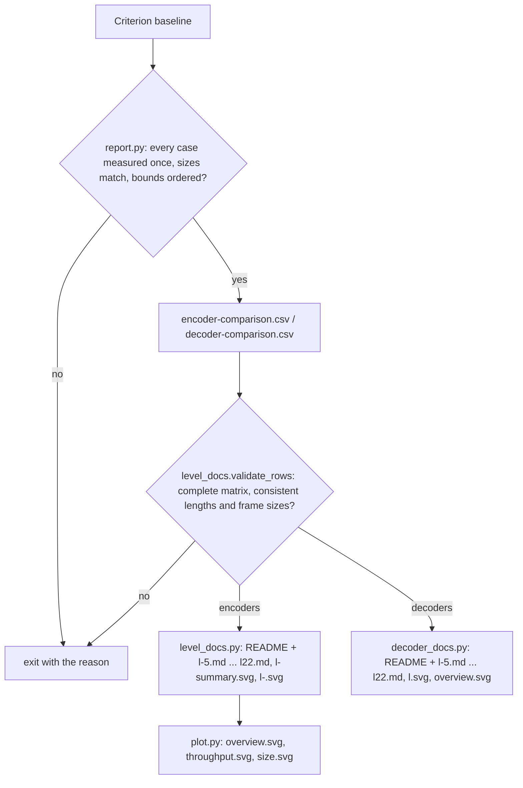

# Benchmarking

mzstd has two benchmark layers. The library's own Criterion benches
(`benches/`) time warm contexts and streaming against zstd 1.5.7 for
development work. The implementation comparison (`benchmarks/comparison/`)
times both libraries' cold one-shot APIs on a fixed corpus and produces the
published reports in [`docs/benchmarks/`](../docs/benchmarks/README.md).
This page describes the comparison harness; [running it](../docs/benchmarking.md)
is described with the commands.

## Framed container benches

`benches/framed_compress.rs` and `benches/framed_decompress.rs` need
`--features framed`. They compare [framed containers](framing.md) with the
closest thing zstd ships, the contrib seekable format compiled into
`zstd-ffi`: identical inputs (`zstd_ffi::corpus` text, binary and mixed
data, a 16 KiB text, 512 records), identical levels and 64 KiB frames.
Before timing, every container must decode with `FramedDecompressor`,
`ZSTD_decompress` and `ZSTD_seekable_decompress`, and every reference output
with the seekable reader; both sizes are printed.

The records case stores each record as its own resource and compares with
one `ZSTD_compress2` frame per record; the difference in size is the
container's per-resource structure (header frame, directory record and seek
table entries).

## Module map

The package has its own `[workspace]` and lockfile, and the root workspace
excludes it, so Criterion output and the comparison's dependency resolution
never touch the library's own checks. Its `core` module is private and
exposes the encoder and decoder benchmark entry points plus the focused
profiling driver. The driver validates one case before entering an uninlined
collection boundary, so Callgrind can exclude corpus setup and preflight.
`paired.py` runs saved driver binaries with randomized AB/BA process ordering
and records every pair for analysis; it does not generate the published
Criterion matrix. See the [profiling commands](../docs/benchmarking.md#profiling).

## Corpus and matrix

The eight datasets are mbrotli's comparison corpus, with the same
generators and seeds, so the two projects' results describe one corpus:
`empty`, `tiny-text` (44 bytes), `alice29` (152,089 bytes), `text-1m` (Alice
repeated to 1 MiB), `binary-64k` (`((i / 16) ^ i) as u8`), `random-64k`
and `random-1m` (xorshift64), and `repeated-1m` (`a` bytes). Each dataset is
timed at 24 levels: -5, -1 and 1 through 22. That is 384 encoder and 384
decoder cases per run (two implementations each).

## Data flow

- **Preflight before timing.** The encoder run compresses every case with
  both libraries first and fails unless the frames are byte-identical and
  decode to the input through the C decoder. The decoder run compresses with
  C and requires both decoders to restore the input. Filtered runs preflight
  the whole matrix too, so a partial sweep never succeeds over a broken case.
- **Cold APIs.** Each iteration includes construction, allocation, the call
  and disposal: `ZSTD_createCCtx` + `ZSTD_CCtx_setParameter(level)` +
  `ZSTD_compress2` into a `ZSTD_compressBound` buffer against
  `Compressor::new(level).compress`; `ZSTD_getFrameContentSize` +
  `ZSTD_decompress` into an exactly sized buffer against
  `Decompressor::default().decompress`. Buffers on the C side are
  uninitialized `Vec` capacity, which C fills; mzstd's API returns its own
  vector.
- **Sampling defaults.** 20 samples, 1 s warm-up and at least 3 s of measurement
  per case; Criterion command-line options override them. Each published
  environment record stores the settings actually used for that run.

## Report generation

The layout mirrors mbrotli's benchmark documentation. Per level and
dataset, speed / C = C mean latency / mzstd mean latency and output / C =
mzstd bytes / C bytes; level summaries take the median of the eight
per-dataset ratios, and the index pages order levels by mzstd's median
speed / C. Each compression level page has a summary chart, one chart per
dataset (throughput or latency with 95% bounds, beside the frame size) and
the exact numbers; each decompression level page has one panel per dataset.
The hand-written run reports (`encoder-comparison.md`,
`decoder-comparison.md`) record the measurement contract, reproduction
commands and interpretation limits; the environment records hash the
measured sources and name the archived size manifests. SVGs are generated
with Matplotlib 3.10.8 with fixed hash salts and no timestamps, so
regenerating from the same CSV yields the same files.

## Invariants

- Both sides of a case see identical bytes and the same level; the encoder
  comparison only runs when the frames are identical, so every speed ratio
  is read at an identical compression ratio.
- A published CSV always holds the complete 384-case matrix of one named
  Criterion baseline; `report.py` and `level_docs.py` refuse anything else.
- Python unit tests (`python3 -m unittest` in `benchmarks/comparison`)
  cover validation, ordering, page text and the exporter without Matplotlib
  (`test_level_docs.py`, `test_decoder_docs.py`, `test_report.py`);
  `test_plot.py` renders every chart kind when Matplotlib is installed.

## Known gaps

- One host (Intel Core i7-13700KF under WSL2); frequency and scheduling are
  not controlled beyond pinning to one core.
- The C library is built by `zstd-ffi` with `cc` defaults (`-O3`), without
  its x86-64 Huffman assembly (`ZSTD_DISABLE_ASM`) and single-threaded.
- Warm (reused-context) and streaming performance are measured only by the
  root `benches/`, not published here.
