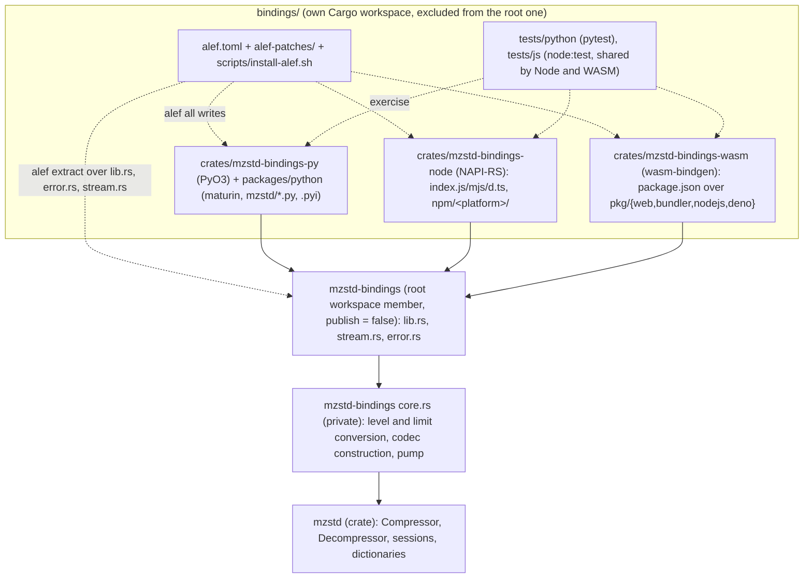
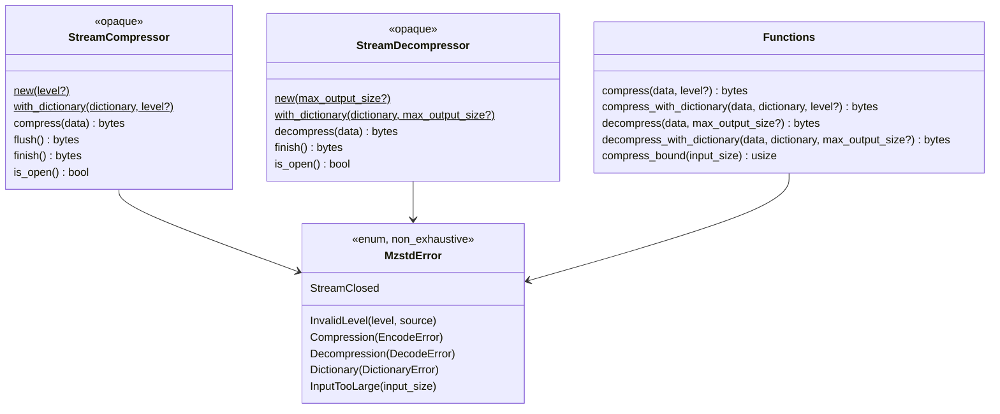
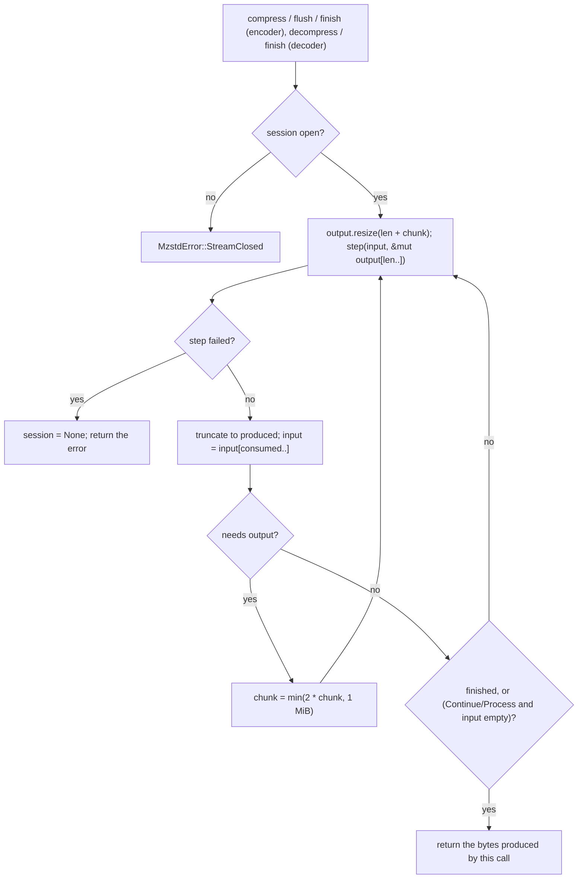
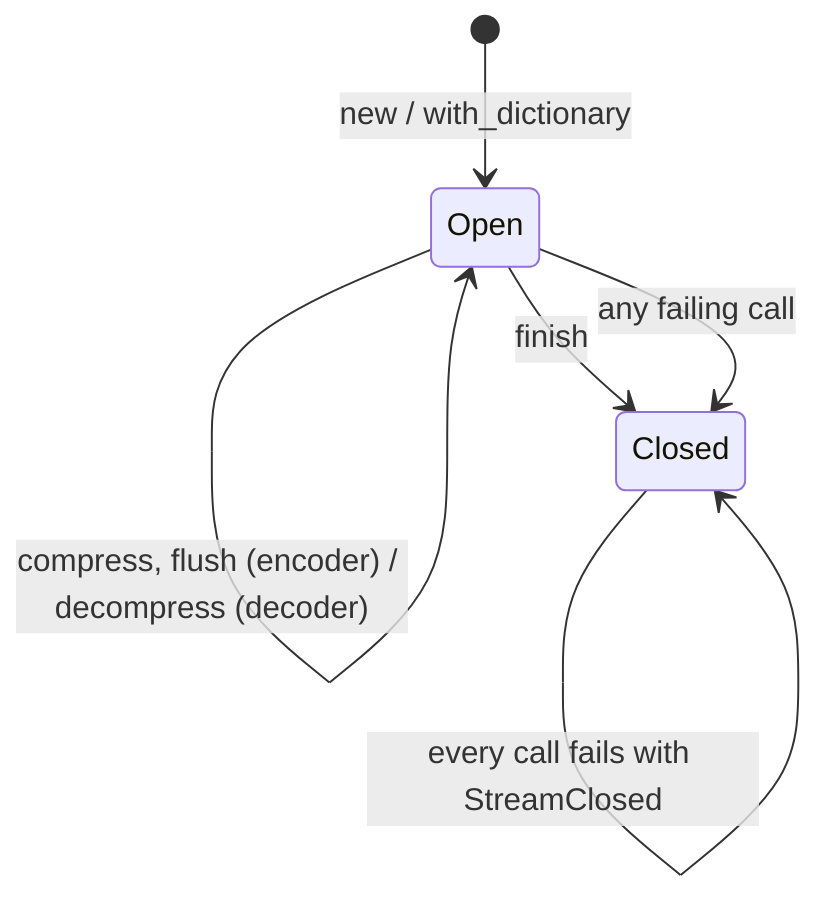
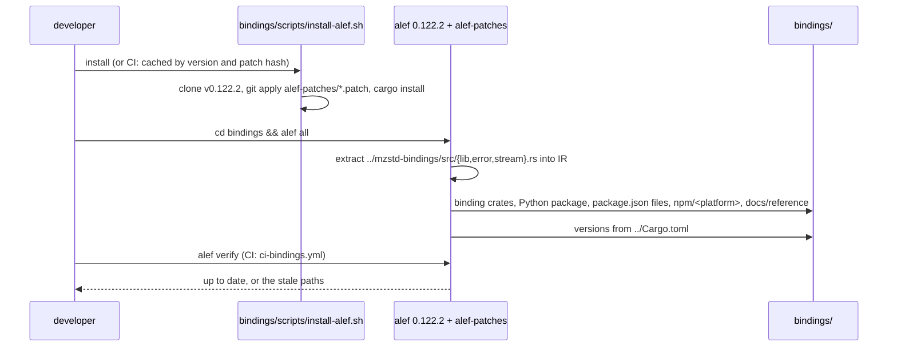
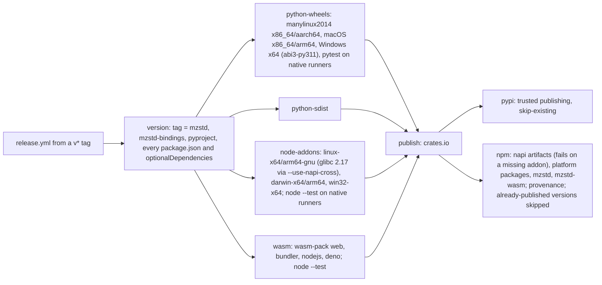

# Language bindings

mzstd is published for Python (`mzstd` on PyPI), Node.js (`mzstd` on npm)
and WebAssembly (`mzstd-wasm` on npm). The packages are generated by
[alef](https://github.com/xberg-io/alef) 0.122.2 from a small Rust facade,
`mzstd-bindings`, and are released by `release.yml` in the same run as the
crate.

## Layout and ownership

- **`mzstd-bindings/`** is hand-written and is the only input alef reads.
  It is a member of the repository workspace, so `cargo fmt`, `clippy`,
  `cargo test --workspace` and coverage include it. It follows the
  repository shape: the public items live in `lib.rs`, `stream.rs` and
  `error.rs`; the private `core` module holds the conversion and the loop
  that drives sessions.
- **`bindings/`** holds alef's configuration and its output. It is its own
  Cargo workspace and is excluded from the repository one, because alef owns
  files at its project root (`rustfmt.toml` with a 120-column width,
  `poly.toml`, `.cargo/config.toml`, the `.alef-*.toml` records) that must
  not reach `mzstd`. `rust-toolchain.toml` there selects stable with the
  `wasm32-unknown-unknown` target; alef seeds that file only when it is
  missing, so this one replaces its `1.99` pin.
- Every file under `bindings/crates/` and `bindings/packages/`, the API
  reference in `bindings/docs/reference/` and `bindings/LICENSE`'s copies
  are generated: alef stamps them with an `alef:hash` and `alef verify`
  re-renders and compares them. The exceptions are listed under
  `[workspace.ownership] user_owned`: the three package READMEs, which are
  the PyPI and npm landing pages. `bindings/LICENSE` is LICENSE-MIT followed
  by LICENSE-APACHE.

## Public surface

Everything takes byte slices and optional integers and returns owned bytes,
so alef maps it onto `bytes`, `Buffer` and `Uint8Array` without generics,
lifetimes or caller-provided buffers. `DEFAULT_LEVEL`, `MIN_LEVEL` and
`MAX_LEVEL` are Rust-only: alef does not extract constants.

| Facade | Python | Node.js | WebAssembly |
| --- | --- | --- | --- |
| `compress(&[u8], Option<i32>)` | `compress(data, level=None)` | `compress(data, level?)` | `compress(data, level?)` |
| `decompress_with_dictionary` | `decompress_with_dictionary` | `decompressWithDictionary` | `decompressWithDictionary` |
| `StreamCompressor::new` | `StreamCompressor.new(level=None)` | `StreamCompressor.new(level?)` | `StreamCompressor.new(level?)` |
| `is_open` | `is_open()` | `isOpen()` | `isOpen()` |
| `Vec<u8>` | `bytes` | `Buffer` | `Uint8Array` |
| `usize` | `int` | `number` | `number` |
| `MzstdError::InvalidLevel` | `InvalidLevelError(MzstdError)` | `Error` with the message | `Error` with the message |

Constructors are static factories (`new`, `with_dictionary`): alef binds an
opaque type's `new` as a static method in every backend. The Python package
re-exports the native `_mzstd` module through generated `api.py`,
`exceptions.py` and `_mzstd.pyi`; each `MzstdError` variant becomes an
exception class. Node.js and WebAssembly throw `Error` with the facade's
`Display` text.

## Semantics

One-shot calls forward to `Compressor::compress` and
`Compressor::compress_with_dictionary` with `EncoderConfig::default()` at
the level, so frames are byte-identical to `ZSTD_compress2`: content size
recorded, no checksum. A level of `None` or `0` is level 3. Dictionaries are
prepared with `DictionaryContent::Auto` for the compressor's configuration,
matching `ZSTD_CCtx_loadDictionary`. Decompression accepts every frame in the
input, skips skippable frames, decodes empty input to nothing, uses the
default 128 MiB window limit and applies `max_output_size` as
`DecodeLimits::with_max_output_bytes`.

The streams own an `EncoderSessionOwned` or `DecoderSessionOwned` and drive
it with `core::pump`:

The first chunk is 32 KiB. The encoder runs `Operation::Continue` for
`compress`, `Flush` until the encoder stops asking for space, and `End`
until `Finished`; the decoder runs `DecodeOperation::Process` for
`decompress` and `Finish` for `finish`. Feeding the same chunks therefore
produces the bytes `ZSTD_compressStream2` produces for those chunks with
`ZSTD_e_continue`, `ZSTD_e_flush` and a final empty `ZSTD_e_end`. A stream
frame records no content size.

`finish` closes the stream whether or not it succeeds. A decoder reports a
frame cut short only on `finish`, because more input could still follow a
`decompress` call.

## Errors

`MzstdError` keeps the `mzstd` error of each failure as its `#[source]`
(`ConfigError`, `EncodeError`, `DecodeError`, `DictionaryError`), so Rust
callers of the facade keep the chain. alef reports those fields as a lossy
conversion, since the bindings carry only the message; `alef.toml`
downgrades that diagnostic (`suppress_validation_codes =
["lossy_sanitized_surface"]`). In Python the free functions and the stream
methods raise the typed subclasses, `InvalidLevelError` to
`StreamClosedError`, all derived from `MzstdError`.

## Generation

alef 0.122.2 needs three fixes, kept as patches against its `v0.122.2` tag
until they are released upstream:

| Patch | Without it |
| --- | --- |
| `0001-napi-opaque-method-bytes-return.patch` | The Node.js stream methods return `Vec<u8>` where their signature says `Buffer`, and the addon does not compile. |
| `0002-pyo3-typed-errors-for-opaque-methods.patch` | Python stream methods raise `RuntimeError` instead of `MzstdError` subclasses (the free functions were fixed upstream in alef #452). |
| `0003-python-readme-and-homepage-url.patch` | `pyproject.toml` has no `readme`, so the PyPI page is blank, and puts `homepage` directly in `[project]`, which PEP 621 does not define. |

The only formatter alef finds, here and in CI, is `rustfmt`, so its output
does not depend on the host. alef merges into an existing `package.json`
rather than rewriting it: after changing `exclude_platforms`, delete
`crates/mzstd-bindings-node/package.json` before `alef all`.

## Tests

| Layer | Where | What it checks |
| --- | --- | --- |
| Facade unit | `mzstd-bindings/src/core.rs` | The pump over chunk growth, slow steps, `until_finished` and errors; level defaults and range; `compress_bound` overflow. |
| Facade differential | `mzstd-bindings/tests/facade.rs` | Frames equal `ZSTD_compress2` at seven levels, streams equal `ZSTD_compressStream2` in 1-byte to 1 MiB chunks, `flush` included; raw dictionaries equal the reference, trained ones round-trip through it; reference frames decode one-shot and streamed; limits, corrupt and truncated input, malformed dictionaries, closed streams and every error message. |
| Python | `bindings/tests/python` | Round trips at each level, bytes-like input, defaults, each exception class, dictionaries, streams, flush, closed and truncated streams, parallel threads. |
| Node.js and WebAssembly | `bindings/tests/js` (`MZSTD_MODULE` selects the package) | The same behaviour through each JavaScript API. |

## Release

Every package is built and tested before crates.io is touched, and PyPI
and npm are published only after crates.io accepted the crate, so a failure
leaves every registry on the previous release, or lets a re-run of the
failed jobs finish it. The binding versions follow `Cargo.toml`: bumping a
release means bumping `Cargo.toml` and `mzstd-bindings/Cargo.toml` and
running `alef all` in `bindings/`; `ci-bindings.yml` fails until that is
done, and the `version` job refuses a tag that disagrees with any manifest.

Registry setup, once: crates.io, PyPI and npm trust `release.yml` in the
`release` environment. npm can only trust a workflow for a package that
exists, so the first release needs an `NPM_TOKEN` secret, deleted
afterwards.

## Known gaps

- **Patched generator.** CI and local regeneration build alef from source
  with the three patches above, which takes a few minutes the first time.
- **Platforms.** No musl (Alpine) or Windows-on-Arm wheels or addons, no
  32-bit targets, and no Python free-threaded (`3.14t`) wheels. Node.js on
  those platforms can use `mzstd-wasm`; Python falls back to the sdist,
  which needs a Rust toolchain.
- **API reach.** Only levels and dictionaries are exposed: no checksums,
  explicit compression parameters, long distance matching, pledged sizes,
  parallel compression, framed containers, reusable contexts or
  `max_window_log` for the decoder. Stream methods hold the GIL in Python;
  only the free functions release it. Node.js and WebAssembly errors are
  plain `Error` objects distinguished by message, and every call runs
  synchronously on the calling thread.
- **Generated reference.** `bindings/docs/reference/` is alef's rendering;
  its usage snippets use placeholder arguments (for example `level=42`) and
  are not checked.
- **Copies.** Input and output cross the boundary as owned `Vec<u8>`s:
  the generated code copies each input once, the pump grows a zeroed
  output `Vec`, and Python copies that into a new `bytes`.
