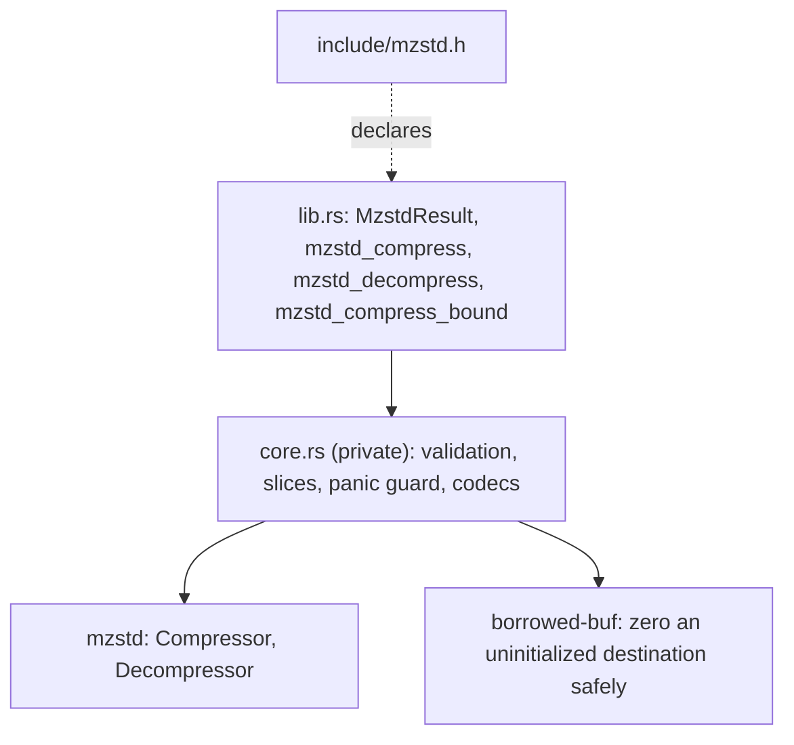
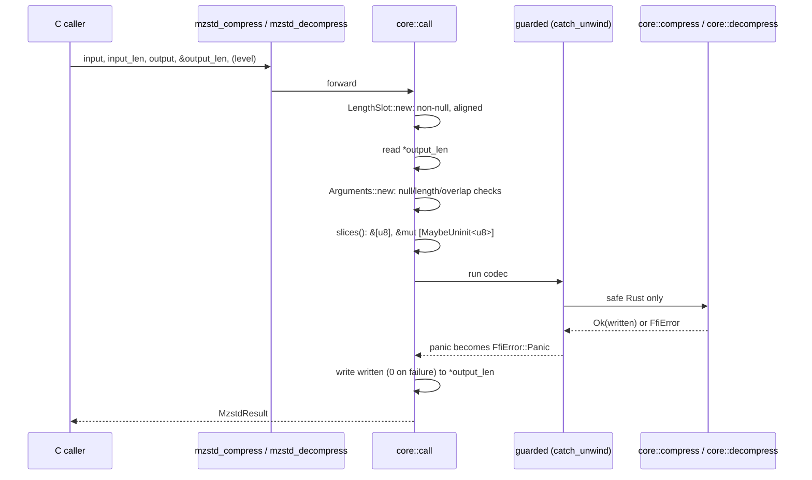
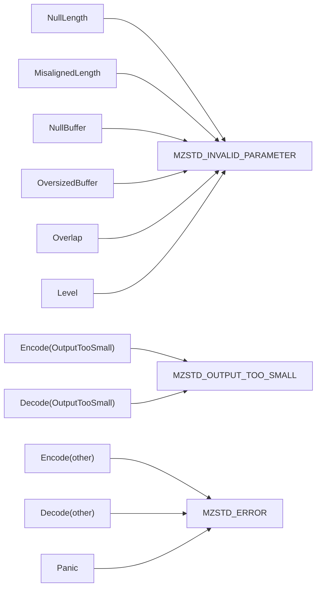

# C ABI

`mzstd-ffi` is a separate workspace crate that exports three C functions over
mzstd: one-shot compression at a level, one-shot decompression of a sequence
of frames, and the output bound. It builds a `cdylib`, a `staticlib` and an
`rlib` (for the Rust tests), and ships `include/mzstd.h`.

## Layout

`lib.rs` holds only the exported functions and their contracts. Each forwards
to `core::call` with a closure, so all the `unsafe` code lives in one function
of `core.rs`.

## Call flow

## Status mapping

`FfiError` is private. Its `Level` variant keeps the `ConfigError` as its
source, and the codec variants keep their `EncodeError` or `DecodeError`.
Only the status code crosses the boundary.

## Contracts

| Function | Behavior |
| --- | --- |
| `mzstd_compress` | `ZSTD_compress(level)` byte for byte: content size recorded, no checksum. Levels `-131072..=22`; `0` is 3. Out-of-range levels are rejected rather than clamped. A destination of `mzstd_compress_bound` bytes always suffices. A smaller one fails exactly when `ZSTD_compress` fails: the reference needs room for an 18-byte worst-case header and some slack, so a destination as long as the frame may be refused. |
| `mzstd_decompress` | `ZSTD_decompress`: every Zstandard frame in order, with skippable frames skipped. Empty input decodes to nothing. Window logs up to 31 are accepted, because the destination already bounds memory. The destination is zeroed before decoding, because the decoder writes only to initialized memory. |
| `mzstd_compress_bound` | `ZSTD_compressBound`; `0` when it overflows `size_t`. |

`*output_len` is the capacity on entry and the bytes written on return. It is
`0` after any failure, except when `output_len` itself is null or misaligned,
in which case it is never touched. Every call builds and drops its own codec,
so the functions are thread-safe.

## Invariants

- Validation happens before any dereference: null pointers with a non-zero
  length, lengths above `isize::MAX`, ranges that wrap the address space, and
  any overlap among input, output and the length slot are rejected.
- Empty buffers become empty slices whatever their pointer is.
- No panic unwinds into C.

## Verification

`mzstd-ffi/tests/c_abi.rs` calls the exported symbols through their ABI and:

- compares frames with `ZSTD_compress` at 19 levels over empty, tiny, text,
  binary, incompressible and multi-block inputs;
- compares the bound with `ZSTD_compressBound`;
- compares each short destination's outcome with the reference;
- decodes reference frames with checksums and 2^30 windows;
- checks concatenated and skippable frames, every rejection path, and
  concurrent calls;
- checks that the status codes match the header.

`benches/one_shot.rs` times both libraries through identical calls after
checking that their frames are identical.

## Known gaps

- No streaming, advanced-parameter or dictionary entry points.
- `mzstd_decompress` zeroes the whole destination even when the output is
  much smaller.
