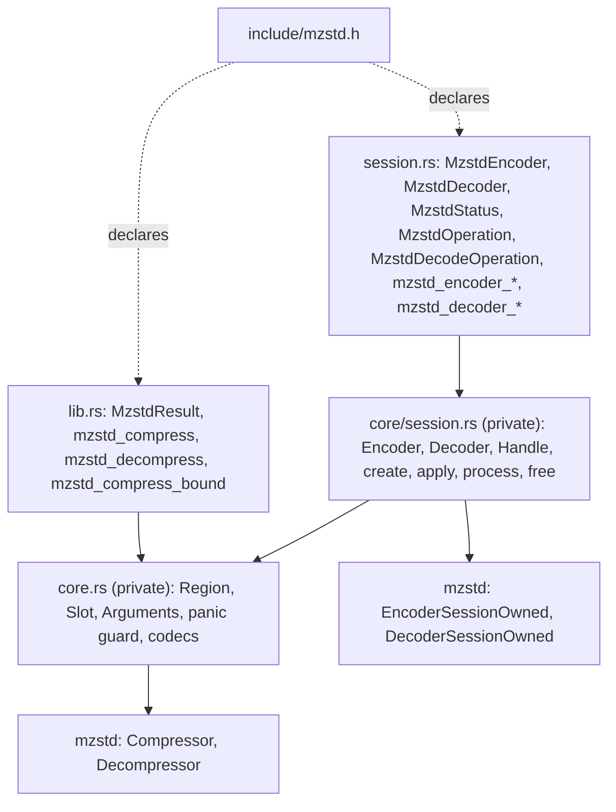
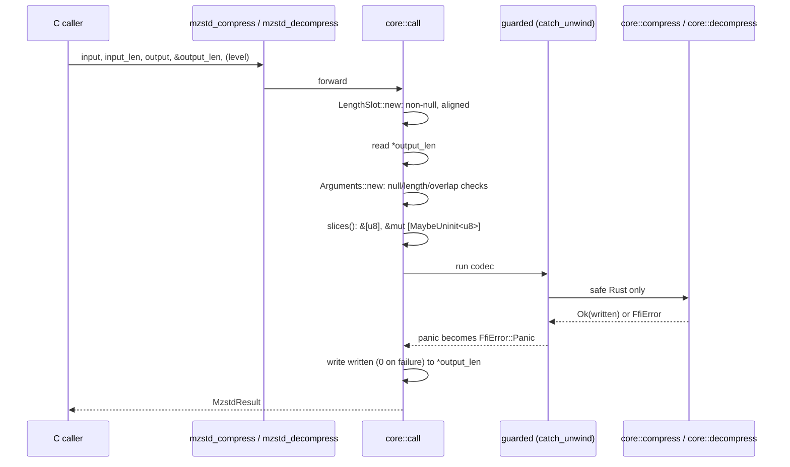
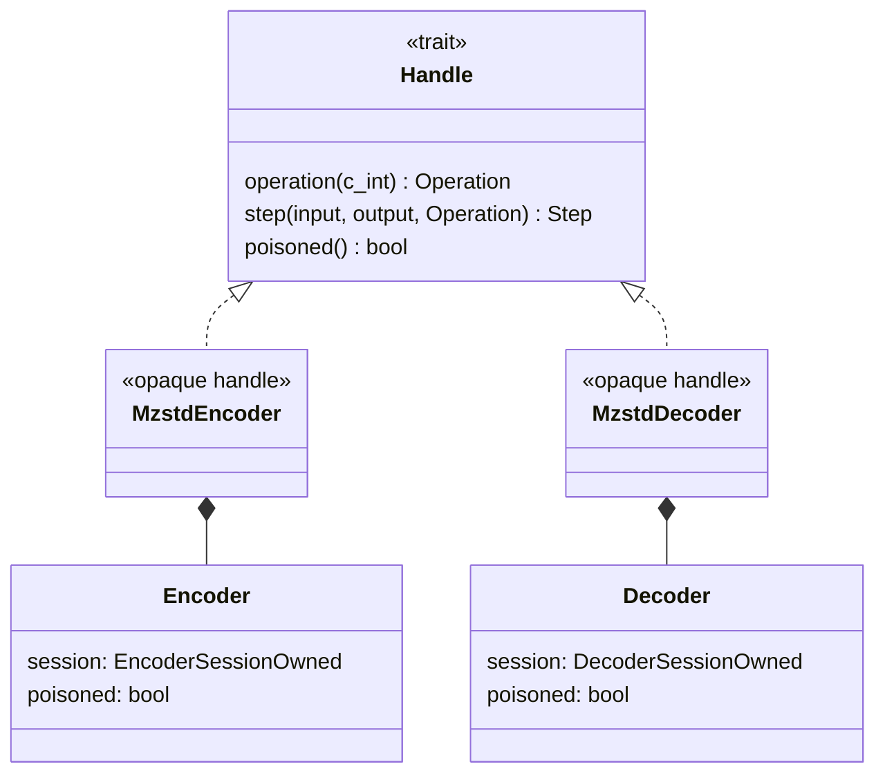
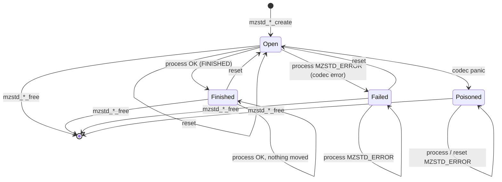
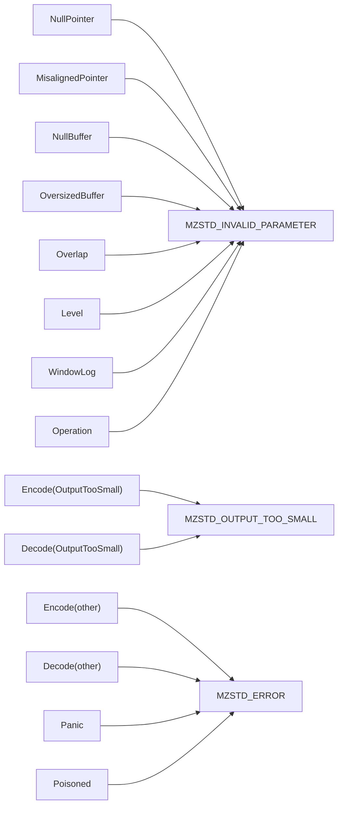

# C ABI

`mzstd-ffi` is a separate workspace crate that exports C functions over
mzstd: one-shot compression at a level, one-shot decompression of a sequence
of frames, the output bound, and incremental encoder and decoder sessions
behind opaque handles. It builds a `cdylib`, a `staticlib` and an `rlib` (for
the Rust tests), and ships `include/mzstd.h`.

## Layout



`lib.rs` and `session.rs` hold only the exported items and their contracts.
Each one-shot function forwards to `core::call` with a closure, and each
session function to `core::session::{create, apply, process, free}`, so all
the `unsafe` code lives in `core`. `MzstdEncoder` and `MzstdDecoder` are
public newtypes over the private `core::session::Encoder` and `Decoder`; C
sees them only as incomplete structs.

## Call flow



## Sessions



A handle is a `Box` the C caller owns between `*_create` and `*_free`. The
encoder wraps `Compressor::into_session` at the requested level (content size
on, checksum off, as a fresh `ZSTD_CCtx`); the decoder wraps
`Decompressor::into_session` with `FrameMode::Concatenated` and a window
limit of `2^window_log_max` (`0` keeps `DecodeLimits::DEFAULT`, 2^27, the
reference's `ZSTD_d_windowLogMax` default). `Handle` is the one trait the
generic `process` and `apply` are written against: it parses the C
`operation`, runs one `process_uninit` step and exposes the poison flag.



`Failed` is the mzstd session's own terminal state (`EncodeError` /
`DecodeError::InvalidState` on later calls); `reset` clears it through
`EncoderSessionOwned::reinit(stream)` or `DecoderSessionOwned::reinit()`.
`Poisoned` is the FFI layer's flag: a panic may leave the codec half-updated,
so `core::session::run` refuses every later call on the handle with
`FfiError::Poisoned`, and only `free` remains. Invalid arguments are rejected
before the session is touched, so they never change its state.

```mermaid
sequenceDiagram
    participant C as C caller
    participant X as mzstd_encoder_process / mzstd_decoder_process
    participant P as core::session::process
    participant R as core::session::run
    participant S as Handle::step
    C->>X: handle, input, &input_len, output, &output_len, operation, &status
    X->>P: forward
    P->>P: Outputs::new: three non-null, aligned slots (else return, nothing written)
    P->>P: read *input_len, *output_len
    P->>P: Slot::new(handle), H::operation(operation)
    P->>P: Arguments::new: buffers vs each other, the three slots and the handle struct
    P->>P: slices(), &mut *handle
    P->>R: run(handle, step)
    R->>R: poisoned? -> FfiError::Poisoned
    R->>S: guarded (catch_unwind)
    S->>S: session.process_uninit(src, dst, op)
    S-->>R: Step or FfiError
    R->>R: Panic -> set poisoned
    R-->>P: outcome
    P->>P: OK: write *status; write consumed / produced (0, 0 on failure)
    P-->>C: MzstdResult
```

`create` validates its out-pointer, builds the handle inside the panic guard,
and stores the pointer, or null on failure. `free` ignores null and
misaligned pointers, rebuilds the `Box`, and drops it inside the guard.
`apply` (behind both `*_reset`s) validates the handle and runs its body
through `run`.

## Status mapping



`FfiError` is private. Its `Level` variant keeps the `ConfigError` as its
source, `WindowLog` its `DecodeConfigError`, and the codec variants keep
their `EncodeError` or `DecodeError` (a session's `DecodeFailure` is reduced
to its error; the lengths report zero on failure). Only the status code
crosses the boundary. Sessions report progress through a separate
`mzstd_status` (`NEEDS_INPUT`, `NEEDS_OUTPUT`, `FINISHED`), mapped one to one
from `EncoderStatus` and `DecoderStatus` and written only on `MZSTD_OK`.

## Contracts

| Function | Behavior |
| --- | --- |
| `mzstd_compress` | `ZSTD_compress(level)` byte for byte: content size recorded, no checksum. Levels `-131072..=22`; `0` is 3. Out-of-range levels are rejected rather than clamped. A destination of `mzstd_compress_bound` bytes always suffices. A smaller one fails exactly when `ZSTD_compress` fails: the reference needs room for an 18-byte worst-case header and some slack, so a destination as long as the frame may be refused. |
| `mzstd_decompress` | `ZSTD_decompress`: every Zstandard frame in order, with skippable frames skipped. Empty input decodes to nothing. Window logs up to 31 are accepted, because the destination already bounds memory. The destination is viewed as `MaybeUninit<u8>` and decoded with `decompress_to_uninit`: it is never zeroed in full, and on success no byte past the result is written. |
| `mzstd_compress_bound` | `ZSTD_compressBound`; `0` when it overflows `size_t`. |
| `mzstd_encoder_create` | A handle at a level `-131072..=22` (`0` is 3), its first frame started with an undeclared size; `*encoder` is null on failure. |
| `mzstd_encoder_reset` | Abandons the current frame and starts one of `pledged_size` bytes (`ZSTD_CCtx_setPledgedSrcSize`), or `MZSTD_CONTENT_SIZE_UNKNOWN` (`UINT64_MAX`). Clears a failure, not a poison. |
| `mzstd_encoder_process` | One `ZSTD_compressStream2` step with `MZSTD_CONTINUE`, `MZSTD_FLUSH` or `MZSTD_END`: the same inputs, capacities and operations give the same bytes. Input contradicting the pledged size, including a first `END` of another length, is `MZSTD_ERROR` (the reference instead re-pledges on a first `END`). |
| `mzstd_decoder_create` | A handle for concatenated frames with windows up to `2^window_log_max` (`10..=31`, `0` for 27). The session allocates its window, so the limit bounds memory. |
| `mzstd_decoder_reset` | Abandons the current operation and starts a new one. |
| `mzstd_decoder_process` | One `ZSTD_decompressStream` step with `MZSTD_DECODE_PROCESS` or `MZSTD_DECODE_FINISH`. A frame boundary reports `NEEDS_INPUT` until `FINISH` confirms the end; input ending inside a frame is `MZSTD_ERROR`. No byte past the produced ones is written. |
| `mzstd_encoder_free`, `mzstd_decoder_free` | Release a handle; null is ignored. |

`*output_len` is the capacity on entry and the bytes written on return. It is
`0` after any failure, except when `output_len` itself is null or misaligned,
in which case it is never touched. Every one-shot call builds and drops its
own codec, so those functions are thread-safe. A session's `*input_len` and
`*output_len` follow the same rule (offered and capacity on entry, consumed
and produced on return, both `0` after a failure, none of the three
out-pointers written when any is null or misaligned). A handle may move
between threads but serves one call at a time.

## Invariants

- Validation happens before any dereference: null pointers with a non-zero
  length, lengths above `isize::MAX`, ranges that wrap the address space, and
  any overlap among input, output and the length slot are rejected.
- Empty buffers become empty slices whatever their pointer is.
- A session call's buffers are also checked disjoint from its three
  out-pointers and from the handle's own struct; the handle's heap state
  cannot be checked and is the caller's obligation.
- A handle is dereferenced only after every check passed, and the borrow
  ends before the out-pointers are written.
- No panic unwinds into C, and a handle a panic interrupted is never run
  again.

## Verification

`mzstd-ffi/tests/c_abi.rs` calls the exported symbols through their ABI and:

- compares frames with `ZSTD_compress` at 19 levels over empty, tiny, text,
  binary, incompressible and multi-block inputs;
- compares the bound with `ZSTD_compressBound`;
- compares each short destination's outcome with the reference;
- decodes reference frames with checksums and 2^30 windows;
- checks concatenated and skippable frames, every rejection path, and
  concurrent calls;
- checks that the status codes match the header.

`mzstd-ffi/tests/sessions.rs` drives the session functions the same way and:

- compares frames with `ZSTD_compressStream2` (`oracle::compress_stream_with_output`)
  at six levels over six inputs, four chunk/flush schedules and output
  capacities of 128 KiB, 4 KiB and 7 bytes, reusing one handle per level
  through `mzstd_encoder_reset`;
- compares pledged-size frames, and checks that a contradicted pledge fails
  until the next reset;
- decodes at input chunks of 1, 7 and 4096 bytes and output buffers down to
  one byte, reference frames with checksums, corrupt checksums, concatenated
  and skippable frames, frame boundaries before `FINISH`, truncated input,
  and the window limit at 27 and 28;
- checks every rejection path (null and misaligned handles and
  out-pointers, out-of-range levels, window logs and operations, overlaps)
  and that rejections leave the session usable;
- moves handles to other threads and runs them side by side.

`core/session.rs` unit-tests the status and operation mapping, the window
limits, the pledged-size sentinel, and poisoning after a panic.

`benches/one_shot.rs` times both libraries through identical calls after
checking that their frames are identical. `benches/session.rs` does the same
for sessions, with one reused context per side, 64 KiB input chunks and
64 KiB (encoder) / 128 KiB (decoder) output buffers.

## Known gaps

- No advanced-parameter (checksum, window log, LDM, strategy) or dictionary
  entry points, one-shot or session.
- No session entry point reports the decoder's totals, frame count or window
  size, or a failed call's partial progress.
- `mzstd-ffi` has no AFL or libFuzzer target of its own; the mzstd sessions
  it wraps are fuzzed directly.
- `mzstd_decompress` decodes a 64-byte frame about 5 ns slower than when it
  zeroed the destination and called `decompress_to_slice`; see
  [uninitialized output](decoder-uninit-output.md#known-gaps).
