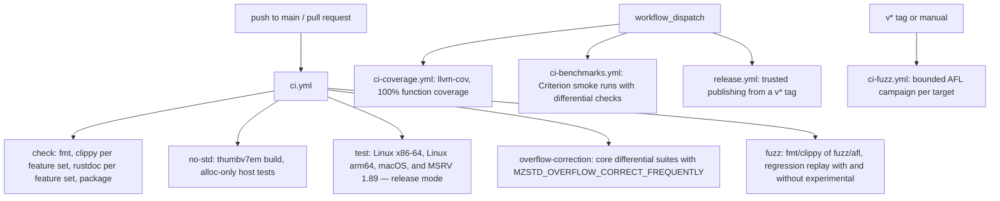

# CI

GitHub Actions workflows live in `.github/workflows`. Every job checks out
submodules recursively, because the C reference in
`zstd-ffi/vendor/zstd` is needed to build the test oracle.

| Workflow | Trigger | Checks |
| --- | --- | --- |
| `ci.yml` | push to `main`, pull requests | `cargo fmt --check`. Clippy with `-D warnings` for all features, for the default features plus hotpath, and for each codec with `std` and with `no_std`. Rustdoc with `-D warnings` for the same configurations. `cargo package`. A bare-metal build. Release-mode tests on three platforms and on the MSRV. The overflow-correction mode. Fuzz package lint and regression replay. |
| `ci-coverage.yml` | manual | `cargo llvm-cov --workspace --release` with `--fail-under-functions 100` over repository-owned sources (zstd-ffi and the vendored C excluded); HTML report as an artifact. |
| `ci-benchmarks.yml` | manual | Short `compress`, `decompress` and `mzstd-ffi` `one_shot` runs. Each benchmark asserts byte identity with zstd before timing. |
| `ci-fuzz.yml` | `v*` tags, manual | `prepare-seeds.sh`, then `campaign.sh` for each target (600 s by default); findings uploaded. |
| `release.yml` | manual from a `v*` tag | Tag/version match, then `cargo publish` through crates.io trusted publishing. |

All Cargo invocations that build the workspace pass `--locked`, because
`Cargo.lock` is committed so that benchmark baselines and campaigns are
reproducible.

## Known gaps

- No Miri or sanitizer jobs. The crate forbids `unsafe` outside tests, and
  the only `unsafe` code is FFI glue in `zstd-ffi` and `mzstd-ffi`.
- Benchmark numbers from shared runners are smoke tests, not evidence.
