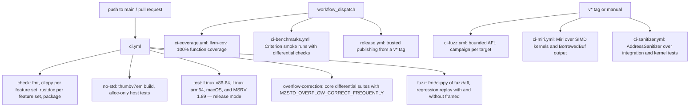
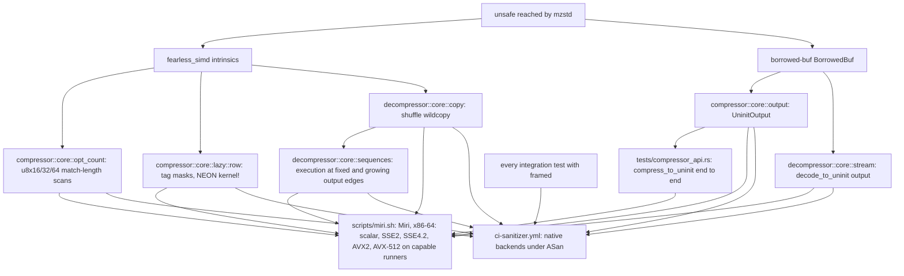

# CI

GitHub Actions workflows live in `.github/workflows`. Every job checks out
submodules recursively, because the C reference in
`zstd-ffi/vendor/zstd` is needed to build the test oracle.

| Workflow | Trigger | Checks |
| --- | --- | --- |
| `ci.yml` | push to `main`, pull requests | `cargo fmt --check`. Clippy with `-D warnings` for all features, for the default features plus hotpath, and for each codec with `std` and with `no_std`. Rustdoc with `-D warnings` for the same configurations. `cargo package`. A bare-metal build. Release-mode tests on three platforms and on the MSRV, each with the default features, with all features (alloc only) and with `framed` (which adds the std framed adapters and seek reader). Clippy and rustdoc also cover `framed` with each codec. The overflow-correction mode. Fuzz package lint and regression replay. |
| `ci-coverage.yml` | manual | `cargo llvm-cov --workspace --release` with `--fail-under-functions 100` over repository-owned sources (zstd-ffi and the vendored C excluded); HTML report as an artifact. |
| `ci-benchmarks.yml` | manual | Short `compress`, `decompress` and `mzstd-ffi` `one_shot` runs. Each benchmark asserts byte identity with zstd before timing. The framed benches (`framed_compress`, `framed_decompress`) are run locally with `--features framed`. |
| `ci-fuzz.yml` | `v*` tags, manual | `prepare-seeds.sh`, then `campaign.sh` for each target, the three framed targets included (600 s by default); findings uploaded as `findings-<target>.tar.gz`, since AFL file names contain `:`, which `upload-artifact` rejects. |
| `ci-miri.yml` | `v*` tags, manual | `scripts/miri.sh` on nightly: exact-named tests for the vector kernels and `BorrowedBuf` output under Miri, interpreted for x86-64 with `MIRI_TARGET_CPU=native`, so the runner's CPU picks the backends. See [memory checks](#memory-checks). |
| `ci-sanitizer.yml` | `v*` tags, manual | Nightly `-Zsanitizer=address` release builds: every integration test with `framed`, then the kernel and uninitialized-output unit modules on the runner's own backends. |
| `release.yml` | manual from a `v*` tag | Tag/version match, then `cargo publish` through crates.io trusted publishing. |

All Cargo invocations that build the workspace pass `--locked`, because
`Cargo.lock` is committed so that benchmark baselines and campaigns are
reproducible.

## Memory checks

`mzstd` is `forbid(unsafe_code)` outside tests. The `unsafe` with memory
effects that its code reaches lives in two dependencies: `fearless_simd`,
whose vector types, `kernel!` and `#[simd]` entries call architecture
intrinsics inside a target-feature context, and `borrowed-buf`, which
tracks the zeroed prefix of uninitialized output. The third, `branches`,
only emits prefetch hints, which never fault; on nightly, and so under
Miri, they lower to the compiler intrinsic instead of inline assembly. The
FFI glue in `zstd-ffi` and `mzstd-ffi` is outside the published crate.

Miri covers only those paths. Code that is safe Rust inside a `#[simd]`
context, such as the scalar `mem` counts the compiler auto-vectorizes, the
Huffman and sequence bit packers and the match finders around the kernels,
has no `unsafe` of its own and is left to the ordinary suites.

`scripts/miri.sh` interprets the tests for `x86_64-unknown-linux-gnu` on
any host, with `-Ctarget-cpu=$MIRI_TARGET_CPU` (default `x86-64-v3`). Miri
implements the x86 intrinsics the kernels use, AVX-512 included, but not
all of NEON (`vsli` is missing), and it reports compile-time target
features instead of executing CPUID, so the target CPU decides which
backends `Backend::available()` returns. The default gives scalar, SSE2,
SSE4.2 and AVX2 on any machine; CI passes `native`, which adds AVX-512 on
runners with every extension `fearless_simd` requires for it (Ice Lake
and later Xeons, not Cascade Lake or Zen 3), and prints the runner's CPU
model first. A local `MIRI_TARGET_CPU=icelake-server` reproduces that
case on any host. Each run names its tests with
`--exact` and fails unless that many pass, so a renamed test cannot leave
a filter that silently matches nothing. Two sweeps thin out under
`cfg!(miri)` while keeping every vector width, tail and full-length case:
`opt_count`'s window test keeps lengths next to 16-byte boundaries, and
`compress_to_uninit_writes_the_one_shot_frame` compresses 2 KB instead of
30 KB. Native runs are unchanged.

The AddressSanitizer job needs an explicit `--target` so that build
scripts and proc macros stay uninstrumented. It runs every integration
test, the C-reference differential suites included, and then the Miri
modules natively on the runner's own backends, AVX-512 included when the
runner has it. Locally, the same commands with an `aarch64-apple-darwin`
target cover NEON.

## Known gaps

- Miri does not interpret NEON and cannot call the C reference, so NEON
  and the differential suites are checked only natively, under
  AddressSanitizer. Whether a tag's Miri run reaches AVX-512 depends on
  the runner GitHub assigns. The C oracle itself is not built
  with ASan.
- Memory checks run on tags and on demand, not on pull requests.
- Benchmark numbers from shared runners are smoke tests, not evidence.
