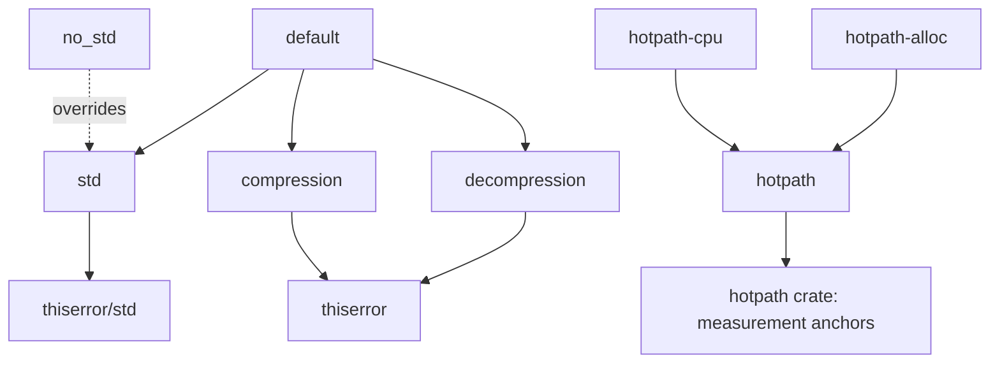
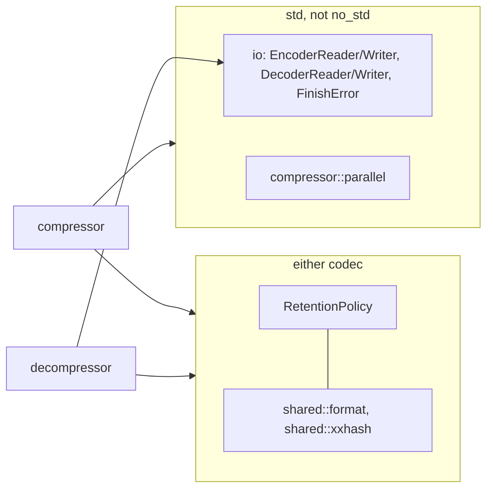

# Codec features

Cargo features select each codec and the standard library independently.

| Feature | Effect |
| --- | --- |
| `compression` | `mzstd::compressor` and its root re-exports. |
| `decompression` | `mzstd::decompressor` and its root re-exports. |
| `std` | `std::error::Error` for every error type, plus, unless `no_std` is also set, `mzstd::io` (reader and writer adapters, `FinishError`) and `compressor::parallel`. |
| `no_std` | `#![no_std]` with `alloc`; it wins over `std`, so `--all-features` builds the alloc-only crate. One-shot calls, sessions, owned sessions and retention remain. |
| `hotpath`, `hotpath-cpu`, `hotpath-alloc` | Turn on the `hotpath::measure` anchors at stage boundaries (one-shot compression, frame chunks, sequence building, entropy coding, LDM, parallel segments, and the decoder's frame, block, literal, Huffman and sequence stages). Ignored with `no_std`. |

With neither codec enabled, the crate exposes nothing; `retention`, `shared`
and `io` exist only when at least one codec does.

`shared::format` items that only the decoder reads (skippable-frame magic
numbers and sizes, the checksum size) are gated on `decompression`, so a
compression-only build has no dead code.

## Checks

Clippy is clean with `-D warnings` for each of these configurations:

- `--all-features` (alloc only), and the default features;
- `std,compression` and `std,decompression`;
- `no_std,compression` and `no_std,decompression`;
- no codec at all.

`cargo doc` is clean in each configuration under
`deny(rustdoc::broken_intra_doc_links)`. That works because the crate
documentation's codec sections, and their links, are attached with
`cfg_attr(feature = …, doc = …)`. Integration tests are gated by the codec
they need and, for `io` and `parallel`, by `not(no_std)`.
