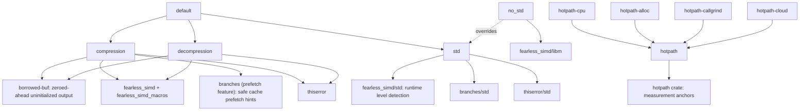
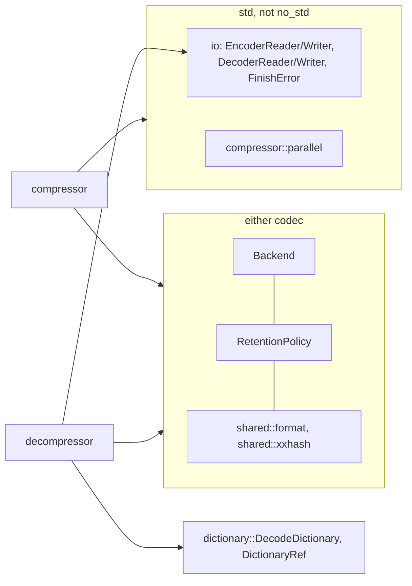
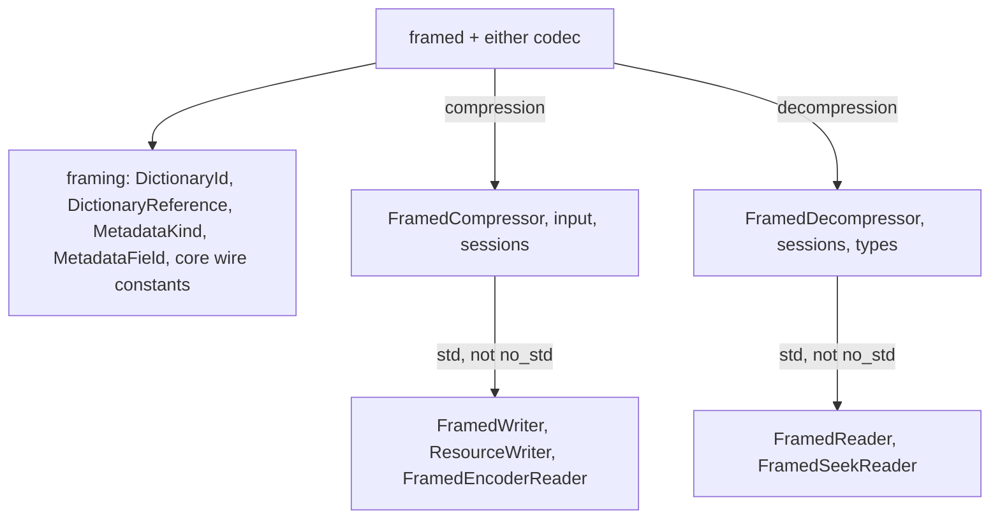

# Codec features

Cargo features select each codec and the standard library independently.

| Feature | Effect |
| --- | --- |
| `compression` | `mzstd::compressor` and its root re-exports. Pulls in `branches` (with only its `prefetch` feature, plus `std` under `std`) for the safe `prefetch_read_data` hints of the row match finder and of the fast and dfast loops: inline assembly inside that crate on x86 with SSE and on aarch64, a no-op elsewhere, so mzstd itself stays `forbid(unsafe_code)`. The row match finder's NEON tag mask is a `fearless_simd::kernel!`: its intrinsics are safe calls in NEON's feature context, and the one `unsafe` call that establishes that context is inside the macro's audited expansion in `fearless_simd`, not in mzstd's source. |
| `decompression` | `mzstd::decompressor` and its root re-exports, and `mzstd::dictionary::{DecodeDictionary, DictionaryRef}`. Pulls in `borrowed-buf`, through which `decompress_to_uninit` zeroes its destination just ahead of the decoder without `unsafe`. |
| `std` | `std::error::Error` for every error type, plus, unless `no_std` is also set, `mzstd::io` (reader and writer adapters, `FinishError`) and `compressor::parallel`. |
| `no_std` | `#![no_std]` with `alloc`; it wins over `std`, so `--all-features` builds the alloc-only crate. One-shot calls, sessions, owned sessions and retention remain. `Backend::default()` is then the compile-time baseline level instead of the detected one. |
| `framed` | `mzstd::framing` with either codec: its neutral types always; `FramedCompressor` and its sessions with `compression`; `FramedDecompressor` and its sessions with `decompression`. `FramedWriter`, `ResourceWriter`, `FramedEncoderReader`, `FramedReader` and `FramedSeekReader` also need std (not `no_std`). Enables no codec by itself and adds no dependency. |
| `hotpath`, `hotpath-cpu`, `hotpath-alloc`, `hotpath-callgrind`, `hotpath-cloud` | Turn on the `hotpath::measure` anchors at stage boundaries (one-shot compression, frame chunks, sequence building, entropy coding, LDM, parallel segments, and the decoder's frame, block, literal, Huffman and sequence stages). `hotpath-cpu` and `hotpath-alloc` add CPU and allocation metrics, `hotpath-callgrind` replaces timing with Valgrind Callgrind instruction counts per anchor, and `hotpath-cloud` lets the report be uploaded to hotpath Cloud. `examples/profile_compressor.rs` (needs `compression`) carries `#[hotpath::main]`. Ignored with `no_std`, but the dependency stays in the graph, so bare-metal builds must omit every `hotpath*` feature. |

With neither codec enabled, the crate exposes nothing; `backend`,
`retention`, `shared`, `dictionary` (its content type, ID and error) and
`io` exist only when at least one codec does.
Either codec pulls in `fearless_simd`; development builds enable its
`force_support_fallback` so unit tests can run the scalar level
(`Backend::SCALAR`, test-only) on every host.

`shared::format` items that only the decoder reads (skippable-frame magic
numbers and sizes, the checksum size) are gated on `decompression`, so a
compression-only build has no dead code.

## Framed gates

## Checks

Clippy is clean with `-D warnings` for each of these configurations:

- `--all-features` (alloc only), and the default features;
- `std,compression` and `std,decompression`;
- `no_std,compression` and `no_std,decompression`;
- no codec at all;
- `std,compression,framed`, `std,decompression,framed`,
  `no_std,compression,framed` and `no_std,decompression,framed`.

`cargo doc` is clean in each configuration under
`deny(rustdoc::broken_intra_doc_links)`. That works because the crate
documentation's codec sections, and their links, are attached with
`cfg_attr(feature = …, doc = …)`. Integration tests are gated by the codec
they need and, for `io` and `parallel`, by `not(no_std)`.
