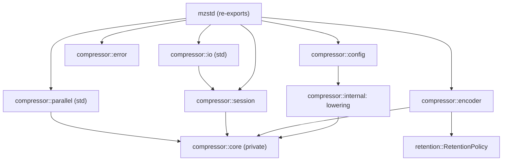
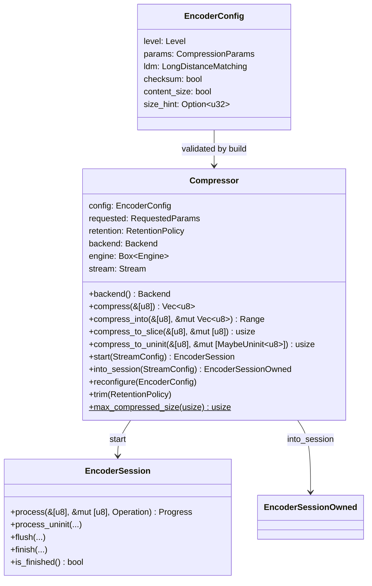
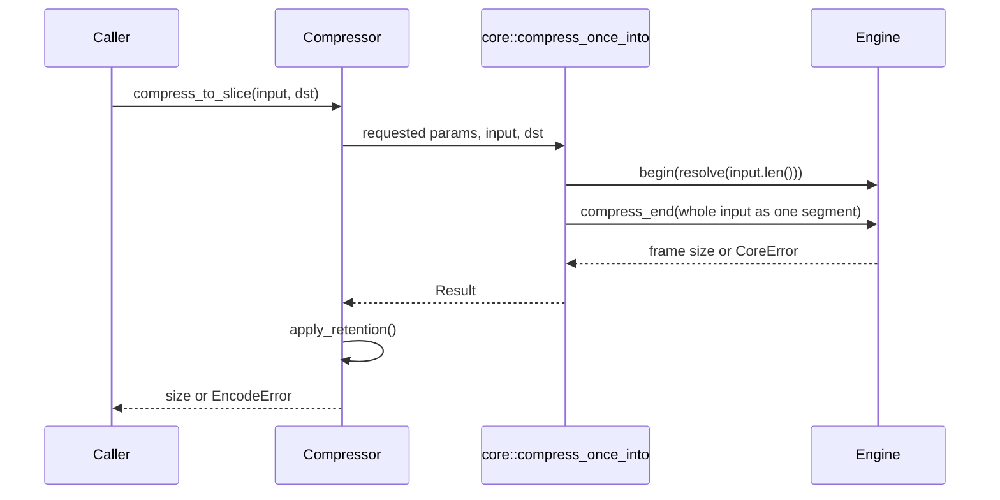
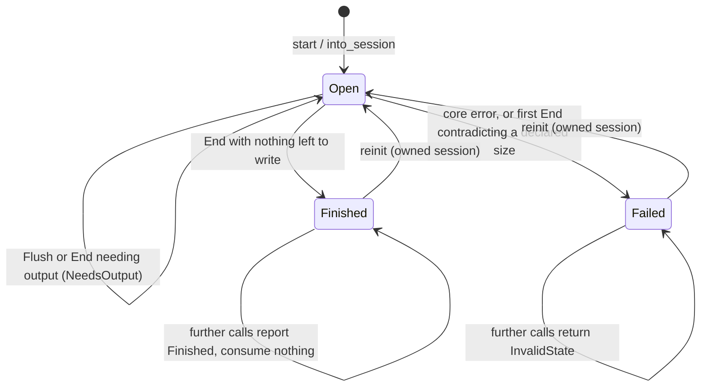
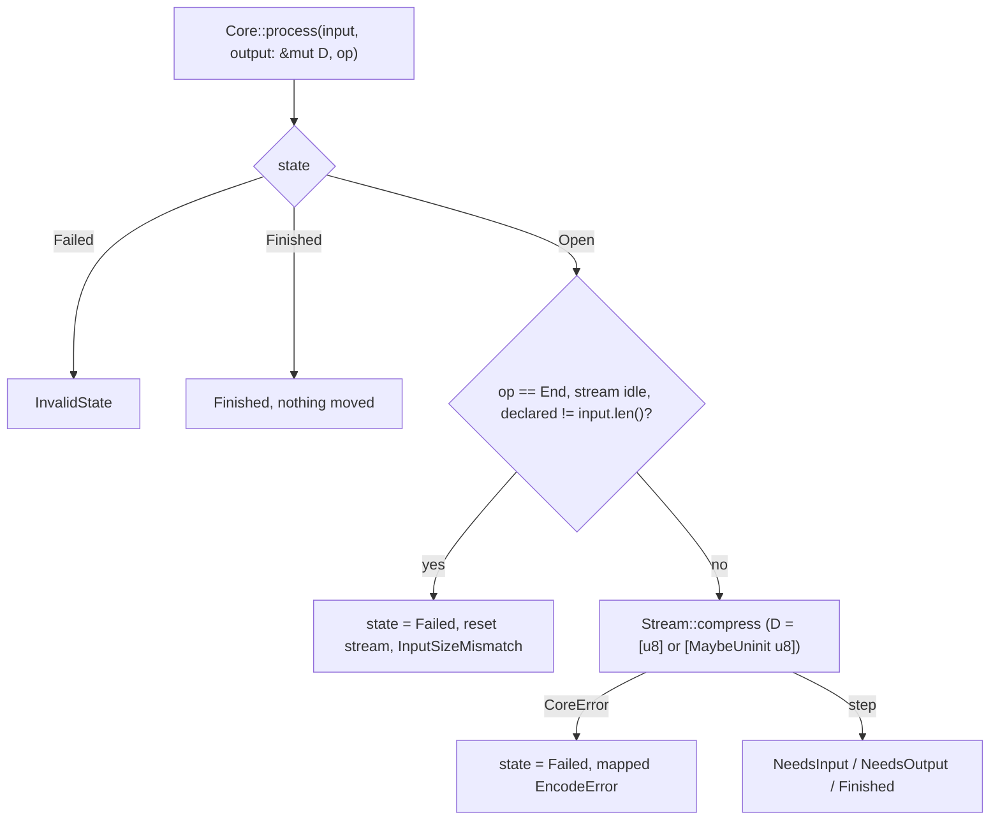
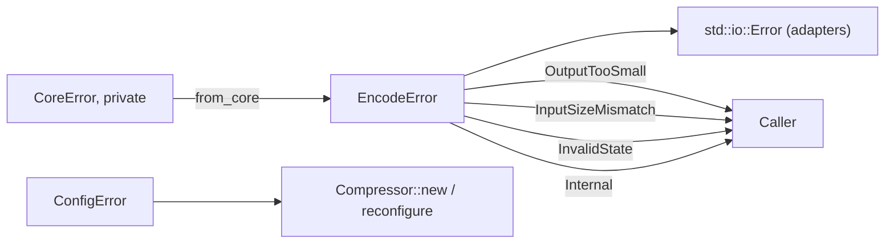

# Compressor

The public compression layer: configuration, the `Compressor` owner, one-shot
calls, incremental sessions, `std::io` adapters, errors and memory retention.
Everything here is a thin shell over the private engine described in
[encoder core](encoder-core.md); the bytes it produces are decided there.

## Modules and ownership

| Module | Owns |
| --- | --- |
| `config` | `Level`, `Strategy`, `CompressionParams`, `LdmParams`, `LongDistanceMatching`, `EncoderConfig`, `Parameter`, `ConfigError`, `SizeOverflow`, and validation against the reference's bounds. |
| `internal` | `requested_params`: the single translation from `EncoderConfig` to the core's `RequestedParams` (the reference's `ZSTD_CCtx_params`). |
| `encoder` | `Compressor`, `CompressorBuilder` (`with_retention`, `with_backend`), one-shot calls, `start`/`into_session`, retention. The backend (default: the detected SIMD level) is stored in the `Engine` for the match finders. |
| `session` | `EncoderSession`, `EncoderSessionOwned`, `StreamConfig`, `InputSize`, `Operation`, `EncoderStatus`, `Progress`. |
| `error` | `EncodeError` and the mapping from the core's private `CoreError`. |
| `io` | `EncoderReader`, `EncoderWriter`, `EncoderReaderParts` (re-exported from `mzstd::io`). `EncoderReader::into_parts` returns the source with the bytes read from it that the session had not accepted; `ParallelEncoderReader::into_parts` returns the same type. |
| `parallel` | See [parallel compression](parallel-compression.md). |

`Compressor` owns a boxed `core::cctx::Engine` (match state, entropy tables,
LDM state, sequence store) and a `core::stream::Stream` (the streaming input
and output buffers). Sessions borrow the compressor mutably, or own it in the
`Owned` variant, so one engine serves one frame at a time.

## Types

`EncoderConfig::default()` is level 3 with content size on and checksum off,
like the reference's defaults; `Compressor::default()` uses it without
validation because it has no explicit parameter. Explicit parameters are
`Option`s: `None` keeps the level's value, exactly as an unset
`ZSTD_c_*` parameter does.

## One-shot compression

The slice entry points use `core::compress_once_into`, which is
`ZSTD_compress2` with a stable input: the input is a segment of its own
(`Segment::Input(id)`, with a fresh id per call), so the engine matches
directly in caller memory and never copies it. `compress_to_uninit` runs the
same pipeline through `core::compress_once_uninit`, which writes into the
caller's `MaybeUninit` memory via `core::output::UninitOutput`: the
destination is zeroed just ahead of each block instead of being copied from
a temporary buffer (see [encoder core](encoder-core.md#destinations)). It
succeeds, fails and writes exactly as `compress_to_slice`.

`compress` and `compress_into` use `core::compress_once_append`: they reserve
`compressBound` capacity, but for inputs larger than 128 KiB initialize only
the frame header and the room required by each next block. The shared engine
pipeline writes through `core::output::VecOutput`, reusing the initialized
tail between blocks. Highly compressible frames therefore avoid zeroing a
destination as large as their input. Inputs up to 128 KiB keep the slice path.
`compress_into` preserves the existing prefix and rolls the vector back on
failure. Returned capacity and retention policy are unchanged.

A destination smaller than the frame fails with `OutputTooSmall` exactly when
`ZSTD_compress2` fails with `dstSize_tooSmall`; the reference needs room for
the largest frame header and some slack, so an output exactly as long as the
frame may be refused. The `output_capacity` fuzz target checks this.

## Sessions

A session is one frame driven by `process(input, output, operation)`, which
is `ZSTD_compressStream2` in buffered mode: the same sequence of inputs,
output capacities and operations produces the same bytes.

- `InputSize::Exact(n)` pledges the size (`ZSTD_CCtx_setPledgedSrcSize`):
  it is written in the header and a mismatch fails with
  `InputSizeMismatch`. `InputSize::Unknown` leaves the header without a
  content size unless the whole input arrives with the first `End`, as in the
  reference.
- A first call that is already `End` deviates from the reference on
  purpose. `ZSTD_compressStream2` replaces the pledged size with that call's
  input length and writes a frame for it; the session instead fails with
  `InputSizeMismatch` before touching the stream, as it does for every later
  mismatch, so a truncated or overlong input never produces a frame. The
  check lives in `session::Core`; the core stream remains a faithful port.
  When the length matches, the bytes are the reference's.
- `process_uninit` is `process` over a `[MaybeUninit<u8>]` destination: the
  same generic `Core::process` and `Stream::compress`, with blocks written
  straight to the caller zeroed just ahead and buffered output copied in.
  Bytes, counts, statuses and errors equal `process`, and the two may be
  mixed on one frame; nothing is allocated per call. Past `produced` the
  output may hold zeros or the engine's scratch bytes (a block it replaced
  with a raw or RLE block, for instance), exactly as a slice would; only
  the reported prefix is meaningful.

- `flush` and `finish` are `process` with `Flush` and `End`.
- Dropping a session mid-frame leaves the compressor reusable: the next
  `start` resets the stream state.

`EncoderStatus` reports `NeedsInput`, `NeedsOutput` (internal output is still
pending) or `Finished`. `Progress` carries the bytes consumed and produced by
the call.

## I/O adapters (`std`)

`EncoderWriter` wraps a `Write` sink: `write` feeds `Continue`, `flush` feeds
`Flush` and drains, and `finish`/`try_finish` feed `End`, returning the sink.
`finish` reports a failure as `FinishError`, which keeps the writer so the
caller can retry or recover the sink. `EncoderReader` wraps a `Read` source
and yields the compressed frame; it drives the session with `End` once the
source is exhausted. Both use internal buffers of one block.

## Errors

`ConfigError::OutOfRange` names the `Parameter`, the value and its bounds.
`EncodeError::Internal` stands for a core failure that valid input cannot
produce; it exists so such a bug is an error rather than a panic.
`EncodeError::Bound` reports a `compressBound` overflow for inputs near
`usize::MAX`.

## Retention

`RetentionPolicy::Aggressive` keeps every table and buffer between frames,
`Bounded(n)` releases them when they exceed `n` bytes, and `ReleaseAll`
releases them after each operation. `trim` applies a policy once.
`retained_bytes` sums the engine's tables and the stream buffers. Reuse never
changes output: a reused engine's frames equal a fresh one's (checked by
`compressor_lifecycle` and `tests/reuse_probe.rs` against the reference).

## Known gaps

- No dictionaries, no `targetCBlockSize`, no magicless frames, no external
  sequence producers, and no explicit `ZSTD_c_useRowMatchFinder`,
  `ZSTD_c_blockSplitterLevel` or `ZSTD_c_maxBlockSize` control in the public
  API; the core models them only at their automatic values.
- The stable-buffer streaming modes (`ZSTD_c_stableInBuffer`,
  `ZSTD_c_stableOutBuffer`) are not exposed; sessions always behave as the
  reference's buffered mode.
