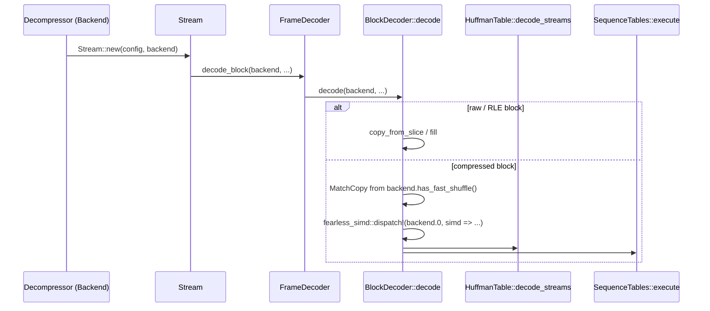
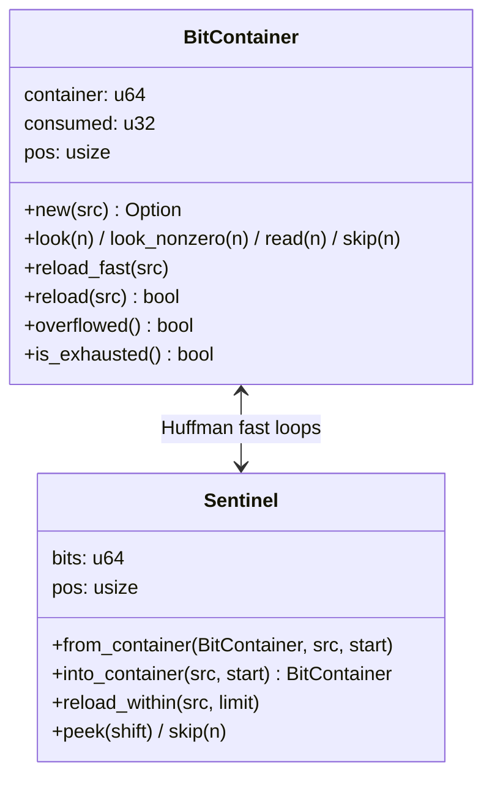
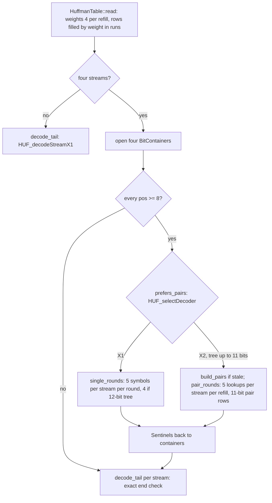
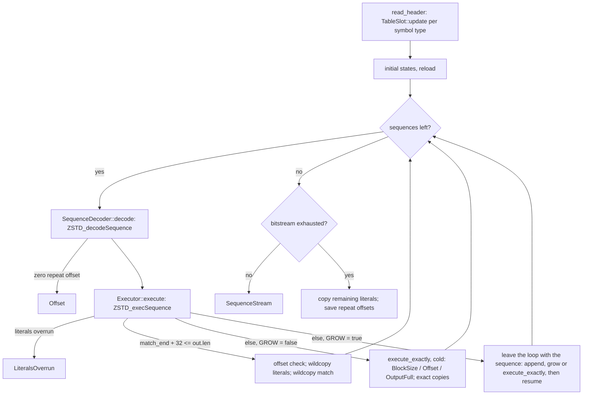
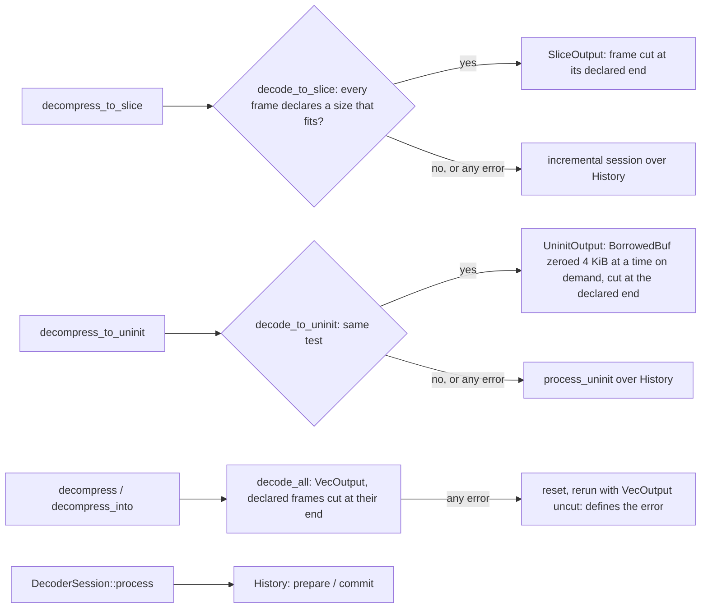
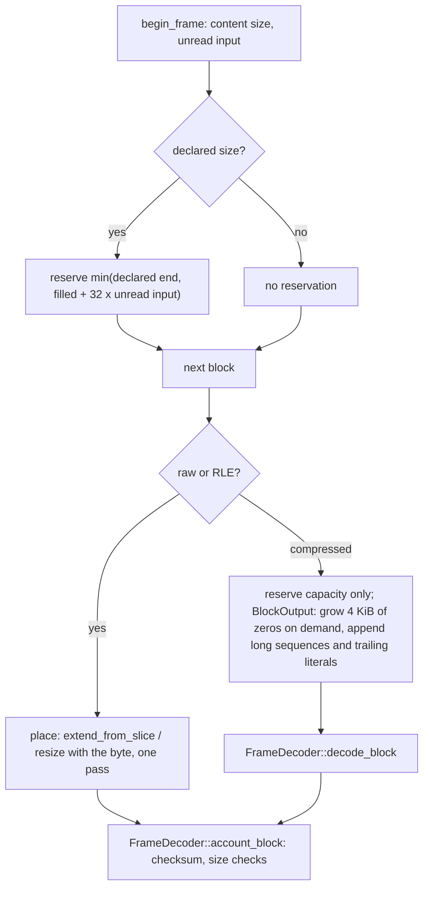
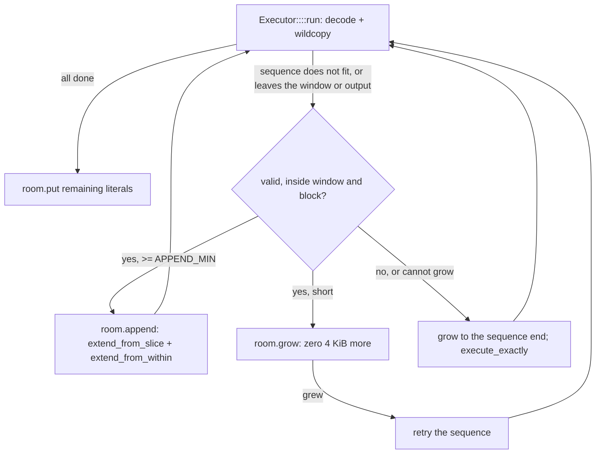

# Decoder fast paths

How `decompressor::core` regenerates blocks at speed: SIMD dispatch, the
bit readers, the Huffman and sequence loops, the copies, and the output
paths. Every fast path decodes exactly the bits the reference decoder
(zstd 1.5.7) reads, in the same order, so it accepts and rejects the same
streams as the straightforward port it replaced; only refill timing and
copy granularity differ. The crate stays `forbid(unsafe_code)`: bounds are
checked, and the code is shaped so the compiler can drop most of the
checks (see [index masks](#index-masks)).

## Dispatch

`Backend` (public, `src/backend.rs`) wraps a `fearless_simd::Level`
detected once when the decoder is built (`DecompressorBuilder::with_backend`
overrides it). `BlockDecoder::decode` dispatches once per compressed
block. The two hot loops are separate `#[fearless_simd_macros::simd]`
functions: each is compiled per level with that level's target features
(on AVX2 that includes BMI2, so bit reads use `shrx`/`bzhi`), and keeping
them apart keeps each loop's register allocation independent.
`MatchCopy::Shuffle` is chosen on levels with a native byte shuffle
(SSSE3 and up, NEON, WASM SIMD); `sse2` and `fallback` use
`MatchCopy::Scalar`.

## Bit readers

- **`BitContainer`** is `BIT_DStream_t`: the eight stream bytes at `pos`,
  `consumed` bits read from the top. `look` is `BIT_getMiddleBits`.
  `reload` is `BIT_reloadDStream`: a full refill while `pos >= 8`, the
  cautious refill near the start (`#[cold]`, by value so the container
  stays in registers), and no change once more than 64 bits were consumed.
  While `pos >= 8` every refill so far was full and callers read at most
  57 bits between refills, so the overflow test only runs on the cautious
  path. A stream is valid only when `pos == 0 && consumed == 64`; once
  reads pass the start, `consumed` stays above 64, so corrupt streams are
  rejected exactly as by `BIT_endOfDStream`. `overflowed` (`consumed >
  64`) is the reference's `BIT_DStream_overflow`; the Huffman weight
  decoder uses it, so no separate reverse reader remains.
- **`Sentinel`** is the reference's fast-loop stream
  (`HUF_DecompressFastArgs`): unread bits at the top, a `1` below them
  shifted up with every read, so the consumed count is the sentinel's
  position (`trailing_zeros`) and a lookup is one shift. Positions index
  the buffer holding all four streams. `reload_within(src, limit)` refills
  at the position clamped to `limit`, the last in-bounds one: the fast
  loops' round counts keep every position below it, so the clamp never
  changes a value, but it replaces a bounds-checked load and its fallback
  branch with a compare and a `cmov`. Each stream keeps its own position
  and output count, so its tail takes over where its fast rounds ended.

## Huffman literals

- Single rows are built for 12-bit lookups whatever the tree depth (each
  code's rows repeated `1 << (12 - log)` times), so lookups need no mask.
  A row packs the code length in its low byte and the symbol in its high
  byte (`HUF_DEltX1`), so a `Sentinel` shift by the whole row (`shlx`
  masks to six bits) consumes the code. `HuffmanTable::fill`
  counting-sorts the symbols by weight and writes each weight's runs, all
  of one length and aligned to it, with fixed-size stores
  (`fill_runs::<1|2|4|8>`, 16-row chunks beyond), as
  `HUF_readDTableX1_wksp` does; weight streams decode four symbols per
  refill while a whole word can be refilled, then follow the reference's
  per-symbol overflow tail. Reading a tree costs about 35% fewer
  instructions than the per-symbol fill, with far fewer mispredictions.
- `single_rounds` splits the four output segments once and walks them as
  fixed-size chunks (`windows`, `single_round`), storing each stream's
  five (or four) symbols straight into its chunk, with no per-stream window
  check and no array gathered on the stack: 176 instructions per 20
  symbols against the reference's 163.
- The fast loops count the rounds every stream can afford up front (each
  refill moves back at most seven bytes and must stay seven bytes into its
  stream; outputs need room for the round's stores), run them without
  per-stream tests, then recount.
- Pair rows (`HUF_DEltX2`) use 11-bit lookups
  (`HUF_DECODER_FAST_TABLELOG`): 2048 rows, half the size and build cost
  of 12-bit ones, a row pairing the code at the top of its index with the
  next only when both fit in 11 bits. A `PairRow` packs the bit count
  (byte 0, so a whole-row shift consumes them), the symbols (bits 8-23)
  and the symbol count (the top two bits, read with one shift and no
  mask). `pair_rounds` does five lookups per stream per refill (55 bits),
  as the reference's fast loop does; each stores two bytes into a 14-byte
  window of the stream's segment, and the count's range (at most 3) lets
  the compiler prove the five stores stay inside it without a mask or
  per-store checks. Refill positions and window offsets are clamped to
  their last in-bounds values, which the round counts never pass. Rounds
  are limited to `(end - op - 8) / 10` per stream; 264 instructions per 20
  lookups against the reference's about 225. Trees of 12 bits, which the reference accepts but
  never writes, build no pair rows and decode with the single loop. Pair
  rows are rebuilt only after a new tree, and a test checks every row of
  trees of every depth against the definition.
- A code of `b` bits fills a run of `1 << (11 - b)` pair rows whose `j`th
  row continues with the code at row `j << b`, the same series for every
  code of that length (the reference's `HUF_fillDTableX2Level2` per rank).
  The first run of each length is built from the single rows; later runs
  of that length copy it with one add per row that swaps in their own
  first symbol.
- Every stream finishes with the single-symbol table in the reference's
  cautious loop and must be consumed exactly; the pair decoder never
  decides how a stream ends.
- The loops reach a table through `TableAccess`: the decoder's own table
  (`&mut HuffmanTable`, `decode_streams`) builds its pair rows on first
  use, a dictionary's shared table (`&HuffmanTable`,
  `decode_streams_shared`) only uses rows built when the dictionary was
  parsed. Both are monomorphized, so the own-table path compiles as before.

## Sequences

- `SeqTable` rows are `ZSTD_seqSymbol`: baseline, next-state base,
  extra-bit and state-bit counts. Both counts are a `BitCount`, a
  32-variant `#[repr(u8)]` enum: as an enum its range reaches the compiler
  with every load, so reads by these counts need no `& 63` before the
  `bzhi` or shift (about four instructions per sequence). The loop holds references to rows and
  reads fields as needed. Slots are allocated on first use and rebuilt in
  place. A slot's `predefined` flag says its entries hold the predefined
  distribution whatever its `content` (what `Repeat_Mode` may reuse)
  says: a frame start forgets the table for repeat modes but not its
  entries, so the next predefined mode reuses them instead of rebuilding
  them, as the reference points at static tables. An RLE or described
  table clears it. Decoding a thousand small frames rebuilt all three
  predefined tables per frame, 28% of the instructions.
- `SeqTable::fill` precomputes each symbol's (baseline, extra bits) row,
  so its row loop has no bounds checks or branches, and `spread` ports
  `ZSTD_buildFSETable_body`: without "less than one" symbols it lays the
  symbols down eight at a time and scatters them with a fixed step,
  unrolled by two with no per-cell tests; otherwise it keeps the skipping
  loop. Building a sequence table costs about 20% fewer instructions.
- `Executor<const GROW: bool>`: fixed outputs (`decompress_to_slice`,
  streaming `History`) compile to the loop above with `execute_exactly`
  inline and cold. Growing outputs (`VecOutput`, `UninitOutput`) leave the
  loop with any sequence the wildcopies cannot take (no room for the
  overlength, a match before the output or past the window); the cold
  part of `SequenceTables::execute` appends it when it is at least
  `APPEND_MIN` (1024) bytes and valid, else grows the zeroed room and
  retries it, else runs `execute_exactly` (dictionary, end of output,
  errors in the old order: block size, offset, output full). Then the loop
  resumes.
- Decoding refills once per sequence and once more when the sequence's
  extra bits exceed `64 - 7 - (9 + 9 + 8)`, as the reference does.
- Errors keep the old order: literal overrun, block size, offset (and
  output room for caller-sized buffers).

### Copies

`copy.rs` holds the wildcopies (`ZSTD_wildcopy`, `ZSTD_overlapCopy8`):

| Case | Copy |
| --- | --- |
| literals | one 16-byte chunk, then 32-byte chunks |
| match, offset >= 32 | 32-byte chunks; the first is copied from the output split at the literals' end, whose history's last `offset` bytes provably hold it, so it needs no bounds check |
| match, 16 <= offset < 32 | 16-byte chunks |
| match, offset < 16, `Shuffle` | `PERIOD[offset]` spreads the period over a `u8x16`; `ROTATE[offset]` turns each chunk's vector into the next's |
| match, offset < 16, `Scalar` | the reference's offset spreading (`dec32table`/`dec64table`), then 8-byte chunks |
| end of buffer | `execute_exactly`: exact literal copy, `exact_match` doubling copies |

Fast copies write up to `WILDCOPY_OVERLENGTH` (32) bytes past a sequence
and read as far past its source; the executor uses them only when the
output has that room, and literals always carry 32 readable bytes after
their end (`Literals`): raw literals are borrowed in place when the block
holds 32 more bytes after them, and copied otherwise.

### Index masks

Release-mode `usize` additions may wrap, so `out[i..i + 16]` normally
costs an overflow test and a bounds test. The sequence executor cuts the
output to start at `max(history_start, op - window)` — no valid match
reaches further back — so every index is below `2^31 + 2^19`
(compile-time asserted against `DecodeLimits::MAX_WINDOW_LOG`), and
`copy::idx` masks operands to 32 bits. The masked sums provably do not
wrap, which lets the compiler relate the executor's room tests to the
copies' bounds checks and drop many of them. The masks never change a
valid index.

### Dictionaries

A dictionary adds nothing to the per-sequence fast path. Its content is
not copied into the output: `Executor` carries it as a slice that only the
cold `execute_exactly` reads. The fast path's test is the one it always
had, `offset > lit_end || offset > window`; a sequence failing it, which
without a dictionary is always an error, now calls `execute_exactly`,
which reports the error or, with a dictionary, copies the match's head
from the dictionary's tail and the rest from the output. The dictionary's
tables are picked once per block (`TableSlot::get`), and its repeat
offsets once per frame. The index bounds above are unchanged: the cut
output still starts at the history's first byte or a window before the
block.

Measured on a loaded i7-13700KF (AVX2, pinned), `cargo bench --bench
decompress -- 'decompress-(dictionary|small)'`: a thousand JSON-like
records of about 120 bytes, each its own level-3 frame with a 16 KiB
dictionary trained on similar records, decode in 198 µs against zstd
1.5.7's 135 µs (1.47x), and the same records compressed without a
dictionary in 1.60 ms against 1.11 ms (1.44x). The dictionary adds no gap
of its own beyond the decoder's per-frame overhead on tiny frames. Frames
without a dictionary decode as before: on a quiet host, text level 1
2.12 → 2.06 ms, text level 3 1.85 → 1.80 ms, binary level 3 3.49 →
3.43 ms, random 19.7 → 19.1 µs, streaming mixed 2.46 → 2.44 ms (Criterion
medians, before and after the change).

## Output paths

`decompress` and `decompress_into` write through `VecOutput`, which owns
three decisions per frame and block:

- `Stream::walk` is the one-shot frame grammar over an `Output`.
  `SliceOutput` cuts the caller's slice at each frame's declared end, so
  chunked copies never touch bytes past the output and the rest of `dst`
  stays unchanged.
- `VecOutput` cuts a declared frame's blocks at its end, like
  `SliceOutput`, so no slack past the output is zeroed or kept. A frame that
  overruns its declared size then fails with `OutputTooSmall` instead of the
  reference's `ContentSizeMismatch`, so `decode_all` resets the stream and
  reruns the input uncut on any error; the uncut pass defines every error and
  leaves the vector as it was.
- Capacity grows by doubling (`grow_output`/`reserve_output`), never past
  twice the requested length. When the frame's last request is within that
  factor, capacity jumps straight to it, so a declared frame ends with no
  reallocation and no spare capacity. At a frame start, a declared size is
  reserved only up to 32 output bytes per unread input byte
  (`PLAUSIBLE_RATIO`): an allocation always needs input in proportion, and
  a frame that claims more grows with its actual output.
- Raw and RLE blocks are appended in one pass (`Output::place`):
  `extend_from_slice` or `resize` with the run byte write straight into spare
  capacity. Compressed blocks write through `BlockOutput` (`block.rs`): the
  buffer's initialized prefix, which `VecOutput` and `UninitOutput` extend
  on demand (`grow`, 4 KiB of zeros at a time, up to the block's room cut
  at the frame's end) and `VecOutput` also by `append` (cut at the
  output's end, then `extend_from_slice` for the literals and doubling
  `extend_from_within` for the match). Sequences of 1 KiB or more, a
  block's trailing literals and literal-only blocks are therefore written
  once; shorter sequences still need zeroed room for the wildcopies' 32
  bytes of overlength, since safe Rust cannot hand the decoder
  uninitialized memory. Caller slices and `History` are fixed
  (`grows() == false`).

- `UninitOutput` is `SliceOutput` over a `BorrowedBuf`: it zeroes its
  prefix on demand, 4 KiB at a time (cut at the frame's end), and `place` writes raw and RLE blocks once, over the zeroed
  bytes and then appended. See
  [uninitialized output](decoder-uninit-output.md).
- `decompress_to_slice` tries the direct path and, when a frame has no
  content size, does not fit, or anything fails, reruns the whole input
  through the incremental session, which defines the method's results and
  errors.
- `History` keeps an initialized buffer with a fill mark; `prepare`
  compacts as before and ensures room for a block plus the overlength,
  `commit` records the block's end.
- The literal buffer only grows, so blocks of varying sizes zero nothing
  but its new tail.

## Measurements

`cargo bench --bench decompress -- --warm-up-time 1 --measurement-time 3`,
pinned to one core of an i7-13700KF (AVX2 backend). Frames are written by
zstd 1.5.7 from `zstd_ffi::corpus` inputs and decoded with reused contexts,
`decompress_to_slice` against `ZSTD_decompressDCtx`. Times are Criterion
medians; "before" is the scalar port this replaced.

| Case | before | now | zstd 1.5.7 | ratio |
| --- | --- | --- | --- | --- |
| text 4 MiB, level 1 | 5.96 ms | 2.14 ms | 1.81 ms | 1.18 |
| text 4 MiB, level 3 | 4.47 ms | 1.86 ms | 1.64 ms | 1.13 |
| text 4 MiB, level 19 | 2.70 ms | 1.10 ms | 1.05 ms | 1.05 |
| binary 4 MiB, level 1 | 18.89 ms | 2.13 ms | 2.28 ms | 0.93 |
| binary 4 MiB, level 3 | 14.37 ms | 3.52 ms | 3.28 ms | 1.07 |
| binary 4 MiB, level 19 | 15.98 ms | 4.73 ms | 4.34 ms | 1.09 |
| random 1 MiB, levels 1-19 | 64.5 µs | 19.8-21.3 µs | 19.6-21.4 µs | 0.99-1.04 |
| text+binary+text 12 MiB, LDM | 18.02 ms | 5.06 ms | 4.79 ms | 1.06 |
| mixed 4 MiB, streaming | 7.26 ms | 2.48 ms | — | — |

Both decoders run near five instructions per cycle on these inputs, so
instruction counts (callgrind) track time closely. When these were
measured, the remaining gap was in the sequence loop (about 140
instructions per sequence against the reference's 125, mostly bounds
checks and bit-count masks) and the pair Huffman loop; the loop has since
reached the reference's count (see the known gaps).

XXH64 checksums are not vectorized: each of its four lanes is a serial
multiply-rotate-multiply chain, and AVX2 has no 64-bit vector multiply. A
`u64x4` kernel measured 11.8 GB/s against 20.9 GB/s for the scalar code,
which already matches the reference's 21 GB/s.

## Known gaps

- Measured and rejected for `decompress` (2026-10-14): appending every
  sequence to the vector with `extend_from_slice`/`extend_from_within` is
  slower (Alice level 1: 110 µs against 96 µs) because every chunk reloads
  and stores the vector's length through memory, which serializes the
  copies; appending only sequences of 1 KiB or more is what `VecOutput`
  does now. Decoding a batch of sequences before executing it, in two
  out-of-line loops, executes about 15% more instructions; one allocation
  for the three sequence tables changes nothing.
- Measured and rejected (2026-10-15, `silesia.tar` levels 1, 3 and 19):
  copying matches with offsets of 32 or more in 16-byte chunks, as
  `ZSTD_wildcopy` does, instead of 32-byte ones (no faster; the hot store
  after the match load is a cache miss on the match source, which the
  reference pays too).
- With the default 16 codegen units, a size change in `huffman.rs` or
  `fse.rs` moves the unchanged `SequenceTables::execute` by about ±1.6%
  of its instructions (26.45M against 26.87M on Alice level 3, identical
  source), and its time by about ±2%. The table builds rejected on
  2026-10-15 for a 2.5-4% slowdown were measured through that noise; with
  `execute` controlled for they are faster and are now in place. Check
  loop changes by `execute`'s instructions per sequence or a
  `codegen-units = 1` build, not by time alone.
- Measured and rejected (2026-10-18, i7-13700KF): per-stream staging
  buffers in the pair loop (fewer instructions per round, more
  mispredictions and more Huffman instructions overall); a run-based pair
  table build (no fewer instructions, more mispredictions); zeroing growing
  output in 2-16 KiB chunks without appends (±0.5%), or with `prefetchw`
  16 KiB ahead of the zeroed front (Alice 2% slower); 64 KiB zeroing
  chunks (14-23% slower on the 64 KiB binary input, which they zero
  whole); the cold path for growing outputs as a separate `#[cold]`
  function (1% fewer instructions, 6-8% slower on Alice from layout).
  Sequence-loop rewrites each added instructions per sequence on Alice
  level 1: one bounds test per refill instead of two (+1.0), literals as
  an advancing slice (+5.0, +7.0 with a merged offset/window test),
  current rows held by value (+24.9) or by reference (+11.0), the decoder
  copied into `run` (+12.1), the fixed-output loop out of the function
  (+3.0); repeat offsets as `[u64; 3]` (+2.9% in total, no faster) or
  packed into a `u64` and a `u32` (+12.4%, slower). Almost any change to
  this function moves its register allocation by 1 to 25 instructions per
  sequence. Executing matches that start in a dictionary inline (the
  extDict branch of `ZSTD_execSequence`) made dictionary decoding 9%
  faster but large decodes without a dictionary 1.5-3% slower through the
  same code-generation shift; it is not kept.

- The one-shot sequence loop runs at the reference's instruction count:
  126.9 instructions per sequence against 125.8 on Alice level 1 (AVX2),
  with fewer mispredicted branches; both spill the decoder state to the
  stack on every sequence. Literal-heavy text (Alice) still decodes a few
  percent slower than the reference through `decompress`: the Huffman
  pair loop executes about 13.2 instructions per lookup against the
  reference's 11.25 (spills: four streams' bits, positions and outputs
  plus their bases do not fit in 15 registers), the single-symbol loop 8.8
  per symbol against 8.2, and about 2% of the time zeroes room for short
  sequences (`VecOutput::grow`). Both loops are limited by each stream's
  chain of dependent lookups, as the reference's are: removing 9-12% of
  their instructions made no measurable difference in a `codegen-units =
  1` build. Raw-literal frames (Alice level -5) decode at
  parity.
- `SeqTable::fill` runs at about 26 instructions per row against the
  reference's 21: it runs outside the SIMD dispatch, so without BMI or
  LZCNT (`bsr`), and the `BitCount` enum needs a table lookup. Building
  the pair table costs about 6K instructions per tree beyond its 8 KiB
  zeroed allocation.
- `decompress_to_slice` on 4 MiB of text is about 11% slower than
  `ZSTD_decompressDCtx` (level 1: 2.18 ms against 1.85 ms; level 3:
  1.89 ms against 1.65 ms) while executing only about 4% more
  instructions (111.9M against 107.3M), so it retires fewer instructions
  per cycle; finding the stall needs a cycle-level profiler, which this
  WSL2 host lacks. One suspect is the repeat-offset shift, which compiles
  to an 8-byte reload spanning two earlier stores that cannot be
  forwarded; `u64` repeat offsets removed that pattern without measurable
  gain.
- `decompress_to_slice` takes the incremental path, with its extra copies,
  for frames without a content size.
- No prefetching variant for long offsets (`ZSTD_decompressSequencesLong`)
  and no split literal buffer.
