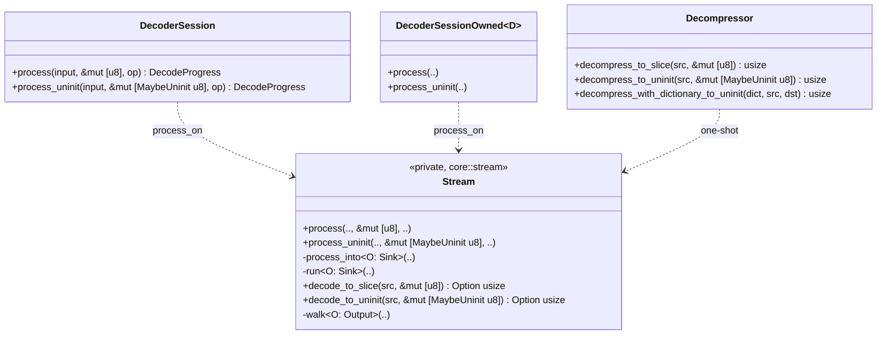
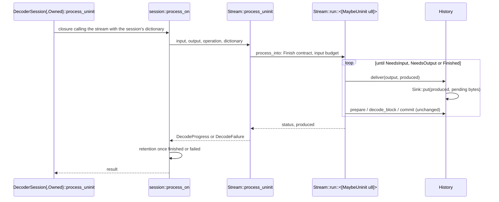
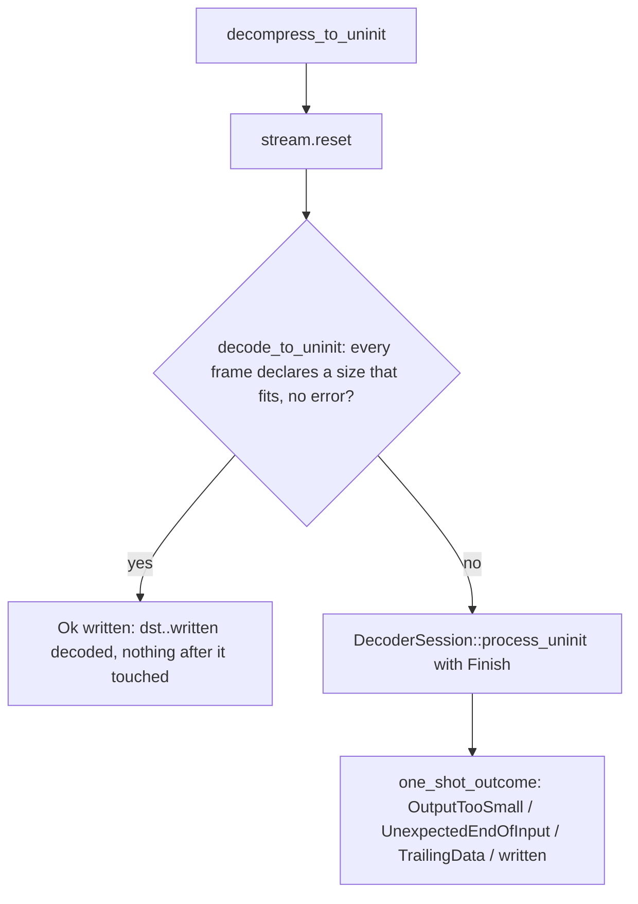
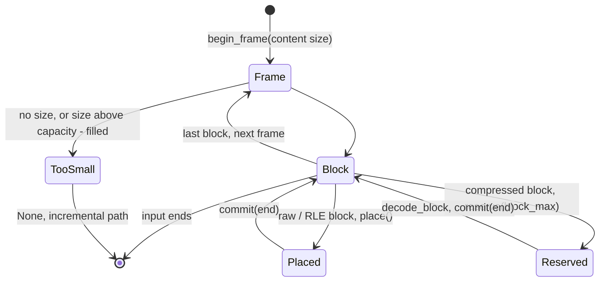

# Decoder output into uninitialized memory

Decoder sessions and the one-shot slice methods have `*_uninit` siblings
that write into `&mut [MaybeUninit<u8>]`: spare `Vec` capacity, a foreign
buffer, or C memory that was never initialized. They produce the same bytes,
counts, statuses and errors as the initialized methods. The crate stays free
of `unsafe` (`src/lib.rs` forbids it outside tests). The one path that reads
back what it wrote, the one-shot direct path, does so through
`borrowed_buf::BorrowedBuf`, whose filled prefix is safe to view as
`&mut [u8]`. The encoder side is described in
[encoder core](encoder-core.md#destinations).

## Public API surface

| Initialized | Uninitialized | Owner |
| --- | --- | --- |
| `DecoderSession::process` | `DecoderSession::process_uninit` | `decompressor::session` |
| `DecoderSessionOwned::process` | `DecoderSessionOwned::process_uninit` | `decompressor::session` |
| `Decompressor::decompress_to_slice` | `Decompressor::decompress_to_uninit` | `decompressor::decoder` |
| `Decompressor::decompress_with_dictionary_to_slice` | `Decompressor::decompress_with_dictionary_to_uninit` | `decompressor::decoder` |

`flush` and `finish` have no uninitialized siblings: they are shorthands for
`process`. Sessions with a dictionary use `process_uninit` unchanged.

The contract every method keeps:

- On success exactly `output[..produced]` (or `dst[..written]`) is
  initialized and no byte after it has been written.
- A session's `DecodeFailure` reports `produced`; exactly that prefix was
  written, as on success.
- After a one-shot `OutputTooSmall`, all of `dst` holds the output's prefix,
  as with `decompress_to_slice`. After any other one-shot error the caller
  treats `dst` as uninitialized.
- Calls of `process` and `process_uninit` may be mixed on one operation.



## Streaming: a write-only sink

The streaming decoder regenerates every block into its own `History` and
only copies finished bytes out (`History::deliver`). It never reads the
caller's slice, so an uninitialized one serves as well as an initialized one
and needs no zeroing.

```mermaid
classDiagram
    class Sink {
        <<private trait, core::history>>
        +capacity() usize
        +put(at, bytes)
    }
    class InitSlice["[u8]"]
    class UninitSlice["[MaybeUninit u8]"]
    Sink <|.. InitSlice : copy_from_slice
    Sink <|.. UninitSlice : zip + MaybeUninit::write
    class History {
        +deliver~O: Sink~(output, at) usize
    }
    History ..> Sink
```

`Stream::process` and `Stream::process_uninit` are thin non-generic entry
points over `process_into::<O: Sink>`, which runs the state machine
(`run::<O>`). Each destination type gets its own instantiation, chosen at
compile time; no call matches on a destination at run time, so the
initialized loop compiles to the slice copy it had before. The
`[MaybeUninit<u8>]` `put` is a `zip` + `write` loop (`write_copy_of_slice`
needs Rust 1.93; the MSRV is 1.89) and compiles to a `memcpy`. It writes
exactly the bytes `deliver` counts into `produced`, which is what keeps
"nothing past `produced`", on success and on failure alike.



## One-shot: the zeroed-ahead prefix

`decompress_to_slice` decodes straight into `dst` when every frame declares
a content size that fits (`Stream::decode_to_slice` over `SliceOutput`); the
decoder then reads earlier output as history and its 16- and 32-byte copies
may read bytes ahead of what they have written. `decompress_to_uninit` keeps
that direct path with `UninitOutput`, which wraps `dst` in a `BorrowedBuf`.
The buffer's filled prefix is what the decoder may see. It is grown with
zeros (`BorrowedCursor::append_fill`) only just ahead of the decoder and
never past the current frame's declared end.





- `begin_frame` accepts a frame only with a declared size that fits in the
  rest of `dst`, as `SliceOutput` does, and records `frame_end`.
- `reserve(block_max)` zeroes up to
  `min(filled + block_max + WILDCOPY_OVERLENGTH, frame_end)` and returns the
  filled prefix up to there. Each byte is zeroed at most once, and only inside
  a frame whose size is declared, so on success nothing past `written` has
  been written. The cut is at most a block plus the copies' overlength, where
  `SliceOutput` hands over the whole frame; decoded bytes are the same, and a
  block that would pass `frame_end` fails `OutputFull` either way.
- `place` writes raw and RLE blocks in one pass: bytes already zeroed for an
  earlier `reserve` are overwritten through `filled_mut`, the rest is
  appended (`BorrowedCursor::append` or `append_fill` with the run byte). A
  stored or RLE block's output is therefore never zeroed first.
- Any failure returns `None`. The incremental `process_uninit` then decodes
  the whole input again and defines the result. It rewrites at least every
  frame the direct attempt reached whenever it succeeds, because the direct
  path only touches frames whose declared size fits.

`one_shot_outcome` maps the single `Finish` call's progress to the one-shot
result and is shared by `decompress_to_slice` and `decompress_to_uninit`, so
both report `OutputTooSmall`, `UnexpectedEndOfInput` and `TrailingData`
identically.

## C ABI

`mzstd_decompress` views the caller's output as `&mut [MaybeUninit<u8>]` and
calls `decompress_to_uninit`; it no longer zeroes the whole destination
first. See [C ABI](c-abi.md).

## Invariants

- No uninitialized byte is ever read. Streaming delivery only writes to the
  caller's slice. The one-shot direct path reads only `BorrowedBuf`'s
  filled prefix, which holds decoded bytes or zeros it wrote itself.
- The uninitialized and initialized methods produce identical bytes,
  counts, statuses and errors: they share `run`, `walk`, `decode_block` and
  `one_shot_outcome`, and differ only in how bytes reach the destination.
- Destination selection is static: `Sink` and `Output` are monomorphized,
  never matched inside the decode loops.

## Measurements

Criterion, `benches/decompress.rs`, Apple M5 Pro, one core, 10 samples
(2026-10-16): `decompress_to_uninit` against `decompress_to_slice` into the
same exact-size buffer took 0.97-1.05 times as long on 4 MiB text and binary
at levels 1, 3 and 19 and on the 12 MiB LDM frame, and the same on 1 MiB of
random data (raw blocks, never zeroed). Streaming `process_uninit` over 4 MiB
of mixed data took 2.83 ms, against 2.81 ms for `process`; `process` itself
was unchanged from before this path existed (2.84 ms → 2.81 ms).

## Verification

- `tests/decoder_uninit.rs`: `process_uninit` alone and alternating with
  `process` against `process` for five corpora, three levels, with and
  without a content size, input chunks of 1 byte to 1 MiB and output windows
  of 1 byte to 1 MiB, with sentinels checked past every `produced`. Also
  failure progress on corrupt data and a bad checksum, failed and finished
  sessions, owned and dictionary sessions, and `decompress_to_uninit`
  against `decompress_to_slice` for exact, larger, smaller, tiny and empty
  destinations, frame sequences (skippable, declared and undeclared frames,
  where the direct path gives up midway), truncated, empty and trailing input,
  and an output limit. The dictionary one-shot is covered as well.
- Unit tests: `history` (`Sink` delivery into an offset of an uninitialized
  slice) and `stream` (`UninitOutput` zeroing bounds, `place` across and past
  the zeroed prefix, `decode_to_uninit` sentinels, `process_uninit` delivery).
- AFL: `decode_streaming`, `decode_roundtrip` and `decode_dictionary` drive
  sessions alternating `process` and `process_uninit` and check that nothing
  is written past `produced`; `decompress` compares `decompress_to_uninit`
  with `decompress_to_slice`, including sentinels past the result.

## Known gaps

- `decompress_to_uninit` zeroes every compressed block's output before
  decoding into it, so those bytes are written twice. Safe code cannot hand
  the decoder memory it has not initialized. Raw and RLE blocks are written
  once.
- Through the C ABI (`mzstd-ffi/benches/one_shot.rs`, same host), a 64-byte frame at level -5 decodes in 30 ns instead of
  25 ns, from the `BorrowedBuf` bookkeeping; mbrotli zeroes destinations of
  at most 1 KiB instead, which mzstd does not, to keep "nothing past the
  result is written".
- No uninitialized variant of `decompress_into`, which already writes into
  the vector's spare capacity in one pass for raw and RLE blocks.
