# Decoder verification

How the [decompressor](decompressor.md) is checked against RFC 8878 and the
zstd 1.5.7 reference. Unit tests sit beside each private `core` module;
integration tests in `tests/decoder_*.rs` drive the public API against the
reference through the `zstd-ffi` oracle (`zstd_ffi::oracle`).

```mermaid
graph TD
    subgraph unit[Unit tests in decompressor::core]
        Bits[bits: marker, padding, overflow, wide reads]
        Fse[fse: distributions, repeat flags, Appendix A tables, weight decoder]
        Huf[huffman: RFC example tree, 1 and 4 streams, invalid weights, 12-bit trees]
        Lit[literals: all size formats, RLE, treeless reuse]
        Seq[sequences: baselines, overlapping copies, repeat-offset rules, invalid sequences, dictionary reach]
        DictU[dictionary: entropy section, repeat-offset limits, truncation]
        Frame[frame / block / history / stream]
    end
    subgraph integration[tests/decoder_*.rs]
        Oracle[decoder_oracle: reference frames, every entry point, chunkings, windows, limits]
        Golden[decoder_golden: golden-decompression and golden-decompression-errors]
        Corrupt[decoder_corruption: every truncation, bit flips, random damage]
        Api[decoder_api: modes, Finish contract, budgets, typed errors, retention]
        Io[decoder_io: Read / Write adapters, deferred and sink errors]
        Dict[decoder_dictionary: raw and trained dictionaries, IDs, entropy reuse, dictionary acceptance]
    end
    Ref --> Dict
    Ref[zstd 1.5.7 via zstd-ffi] --> Oracle
    Ref --> Golden
    Ref --> Corrupt
    Spec[format spec Appendix A, vendored copy] --> Fse
```



## What each suite establishes

- **`decoder_oracle`** compresses generated corpora (text, random, records,
  runs, mixed) with `ZSTD_compress2` at levels -5 to 19, sizes 0 to 140 KB,
  with the checksum and content-size flags varied, and requires byte
  equality through `decompress`, `decompress_into` (after a prefix) and
  `decompress_to_slice` (suffix untouched), plus agreement with
  `ZSTD_decompress`. Streaming is checked with 1-, 7-, 13- and 4096-byte
  input pieces against 1-, 3- and 64-byte output buffers and random
  pieces, and through an owned session. Frames from `ZSTD_compressStream2`
  with random flushes cover unknown content sizes and small blocks; window
  logs 10, 12 and 17 on 1.2 MB force history compaction and 1 KiB blocks.
  Concatenated frames with skippable frames, `Single` mode, and window
  limits (including a header patched to a `2^28` window) are compared with
  the reference's streaming limit. A release-only matrix covers every level
  from -7 to 22 on 3 MB corpora and 20 MB inputs with long-distance matching
  and `2^27` windows.
- **`decoder_golden`** decodes the reference's golden vectors one-shot and
  in 1/7/whole-input pieces, comparing with the reference, and requires
  every golden error vector to be rejected as invalid data.
- **`decoder_corruption`** requires every proper prefix of sample frames to
  fail with `UnexpectedEndOfInput`, one-shot and streaming. For every
  single-bit flip of the first 64 bytes and random byte damage, it requires
  no panic, one-shot and streaming verdicts and outputs to agree, identical
  output whenever both decoders accept, and never accepting what the
  reference rejects. The only tolerated difference is the documented
  stricter Huffman stream-end check.
- **`decoder_dictionary`** compresses with `ZSTD_compress2` and a
  dictionary trained by `ZDICT_trainFromBuffer` on JSON-like records, or
  48 KB of raw text, at every level from -5 to 22 (five levels in debug
  builds), from one record to inputs past 128 KiB (so the reference both
  attaches and copies the dictionary; forced attach, copy and load modes
  are checked too), with checksums, unknown sizes, small windows and
  long-distance matching. Every frame must decode through
  `decompress_with_dictionary`, its `_into` and `_to_slice` twins, a
  borrowed session and an owned session (`Arc`) fed random pieces, and the
  reader and writer adapters, on every backend, and concatenations with
  skippable and dictionary-less frames must decode. Dictionary IDs are
  checked against the reference's verdicts (missing, other trained, raw
  and empty dictionaries); frames whose first block uses treeless literals
  or repeated tables are found by parsing them and must fail, as in the
  reference, when the same bytes are loaded as raw content. Every
  truncation of the entropy section, zero and oversized repeat offsets and
  2000 random corruptions must be accepted or rejected exactly as
  `ZSTD_DCtx_loadDictionary_advanced` does, and a frame decoded with an
  accepted corrupt dictionary must equal the reference's output.
- **`decoder_api`** and **`decoder_io`** pin the public contract: frame
  modes, the `Finish` suffix rule and `InvalidState`, failure progress,
  byte budgets, typed errors (with reference agreement where it applies),
  retention, owned sessions, and the adapters' deferred errors, retries,
  `into_parts` and `FinishError` round trips.

## Running

```sh
CARGO_TARGET_DIR=target-dec cargo test --no-default-features --features std,decompression \
    --lib --test 'decoder_*'
CARGO_TARGET_DIR=target-dec cargo test --release --no-default-features \
    --features std,decompression --test decoder_oracle
```

Function coverage of `src/decompressor` with
`cargo llvm-cov --no-default-features --features std,decompression --lib --test 'decoder_*'`
is 100%.
