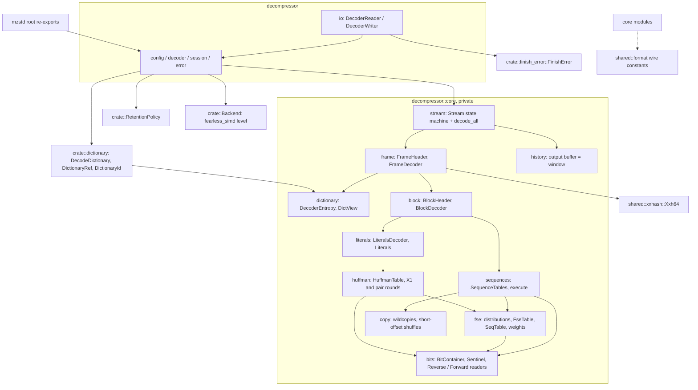
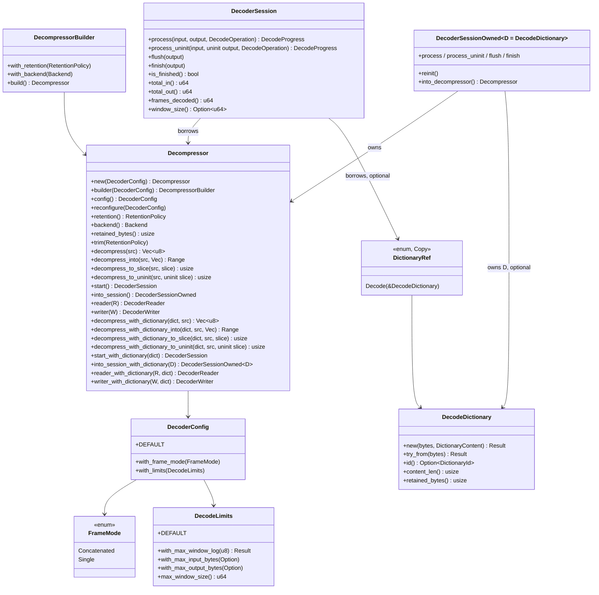
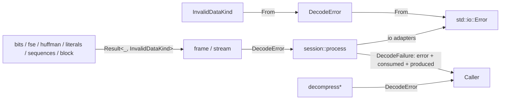
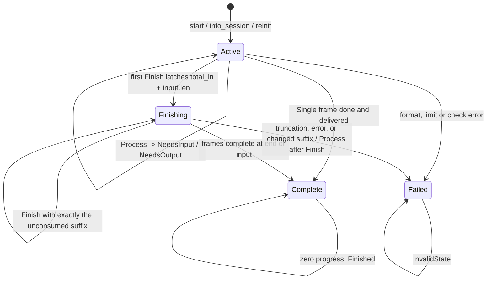
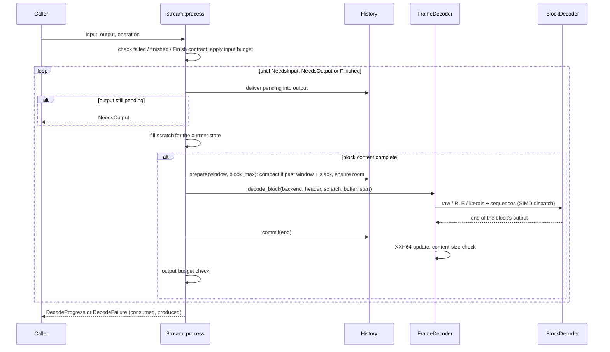
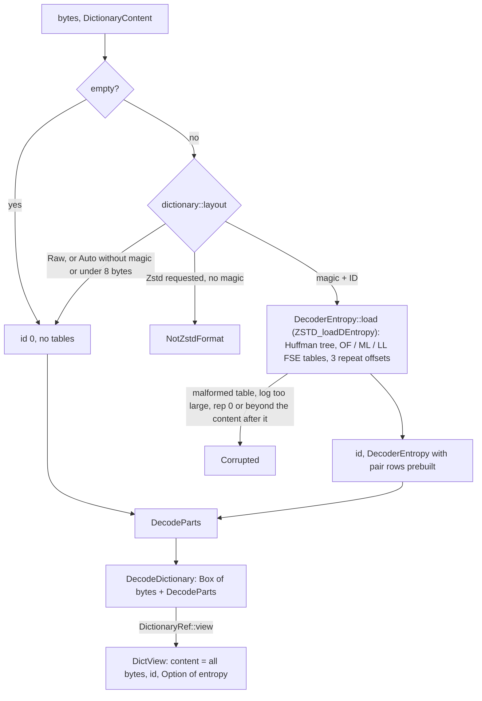
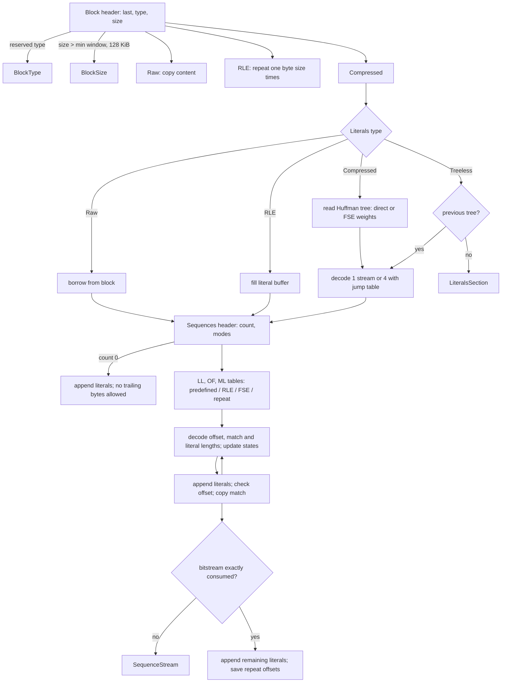

# Decompressor

The `decompression` feature enables the public `decompressor` module: a
safe-Rust Zstandard (RFC 8878) decoder with one-shot, incremental and
`std::io` APIs, with or without a dictionary. The public module owns
configuration, decoder ownership, sessions, typed errors and the I/O
adapters; `crate::dictionary` owns the public dictionary types; the private
`decompressor::core` owns parsing and regeneration. The decoder needs only
`alloc`; the `io` adapters and the `std::io::Error` conversion exist unless
`no_std` is enabled. There is no `unsafe` code. Compressed blocks run
`fearless_simd` kernels on the `Backend` chosen when the decoder is built;
the fast paths are described in [decoder fast paths](decoder-performance.md).

The reference this decoder is checked against is zstd 1.5.7, vendored in
`zstd-ffi/vendor/zstd`; the format text is
[`zstd_compression_format.md`](../zstd-ffi/vendor/zstd/doc/zstd_compression_format.md).
How it is verified is described in
[decoder verification](decoder-verification.md).

## Module map



`shared::format` (wire constants, length-code extra bits, predefined
distributions, `highbit32`) and `shared::xxhash` are shared with the
encoder; everything else is decoder-private. Length-code baselines are
derived at compile time from the shared extra-bit tables
(`sequences::baselines`).

## Public API



- **Construction.** `Decompressor::new`, `Default`, `From<DecoderConfig>`
  and `Decompressor::builder(config).with_retention(..).with_backend(..).build()`
  are infallible (the backend defaults to the best detected level): every configuration value is validated where it is built
  (`DecodeLimits::with_max_window_log` returns `DecodeConfigError`).
  Nothing is allocated until the first decode.
- **`DecoderConfig`** is a `Copy` value with `DEFAULT`, `Default` and
  `From<DecodeLimits>` / `From<FrameMode>`.
  - `FrameMode::Concatenated` (default) decodes every frame until the input
    ends, as `ZSTD_decompress` does; at least one frame (Zstandard or
    skippable) is required.
  - `FrameMode::Single` decodes exactly one frame, Zstandard or
    skippable, and stops: sessions leave the rest unconsumed, one-shot calls
    report `TrailingData`. A skippable frame ends the operation with no
    output, as `ZSTD_decompressStream` reports a frame complete (returns 0)
    after either kind; a reader of single-frame members therefore sees a
    trailing skippable frame, or a stream of only skippable frames, as
    complete empty members, and a skippable frame before a Zstandard frame
    as its own member.
- **`DecodeLimits`**: the window limit (default `2^27`, the reference's
  `ZSTD_WINDOWLOG_LIMIT_DEFAULT`; `10..=31`) and optional input and output
  byte budgets over a whole operation.
- **One-shot.** `decompress` returns a new vector; `decompress_into`
  appends and returns the appended range, truncating back on error;
  `decompress_to_slice` fills a caller slice and reports `OutputTooSmall`
  with the slice completely filled. `decompress_to_uninit` does the same
  into `&mut [MaybeUninit<u8>]` and writes nothing past the result; see
  [uninitialized output](decoder-uninit-output.md).
- **Incremental.** `start()` borrows the decoder, `into_session()` owns it.
  Both run the same `core::Stream` state machine; see below. Each has
  `process_uninit`, the same call into `&mut [MaybeUninit<u8>]`, which may
  be mixed with `process` and writes exactly `output[..produced]`.
- **Retention.** `RetentionPolicy` (shared with the encoder) is applied
  after each one-shot operation, when a session's operation finishes or
  fails, when the next operation starts, and by
  `DecoderSessionOwned::{reinit, into_decompressor}`. `trim` applies a
  policy once; releasing drops every buffer but keeps the session state, so
  a finished session still reports `Finished`.
- **I/O.** `reader(R)` and `writer(W)` (module `decompressor::io`) own one
  8 KiB buffer each; a failed `DecoderWriter::finish` returns the writer in
  the crate-wide `io::FinishError`.
- **Dictionaries.** Every entry point has a `*_with_dictionary` twin taking
  `impl Into<DictionaryRef>`; see [Dictionaries](#dictionaries).
  `DecoderSession<'d>` keeps its single lifetime: `start_with_dictionary`
  borrows the dictionary for `'d` too. `DecoderSessionOwned<D>` owns any
  `D: AsRef<DecodeDictionary>` (an `Arc` shares one); `D` defaults to
  `DecodeDictionary`, so `DecoderSessionOwned` without parameters still
  names the plain owned session.

## Errors



- Entropy-level code returns `InvalidDataKind`, a `#[non_exhaustive]`
  enum naming the malformed structure: `Magic`, `FrameHeader`,
  `SkippableFrame`, `BlockType`, `BlockSize`, `LiteralsSection`,
  `HuffmanTable`, `HuffmanStream`, `FseTable`, `SequencesSection`,
  `SequenceStream`, `LiteralsOverrun`, `Offset`.
- The frame and stream layers return `DecodeError` (`#[non_exhaustive]`,
  `thiserror`): `InvalidData { kind }` (with `kind` as its `source`),
  `UnexpectedEndOfInput`, `TrailingData`, `OutputTooSmall`,
  `ChecksumMismatch`, `ContentSizeMismatch`, `DictionaryUnsupported` (the
  frame names a dictionary and the operation has none),
  `DictionaryMismatch { expected, frame }` (the operation's dictionary
  declares another ID, or none), `WindowLimitExceeded`,
  `InputLimitExceeded`, `OutputLimitExceeded`, `AllocationFailed`,
  `InvalidState`.
- Building a `DecodeDictionary` returns `crate::dictionary::DictionaryError`:
  `NotZstdFormat` or `Corrupted`. The core's entropy parser reports an
  `InvalidDataKind`, which the dictionary layer maps to `Corrupted`.
- Sessions wrap errors in `DecodeFailure { error, consumed, produced }`,
  the exact progress of the failing call; `From<DecodeFailure>` recovers
  the error. Failures are terminal for the operation; the decoder is
  reusable.
- `From<DecodeError> for std::io::Error` maps format errors to
  `InvalidData`, truncation to `UnexpectedEof`, contract violations to
  `InvalidInput`, allocation failure to `OutOfMemory` and limits to `Other`.

## Streaming state machine

`core::stream::Stream` is a resumable parser over arbitrary input pieces.
Every header, and each block's whole content (at most 128 KiB), is
collected in a scratch buffer before it is acted on, so the parsers below it
never see partial data and never need to suspend.

```mermaid
stateDiagram-v2
    [*] --> Magic
    Magic --> FrameHeader: 0xFD2FB528
    Magic --> SkippableSize: 0x184D2A5?
    Magic --> Finished: Finish, no input left, >= 1 frame (Concatenated)
    Magic --> Failed: other magic
    SkippableSize --> Skipping: size <= u32::MAX - 8
    Skipping --> Magic: payload skipped (Concatenated)
    Skipping --> Done: payload skipped (Single)
    FrameHeader --> BlockHeader: header parsed and within limits
    BlockHeader --> BlockContent: type and size valid
    BlockContent --> BlockHeader: block regenerated, not last
    BlockContent --> Checksum: last block, checksum flag
    BlockContent --> FrameEnd: last block, no checksum
    Checksum --> FrameEnd: XXH64 low 32 bits match
    FrameEnd --> Magic: Concatenated
    FrameEnd --> Done: Single
    Done --> Finished: output delivered
    FrameHeader --> Failed
    BlockHeader --> Failed
    BlockContent --> Failed
    Checksum --> Failed
    Finished --> [*]
```

`FrameEnd` is not a stored state: `end_frame` counts the frame and picks
`Magic` or `Done` directly.

Every `process` call first delivers pending output from the history; it
returns `NeedsOutput` while any remains, so a new block is only decoded
once the previous one is fully delivered. Each state then either has
enough bytes to advance or returns `NeedsInput`.

### The incremental contract



- `Process` with empty input only drains output; it never ends the input.
- In `Concatenated` mode a frame boundary is `NeedsInput` until `Finish`
  confirms the input ends there. `Finish` with the input exhausted inside
  a frame, or before any frame, is `UnexpectedEndOfInput`.
- The input budget slices each call's input to what remains of the
  budget; if the decoder then still needs input, the call fails with
  `InputLimitExceeded`. The output budget is checked after each block is
  regenerated, before any of it is delivered.

### One call



### History and window

`core::history::History` is one buffer that holds the frame's retained
history followed by undelivered output, kept initialized past its fill
mark with room for a block and the copies' 32-byte overlength. Blocks are
regenerated after the fill mark, and matches copy from the same buffer, so
history never wraps.
Before each block (all output delivered), if the buffer is longer than
`window + max(window, 128 KiB)` it drops everything but the last `window`
bytes. Compaction therefore moves each byte at most once on average, and
the buffer never exceeds `2 * window + 128 KiB` (window `>= 128 KiB`): the
retained window, a window of slack and one block.
A single-segment frame's window is its content size, so its history is
never compacted.

The one-shot driver (`Stream::walk`, behind `decode_all` and
`decode_to_slice`) parses straight from the input slice, with no scratch
copies, and regenerates into the caller's vector or slice, which serves as
history; each frame's history starts at its first byte in the output, so a
`decompress_into` prefix is never referenced. `decompress_to_slice`
decodes straight into `dst` when every frame declares a content size that
fits, and otherwise (or on any error) takes the incremental path, which
defines its results.

## Dictionaries

A dictionary is parsed once, when a `DecodeDictionary` is built
(`ZSTD_createDDict_advanced` and `ZSTD_loadEntropy_intoDDict`), and
borrowed by each operation; the decoder keeps no reference to it between
calls, so `Stream::process`, `decode_all` and `decode_to_slice` take it as
an `Option<DictView>` argument on every call.



- `parse_decode_parts(bytes, content)` (crate-private, in
  `dictionary::decode`) returns `DecodeParts { id, entropy }` without
  holding the bytes; `DecodeParts::view(bytes)` pairs them with whatever
  owns them. `DecodeDictionary` is one such owner; `PreparedDictionary`
  (with `compression`) is the other, and `DictionaryRef::Prepared` views
  its bytes the same way.
- As in the reference's `ZSTD_DDict`, **all** of a dictionary's bytes are
  history, the Zstandard format's magic number, ID and tables included;
  encoders only reference the content after the tables.
- The Huffman table's pair rows are built when the dictionary is parsed, so
  decoding reads the shared table without modifying it
  (`HuffmanTable::decode_streams_shared`).

### Frame start

```mermaid
sequenceDiagram
    participant S as Stream / walk
    participant F as FrameDecoder::begin
    participant B as BlockDecoder::reset
    participant D as FrameDecoder::decode_block
    participant Q as SequenceTables::execute
    S->>F: header, limits, Option of DictView
    alt frame names ID f, no dictionary
        F-->>S: DictionaryUnsupported
    else frame names ID f, dictionary declares another or none
        F-->>S: DictionaryMismatch
    end
    F->>B: Option of DecoderEntropy
    B->>B: literals tree = Dictionary or Missing; LL/OF/ML slots = Dictionary or Empty
    B->>B: repeat offsets = dictionary's or 1, 4, 8
    loop each compressed block
        S->>D: content, out, history range, same DictView
        D->>D: dictionary content reachable iff frame output so far < window
        D->>Q: BlockContext: history start, window, dictionary content, entropy
        Q->>Q: Repeat / treeless modes read the dictionary's tables until the frame replaces them
        Q->>Q: offsets past the frame's output take execute_exactly, which copies from the dictionary's tail
    end
```

- **IDs** follow `ZSTD_decodeFrameHeader`: a frame without a dictionary ID
  decodes with any dictionary or without one; a frame with ID `f` needs a
  dictionary declaring `f`. Raw content declares no ID.
- **Entropy** follows `ZSTD_copyDDictParameters`: a Zstandard-format
  dictionary sets the reference's `litEntropy` and `fseEntropy`, so the
  frame's first treeless literals block and its first repeat-mode sequence
  tables use the dictionary's tables (`TreeSource::Dictionary`,
  `SlotContent::Dictionary`), and its repeat offsets start at the
  dictionary's. A block that describes its own tables replaces them for
  the rest of the frame. Raw dictionaries leave the frame-start state of a
  frame without a dictionary.
- **History.** The dictionary's content is a separate segment before the
  frame's first byte (the reference's `extDict`): it is never copied into
  the output or the streaming history. A block may reach into it while the
  frame's output before the block is below the frame's window, and only
  when the executor's history starts at the frame's first byte; an offset
  may then reach `output + dictionary length` bytes back, whatever the
  window, as `oLitEnd - virtualStart` bounds it in the reference. The
  reference encoder references a dictionary only from blocks that end
  within one window of it (`ZSTD_checkDictValidity`), and the first window
  is never compacted out of the streaming history, so every frame it writes
  decodes. Past the first window, offsets are bounded by the window as
  without a dictionary.
- **Hot loop.** The fast path's offset test is unchanged; a sequence that
  fails it calls the cold `execute_exactly`, which is where the
  dictionary's reach and the two-segment copy live. Frames without a
  dictionary execute the same instructions as before (see
  [decoder fast paths](decoder-performance.md#dictionaries)).

## Block regeneration



Invariants each layer relies on:

- **Bit readers.** Readers start after the end marker of the last byte (a
  zero last byte is rejected); streams are valid only when consumed
  exactly. `BitContainer` (Huffman and sequence streams) is refilled where
  the reference refills, and once reads pass the start its consumed count
  stays above 64, so such streams are rejected; `ReverseBitReader`
  (Huffman weights) reads zeros past the start and remembers it. Reads are
  at most 56 bits (the widest is a 31-bit offset).
- **FSE.** `read_distribution` accepts accuracy logs `5..=15` and requires
  the probabilities to sum exactly to the table size with no symbol above
  the alphabet; callers then cap the log (LL/ML 9, OF 8, Huffman weights 6).
  `FseTable::from_distribution` follows RFC 8878 section 4.1.1 (and
  matches Appendix A row for row); `SeqTable::fill` spreads the same way and
  adds each symbol's baseline and extra-bit count. Every state a table
  produces indexes that table.
- **Huffman.** Weights above 12 or trees deeper than 12 bits are rejected;
  the implied last weight must complete a power of two and there must be an
  even number, at least two, of weight-1 symbols. The lookup table is
  indexed by the next `log` bits; codes are assigned by ascending weight,
  then symbol. Rows are replicated to a 12-bit lookup.
- **Literals.** Regenerated size at most the block maximum; four streams
  need at least six literals and a 6-byte jump table plus four non-empty
  streams; the Huffman table persists across blocks of one frame.
- **Sequences.** Repeat mode needs an earlier table in the frame; an RLE
  symbol must be in its alphabet. Each sequence is checked before it is
  executed: literal length within the remaining literals, block output
  within the block maximum, and `0 < offset <= min(window, bytes of this
  frame produced so far)`. The repeat-offset rules (including
  `Repeated_Offset1 - 1` for a zero literal length) follow the reference
  exactly; a zero offset is `Offset`.
- **Frames.** The reserved descriptor bit must be clear; a non-zero
  dictionary ID must match the operation's dictionary; the window must be
  within the limit (single-segment frames: the content size). The
  regenerated size
  may never exceed a declared content size and must equal it after the
  last block; the checksum is the low 32 bits of XXH64 with seed 0.

## Compatibility with the reference decoder

Valid frames decode identically. On malformed input the verdicts match the
reference's, with these deliberate exceptions:

- **Huffman stream ends.** The reference's fast four-stream Huffman path
  checks only the regenerated length, not that each stream is consumed
  exactly (its final reads are bounded by the start of the whole literals
  section). RFC 8878 calls such streams faulty and this decoder rejects
  them with `HuffmanStream`; the reference may accept them, with garbage
  output, in frames without a checksum.
- **Offsets beyond the window.** Offsets are limited to the window as well
  as to the frame's output, deterministically, in every API. The
  reference's one-shot decoder only checks the latter, and its streaming
  decoder depends on its buffer layout. Reference encoders never emit
  such offsets.
- **Block sizes.** Raw and RLE blocks larger than the block maximum and
  compressed blocks regenerating more than it are rejected in every API,
  as the reference's streaming decoder does; its one-shot decoder only
  bounds compressed block input.
- **Empty input** is `UnexpectedEndOfInput`; `ZSTD_decompress` returns an
  empty result.
- **Window limit.** The limit applies to one-shot calls too (the
  reference's one-shot API has none beyond `2^31`), and the default limit
  is exactly `2^27`, where the reference's streaming default is
  `2^27 + 1` bytes.
- **Huffman depth.** Trees of 12 bits are accepted, as by the reference,
  although RFC 8878 caps literal codes at 11 bits.
- **Dictionary reach.** A dictionary's content is reachable only from
  blocks that start within the frame's first window. The reference's
  one-shot decoder lets any offset reach it, and its streaming decoder until
  its ring buffer first wraps, which is never before the end of the first
  window. Reference encoders never reference a dictionary later.
- **Dictionary acceptance** matches `ZSTD_DCtx_loadDictionary_advanced`
  exactly: empty bytes are no dictionary, raw content is never rejected,
  and Zstandard-format bytes are rejected where `ZSTD_loadDEntropy` rejects
  them. `DictionaryContent::Zstd` on bytes without the magic number is
  `NotZstdFormat`, where the reference reports `dictionary_corrupted`.

## Known gaps

- **Dictionaries.** Only one dictionary per operation: there is no
  selection among several by frame ID (`ZSTD_d_refMultipleDDicts`), and
  `DecodeDictionary` always copies its bytes (no `ZSTD_dlm_byRef`). A
  `PreparedDictionary` decodes through `DictionaryRef::Prepared`, which
  views its own bytes with the `DecodeParts` it parsed when it was built.
- **Speed.** Text at levels 1-3 decodes about 1.1x slower than the
  reference; see [decoder fast paths](decoder-performance.md#known-gaps).
- **Memory.** The streaming history can reach twice the window plus
  128 KiB, where the reference keeps about one window plus two blocks; a
  ring buffer would close the gap. Allocation follows the output actually
  regenerated: `decompress`/`decompress_into` reserve a declared size up
  front only up to 32 bytes per unread input byte, and grow with the output
  beyond that ([output paths](decoder-performance.md#output-paths)).
- **Uninitialized output** has no `decompress_into` variant, and the
  one-shot path zeroes compressed blocks' output before decoding into it
  ([uninitialized output](decoder-uninit-output.md#known-gaps)). There is
  no exact-size output contract, unlike mbrotli.
- **Legacy formats** (zstd v0.x) are not decoded.
