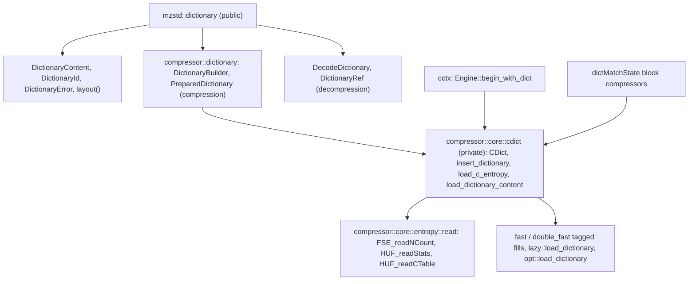
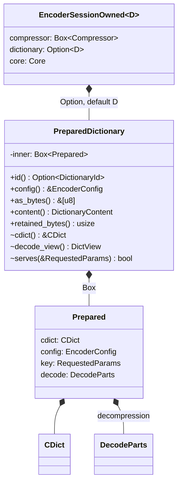
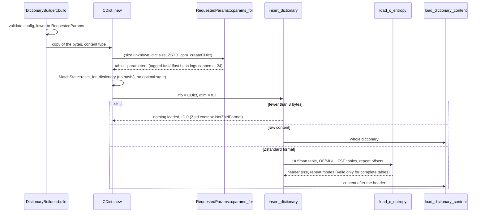
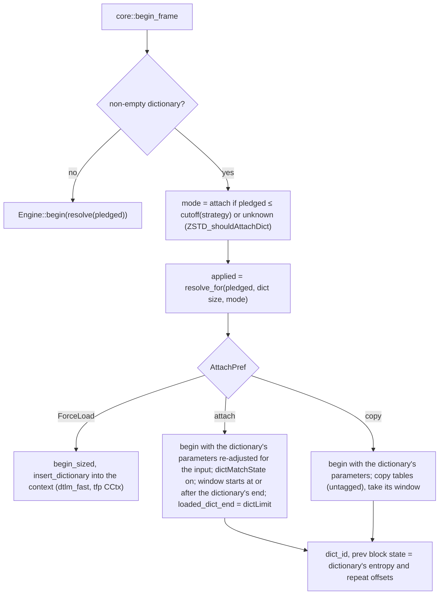

# Dictionaries

This specification covers the shared types and the encoder; the decoder's
side (parsing into `DecodeDictionary`, frame-start setup, dictionary
history) is in [decompressor](decompressor.md#dictionaries).

A dictionary is history both sides agree on before a frame starts. mzstd
reads dictionaries in both forms zstd 1.5.7 does: raw content, and the
Zstandard dictionary format (magic number `0xEC30A437`, a 32-bit ID, entropy
tables, three repeat offsets, content). Compression with a dictionary is
byte-identical to the reference's `ZSTD_CCtx_loadDictionary_advanced`
(by copy) followed by `ZSTD_compress2` or `ZSTD_compressStream2`, for every
level, strategy and dictionary size.

## Modules and public types

| Type | Role |
| --- | --- |
| `DictionaryContent` | `Auto` (format by magic number), `Raw`, `Zstd` (`ZSTD_dct_*`). |
| `DictionaryId` | A non-zero ID, as a Zstandard dictionary declares it and a frame header names it. |
| `DictionaryError` | `NotZstdFormat`, `Corrupted`, and `Config` for an invalid encoder configuration. |
| `DictionaryBuilder` | Borrowed bytes, a content type and an `EncoderConfig`; `build` copies and prepares. |
| `PreparedDictionary` | An immutable `CDict` for one configuration: `id`, `config`, `as_bytes`, `content`, `retained_bytes`, `AsRef<Self>`. With `decompression` it also holds the decoder's `DecodeParts`, so `DictionaryRef::Prepared` decodes its frames without a second copy of the bytes. |
| `DecodeDictionary`, `DictionaryRef` | The decoder's parsed dictionary and the borrowed view decoder entry points take (`Decode` or `Prepared`). |

`Compressor` gains `compress_with_dictionary`, `_into`, `_to_slice`,
`_to_uninit`, `start_with_dictionary`, `into_session_with_dictionary` and,
with `std`, `writer_with_dictionary` and `reader_with_dictionary`.
`EncoderSessionOwned<D = PreparedDictionary>` owns its dictionary as any
`D: AsRef<PreparedDictionary>` (an `Arc` shares one) and returns it from
`into_parts`.

### Ownership and size

`PreparedDictionary` is a single `Box` around its private `Prepared`
contents: the `CDict` (its byte copy, `MatchState` and `BlockState` entropy
tables, about 7.9 KiB inline before its heap tables), the configuration, the
dictionary key and, with `decompression`, the decoder's `DecodeParts`. The
handle is therefore one pointer wide, and `Option<PreparedDictionary>` uses
the box's niche. An `EncoderSessionOwned` started without a dictionary
carries `None` in that one word instead of reserving room for the tables
(about 8 KiB per session in 0.2.4). Encoder entry points reach the
tables through the crate-private `PreparedDictionary::cdict`; building a
dictionary costs one extra allocation and every use one extra indirection
at frame start.

A prepared dictionary's tables depend on the configuration's level, explicit
parameters, LDM switch and size hint, as the reference's local `CDict`
depends on `requestedParams`. A compressor accepts it when its own
configuration matches apart from the frame options (checksum, content
size); otherwise every dictionary entry point fails with
`EncodeError::DictionaryMismatch` before touching the engine.

## Preparing (`ZSTD_createCDict_advanced2`)

`load_dictionary_content` is `ZSTD_loadDictionaryContent`: it truncates a
huge dictionary to a suffix (index space; 2^24 for tagged tables; then what
the tables can index), updates the window, records `loaded_dict_end`, and
fills the strategy's tables:

| Strategy | Dictionary tables (`tfp = CDict`) | Context load (`tfp = CCtx`) |
| --- | --- | --- |
| fast | every position, tagged (`fill_cdict_hash_table`) | every third (`dtlm_fast`) or all (`dtlm_full`) |
| dfast | long and short tables, tagged | as fast |
| greedy, lazy, lazy2 | row tags cleared then `ZSTD_row_update`, or `ZSTD_insertAndFindFirstIndex` | same |
| btlazy2, btopt, btultra(2) | `ZSTD_updateTree` (sorted tree) | same |

Tagged entries hold the index above an 8-bit hash tag
(`ZSTD_writeTaggedIndex`), which the dictMatchState finders compare before
reading the dictionary.

The entropy section is read by straight ports of `FSE_readNCount`,
`HUF_readStats` (with its FSE weight decoder) and `HUF_readCTable`,
checked against the reference's functions on mutated descriptions, so a
malformed dictionary is rejected exactly when the reference rejects it.

## Beginning a frame

An empty dictionary is no dictionary, whatever its content type
(`ZSTD_CCtx_loadDictionary_advanced` with size zero clears it): the frame is
begun as without one. Dictionaries of 1 to 7
bytes still select the dictionary's parameters, as the reference's do, but
load nothing.

The cutoffs are `attachDictSizeCutoffs`: 8 KiB for fast, btultra and
btultra2, 16 KiB for dfast, 32 KiB otherwise; a stream of unknown size
always attaches. `AttachPref` (`ZSTD_c_forceAttachDict`) is internal: the
public API always uses the default, and tests force each path to compare it
with the reference.

Copy mode copies the row tables between their 64-byte aligned views
(`match_state::aligned_range`), since each table's view depends on its own
allocation's address.

## Addressing the dictionary

The dictionary's bytes are a window segment of their own
(`Segment::Dict`). `Segments` carries them and the `CDict` for every call of
a frame, so a session that borrows or owns a dictionary passes it on each
step:

- attach: the context's window holds only input; `BlockInput::dms` carries
  the dictionary's `MatchState` and a view of its content in the
  dictionary's own indices. The finders translate between the two index
  spaces as the reference does.
- copy and load: the dictionary is the window's first segment, so the first
  input turns it into the extDict and the extDict finders read it.

Before each block, `check_dict_validity` (`ZSTD_checkDictValidity`) and
`enforce_max_dist` drop an attached or loaded dictionary once the window
has moved past it or the window stopped being contiguous with it (a stream's
ring buffer wrapping); overflow correction drops it too. `select_block_compressor`
then picks the dictMatchState variant only while the dictionary is
attached and the window has no extDict (`ZSTD_matchState_dictMode`).

The frame header names the dictionary's ID in 1, 2 or 4 bytes.

## Known gaps

- Dedicated dictionary search (`ZSTD_c_enableDedicatedDictSearch`),
  referencing a prefix (`ZSTD_CCtx_refPrefix`) and `ZSTD_dictForceLoad` /
  `ZSTD_dictForceCopy` are not public; only the default attach heuristic is.
  (`Engine::load_prefix` is the prefix mechanism, used by the parallel
  compressor for most strategies' overlaps.)
- Dictionaries are not available to the parallel compressor or the C ABI.
- Speed against zstd 1.5.7 (`benches/dictionary.rs`, 64 KiB trained
  dictionary, i7-13700KF, one core, 2026-10-15): 0.85-0.91x its time at
  levels 16 and 19 on 100 and 1000 records, 1.09-1.19x at levels 1-9, and
  1.20-1.29x for one 107-byte record, where per-frame work dominates (the
  fast dictMatchState kernel executes about 1.6x the reference's
  instructions on it).
- A prepared dictionary serves one configuration; another configuration
  needs its own (`EncodeError::DictionaryMismatch` otherwise).
- The optimal parser's seeding reads `FSE_getMaxNbBits` for every literal
  and match length symbol. Past a dictionary table's largest symbol the
  reference reads uninitialized workspace, so its own frames then depend on
  what the heap held before (an AFL campaign found such a dictionary: the
  reference's frame changed in 20 of 20 runs after other compressions),
  while mzstd reads the zeros of a fresh table and is deterministic. Byte
  identity therefore holds only for dictionaries whose literal and match
  length tables describe every symbol, which `ZDICT` training produces; the
  `compress_dictionary` target checks identity only for those
  ([optimal parser](optimal-parser.md#known-gaps)).

## Verification

`compressor::core::dict_tests` and the finder modules' tests compare frames
with `ZSTD_CCtx_loadDictionary_advanced` + `ZSTD_compress2` /
`ZSTD_compressStream2` for every level and strategy, every attach
preference (forced through `ZSTD_c_forceAttachDict`), trained and raw
dictionaries, tiny, multi-block and streamed inputs, LDM, every backend and
the overflow-correction build; `entropy::read` is checked against
`FSE_readNCount` and `HUF_readCTable` on mutated descriptions;
`tests/compressor_dictionary.rs` covers the public API, mismatch errors and
dictionaries the reference rejects; the `compress_dictionary` AFL target
compares one-shot and streamed frames and dictionary acceptance with the
reference and decodes with both decoders.
- Training dictionaries (`ZDICT_*`) is out of scope; tests train with the
  reference through `zstd-ffi`.
