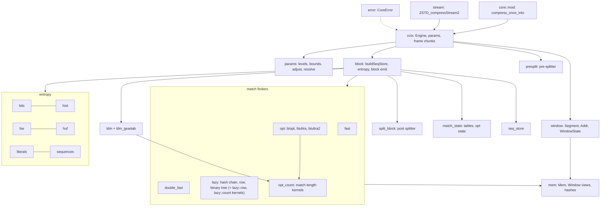
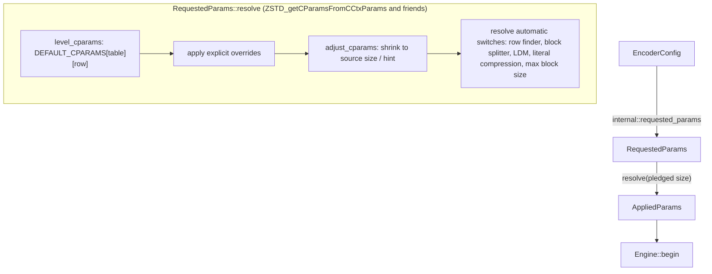
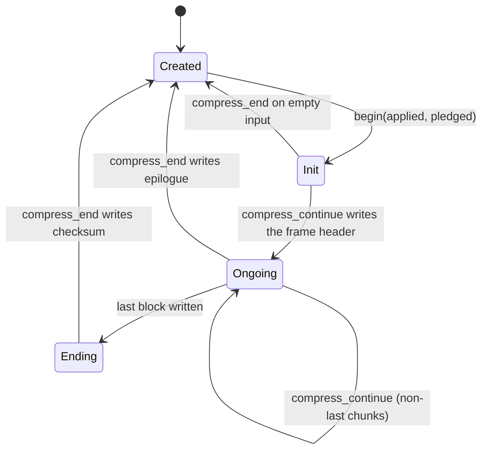
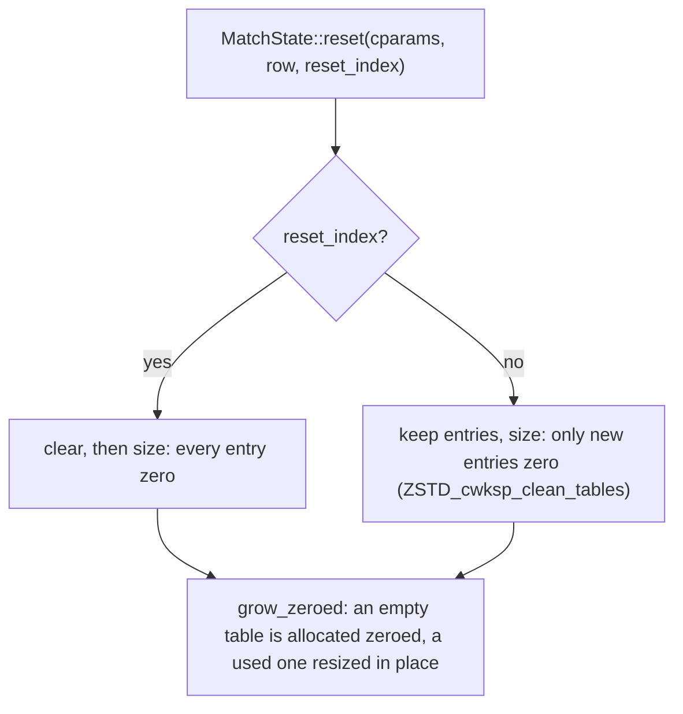
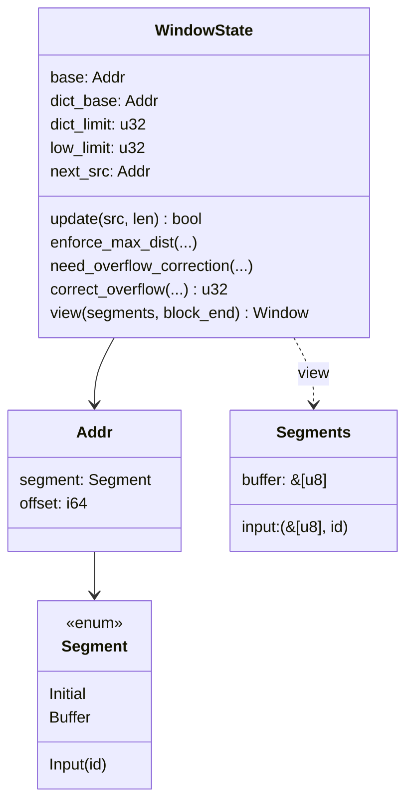
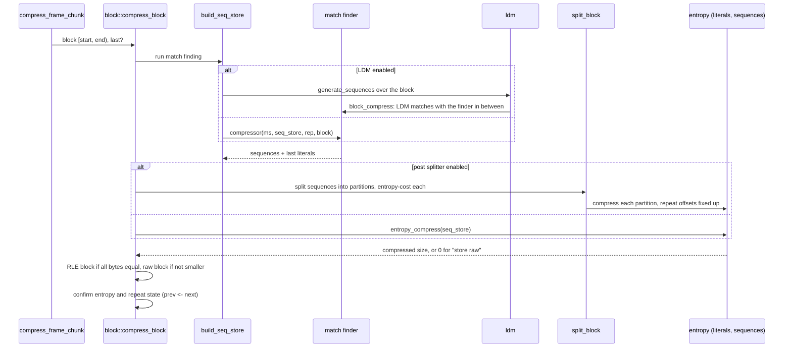
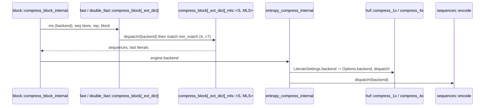
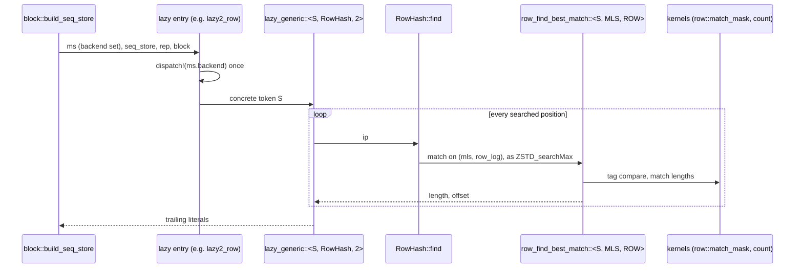
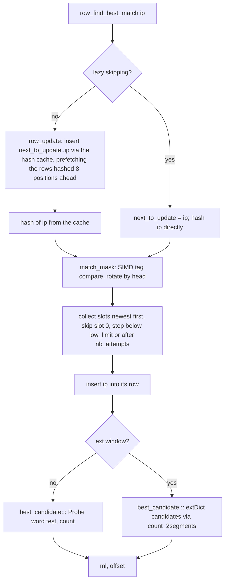
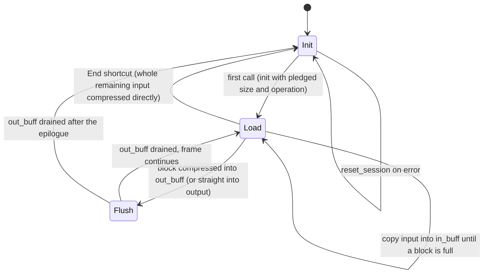

# Encoder core

`compressor::core` is a port of zstd 1.5.7's `lib/compress` restricted to
what mzstd exposes: no dictionaries, no multithreading, no external sequence
producers. Its one obligation is byte identity: for the same parameters,
input and call sequence it writes the bytes the reference writes. Every
function names its C counterpart in its doc comment, and control flow follows
the C code closely, including heuristics that look arbitrary, because any
deviation changes some frame.

## Module map

## Parameters

`params` holds the level tables from `clevels.h` (four tables by source size),
the parameter bounds, `ZSTD_adjustCParams_internal`, the cycle log and the
automatic switches. A size hint (`ZSTD_c_srcSizeHint`) and a pledged size feed
table selection and window shrinking exactly as in the reference; a level of
0 means 3, negative levels use the fast row with `target_length` as the
acceleration.

## Engine lifecycle

`cctx::Engine` is `ZSTD_CCtx` without the streaming buffers.

`begin` is `ZSTD_resetCCtx_internal`: it derives the block size from the
window and the pledged size, resets indices on first use or when they come
within 16 MiB of `ZSTD_CURRENT_MAX` (`ZSTD_indexTooCloseToMax`), sizes the
match state's tables, and resets the entropy tables, the repeat offsets,
the checksum and the LDM state.

Table sizing follows the reference's workspace policy for every finder:

When indices continue, every entry left from the previous input lies below
the new window. The fast and dfast finders test each entry against the
window before reading it. The hash chain and row searches stop at the first
candidate below `lowLimit`, and the binary trees (lazy and optimal) and the
3-byte table stop at their low bounds; inserting a tree node rewrites both
of its cells. A stale entry therefore acts as the zero it replaces. Keeping the
tables changes no output and saves zeroing them on every call. The row
finder's tag table is likewise never re-zeroed while indices continue (the
reference's `init_once` tags). The reference's per-frame salt is not
modelled, because XOR-ing it into the hash permutes rows and tags without
changing which positions collide. The engine's two block states (`prev`, `next`) are boxed, so
confirming a block swaps two pointers as the reference does.

`compress_continue` is `ZSTD_compressContinue_internal`: it writes the
header once, updates the window, then `compress_frame_chunk` cuts the input
into blocks (optionally with the pre-splitter's block sizes), runs overflow
correction and `enforce_max_dist` before each block, and emits each block
through `block::compress_block`.

## Addresses and the window

The reference compares raw pointers into up to three regions: its own input
buffer, the caller's input and the static placeholder a fresh window starts
with. Safe Rust cannot, so `window` models them:

An `Addr` is a segment plus an offset that may lie outside the segment, as a
`base` pointer does. Indices (`u32`, as in C) are offsets from `base`; the
prefix is `[dict_limit, end)` relative to `base`, the extDict
`[low_limit, dict_limit)` relative to `dict_base`. `view` resolves both to
borrowed slices (`mem::Window`), whose `Mem` accessors take the reference's
indices directly, so match finders read `prefix.read32(index)` where C reads
`MEM_read32(base + index)`.

Window updates reproduce `ZSTD_window_update`: input contiguous with the
previous chunk (same segment, next offset) extends the prefix; anything else
turns the old prefix into the extDict and starts a new prefix. Overflow
correction (`ZSTD_window_correctOverflow`) rebases indices and
`MatchState::reduce_index` subtracts the correction from every table entry.
`OVERFLOW_CORRECT_FREQUENTLY`, set at build time by
`MZSTD_OVERFLOW_CORRECT_FREQUENTLY`, makes it run as early as the reference
built with `ZSTD_WINDOW_OVERFLOW_CORRECT_FREQUENTLY` (zstd-ffi's build script
reads the same variable), so the rarely reached path is testable.

## Block pipeline

- `block::select_block_compressor` is `ZSTD_selectBlockCompressor`: the
  strategy, whether the row finder is in use, and whether the window has an
  extDict pick one function pointer, chosen once per block outside the
  finder's inner loop.
- `seq_store` holds sequences in the reference's `SeqDef` form (offBase, a
  16-bit literal length and match length with one "long length" escape) and
  converts them to codes (`fill_codes`).
- `entropy` is the reference's FSE and Huffman encoders: histogram counting,
  normalization, table building, the cost estimates used to choose between
  predefined, repeat, RLE and new tables, and the backward bit streams.
  - `hist::count` counts inputs below 1500 bytes straight into the caller's
    table (`HIST_count_simple`) and larger ones with four interleaved
    tables (`HIST_count_parallel_wksp`).
  - `fse::CTable::build` takes the reference's branch-light spread when no
    symbol has the low-probability count, and sizes its scratch to the
    largest table it holds.
  - `huf` packs each code with its length (`HUF_CElt`, built per call for
    the symbols the table describes) and encodes with the reference's
    two-container, unrolled loop, whose shape depends on the table log and
    on whether the destination holds the tight bound; every shape writes
    the bits the one-symbol-at-a-time writer writes (tested against it).
  - `sequences::encode` walks the codes with zipped iterators and masked
    table indices.
- `presplit` (`ZSTD_splitBlock`, by fingerprint distance) chooses block sizes
  before match finding for the strategies that enable it; `split_block`
  (`ZSTD_compressBlock_splitBlock`) splits the sequences of a finished block
  for the ultra levels.
- After a block, `prev` and `next` swap (`confirm_block_state`) unless the
  block was stored raw or RLE, which keeps the previous entropy tables and
  demotes repeat-mode state as the reference does.

## Backend dispatch

The engine carries the compressor's `Backend` (a `fearless_simd::Level`
chosen once when the compressor is built); `Engine::with_backend` copies it
into `MatchState::backend` for the match finders. Dispatch happens once per
block at the top of each kernel, never inside a loop:

The kernels are `#[simd]` functions generic over the token, so their whole
body is compiled with the level's target features (BMI2, LZCNT and so on
on x86-64; the reference's BMI2 builds of the Huffman and sequence
encoders are the same idea). They use no vector types today. The scalar
fallback is `Backend::SCALAR` in the crate's tests, and every backend
writes the same bytes; `core::tests` and `core::stream_tests` compare every
backend of `Backend::available()` with the reference for levels -5..4, every
minimum match length, and the extDict variants.

## Match finders

| Strategy | Finder | Tables | extDict variant |
| --- | --- | --- | --- |
| fast | `fast` | hash | yes |
| dfast | `double_fast` | long hash, short hash | yes |
| greedy, lazy, lazy2 | `lazy` hash chain, or row finder for windows above 16 KiB | hash, chain or tag rows | yes |
| btlazy2 | `lazy` with the DUBT binary tree | hash, tree | yes |
| btopt, btultra, btultra2 | `opt` with the binary tree and price model | hash, tree, hash3, opt arrays | yes |

`fast` and `dfast` are ported loop for loop but specialized the way the
reference's templates are:

- one instance per minimum match length (`ZSTD_GEN_FAST_FN`,
  `ZSTD_GEN_DFAST_FN`), so the hash width is a constant (`mem::hash_word`,
  `mem::hash_at`);
- positions are offsets into the block's prefix slice and the reference's
  `base` is the prefix's first index, so a read is one fixed-width load
  (`mem::load32`, `mem::load64`) with a single bound test;
- hash indices are masked with `len - 1` after an up-front non-empty
  assertion, which proves them in bounds without a compare;
- the fast loop keeps only `ip0` and `ip2` of the reference's
  `ip0..ip3` pipeline (`ip1 = ip0 + 1`, `ip3 = ip2 + 1` at every probe),
  and reads both probed positions of each through a nine-byte window
  (`mem::window9`, `mem::window_word`): `ip2`'s window becomes the next
  `ip0`'s, so one bound test per step covers every hash and compare at
  the probes;
- the extDict variants use the same prefix offsets, reading only
  candidates below the prefix from the external segment by window index;
- dfast loads each searched position's eight bytes once and derives both
  hashes, the 4- and 8-byte compares and the repcode compare at `ip + 1`
  from that word;
- literals go to the sequence store through `SeqStore::store_seq_from`,
  which copies a run of at most 16 bytes as one fixed chunk
  (`ZSTD_copy16`) and cuts the excess.

The reference's branchless candidate test for windows below 512 KiB
(`ZSTD_match4Found_cmov`) is not ported: a masked-select version measured
slower here. Both forms accept the same candidates.

Match lengths (`mem::count_slices`, behind `Mem::count`/`count_with`)
compare the first word inline with an XOR and a trailing-zero count and the
rest a word at a time out of line, finishing with one word that ends at the
limit.

### Lazy finders and SIMD dispatch

`lazy` holds one parser (`lazy_generic`, and `lazy_ext_generic` for an
extDict window) driving three searches. It is the only finder that uses the
engine's [`Backend`](../src/backend.rs) so far. The engine copies its backend
into `MatchState::backend` before each block (`block::build_seq_store`), and
each block compressor (`lazy::greedy_row`, `lazy::btlazy2_ext`, …) runs
`fearless_simd::dispatch!` once on it. Everything below that dispatch is
generic over the `S: Simd` token and runs with that level's target features:
the dispatch happens once per block, never per position.

The parser is specialized on its search (the `Search` trait: `HashChain`,
`BinaryTree`, `RowHash`) and on its depth (greedy 0, lazy 1, lazy2 2). The
searches are specialized on the minimum match (4, 5 or 6) and the row finder
on its row size (16, 32 or 64 slots), and each search picks its
specialization with one `match` per call, as `ZSTD_searchMax` does. The row
and hash-chain searches are inlined into the parser. The binary tree stays
out of line behind `#[fearless_simd_macros::simd]`, which measured fewer
instructions. Candidate loops are specialized on whether the window has an
external dictionary (`EXT`), so the prefix-only case has no segment test.

Kernels, all safe code:

| Kernel | Reference | What it does |
| --- | --- | --- |
| `lazy::row::match_mask` | `ZSTD_row_getMatchMask` | One `u8x16`/`u8x32`/`u8x64` compare of a tag row with the tag, `to_bitmask`, then a rotation so bit 0 is the row's head. |
| `lazy::count::count`, `common_run` | `ZSTD_count` | The first 8 bytes inline (XOR + trailing zeros). Past them, `long_run` (out of line, `#[simd]`) compares two more words, then native vectors, then words, then one overlapping last word. |
| `Ctx::tree_step` | `ZSTD_count` + byte compare in the DUBT | Without an extDict, one 8-byte load per side gives both the common length and the two bytes that order the runs. |
| `Probe` | `MEM_read32(match + ml - 3) == MEM_read32(ip + ml - 3)` | Cuts the searched window once per search (to the block end, which can precede the prefix end under LDM), and keeps its probe word until `ml` changes. |

The row search keeps the reference's two phases: it collects the candidates,
inserts the searched position, and then measures them. A single fused pass
gives identical output but measured 15-20% slower, because collecting first
lets the candidates' loads overlap. Row tables are viewed as
`&mut [[u8; ROW]]` and `&mut [[u32; ROW]]`, cut to a common row count, so
one check of the row number covers both and slot indexes are masked.

Every backend in `Backend::available()`, including the scalar fallback that
unit tests add, must produce the reference's bytes. `lazy::tests` checks
levels 5–15, every search specialization, the extDict variants, and LDM
sub-blocks on each backend against `zstd_ffi::oracle`. The kernel tests
compare `match_mask` and `count` with scalar references at every row head
and at vector and word boundaries.

`opt` is the optimal parser: it collects every match at each position
(`get_all_matches` with a `MatchQuery`), prices literals and matches from the
current statistics (`OptState`, initialized from the previous block or, for
btultra2's first block, by a throwaway first pass), and backtracks the
cheapest path. LDM candidates enter as extra matches.
It dispatches to the block's SIMD backend (`BlockInput::backend`) once per
block, specializes the tree search by minimum match length, and keeps its
prices in tables patched as the statistics change; see
[Optimal parser](optimal-parser.md).

`ldm` is long distance matching: a gear rolling hash (`ldm_geartab`) samples
positions, a bucketed table stores them, and matches found far back become
raw sequences that `block_compress` interleaves with the regular finder's
output. LDM keeps its own window (`LdmState::window`) over the same segments. It
takes the backend as an argument of `generate_sequences` and counts match
lengths with the optimal parser's kernels (`opt_count`).

## Streaming

`stream::Stream` is `ZSTD_compressStream2` in buffered mode on top of the
engine.

The input buffer is a ring of window size plus one block; blocks are taken
from it, so its wrap-around is what makes the engine see an extDict. When
the reference's shortcut condition holds — an `End` call, an empty input
buffer, and an output with room for `compressBound` of the remaining input —
the input is compressed straight from the caller's memory into the caller's
output, which changes the bytes and is reproduced. A first call that is
already `End` also pledges the input size, so the header records it.
`StreamStep` reports bytes consumed, produced and still buffered.

## Errors

`CoreError` mirrors the reference's error codes the encoder can raise
(`dstSize_tooSmall`, `srcSize_wrong`, `stage_wrong`, parameter errors, table
construction failures). It never leaves the crate: `EncodeError::from_core`
maps it, and sessions turn an unexpected `DstSizeTooSmall` (their internal
buffers are always large enough) into `EncodeError::Internal`.

## Invariants

- Indices are `u32` and wrap exactly as in C; `Addr` arithmetic is `i64` so
  that "pointer below the segment" states exist without overflow.
- Every table read is bounds-checked (safe Rust only); a bounds failure would
  be a panic, so the fuzz targets and differential tests double as checks
  that the reference's index invariants hold here too. Where an index is
  masked to its table size instead (finder hash tables, FSE state and symbol
  tables, Huffman tree nodes), the mask is the identity for every index the
  reference's invariants allow.
- Kernels never re-detect the SIMD level: the backend is fixed when the
  compressor is built and dispatched once per block.
- Parameters are validated before `begin`; the core assumes they are in
  range.

## Known gaps

- SIMD: the lazy finders compare row tags with one vector compare and
  count long matches with native vectors; the optimal parser and LDM use
  vector match-length kernels (`opt_count`); fast/dfast and the entropy
  coders run in the backend's feature context without vector code.
  Histogram counting is scalar. Output is identical on every backend.
- Levels -5..4 run within 5-30% of the reference; most of the remaining gap
  is the finders' inner loops (register pressure and bounds tests carried
  across loop iterations).
- The row finder issues the reference's row prefetches (`ZSTD_row_prefetch`
  from `ZSTD_row_fillHashCache` and `ZSTD_row_nextCachedHash`, 8 positions
  ahead) through the `branches` crate's safe `prefetch_read_data`. On binary
  level 9 that took 21.4 → 14.0 ms. The reference's per-candidate prefetch
  in `ZSTD_RowFindBestMatch` measured no gain (slightly slower on text) and
  is not issued. The hash chain and binary tree have no prefetch points
  outside dictionary modes, so none are ported.
- The reference also resets indices when it reallocates its workspace for
  larger parameters; mzstd resets them only on first use or near
  `ZSTD_CURRENT_MAX`. Frames are unaffected — a reused reference context
  writes the same bytes as a fresh one (`zstd-ffi/tests/reuse_probe.rs`),
  and so does a reused mzstd engine — but internal index values differ from
  a reused reference context's.
- Allocation sizes do not follow the reference's workspace accounting.
- Platform constants are the reference's 64-bit ones (`ZSTD_CURRENT_MAX`,
  `ZSTD_WINDOWLOG_MAX`). On 32-bit targets mzstd still writes what a 64-bit
  build of the reference writes; a 32-bit build of the reference caps the
  window at 2^30 and corrects overflow earlier, so their frames can differ
  for very large windows or inputs.
