# Encoder core

`compressor::core` is a port of zstd 1.5.7's `lib/compress` restricted to
what mzstd exposes: no multithreading, no external sequence producers.
Dictionaries (`cdict`, the dictMatchState finders and the window's
dictionary segment) are described in [dictionaries](dictionaries.md). Its one obligation is byte identity: for the same parameters,
input and call sequence it writes the bytes the reference writes. Every
function names its C counterpart in its doc comment, and control flow follows
the C code closely, including heuristics that look arbitrary, because any
deviation changes some frame.

## Module map

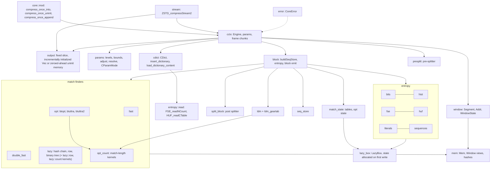

## Parameters

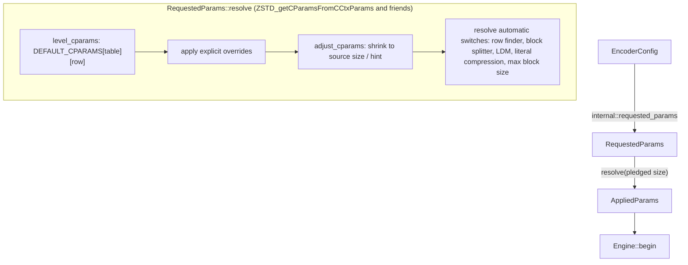

`params` holds the level tables from `clevels.h` (four tables by source size),
the parameter bounds, `ZSTD_adjustCParams_internal`, the cycle log and the
automatic switches. A size hint (`ZSTD_c_srcSizeHint`) and a pledged size feed
table selection and window shrinking exactly as in the reference; a level of
0 means 3, negative levels use the fast row with `target_length` as the
acceleration.

## Engine lifecycle

`cctx::Engine` is `ZSTD_CCtx` without the streaming buffers.

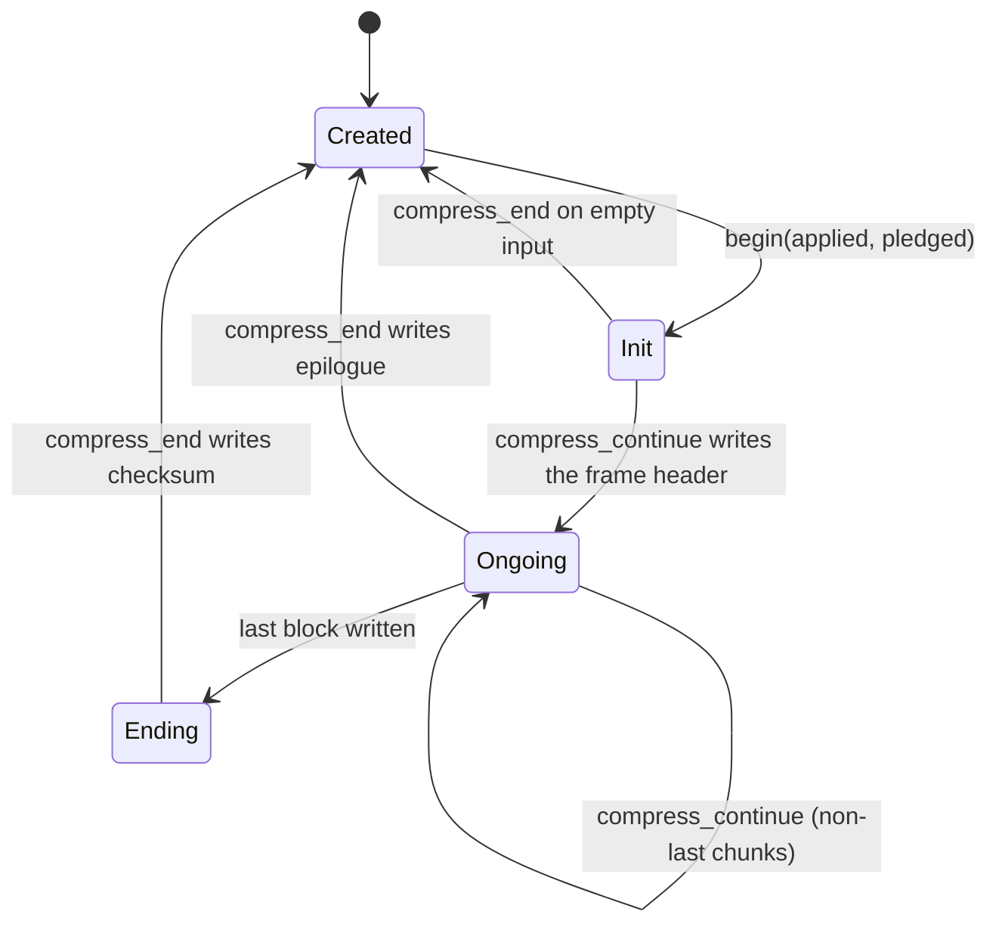

The frame header is written by the free function
`cctx::write_frame_header` from a `FrameHeaderFields` value (window log,
dictionary ID, checksum and content-size flags, pledged size) that the
engine's method fills in, and block headers by `write_block_header`;
`block::write_sequence_count` writes a block's `Number_of_Sequences`. The
three are small and free of SIMD so that the [formal
verification](formal-verification.md) can translate them and check them
against RFC 8878.

`begin` is `ZSTD_resetCCtx_internal`: it derives the block size from the
window and the pledged size, resets indices on first use or when they come
within 16 MiB of `ZSTD_CURRENT_MAX` (`ZSTD_indexTooCloseToMax`), sizes the
match state's tables, and resets the entropy tables, the repeat offsets,
the checksum and the LDM state.

Table sizing follows the reference's workspace policy for every finder:

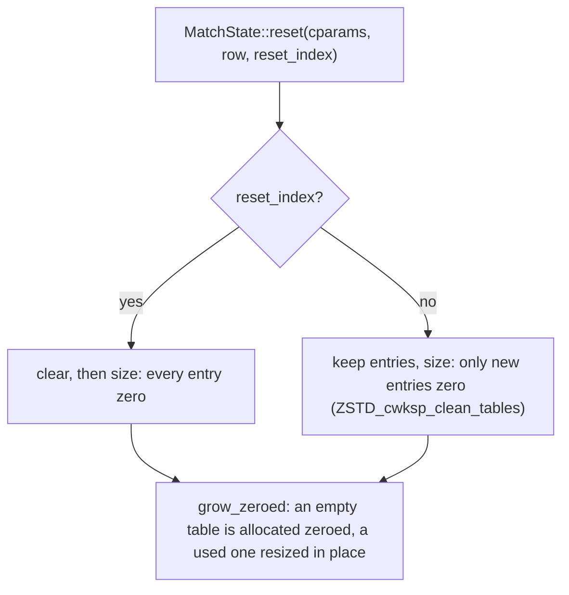

When indices continue, every entry left from the previous input lies below
the new window. The fast and dfast finders test each entry against the
window before reading it. The hash chain and row searches stop at the first
candidate below `lowLimit`, and the binary trees (lazy and optimal) and the
3-byte table stop at their low bounds; inserting a tree node rewrites both
of its cells. A stale entry therefore acts as the zero it replaces. Keeping the
tables changes no output and saves zeroing them on every call. The row
finder's tag table is likewise never re-zeroed while indices continue (the
reference's `init_once` tags). Kept row tables are searched through a view
one 64-entry step further on at every reset (`MatchState::row_view`, eight
views in turn, back to the first when tables are cleared), so the entries
an input of similar content left behind lie in rows of unrelated hashes
(tables of at least 2^14 entries)
and match the new input's tags by chance only. Without it, on repeated
Alice frames every search found and dismissed the previous frame's twins:
five times the stale candidates, ten times the page walks of speculatively
prefetched ones, and 1-6% of the row levels' time. The reference keeps
them apart by salting its hash at every reset (`ZSTD_advanceHashSalt`); a
salt costs an XOR per hash, which measured 1.5-5% slower on cold row
searches, and a view costs nothing per position. Like the salt, the view
changes no frame. A copied dictionary's rows are written through the
context's current view.

```mermaid
stateDiagram-v2
    [*] --> View0: tables allocated (zero)
    View0 --> ViewNext: reset, indices continue (tables kept)
    ViewNext --> ViewNext: reset, indices continue: view + 64 entries mod 8 steps
    ViewNext --> View0: reset with fresh indices or for a dictionary (tables cleared)
    View0 --> View0: reset with fresh indices
    note right of ViewNext
        RowState::new and copy_dictionary_tables
        read and write rows from the 64-byte
        boundary plus row_view
    end note
``` The engine's two block states (`prev`, `next`) are boxed, so
confirming a block swaps two pointers as the reference does.

Their tables are not allocated with them. `Tables` keeps the Huffman table
and the three FSE tables in `LazyBox`es (`core::lazy_box`): the Huffman
table alone, the sequence tables together (`FseCTables`, which `FseTables`
dereferences to). A box is allocated, zeroed, on its first mutable access;
before that it reads as one shared static all-zero table, the value a
zeroed table holds. A table is read only after its repeat mode says a block
wrote it, so empty or tiny inputs, raw literals and blocks without
sequences allocate nothing, as the reference leaves these tables
uninitialized in its workspace. `clone_from` copies in place when both sides
are allocated, so `next.clone_from(prev)` per block never reallocates, and
`huf::compress` stores a fresh table with `LazyBox::set`, without zeroing
it first. The optimal parser's `OptState` (its price tables) is a `LazyBox`
in `MatchState` too, allocated only by btopt and above; `reset` and
`build_seq_store` write it only when it exists. `Engine::with_backend` is
the engine's one constructor.

```mermaid
stateDiagram-v2
    [*] --> Unallocated: Engine::with_backend
    Unallocated --> Unallocated: read (static empty table)
    Unallocated --> Allocated: first write (DerefMut, set) or clone_from(allocated)
    Allocated --> Allocated: build / set / clone_from(allocated), in place
    Allocated --> Unallocated: clone_from(unallocated)
```

`compress_continue` is `ZSTD_compressContinue_internal`: it writes the
header once, updates the window, then `compress_frame_chunk` cuts the input
into blocks (optionally with the pre-splitter's block sizes), runs overflow
correction and `enforce_max_dist` before each block, and emits each block
through `block::compress_block`.

## Addresses and the window

The reference compares raw pointers into up to three regions: its own input
buffer, the caller's input and the static placeholder a fresh window starts
with. Safe Rust cannot, so `window` models them:

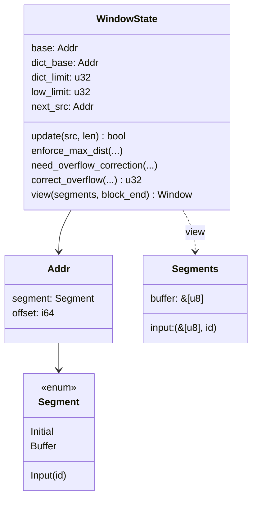

An `Addr` is a segment plus an offset that may lie outside the segment, as a
`base` pointer does. Indices (`u32`, as in C) are offsets from `base`; the
prefix is `[dict_limit, end)` relative to `base`, the extDict
`[low_limit, dict_limit)` relative to `dict_base`. `view` resolves both to
borrowed slices (`mem::Window`), whose `Mem` accessors take the reference's
indices directly, so match finders read `prefix.read32(index)` where C reads
`MEM_read32(base + index)`.

Window updates reproduce `ZSTD_window_update`: input contiguous with the
previous chunk (same segment, next offset) extends the prefix; anything else
turns the old prefix into the extDict and starts a new prefix. Overflow
correction (`ZSTD_window_correctOverflow`) rebases indices and
`MatchState::reduce_index` subtracts the correction from every table entry.
`OVERFLOW_CORRECT_FREQUENTLY`, set at build time by
`MZSTD_OVERFLOW_CORRECT_FREQUENTLY`, makes it run as early as the reference
built with `ZSTD_WINDOW_OVERFLOW_CORRECT_FREQUENTLY` (zstd-ffi's build script
reads the same variable), so the rarely reached path is testable.

## Block pipeline

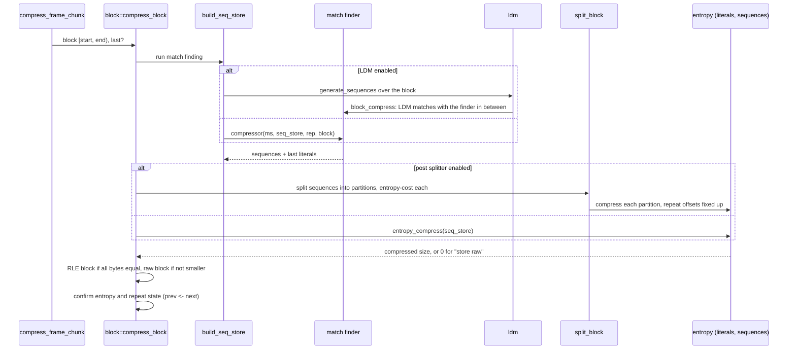

- `block::select_block_compressor` is `ZSTD_selectBlockCompressor`: the
  strategy, whether the row finder is in use, and the dictionary mode
  (`DictMode`: noDict, extDict, or dictMatchState while a dictionary is
  attached; `ZSTD_matchState_dictMode`) pick one function pointer, chosen
  once per block outside the finder's inner loop. Before each block
  `check_dict_validity` and `enforce_max_dist` may detach the dictionary.
- `seq_store` holds sequences in the reference's `SeqDef` form (offBase, a
  16-bit literal length and match length with one "long length" escape).
  `fill_codes(backend)` is one pass, dispatched once per block, that turns
  them into codes: one four-byte `SeqCodes` per sequence (the three FSE
  codes and the sequence's extra-bit count) and, in the same loop, the three
  code histograms (`CodeCounts`) that `ZSTD_buildSequencesStatistics`
  counts with three `HIST_countFast_wksp` passes. The long-length escape is
  patched afterwards for its one sequence, counts included. Small lengths
  use packed 16-bit code/width lookup rows; larger stored lengths derive
  both values from the same high bit. Adding the packed LL and ML rows
  cannot carry from the code byte into the width byte (`35 + 52 < 256`),
  so one shift obtains their combined extra-bit width. Exhaustive tests
  cover every stored 16-bit length and every code combination. The original
  `ll_code` and `ml_code` RFC functions remain unchanged.
  The codes buffer
  only grows and every entry below `nb_seq` is written before it is read.
  It is kept at four bytes a sequence on purpose: a 16-byte record holding
  precomputed extra bits pushed a cold one-shot call's peak heap past
  glibc's dynamic trim threshold, so every call returned and re-faulted
  about 2.7 MB (text-1m level 3 went from 0.69 ms to 1.03 ms).
- Dense full blocks in the `fast` prefix parser can switch from `SeqStore`
  vector appends to a `SeqCursor` over the store's kept full-block
  destinations (`FullBlock`: a boxed `[SeqDef; 32768]` and
  `[u8; 128 KiB + 16]`), allocated and zeroed on the store's first
  promotion and reused by every later one.
  The first 1024 sequences use the original vector writer. At the end of
  a complete match/repeat-code chain, at least 64 KiB of remaining input
  selects the cursor; otherwise the vector loop resumes. This keeps the
  initialization cost away from sparse random and long-run inputs. The
  continuation preserves the hash table, current position and raw repeat
  offsets; it changes neither search order nor match decisions.
  Promotion copies the entries the vectors already hold into the
  destinations; the cursor owns local counts, and on return the block's
  entries stay there: `sequences()`, `literals()`, `sequences_mut()` and
  `nb_seq()` read them until `reset`, and `store_last_literals` appends
  after them. Before, the vectors were resized to a full block and
  truncated again around every promotion, zeroing 384 KiB per dense block:
  on Silesia nci level -1 that was 2.3% of the time, and the call ran
  4.5% behind the main branch (2026-10-30); with the kept destinations it
  runs 1-2.5% ahead of it, and cyclic Alice with a reused context gains
  2.4-2.9% at levels -5 to 2. The vector writer is unchanged: making the
  vectors themselves keep their length cost the dfast and lazy levels
  1.5-3.9%. At most 32768 matches of at least four bytes fit in 128 KiB;
  masks on the sequence and literal indices are therefore identity while
  proving the fixed-size writes in bounds. Dictionary entry points and
  partial blocks keep the vector path. The promoted loop has its own
  `#[simd]` entry so the callback retains the selected target features,
  and scans with a local reborrow of the cursor (`SeqCursor::reborrow`),
  whose address never escapes: the compiler then keeps its counts in
  registers, where through the caller's cursor it stored both on every
  sequence (2026-10-29: 3 instructions per sequence on Silesia dickens).
  Exceptional lengths share one cold helper; the common path tests both
  lengths with one bitwise OR.

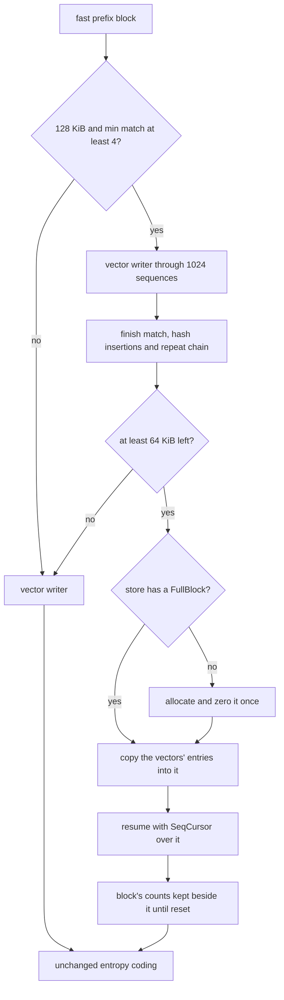

The lazy-family no-dictionary loop uses block-relative `usize` positions
for its cursor, anchor, repeat checks and match counting. One source slice
ends at the logical block end; conversion to global window indices happens
at search-table boundaries. Dictionary variants keep their separate window
adapters. Lookahead depths, cache updates and parsing heuristics are unchanged.

- `entropy` is the reference's FSE and Huffman encoders: histogram counting,
  normalization, table building, the cost estimates used to choose between
  predefined, repeat, RLE and new tables, and the backward bit streams.
  - `hist::count` counts inputs below 1500 bytes straight into the caller's
    table (`HIST_count_simple`) and larger ones with four interleaved
    tables (`HIST_count_parallel_wksp`). It counts literals (and the
    optimal parser's and FSE weights' inputs); sequence code histograms
    come from `fill_codes`, read through `code_histogram`, which reports
    the largest code and count as `HIST_countFast_wksp` does.
  - `fse::CTable::build` takes the reference's branch-light spread when no
    symbol has the low-probability count, and sizes its scratch to the
    largest table it holds. Its state-table and spread loops mask indices
    (symbols below 64, positions below 512), which removes their bounds
    checks without changing any index.
  - `BitWriter` and the Huffman writer store each flushed word at
    `min(pos, end)` and leave `pos` unclamped; `close` reports "does not
    fit" when `pos` passed `end`, the reference's clamp result, while the
    store needs no bounds check.
  - `huf` packs each code with its length (`HUF_CElt`, built per call,
    branch-free over the whole alphabet in the backend's feature context;
    symbols the table does not describe pack to values never read) and encodes with the reference's
    two-container, unrolled loop, whose shape depends on the table log and
    on whether the destination holds the tight bound; every shape writes
    the bits the one-symbol-at-a-time writer writes (tested against it).
    Optimal-depth selection sorts and builds the unlimited tree once.
    Each subsequent depth trial restores leaf lengths from the unchanged
    internal-node heights before applying the reference's height limit;
    table pricing, tie order and the selected depth are unchanged.
    `sort` (`HUF_sort`) places only symbols that occur: the reference
    puts absent ones in the last bucket, so the others' positions do not
    change, and their nodes keep the zero count and length of the cleared
    tree. `fill_from_tree` therefore clears the alphabet's lengths and
    writes those of the non-null ranks rather than reading every leaf.
    One array replaces the reference's start and cursor per bucket: after
    placement it holds each bucket's end, which is the next lower bucket's
    start, so bucket `n - 1` spans `rank[n + 1]..rank[n]`. The buckets from
    count 164 up are sorted by `HUF_simpleQuickSort` without recursion:
    the smaller side of each partition waits on a fixed stack of at most
    28 byte-sized ranges, and short runs go through the reference's stable
    insertion sort, written out rather than `slice::sort_by_key`, which
    would link a whole stable sort for runs of at most nine nodes. Order
    among equal counts is the reference's; tests compare `sort` with a
    verbatim port of `HUF_sort` and the quicksort with the recursive one.
  - `sequences::encode` walks codes and sequences backwards together. Each
    sequence's extra bits are assembled into one word (literal length,
    match length, offset, from the least significant bit; `SeqCodes::extra`)
    and added with one write when they number fewer than 31, the
    reference's own bound; otherwise the word is flushed in two parts.
    Flushes only move whole bytes out of the container, so where they fall
    does not change the stream; `fused_encoding_matches_the_reference_loop`
    checks every backend against a step-by-step port of
    `ZSTD_encodeSequences_body`.
- `literals::try_compress` reports a raw-literals fallback without copying
  it. If those raw bytes alone reach `block_size - min_gain`, entropy coding
  returns the raw-block decision immediately. This shortcut requires a
  destination large enough for the raw block; smaller caller-owned buffers
  follow the reference's original capacity/error path. A block with no
  sequences can still use Huffman literals, so the Huffman attempt is kept.
- `presplit` (`ZSTD_splitBlock`, by fingerprint distance) chooses block sizes
  before match finding for the strategies that enable it; `split_block`
  (`ZSTD_compressBlock_splitBlock`) splits the sequences of a finished block
  for the ultra levels. `presplit::split_block` dispatches once per eligible
  full block to the encoder's selected backend. The splitter body stays out
  of line so the dispatcher does not retain a second fingerprint stack
  frame; the frame is released before match finding. `split_by_chunks`
  selects the instance compiled for the level's sampling rate and hash log (43/8,
  11/9, 5/10, 1/10), as `ZSTD_GEN_RECORD_FINGERPRINT` does: a constant
  stride and hash indices that provably fit the table. Fingerprints hold
  their fixed 1024-entry event arrays on the stack; chunk sampling needs
  two, and border sampling at most three. Recording, comparison and
  accumulation touch only the active 256, 512 or 1024 entries, with no
  fingerprint heap allocation.
  `fpDistance` uses signed 32-bit products and an unsigned 32-bit sum:
  before each comparison at most fifteen 8191-event chunks have accumulated,
  and the incoming chunk has at most 8191 events. Each product is below
  2^30 and the sum of absolute differences is below 2^31. Border samples
  have only 512 events. These bounds preserve the reference's exact
  distance while allowing native integer SIMD arithmetic. The scalar and
  feature-enabled paths keep the reference's sample-count rounding,
  thresholds and split positions; tests compare every backend with a plain
  reference loop and cover the largest chunk products.
- After a block, `prev` and `next` swap (`confirm_block_state`) unless the
  block was stored raw or RLE, which keeps the previous entropy tables and
  demotes repeat-mode state as the reference does.

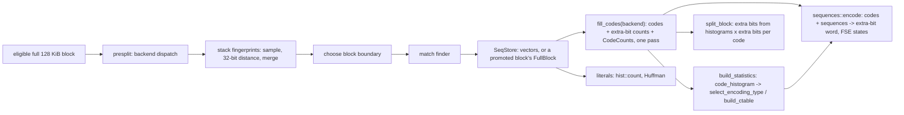

Huffman table construction (`huf::CTable::build`; `optimal_table_log` runs
the same steps once and then only the height limit per depth):

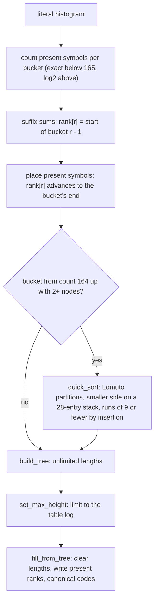

## Backend dispatch

The engine carries the compressor's `Backend` (a `fearless_simd::Level`
chosen once when the compressor is built); `Engine::with_backend` stores it
in `MatchState::backend` for the match finders. Dispatch happens once per
block at the top of each kernel, never inside a loop:

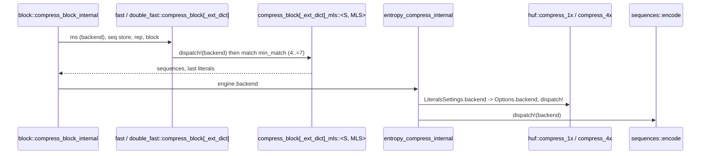

The kernels are `#[simd]` functions generic over the token, so their whole
body is compiled with the level's target features (BMI2, LZCNT and so on
on x86-64; the reference's BMI2 builds of the Huffman and sequence
encoders are the same idea). They use no vector types today. The scalar
fallback is `Backend::SCALAR` in the crate's tests, and every backend
writes the same bytes; `core::tests` and `core::stream_tests` compare every
backend of `Backend::available()` with the reference for levels -5..4, every
minimum match length, and the extDict variants.

## Match finders

| Strategy | Finder | Tables | extDict variant | dictMatchState variant |
| --- | --- | --- | --- | --- |
| fast | `fast` | hash | yes | `compress_block_dict_match_state` (tagged dictionary table) |
| dfast | `double_fast` | long hash, short hash | yes | `compress_block_dict_match_state` (tagged dictionary tables) |
| greedy, lazy, lazy2 | `lazy` hash chain, or row finder for windows above 16 KiB | hash, chain or tag rows | yes | `greedy_dms` .. `lazy2_row_dms` |
| btlazy2 | `lazy` with the DUBT binary tree | hash, tree | yes | `btlazy2_dms` (dictionary tree sorted by `ZSTD_updateTree`) |
| btopt, btultra, btultra2 | `opt` with the binary tree and price model | hash, tree, hash3, opt arrays | yes | `btopt_dms`, `btultra_dms` (also btultra2's) |

The dictMatchState variants run while a dictionary is attached
([dictionaries](dictionaries.md)): the block's own tables are searched as in
the noDict variant, then the dictionary's tables, read in place through
`BlockInput::dms` and translated to window indices by `dictIndexDelta`.
Each is a separate monomorphization (fast and dfast as separate kernels,
`lazy_dms_generic` and the optimal parser's `DMS` const parameter), so the
noDict and extDict code is unchanged; a dms entry reached without a
dictionary falls back to the noDict compressor. Ported details that differ
from the noDict kernels: fast's step starts at `targetLength + !targetLength`
and grows every 256 bytes, a dictionary candidate is tried when the
context's index is at or below the prefix start, dfast tries the
dictionary's short table when its short candidate is not strictly inside
the prefix, the dictionary's tagged tables are hashed with the context's
minimum match and the dictionary's hash log plus 8, and the lazy parser's
repeat-offset checks may read the dictionary (`ZSTD_index_overlap_check`)
without the saved-offset rotation.

`fast` and `dfast` are ported loop for loop but specialized the way the
reference's templates are:

- one instance per minimum match length (`ZSTD_GEN_FAST_FN`,
  `ZSTD_GEN_DFAST_FN`), so the hash width is a constant (`mem::hash_word`,
  `mem::hash_at`);
- `compress_block_mls` handles the repeat-offset setup and the
  saved-offset restore, then calls `compress_scan` with a small `Scan`
  (dfast also a `Tables { long, small }`), which returns the trailing
  literals and the two repeat offsets;
- fast compiles in the hash widths of the default parameters for inputs
  above 256 KiB with their match lengths: `compress_scan::<S, MLS,
  IN_PREFIX, HLOG, BRANCHY>` has instances for `(MLS, hashLog)` = (6, 13)
  (negative levels, and level 1 up to 128 KiB), (7, 14) (level 1) and
  (6, 16) (level 2). The hash shift becomes an immediate and the table mask
  a constant, which frees two of the loop's registers; one test of the
  table's length before the loop proves the masked indices in bounds.
  Other parameters take the instance with the width read at run time
  (`0`). The defaults for inputs up to 128 and 256 KiB, (5, 12), (5, 13)
  and (6, 14), also compile in the window index of the scan's first byte
  (`ORIGIN`, the window's first index) and are taken only when the prefix
  starts the window (one-shot frames and a fresh context's first frame),
  with the select alone; any other prefix runs the generic instance. Only
  the prefix loop is specialized;
- dfast compiles in the widths of its defaults too, as `(MLS, hashLog,
  chainLog)` = (5, 14, 14) (level 2 up to 256 KiB), (4, 16, 16) (level 3
  up to 256 KiB), (5, 17, 16) and (5, 18, 18) (levels 3 and 4 above
  256 KiB), (5, 16, 15) (level 3 up to 128 KiB) and (4, 17, 16) (level 4
  on 64 KiB). Each set is its own out-of-line `#[simd]` function
  (`compress_scan_widths`), called once per block: inlined side by side
  into `compress_block_mls`, LLVM merged the instances back into one loop
  that loads the widths at run time. The tables are cut to
  `1 << hashLog` entries first, so the masks are constants. Other
  parameters run the inlined `compress_scan::<.., 0, 0>`;
- `IN_PREFIX` holds when the block starts in the prefix and both repeat
  offsets reach no further back than the prefix start from the block's
  first position. Every later repeat offset is then `ip - match` with the
  match in the prefix, so no read can go below the prefix: positions
  become offsets from the prefix start and the search loop drops the window
  base, the history pointer and its length. Otherwise the base-relative
  loop runs (`IN_PREFIX = false`);
- dfast, and fast while its table is still filling, test candidates
  without a branch on their validity (the reference's
  `ZSTD_match4Found_cmov` / `ZSTD_selectAddr`). While the table fills,
  stale and valid entries are about equally likely, which made the
  validity branch the finder's main source of mispredictions. fast clamps
  the candidate's offset into the history (`min(offset, len - 4)`), so its
  bytes load without a branch, and the candidate matches only when its
  bytes equal the probed word and the clamp left the offset unchanged.
  Both conditions are folded into one value, `(bytes ^ word) | (offset ^
  clamped)`, and tested once: written as two comparisons joined with `&`,
  LLVM turned the range test back into a branch on x86, which mispredicts
  as often as the validity branch the clamp replaced.
  dfast, and the dictionary variants, select between the candidate and a
  stand-in word picked by the probed word's low bit (`mem::matches32` /
  `matches64`, `DUMMIES`), which can never equal it. In fast the clamp
  replaced that select, whose stand-in address and low-bit choice were
  rebuilt at every position; in dfast it measured faster on single small
  blocks but slower on multi-block inputs (see the known gaps);
- like the reference, fast and dfast prefetch the input at `ip1 + 64` and
  `ip1 + 128` whenever the step grows (`mem::prefetch_l1`, through the
  `branches` crate). The reference's per-position `ip + 256` on aarch64
  is not ported: it measured 1-4% slower on the M5;
- dfast's loops call `mem::count_at_simd`, whose first-word test is
  always inlined; the 128-byte scan behind it stays out of line. Its
  repeat offsets are `usize` inside the scan, which saves LLVM a second
  copy of the first one. Its hash slots come from `Slots::{long, small}`
  (always inlined, widths as const generics): closures that LLVM left out
  of line reloaded the compiled-in widths from memory;
- after a match, dfast's prefix loop computes the forward end before the
  backward extension and loads the word there with its long-table slot
  (`Slots::ahead`), prefetching both candidates when the widths are
  compiled in; the catch-up loop and the sequence store follow, and the
  next search starts from the carried word and slot (the slot is read
  again after the complementary insertions, so their writes are seen).
  The load succeeding is the reference's `ip <= ilimit` test, also after
  each immediate repcode. The kernel is bound by the latency after each
  mispredicted match: this took its work off the next search's load chain
  and made text 2-3% faster with 2% more instructions;
- fast's prefix loop switches to branches (`BRANCHY`,
  `mem::matches32_branchy`: is the word inside the history, then does it
  equal the probed word) for a block whose history before it is at least
  four times the table's size (`4 << hashLog` bytes). Its entries are then
  almost all inside the window and rarely match, so both branches predict
  well, and the select's stand-in costs more than they do. On the first
  20 MB of `silesia.tar` this made levels -5, -1 and 1 8-10% faster; on
  Alice (152 KB) the branches alone were 4-7% slower, the per-block choice
  0-3% faster;
- the loops hold `&Cell<u32>` references to the hash slots they will write,
  which removes the bounds check on a table index carried across
  iterations;
- the exit tests share their bounds checks with the loads they guard:
  fast fetches the window at `ip2` with one 10-byte range check that is
  also its `ip2 + 1 < ilimit` test (`mem::probe_window`, `probe_pair`),
  dfast's 8-byte load at `ip1` (`mem::try_load64`) is its `ip1 <= ilimit`
  test;
- after a match, fast extends backwards with the reference's loop over
  single bytes (it rarely takes a step; cutting two slices first cost four
  bounds tests per match), compares the first word of the forward length
  inline with one bounds test (`mem::count_behind_simd`: the match lies
  behind the searched position, so its word is inside the input whenever
  the position's is), and reads `ip0 - 2` once for both the hash insert
  and the first repcode compare;
- the extDict variants use the same prefix offsets, reading only
  candidates below the prefix from the external segment by window index.
  fast's (`compress_block_ext_dict_mls`, `ZSTD_compressBlock_fast_extDict_generic`)
  addresses a candidate through `locate`, which picks without a branch
  (`select_unpredictable`, the reference's `idxBase` select) the slice
  holding it: the external segment from `dict_start_index` up to the
  prefix, or `src` from `base`, and adds that slice's origin as a masked
  difference (selected together with the slice, LLVM turned the origin
  back into a branch). `segment_matches` clamps the offset to the slice's
  last whole word and folds the range test into the word comparison, so a
  stale entry below `dict_start_index` wraps to an out-of-range offset and
  is rejected, as the reference's `idx >= dictStartIndex` test rejects it.
  Offset matches extend backwards inside the selected slice, and matches
  starting in the external segment are counted out of line
  (`count_from_ext`, `ZSTD_count_2segments`). An external segment shorter
  than one word never matches;
- literals go to the sequence store through `SeqStore::store_seq_from`,
  which copies a run of at most 16 bytes as one fixed chunk
  (`ZSTD_copy16`) and cuts the excess. fast's and dfast's prefix loops use
  a local `store_seq_wild` instead, which appends the 16-byte chunk straight from
  the input without the stack copy and overflow test; the same body in
  `store_seq_from` made fast 2.3% faster but dfast 1.3-1.6% slower, so the
  shared store keeps its form.

dfast's match tail:

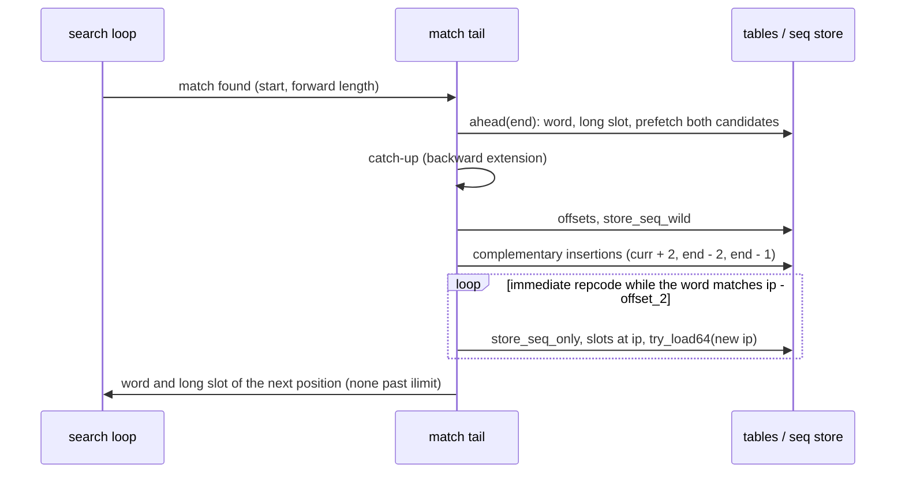

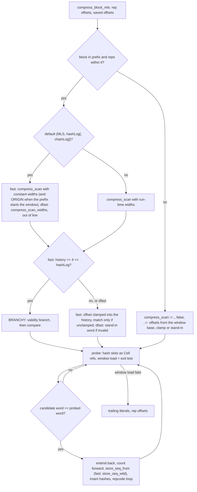

Match lengths (`mem::count_slices`, behind `Mem::count`/`count_with`)
compare the first word inline with an XOR and a trailing-zero count. Out of
line, `count_long` compares words up to 32 bytes, where most matches end,
then skips equal 32-byte chunks (their XORs OR-ed in vector registers), then
finds the difference a word at a time, finishing with one word that ends at
the limit. Run-length inputs, whose matches span whole blocks, spend their
time there. Fast/dfast and lazy search use `mem::count_slices_simd` in
the already-selected backend: the same short-word path, then 128-byte
chunks and a 32-byte cleanup loop. The XOR/OR reduction auto-vectorizes
to four AVX2 registers and one `vptest` per 128 bytes. The first differing
chunk is resolved in byte order with words; every load stays inside both
windows. The feature-entry wrapper is inlined, while the scan stays out
of the candidate loop.

`block::is_rle` (`ZSTD_isRLE`) decides whether a compressed block is
re-emitted as an RLE block. It compares `src[1..]` with
`src[..src.len() - 1]`: equal adjacent bytes imply a constant run. Slice
equality delegates the bulk scan to the platform comparison implementation.

### Lazy finders and SIMD dispatch

`lazy` holds one parser (`lazy_generic`, and `lazy_ext_generic` for an
extDict window) driving three searches. It is the only finder that uses the
engine's [`Backend`](../src/backend.rs) so far. The engine copies its backend
into `MatchState::backend` before each block (`block::build_seq_store`), and
each block compressor (`lazy::greedy_row`, `lazy::btlazy2_ext`, …) runs
`fearless_simd::dispatch!` once on it. Everything below that dispatch is
generic over the `S: Simd` token and runs with that level's target features:
the dispatch happens once per block, never per position.

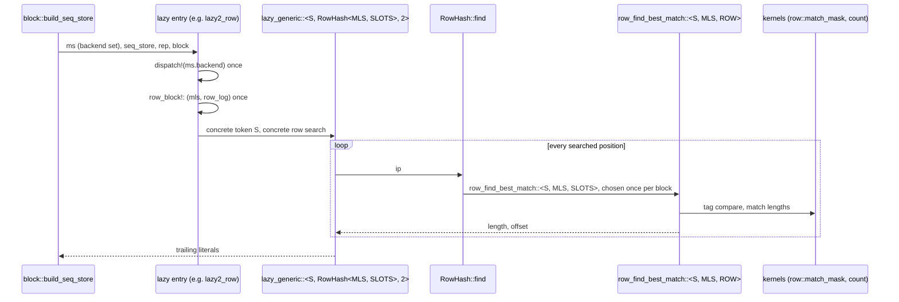

The parser is specialized on its search (the `Search` trait: `HashChain`,
`BinaryTree`, `RowHash`) and on its depth (greedy 0, lazy 1, lazy2 2). The
searches are specialized on the minimum match (4, 5 or 6) and the row finder
on its row size (16, 32 or 64 slots). The hash chain and the binary tree
pick their specialization with one `match` per call, as `ZSTD_searchMax`
does. The row finder (`RowHash<MLS, SLOTS>`) is chosen once per block
instead (`row_block!`, inside the backend's dispatch), so each prefix-only
and extDict parser inlines a single row search: when every call site
inlined all nine behind a `match`, the parser kept their state live and
branched on the parameters at every position (lazy2 levels 1-2.5% slower,
6-8% more mispredicted branches in Callgrind's model on Alice). The
dictMatchState parsers keep the per-search choice (`RowHashAny`):
specializing them too would add about 600 KB of code for parsers that run
only with attached dictionaries. The row and hash-chain searches are
inlined into the parser. The binary tree stays
out of line behind `#[fearless_simd_macros::simd]`, which measured fewer
instructions. Candidate loops are specialized on whether the window has an
external dictionary (`EXT`), so the prefix-only case has no segment test.

Kernels, all safe code:

| Kernel | Reference | What it does |
| --- | --- | --- |
| `lazy::row::match_mask` | `ZSTD_row_getMatchMask` | One `u8x16`/`u8x32`/`u8x64` compare of a tag row with the tag, `to_bitmask`, then a rotation so bit 0 is the row's head. 16-slot rows on NEON instead narrow the compare to four bits per slot (`vshrn` by four in a `fearless_simd::kernel!`, the reference's `ZSTD_row_getNEONMask`), since NEON has no `movemask`; `Matches::pop` turns a group back into a slot. |
| `lazy::count::count`, `common_run` | `ZSTD_count` | Window adapters for the shared `mem::count_slices_simd` word and vector scan described above. |
| `Ctx::tree_step` | `ZSTD_count` + byte compare in the DUBT | Without an extDict, one 8-byte load per side gives both the common length and the two bytes that order the runs. |
| `Probe` | `MEM_read32(match + ml - 3) == MEM_read32(ip + ml - 3)` | Cuts the searched window once per search (to the block end, which can precede the prefix end under LDM), and keeps its probe word until `ml` changes. |

The row search keeps the reference's two phases: it collects the candidates,
inserts the searched position, and then measures them. A single fused pass
gives identical output but measured 15-20% slower, because collecting first
lets the candidates' loads overlap. Row tables are viewed as
`&mut [[u8; ROW]]` and `&mut [[u32; ROW]]`, cut to a common row count, so
one check of the row number covers both and slot indexes are masked.

Per block the parser builds the search's state (`Search::State<'t>`, from
`Search::state(ms, ctx)`) and keeps `lazy_skipping` locally, storing it
back into the match state at the block's end. The row finder's `RowState`
holds:

- the tag and slot tables viewed from their first 64-byte boundary plus
  the current view's offset (`aligned_rows`). `MatchState` gives both
  tables 64 extra entries in row mode, and `ROW_TABLE_SLACK` (64 plus seven
  view steps) from `ROW_VIEW_MIN` (2^14) entries on; smaller tables keep
  one view, since tiny inputs allocate and zero them on every call and the
  views' slack made a 44-byte level 5 call 5-8% slower. glibc returns large blocks 16 bytes past a
  page, so unaligned, half of the 32-byte tag rows crossed a cache line and
  every 128-byte slot row spanned three; the reference's workspace aligns
  them to 64 bytes. Moving the view cannot change a frame: a search only
  follows entries written since indices were last invalidated, and older
  ones fall below `lowLimit` and end the walk as zeros would;
- the hash cache, a local `next_to_update` written back on `Drop`, the
  precomputed hash bits, low-limit inputs and number of attempts;
- a persistent 64-entry candidate buffer, so no row-sized array is zeroed
  per search.

The update loop cuts the words once for the whole range and walks them with
`windows(8)` (a cold per-index fallback covers the end), and steps the row
head through a 256-entry constant table per row size instead of the wrap the
compiler turned into a branch. The tag mask clears slot 0 before rotating, so
collection has no per-candidate head test, and when the attempts reach the
row size the loop keeps no attempts counter. Each collected candidate is
prefetched (`PREFETCH_L1(base + matchIndex)`), as the reference does.
`best_prefix_candidate` measures prefix candidates: the probe word is
compared against a prefix slice shifted by the best length, the first eight
bytes inline, stopping when the next probe word would leave the block.

btlazy2's DUBT inserts nodes from one cut word slice and writes each node
pair in one store. Prefix tree walks use `TreeRun`, which cuts the run once
and counts up to four words inline, ordering the runs with a byte-swapped
compare; longer runs continue in `long_tree_step`, out of line, with the
vector scan (word-at-a-time counting of run-length input, whose matches span
whole blocks, made levels 13-15 on 1 MiB of repeated bytes 18% slower); `TreeLinks::descend` picks the side with a branch, as the reference
does, and writes the dummy link to a `NO_LINK` sentinel, so its write check
doubles as the bounds check. The side is close to a coin flip, but the walk
is a chain of dependent cache misses: a predicted branch starts the next
node's load before the byte comparison that picks it resolves, where a
`select_unpredictable` made every step wait for it. On the first 5 MB of
Silesia (`silesia.tar`) the branch made levels 13 and 15 17% and 21%
faster than the select, as fast as the reference (the optimal parser's walk
measured the same, see [optimal parser](optimal-parser.md)). ExtDict walks
use `Ctx::ext_tree_step`.

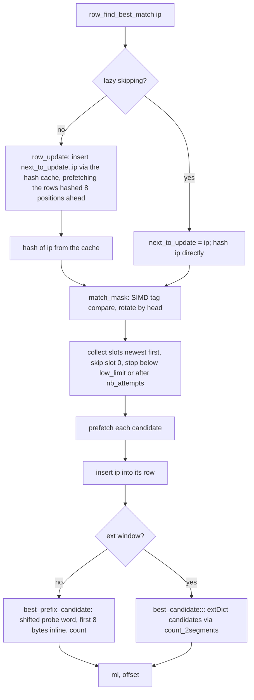

With an attached dictionary, `lazy_dms_generic` drives the same searches
through `Search::find_dms`, which spends the attempts the context's search
left on the dictionary's tables:

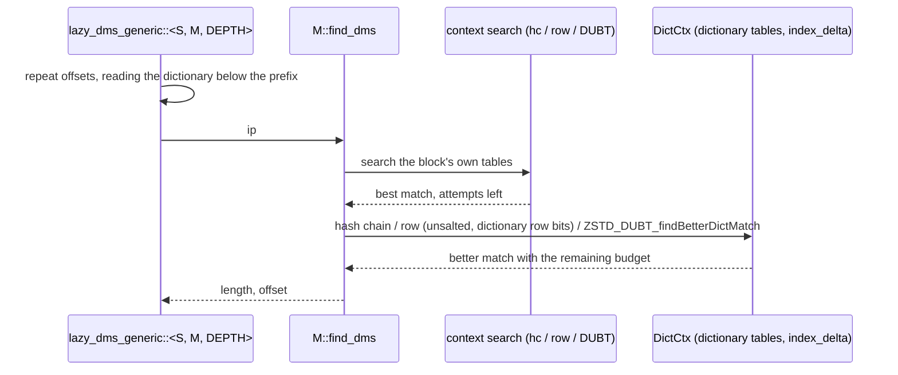

`DictCtx` is built once per block from `BlockInput::dms`: the dictionary's
tables (row tables through `aligned_range`), its bytes, bounds and
`index_delta`. btlazy2 stops searching the dictionary when the context's
walk reached the block end (the reference zeroes `nbCompares`); the other
searches always continue into it.

Every backend in `Backend::available()`, including the scalar fallback that
unit tests add, must produce the reference's bytes. `lazy::tests` checks
levels 5–15, every search specialization, the extDict variants, and LDM
sub-blocks on each backend against `zstd_ffi::oracle`. The kernel tests
compare `match_mask` and `count` with scalar references at every row head
and at vector and word boundaries.

`opt` is the optimal parser: it collects every match at each position
(`get_all_matches` with a `MatchQuery`), prices literals and matches from the
current statistics (`OptState`, initialized from the previous block or, for
btultra2's first block, by a throwaway first pass), and backtracks the
cheapest path. LDM candidates enter as extra matches.
It dispatches to the block's SIMD backend (`BlockInput::backend`) once per
block, specializes the tree search by minimum match length, and keeps its
prices in tables patched as the statistics change; see
[Optimal parser](optimal-parser.md).

`ldm` is long distance matching: a gear rolling hash (`ldm_geartab`) samples
positions, a bucketed table stores them, and matches found far back become
raw sequences that `block_compress` interleaves with the regular finder's
output. LDM keeps its own window (`LdmState::window`) over the same segments. It
takes the backend as an argument of `generate_sequences` and counts match
lengths with the optimal parser's kernels (`opt_count`).

## Streaming

`stream::Stream` is `ZSTD_compressStream2` in buffered mode on top of the
engine.

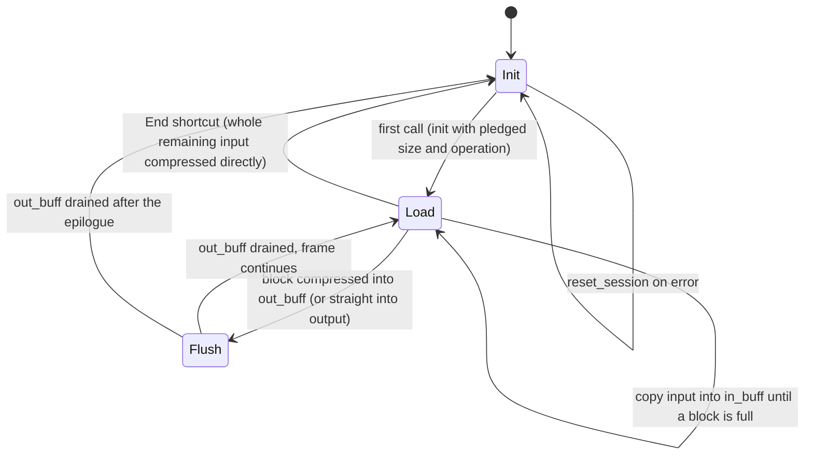

The input buffer is a ring of window size plus one block; blocks are taken
from it, so its wrap-around is what makes the engine see an extDict. When
the reference's shortcut condition holds — an `End` call, an empty input
buffer, and an output with room for `compressBound` of the remaining input —
the input is compressed straight from the caller's memory into the caller's
output, which changes the bytes and is reproduced. A first call that is
already `End` also pledges the input size, so the header records it; the
public session rejects that call first when its length contradicts a
declared size (see [compressor](compressor.md#sessions)).
`StreamStep` reports bytes consumed, produced and still buffered.

## Destinations

The engine writes frames through `output::Output::prepare(position,
needed)`, which returns the writable tail at `position`; `needed` is the
largest amount the next write can take (a frame header, `compressBound` of
the next block, the epilogue). `SliceOutput` returns the caller's exact
tail. `VecOutput` and `UninitOutput` initialize only up to
`min(position + needed, limit)`, so the encoder sees either at least a
block's bound or the exact remaining capacity, the two cases in which its
capacity checks behave as with the whole slice. `UninitOutput` keeps a
`borrowed_buf::BorrowedBuf` over the caller's `MaybeUninit` bytes, zeroes
its filled prefix forward and hands out `filled_mut()[position..]`, so no
`unsafe` code is involved and each byte is zeroed at most once per call.

`Stream::compress` is generic over `output::Destination`, implemented for
`[u8]` and `[MaybeUninit<u8>]`. Its `tail(at)` is the `Output` for blocks
written straight to the caller (the shortcut and `direct` blocks), and
`put(at, bytes)` copies what was compressed into `out_buff`. The `[u8]`
instance compiles to the code the stream had before the abstraction.

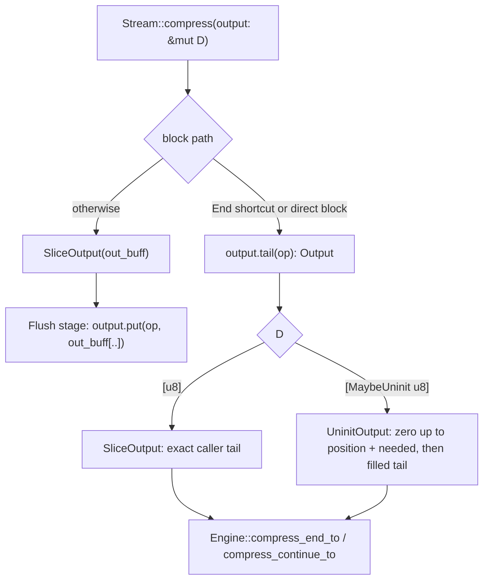

## Errors

`CoreError` mirrors the reference's error codes the encoder can raise
(`dstSize_tooSmall`, `srcSize_wrong`, `stage_wrong`, parameter errors, table
construction failures). It never leaves the crate: `EncodeError::from_core`
maps it, and sessions turn an unexpected `DstSizeTooSmall` (their internal
buffers are always large enough) into `EncodeError::Internal`.

## Invariants

- Indices are `u32` and wrap exactly as in C; `Addr` arithmetic is `i64` so
  that "pointer below the segment" states exist without overflow.
- Every table read is bounds-checked (safe Rust only); a bounds failure would
  be a panic, so the fuzz targets and differential tests double as checks
  that the reference's index invariants hold here too. Where an index is
  masked to its table size instead (finder hash tables, FSE state and symbol
  tables, Huffman tree nodes), the mask is the identity for every index the
  reference's invariants allow.
- Kernels never re-detect the SIMD level: the backend is fixed when the
  compressor is built and dispatched once per block.
- Parameters are validated before `begin`; the core assumes they are in
  range.

## Known gaps

- `fast` on inputs above 256 KiB (Silesia, levels -1 and 1) runs at a
  median 0.939-0.945x the reference, 0.93-0.96x on text
  ([Silesia](../docs/benchmarks/silesia.md), 2026-10-30, Ryzen 9 7950X).
  Its search loop
  costs about the reference's instructions per position; a match costs
  about 127 instructions against the reference's 91 (Silesia dickens,
  level 1), of which about 25 load and store values the loop cannot keep
  in registers and about 12 are bounds tests. Rejected: one span for the
  two hash inserts after a match (no fewer instructions); constant hash
  widths for reused contexts (level -5 3-6% slower).

- The lazy no-dictionary loop's block-relative positions (`lazy_generic`)
  trade incompressible inputs for text: against the main branch's
  absolute positions it is 1-2% faster on Alice with reused contexts at
  the row levels 4-9 (0.7% cold) and 0.4-1% on cyclic Alice, but random
  data at levels 7-10 runs 2-11% slower (random 64 KiB level 10 11%,
  2026-10-30, paired against the main branch). The
  instruction counts match within 1.2%; the extra cycles are register
  pressure from the five inlined `count_at_simd` calls, which spill the
  loop's state (store-to-load interlocks +9%). Calling the context's
  `count` instead, relative repeat tests or `ctx.base` for the local base
  recovered at most half.

- Cold one-shot calls on empty input execute about 70 more instructions
  than the main branch's (2,635 against 2,563, 2026-10-30), 3.7% slower,
  and the 44-byte text at levels -5 to 10 runs 2-6% slower: the frame setup
  (`begin_sized`, `compress_once_into`) is no longer inlined into
  `Compressor::compress_to_slice_with`, and the store carries the
  full-block destinations' state. Forcing the inlining added instructions.

- The `fast` kernel's speed depends on where it lands in the binary: on
  2026-10-29 a change elsewhere left its instructions identical (5,035M
  for 800 Alice level 1 calls) but raised branch mispredictions from 9.28M
  to 9.99M and its time by 1.8% (Ryzen 9 7950X). Measure kernel changes by
  instruction and misprediction counts as well as time.

- SIMD: the lazy finders compare row tags with one vector compare;
  fast/dfast and lazy search share the 128-byte match-length scan. The
  optimal parser and LDM use native-vector kernels (`opt_count`). The entropy
  coders run in the backend's feature context without explicit vector code.
  The pre-splitter's 32-bit distance and histogram merges also run in that
  context. Histogram counting is scalar. Output is identical on every backend.
- See the [benchmarks](../docs/benchmarks/encoder-comparison.md) for the
  current end-to-end ratios. Text at the fast levels and the lazy levels
  6–12 still trails the reference. After the small-table widths
  (2026-10-18) the fast kernel executes 1.34x the reference's
  instructions on Alice at level 1 (11.99M against 8.96M over three calls;
  1.48x before). Per match it executes about 146 instructions plus 27 to
  restart the search against the reference's 87 plus 28, with 21
  conditional branches against 10: bounds tests in the backward extension,
  the first-word count and the post-match fill, and the `Vec` capacity
  tests of the literal and sequence pushes. Per two probed positions it
  is about 61 against 54. Mispredictions are at the reference's level.
  Removing instructions did not make it faster (i7-13700KF, paired cold
  calls): a literal buffer whose length runs ahead of the stored literals
  (up to 3.5% fewer kernel instructions, 1-4% slower on text at levels -5
  and -1), the repcode read clamped instead of bounds checked (7% fewer
  kernel branches, 1-2% slower), the long count out of line (1.5% faster
  at level 1, 2% slower at -5), a branch-free eight-byte backward
  extension (a quarter fewer mispredictions in callgrind's model, 7%
  faster on 1 MiB of text at -5, but 5-6% slower on Alice at -1 and 1-5%
  on binary data), the clamp limit unified with the probe window's (1.6%
  more instructions), the post-match fill bounded by one 10-byte window
  and repcodes held as `usize` (no gain). random-1m timings move by 5-15%
  between builds from code placement alone.
- Cold, the row finder plus its table setup runs at the reference's speed
  on 1 MiB of text (levels 9-12, i7-13700KF, measured against
  `ZSTD_generateSequences` with the entropy stage short-circuited). The
  pre-splitter was the larger part of the rest (1.3M extra instructions on
  1 MiB at level 9) before it was compiled per rate; the entropy stage
  after `build_seq_store` executes at or below the reference's
  instruction count (2.43M against 2.50M there). On Alice at levels 7-8
  (minimum match 4, 16-slot rows) the finder is still 2-3% slower and
  executes about 4% more instructions, two per collected candidate for the
  masked buffer index. The finder is bound by memory latency (without its
  prefetches it is 15-26% slower), so instruction counts are a poor proxy
  there. A reused context measured the finder 2-6% slower on an input
  identical to the previous one before the row view moved per reset
  (see [Engine lifecycle](#engine-lifecycle)); the view recovers 0.2-6.5%
  at levels 4-10, the reference's salt measured 1-3% more at levels 6-8
  with ROW 16 (2026-10-29). btlazy2 executes about 21% more instructions
  than the reference on Alice at level 12 (index arithmetic and bounds
  checks in the tree walk) at equal or better speed. Measured and
  rejected (2026-10-18): the row search out of line (0.5-4.5% slower),
  the reference's branch-free next-slot arithmetic instead of the lookup
  table (0-1% slower), the row update out of line (1.5-2.5% slower), and
  row state pre-cut into rows and generic over the row size (no gain).
- A cold one-shot call into a `Vec` zeroes its destination before writing
  it (`compressBound` of one block, and one block's bound ahead for
  longer inputs), about 0.8 µs per 64 KiB on the i7-13700KF, which the
  reference, writing into uninitialized memory, does not pay. Sizing it
  down would change the capacity the entropy coder's fit decisions see;
  writing without zeroing needs `unsafe` or bit writers that append.
- The select's stand-in picked by the word's low bit was measured
  (2026-10-15, first 20 MB of `silesia.tar`) against one fixed stand-in
  followed by the validity test, as `ZSTD_match4Found_cmov` does: the
  latter was 1% slower at level 1 and 3% slower at level 3. The clamp
  in fast's loop, the prefetches and dfast's inlined count were measured
  on an Apple M5 Pro (2026-10-17, three or more interleaved runs of both
  builds, one reused context per input, on 1 KiB to 128 KiB slices of
  Alice, the structured binary corpus and zstd's
  `large-literal-and-match-lengths` file and on 1 MiB of the synthetic
  text and binary corpora). Against the previous loops, level -5 took
  2-18% less time, level 1 0.3-15%, level 2 0.3-14% and level 3 1-11%
  (1 MiB of text at level 3 unchanged);
  level 4 moved by -3% to +1%. The largest gains are on small inputs.
  One case measured slower, 1 MiB of binary data at level 2 (+5%), and it
  is equally slower with dfast's loop left untouched, so it comes from code
  placement elsewhere, not from this loop.
- The same changes were rechecked on the i7-13700KF (2026-10-17, the
  comparison harness's profile driver, seven to nine interleaved
  process pairs per case on one pinned core). The clamp as first written
  (`(bytes == word) & (offset == clamped)`) compiled to a second,
  mispredicted branch: text at levels -5 to 2 took 5-17% longer than with
  the select (callgrind: 40% more mispredicted conditional branches with
  4% fewer instructions). With the folded test it is back to the select's
  time on text and 1-5% faster on 64 KiB of binary and random data at
  levels -5 to 1. A
  `select_unpredictable` between the loaded word and the probe's
  complement was as slow on text as the split test. dfast's inlined count
  took 3-6% longer on text at levels 2 to 4 (Alice at level 2, 1 MiB at
  levels 3 and 4) and saved 2-3% only on 44 bytes, so dfast's prefix loop
  went back to the out-of-line count. Removing the prefetches did not
  remove the slowdown on text, and they were kept.
- Measured and rejected on the M5 (2026-10-17, interleaved runs of both
  builds; these loops' timings move by up to 10% between builds that
  differ only in code elsewhere, through inlining, register allocation
  and placement):
  - dfast's candidates clamped as fast's are. Clamping both was up to 18%
    faster on single blocks up to 16 KiB at level 3, but 6% slower on
    1 MiB of binary data at level 3, 16% at level 4, and 4-6% slower on
    128 KiB at level 4: the compiler turned the long candidate's clamp
    test into a branch that waited on the table load. Choosing per block
    (clamped only on a frame's first block, or while the history is under
    `4 << hashLog`) fixed 1 MiB, but as a second instance of the loop it
    moved `compress_block_mls` out of line and as a run-time flag it cost
    a register, and either made a single 128 KiB block 3-12% slower.
    Clamping only the short candidate gave 1-4% on small inputs and lost
    3-5% on 128 KiB blocks;
  - dfast's validity tests as branches (5-18% faster up to 16 KiB, 11-32%
    slower on 128 KiB blocks), its repcode read clamped instead of bounds
    checked (no change), its searched index taken where the search stops
    or read back from the short slot just written (no gain, 8-11% slower
    on 128 KiB), and the per-position `ip + 256` prefetch on aarch64 (1-4%
    slower);
  - NEON kernels for the 32- and 64-slot tag masks (`vuzp` in place of
    `vld2q`/`vld4q`; up to 6% slower at level 10, no change at 12) and for
    match counting in 64-byte blocks (`vshrn` nibble masks; no change at
    levels 1 and 3, 0.5-1% slower at 16 and 19, up to 7% slower on highly
    repetitive input).
- dfast's kernel is latency bound: on Alice at level 2 it takes about 78%
  of a cold call's time but 67% of its instructions, and executes 18.3M
  instructions over three calls against the reference's 12.3M (about 61
  against 51 per searched position: the repcode test with its bounds
  check, the word-dependent stand-in select and about 16 spills and
  reloads, since the loop's values do not fit x86-64's 15 registers; about
  185 against 121 per match: store bookkeeping, `SeqDef` packing and
  bounds-checked insertions) while matching or beating its time. Removing
  instructions (the wild literal copy alone, a branch-free catch-up, one
  match tail shared by all exits) did not change the time; only taking
  work off the post-match load chain did. Prefetching the four likeliest
  match ends instead of the match end's own candidates was 1-3% slower.
  The 44-byte input at level 3 (run-time widths) is 1.5-3% slower than
  before the look-ahead (a 0.5 µs call). Measured and rejected
  (2026-10-18, i7-13700KF, paired runs): `branches::unlikely` on the candidate exits (18% more
  instructions; LLVM lost the constant widths), an un-pipelined loop (same
  instructions, 1-3% slower), a branch-free backward extension (28% fewer
  mispredictions in callgrind's model, 1-2% slower: the hardware predicts
  the catch-up branch far better than the model), software pipelining one
  position ahead (21% more instructions, 4-8% slower), a lean loop with
  match handling after it (2% faster on text, up to 3.8% slower on random
  data), the post-match insertions and repcode check through one 10-byte
  window (2.3-3% fewer instructions, 1-2% slower), and `&` instead of `&&`
  in the repcode test (3% more instructions).
- On the Silesia corpus (`silesia.tar`, 2026-10-15, warm contexts and the
  fastest of several runs, as lzbench measures) fast compresses about
  5-10% faster than before the constant widths and the validity branches,
  at 0.91-0.93x the reference's speed; dfast and greedy/lazy/lazy2 still
  run 6-14% slower than the reference; btlazy2 and the optimal parser are
  at or above its speed. Fast's prefix loop executes about 58 instructions per two probed
  positions against the reference's 45: bounds checks on the repcode read
  and the probe windows, and reloads of spilled values.
- Measured and rejected (2026-10-15, first 20 MB of `silesia.tar`):
  carrying fast's `current0` out of the loop instead of through it
  (0.5-1% slower), reading the repcode word at `ip2.saturating_sub(rep)`
  to drop its bounds check (2-3% slower with the select, noise with the
  branches), the search loop out of line in its own function (5-10%
  slower: the call and the result per match cost more than the registers
  it freed) and dfast's candidates with branches (level 3 +1%, level 4 6%
  slower). dfast's compiled-in table widths measured no change then
  because LLVM merged the inlined instances into one loop with run-time
  widths; as separate functions they are now kept. A sequence store written through a block-long cursor kept its
  positions in registers and gave dfast 5%, but its buffers had to be
  initialized at full capacity to be written safely: a cold one-shot call
  on 64 KiB then paid about 2.5 us more (32-50% at levels -5 to 1), so that trial
  kept the store on `Vec`. The current dense full-block promotion above
  avoids paying that setup for short inputs. The constant widths for every match length at once instead
  of per default pair cost 100 KB of code for the same instruction count;
  timings of one build against another varied by about 3% with the
  register allocation alone, so these comparisons interleave several
  runs of both builds.
- The row finder issues the reference's row prefetches (`ZSTD_row_prefetch`
  from `ZSTD_row_fillHashCache` and `ZSTD_row_nextCachedHash`, 8 positions
  ahead) and its per-candidate prefetch through the `branches` crate's safe
  `prefetch_read_data`. The hash chain and binary tree have no prefetch
  points outside dictionary modes, so none are ported.
- A cold one-shot call's heap footprint sits close to glibc's dynamic trim
  threshold on 1 MiB inputs; growing per-call allocations by a few hundred
  KiB makes every call return and re-fault the heap top (see
  `fill_codes`).
- The reference also resets indices when it reallocates its workspace for
  larger parameters; mzstd resets them only on first use or near
  `ZSTD_CURRENT_MAX`. Frames are unaffected — a reused reference context
  writes the same bytes as a fresh one (`zstd-ffi/tests/reuse_probe.rs`),
  and so does a reused mzstd engine — but internal index values differ from
  a reused reference context's.
- Allocation sizes do not follow the reference's workspace accounting.
- Platform constants are the reference's 64-bit ones (`ZSTD_CURRENT_MAX`,
  `ZSTD_WINDOWLOG_MAX`). On 32-bit targets mzstd still writes what a 64-bit
  build of the reference writes; a 32-bit build of the reference caps the
  window at 2^30 and corrects overflow earlier, so their frames can differ
  for very large windows or inputs.

### Alice follow-up (2026-10-29)

The dense full-block writer, relative lazy prefix positions and packed
code/width maps above were chosen with paired Alice runs on AMD; eager
cursor initialization, promotion in dfast/lazy and a separate padded-input
specialization were rejected. Current timings against C and the main
branch are in the [benchmark results](../docs/benchmarks/README.md).
