# Encoder core

`compressor::core` is a port of zstd 1.5.7's `lib/compress` restricted to
what mzstd exposes: no multithreading, no external sequence producers.
Dictionaries (`cdict`, the dictMatchState finders and the window's
dictionary segment) are described in [dictionaries](dictionaries.md). Its one obligation is byte identity: for the same parameters,
input and call sequence it writes the bytes the reference writes. Every
function names its C counterpart in its doc comment, and control flow follows
the C code closely, including heuristics that look arbitrary, because any
deviation changes some frame.

## Module map

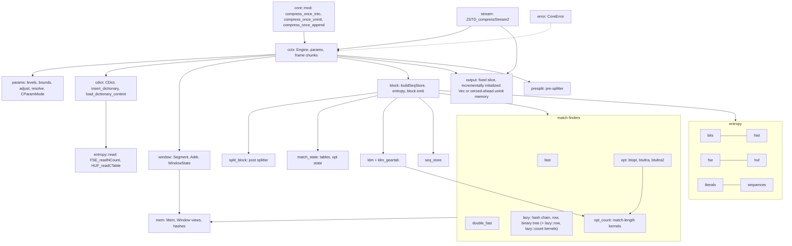

## Parameters

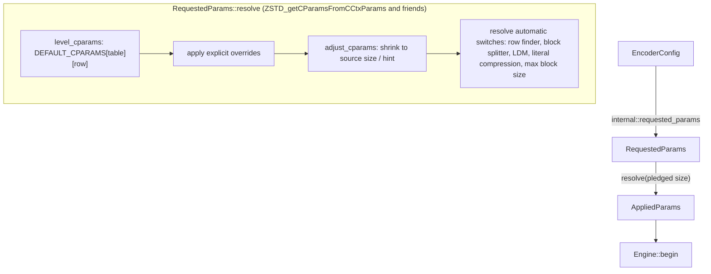

`params` holds the level tables from `clevels.h` (four tables by source size),
the parameter bounds, `ZSTD_adjustCParams_internal`, the cycle log and the
automatic switches. A size hint (`ZSTD_c_srcSizeHint`) and a pledged size feed
table selection and window shrinking exactly as in the reference; a level of
0 means 3, negative levels use the fast row with `target_length` as the
acceleration.

## Engine lifecycle

`cctx::Engine` is `ZSTD_CCtx` without the streaming buffers.

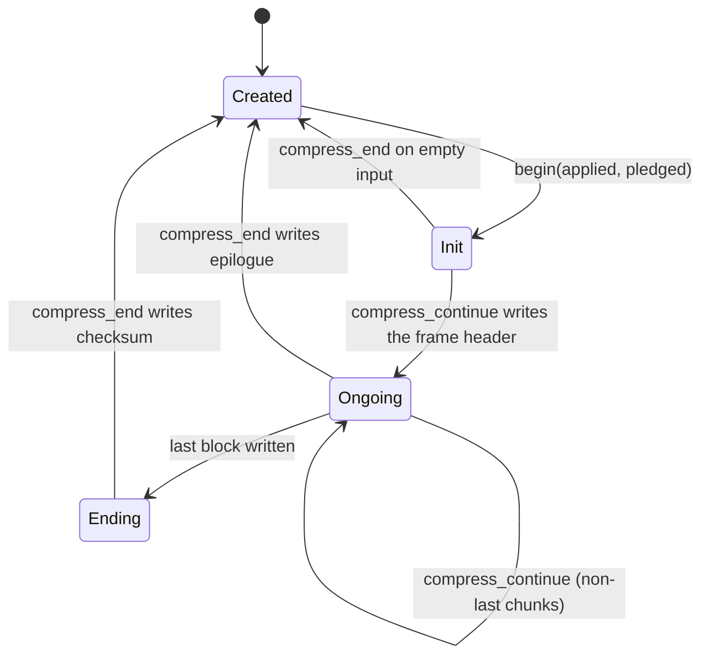

`begin` is `ZSTD_resetCCtx_internal`: it derives the block size from the
window and the pledged size, resets indices on first use or when they come
within 16 MiB of `ZSTD_CURRENT_MAX` (`ZSTD_indexTooCloseToMax`), sizes the
match state's tables, and resets the entropy tables, the repeat offsets,
the checksum and the LDM state.

Table sizing follows the reference's workspace policy for every finder:

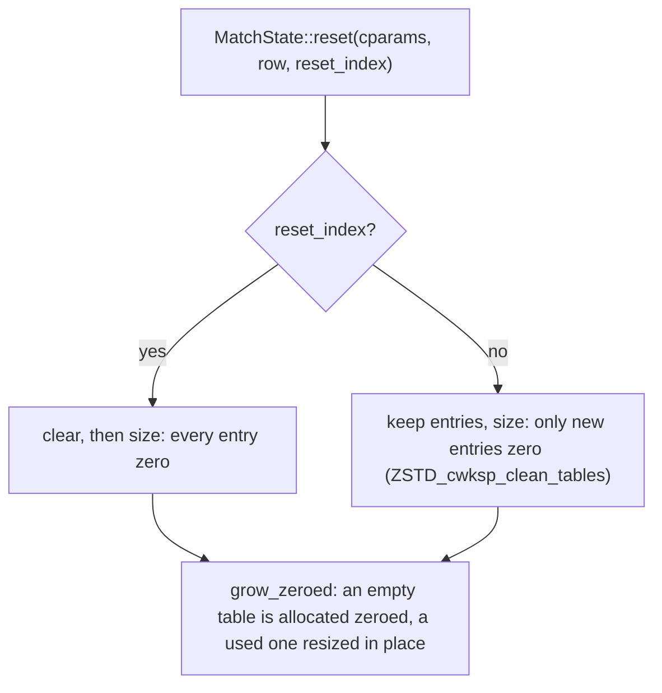

When indices continue, every entry left from the previous input lies below
the new window. The fast and dfast finders test each entry against the
window before reading it. The hash chain and row searches stop at the first
candidate below `lowLimit`, and the binary trees (lazy and optimal) and the
3-byte table stop at their low bounds; inserting a tree node rewrites both
of its cells. A stale entry therefore acts as the zero it replaces. Keeping the
tables changes no output and saves zeroing them on every call. The row
finder's tag table is likewise never re-zeroed while indices continue (the
reference's `init_once` tags). The reference's per-frame salt is not
modelled, because XOR-ing it into the hash permutes rows and tags without
changing which positions collide. The engine's two block states (`prev`, `next`) are boxed, so
confirming a block swaps two pointers as the reference does.

`compress_continue` is `ZSTD_compressContinue_internal`: it writes the
header once, updates the window, then `compress_frame_chunk` cuts the input
into blocks (optionally with the pre-splitter's block sizes), runs overflow
correction and `enforce_max_dist` before each block, and emits each block
through `block::compress_block`.

## Addresses and the window

The reference compares raw pointers into up to three regions: its own input
buffer, the caller's input and the static placeholder a fresh window starts
with. Safe Rust cannot, so `window` models them:

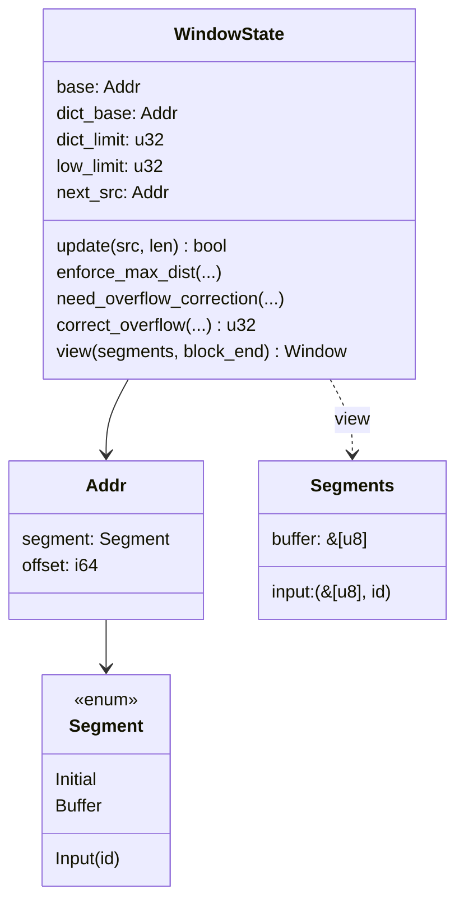

An `Addr` is a segment plus an offset that may lie outside the segment, as a
`base` pointer does. Indices (`u32`, as in C) are offsets from `base`; the
prefix is `[dict_limit, end)` relative to `base`, the extDict
`[low_limit, dict_limit)` relative to `dict_base`. `view` resolves both to
borrowed slices (`mem::Window`), whose `Mem` accessors take the reference's
indices directly, so match finders read `prefix.read32(index)` where C reads
`MEM_read32(base + index)`.

Window updates reproduce `ZSTD_window_update`: input contiguous with the
previous chunk (same segment, next offset) extends the prefix; anything else
turns the old prefix into the extDict and starts a new prefix. Overflow
correction (`ZSTD_window_correctOverflow`) rebases indices and
`MatchState::reduce_index` subtracts the correction from every table entry.
`OVERFLOW_CORRECT_FREQUENTLY`, set at build time by
`MZSTD_OVERFLOW_CORRECT_FREQUENTLY`, makes it run as early as the reference
built with `ZSTD_WINDOW_OVERFLOW_CORRECT_FREQUENTLY` (zstd-ffi's build script
reads the same variable), so the rarely reached path is testable.

## Block pipeline

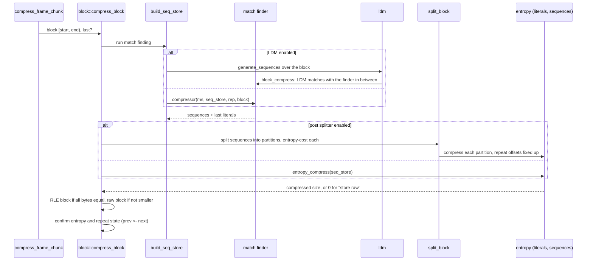

- `block::select_block_compressor` is `ZSTD_selectBlockCompressor`: the
  strategy, whether the row finder is in use, and the dictionary mode
  (`DictMode`: noDict, extDict, or dictMatchState while a dictionary is
  attached; `ZSTD_matchState_dictMode`) pick one function pointer, chosen
  once per block outside the finder's inner loop. Before each block
  `check_dict_validity` and `enforce_max_dist` may detach the dictionary.
- `seq_store` holds sequences in the reference's `SeqDef` form (offBase, a
  16-bit literal length and match length with one "long length" escape).
  `fill_codes(backend)` is one pass, dispatched once per block, that turns
  them into codes: one four-byte `SeqCodes` per sequence (the three FSE
  codes and the sequence's extra-bit count) and, in the same loop, the three
  code histograms (`CodeCounts`) that `ZSTD_buildSequencesStatistics`
  counts with three `HIST_countFast_wksp` passes. The long-length escape is
  patched afterwards for its one sequence, counts included. The codes buffer
  only grows and every entry below `nb_seq` is written before it is read.
  It is kept at four bytes a sequence on purpose: a 16-byte record holding
  precomputed extra bits pushed a cold one-shot call's peak heap past
  glibc's dynamic trim threshold, so every call returned and re-faulted
  about 2.7 MB (text-1m level 3 went from 0.69 ms to 1.03 ms).
- `entropy` is the reference's FSE and Huffman encoders: histogram counting,
  normalization, table building, the cost estimates used to choose between
  predefined, repeat, RLE and new tables, and the backward bit streams.
  - `hist::count` counts inputs below 1500 bytes straight into the caller's
    table (`HIST_count_simple`) and larger ones with four interleaved
    tables (`HIST_count_parallel_wksp`). It counts literals (and the
    optimal parser's and FSE weights' inputs); sequence code histograms
    come from `fill_codes`, read through `code_histogram`, which reports
    the largest code and count as `HIST_countFast_wksp` does.
  - `fse::CTable::build` takes the reference's branch-light spread when no
    symbol has the low-probability count, and sizes its scratch to the
    largest table it holds. Its state-table and spread loops mask indices
    (symbols below 64, positions below 512), which removes their bounds
    checks without changing any index.
  - `BitWriter` and the Huffman writer store each flushed word at
    `min(pos, end)` and leave `pos` unclamped; `close` reports "does not
    fit" when `pos` passed `end`, the reference's clamp result, while the
    store needs no bounds check.
  - `huf` packs each code with its length (`HUF_CElt`, built per call,
    branch-free over the whole alphabet in the backend's feature context;
    symbols the table does not describe pack to values never read) and encodes with the reference's
    two-container, unrolled loop, whose shape depends on the table log and
    on whether the destination holds the tight bound; every shape writes
    the bits the one-symbol-at-a-time writer writes (tested against it).
    Optimal-depth selection sorts and builds the unlimited tree once.
    Each subsequent depth trial restores leaf lengths from the unchanged
    internal-node heights before applying the reference's height limit;
    table pricing, tie order and the selected depth are unchanged.
  - `sequences::encode` walks codes and sequences backwards together. Each
    sequence's extra bits are assembled into one word (literal length,
    match length, offset, from the least significant bit; `SeqCodes::extra`)
    and added with one write when they number fewer than 31, the
    reference's own bound; otherwise the word is flushed in two parts.
    Flushes only move whole bytes out of the container, so where they fall
    does not change the stream; `fused_encoding_matches_the_reference_loop`
    checks every backend against a step-by-step port of
    `ZSTD_encodeSequences_body`.
- `literals::try_compress` reports a raw-literals fallback without copying
  it. If those raw bytes alone reach `block_size - min_gain`, entropy coding
  returns the raw-block decision immediately. This shortcut requires a
  destination large enough for the raw block; smaller caller-owned buffers
  follow the reference's original capacity/error path. A block with no
  sequences can still use Huffman literals, so the Huffman attempt is kept.
- `presplit` (`ZSTD_splitBlock`, by fingerprint distance) chooses block sizes
  before match finding for the strategies that enable it; `split_block`
  (`ZSTD_compressBlock_splitBlock`) splits the sequences of a finished block
  for the ultra levels.
- After a block, `prev` and `next` swap (`confirm_block_state`) unless the
  block was stored raw or RLE, which keeps the previous entropy tables and
  demotes repeat-mode state as the reference does.

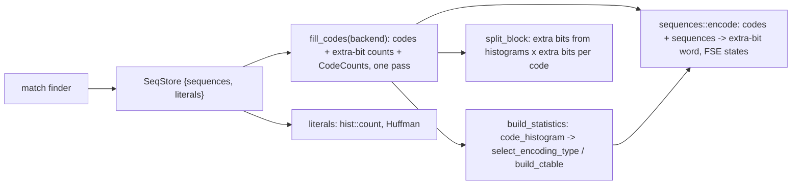

## Backend dispatch

The engine carries the compressor's `Backend` (a `fearless_simd::Level`
chosen once when the compressor is built); `Engine::with_backend` copies it
into `MatchState::backend` for the match finders. Dispatch happens once per
block at the top of each kernel, never inside a loop:

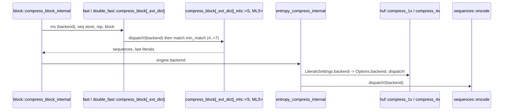

The kernels are `#[simd]` functions generic over the token, so their whole
body is compiled with the level's target features (BMI2, LZCNT and so on
on x86-64; the reference's BMI2 builds of the Huffman and sequence
encoders are the same idea). They use no vector types today. The scalar
fallback is `Backend::SCALAR` in the crate's tests, and every backend
writes the same bytes; `core::tests` and `core::stream_tests` compare every
backend of `Backend::available()` with the reference for levels -5..4, every
minimum match length, and the extDict variants.

## Match finders

| Strategy | Finder | Tables | extDict variant | dictMatchState variant |
| --- | --- | --- | --- | --- |
| fast | `fast` | hash | yes | `compress_block_dict_match_state` (tagged dictionary table) |
| dfast | `double_fast` | long hash, short hash | yes | `compress_block_dict_match_state` (tagged dictionary tables) |
| greedy, lazy, lazy2 | `lazy` hash chain, or row finder for windows above 16 KiB | hash, chain or tag rows | yes | `greedy_dms` .. `lazy2_row_dms` |
| btlazy2 | `lazy` with the DUBT binary tree | hash, tree | yes | `btlazy2_dms` (dictionary tree sorted by `ZSTD_updateTree`) |
| btopt, btultra, btultra2 | `opt` with the binary tree and price model | hash, tree, hash3, opt arrays | yes | `btopt_dms`, `btultra_dms` (also btultra2's) |

The dictMatchState variants run while a dictionary is attached
([dictionaries](dictionaries.md)): the block's own tables are searched as in
the noDict variant, then the dictionary's tables, read in place through
`BlockInput::dms` and translated to window indices by `dictIndexDelta`.
Each is a separate monomorphization (fast and dfast as separate kernels,
`lazy_dms_generic` and the optimal parser's `DMS` const parameter), so the
noDict and extDict code is unchanged; a dms entry reached without a
dictionary falls back to the noDict compressor. Ported details that differ
from the noDict kernels: fast's step starts at `targetLength + !targetLength`
and grows every 256 bytes, a dictionary candidate is tried when the
context's index is at or below the prefix start, dfast tries the
dictionary's short table when its short candidate is not strictly inside
the prefix, the dictionary's tagged tables are hashed with the context's
minimum match and the dictionary's hash log plus 8, and the lazy parser's
repeat-offset checks may read the dictionary (`ZSTD_index_overlap_check`)
without the saved-offset rotation.

`fast` and `dfast` are ported loop for loop but specialized the way the
reference's templates are:

- one instance per minimum match length (`ZSTD_GEN_FAST_FN`,
  `ZSTD_GEN_DFAST_FN`), so the hash width is a constant (`mem::hash_word`,
  `mem::hash_at`);
- `compress_block_mls` handles the repeat-offset setup and the
  saved-offset restore, then calls `compress_scan::<S, MLS, IN_PREFIX>`
  with a small `Scan` (dfast also a `Tables { long, small }`), which
  returns the trailing literals and the two repeat offsets;
- `IN_PREFIX` holds when the block starts in the prefix and both repeat
  offsets reach no further back than the prefix start from the block's
  first position. Every later repeat offset is then `ip - match` with the
  match in the prefix, so no read can go below the prefix: positions
  become offsets from the prefix start and the search loop drops the window
  base, the history pointer and its length. Otherwise the base-relative
  loop runs (`IN_PREFIX = false`);
- candidates are tested without a branch on their validity
  (`mem::matches32` / `matches64`, the reference's
  `ZSTD_match4Found_cmov` / `ZSTD_selectAddr`): an out-of-prefix or stale
  candidate reads a stand-in word chosen by the probed word's low bit
  (`DUMMIES`), which can never equal it, so only the equality compare
  branches. Stale and valid entries are about equally likely, which made
  the validity branch the finder's main source of mispredictions;
- the loops hold `&Cell<u32>` references to the hash slots they will write,
  which removes the bounds check on a table index carried across
  iterations;
- the exit tests share their bounds checks with the loads they guard:
  fast fetches the window at `ip2` with one 10-byte range check that is
  also its `ip2 + 1 < ilimit` test (`mem::probe_window`, `probe_pair`),
  dfast's 8-byte load at `ip1` (`mem::try_load64`) is its `ip1 <= ilimit`
  test;
- after a match, fast extends backwards without per-byte checks
  (`mem::common_suffix`), compares the first word of the forward length
  inline (`mem::count_at_simd`), and reads `ip0 - 2` once for both the
  hash insert and the first repcode compare;
- the extDict variants use the same prefix offsets, reading only
  candidates below the prefix from the external segment by window index;
- literals go to the sequence store through `SeqStore::store_seq_from`,
  which copies a run of at most 16 bytes as one fixed chunk
  (`ZSTD_copy16`) and cuts the excess.

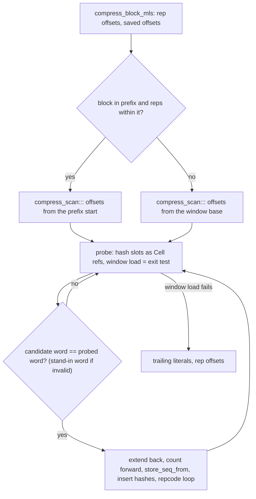

Match lengths (`mem::count_slices`, behind `Mem::count`/`count_with`)
compare the first word inline with an XOR and a trailing-zero count. Out of
line, `count_long` compares words up to 32 bytes, where most matches end,
then skips equal 32-byte chunks (their XORs OR-ed in vector registers), then
finds the difference a word at a time, finishing with one word that ends at
the limit. Run-length inputs, whose matches span whole blocks, spend their
time there. Fast/dfast and lazy search use `mem::count_slices_simd` in
the already-selected backend: the same short-word path, then 128-byte
chunks and a 32-byte cleanup loop. The XOR/OR reduction auto-vectorizes
to four AVX2 registers and one `vptest` per 128 bytes. The first differing
chunk is resolved in byte order with words; every load stays inside both
windows. The feature-entry wrapper is inlined, while the scan stays out
of the candidate loop.

`block::is_rle` (`ZSTD_isRLE`) decides whether a compressed block is
re-emitted as an RLE block. It compares `src[1..]` with
`src[..src.len() - 1]`: equal adjacent bytes imply a constant run. Slice
equality delegates the bulk scan to the platform comparison implementation.

### Lazy finders and SIMD dispatch

`lazy` holds one parser (`lazy_generic`, and `lazy_ext_generic` for an
extDict window) driving three searches. It is the only finder that uses the
engine's [`Backend`](../src/backend.rs) so far. The engine copies its backend
into `MatchState::backend` before each block (`block::build_seq_store`), and
each block compressor (`lazy::greedy_row`, `lazy::btlazy2_ext`, …) runs
`fearless_simd::dispatch!` once on it. Everything below that dispatch is
generic over the `S: Simd` token and runs with that level's target features:
the dispatch happens once per block, never per position.

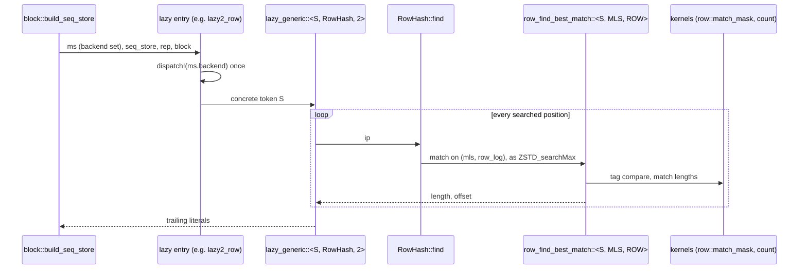

The parser is specialized on its search (the `Search` trait: `HashChain`,
`BinaryTree`, `RowHash`) and on its depth (greedy 0, lazy 1, lazy2 2). The
searches are specialized on the minimum match (4, 5 or 6) and the row finder
on its row size (16, 32 or 64 slots), and each search picks its
specialization with one `match` per call, as `ZSTD_searchMax` does. The row
and hash-chain searches are inlined into the parser. The binary tree stays
out of line behind `#[fearless_simd_macros::simd]`, which measured fewer
instructions. Candidate loops are specialized on whether the window has an
external dictionary (`EXT`), so the prefix-only case has no segment test.

Kernels, all safe code:

| Kernel | Reference | What it does |
| --- | --- | --- |
| `lazy::row::match_mask` | `ZSTD_row_getMatchMask` | One `u8x16`/`u8x32`/`u8x64` compare of a tag row with the tag, `to_bitmask`, then a rotation so bit 0 is the row's head. |
| `lazy::count::count`, `common_run` | `ZSTD_count` | Window adapters for the shared `mem::count_slices_simd` word and vector scan described above. |
| `Ctx::tree_step` | `ZSTD_count` + byte compare in the DUBT | Without an extDict, one 8-byte load per side gives both the common length and the two bytes that order the runs. |
| `Probe` | `MEM_read32(match + ml - 3) == MEM_read32(ip + ml - 3)` | Cuts the searched window once per search (to the block end, which can precede the prefix end under LDM), and keeps its probe word until `ml` changes. |

The row search keeps the reference's two phases: it collects the candidates,
inserts the searched position, and then measures them. A single fused pass
gives identical output but measured 15-20% slower, because collecting first
lets the candidates' loads overlap. Row tables are viewed as
`&mut [[u8; ROW]]` and `&mut [[u32; ROW]]`, cut to a common row count, so
one check of the row number covers both and slot indexes are masked.

Per block the parser builds the search's state (`Search::State<'t>`, from
`Search::state(ms, ctx)`) and keeps `lazy_skipping` locally, storing it
back into the match state at the block's end. The row finder's `RowState`
holds:

- the tag and slot tables viewed from their first 64-byte boundary
  (`aligned_rows`). `MatchState` gives both tables `ROW_TABLE_SLACK` (64)
  extra entries in row mode. glibc returns large blocks 16 bytes past a
  page, so unaligned, half of the 32-byte tag rows crossed a cache line and
  every 128-byte slot row spanned three; the reference's workspace aligns
  them to 64 bytes. Moving the view cannot change a frame: a search only
  follows entries written since indices were last invalidated, and older
  ones fall below `lowLimit` and end the walk as zeros would;
- the hash cache, a local `next_to_update` written back on `Drop`, the
  precomputed hash bits, low-limit inputs and number of attempts;
- a persistent 64-entry candidate buffer, so no row-sized array is zeroed
  per search.

The update loop cuts the words once for the whole range and walks them with
`windows(8)` (a cold per-index fallback covers the end), and steps the row
head through a 256-entry constant table per row size instead of the wrap the
compiler turned into a branch. The tag mask clears slot 0 before rotating, so
collection has no per-candidate head test, and when the attempts reach the
row size the loop keeps no attempts counter. Each collected candidate is
prefetched (`PREFETCH_L1(base + matchIndex)`), as the reference does.
`best_prefix_candidate` measures prefix candidates: the probe word is
compared against a prefix slice shifted by the best length, the first eight
bytes inline, stopping when the next probe word would leave the block.

btlazy2's DUBT inserts nodes from one cut word slice and writes each node
pair in one store. Prefix tree walks use `TreeRun`, which cuts the run once
and counts up to four words inline, ordering the runs with a byte-swapped
compare; longer runs continue in `long_tree_step`, out of line, with the
vector scan (word-at-a-time counting of run-length input, whose matches span
whole blocks, made levels 13-15 on 1 MiB of repeated bytes 18% slower); `TreeLinks` picks the side with `select_unpredictable` (the side
is close to a coin flip) and writes the dummy link to a `NO_LINK` sentinel,
so its write check doubles as the bounds check. ExtDict walks use
`Ctx::ext_tree_step`.

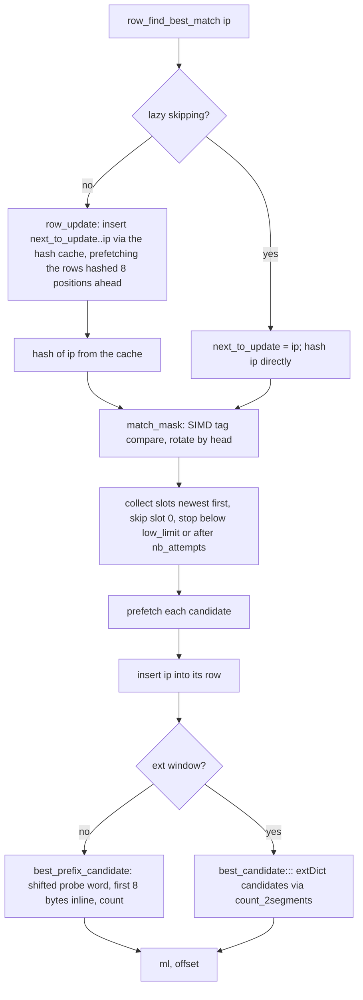

With an attached dictionary, `lazy_dms_generic` drives the same searches
through `Search::find_dms`, which spends the attempts the context's search
left on the dictionary's tables:

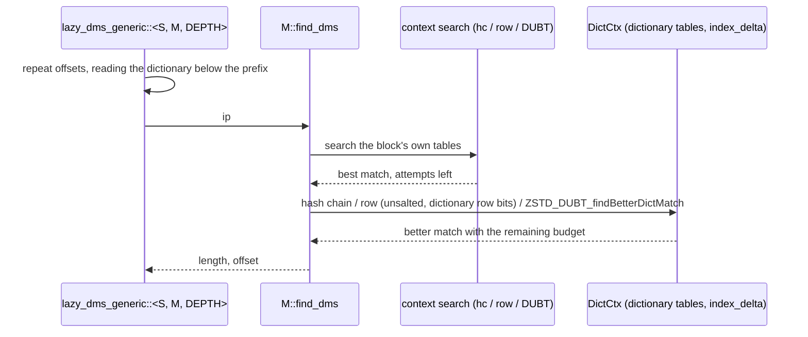

`DictCtx` is built once per block from `BlockInput::dms`: the dictionary's
tables (row tables through `aligned_range`), its bytes, bounds and
`index_delta`. btlazy2 stops searching the dictionary when the context's
walk reached the block end (the reference zeroes `nbCompares`); the other
searches always continue into it.

Every backend in `Backend::available()`, including the scalar fallback that
unit tests add, must produce the reference's bytes. `lazy::tests` checks
levels 5–15, every search specialization, the extDict variants, and LDM
sub-blocks on each backend against `zstd_ffi::oracle`. The kernel tests
compare `match_mask` and `count` with scalar references at every row head
and at vector and word boundaries.

`opt` is the optimal parser: it collects every match at each position
(`get_all_matches` with a `MatchQuery`), prices literals and matches from the
current statistics (`OptState`, initialized from the previous block or, for
btultra2's first block, by a throwaway first pass), and backtracks the
cheapest path. LDM candidates enter as extra matches.
It dispatches to the block's SIMD backend (`BlockInput::backend`) once per
block, specializes the tree search by minimum match length, and keeps its
prices in tables patched as the statistics change; see
[Optimal parser](optimal-parser.md).

`ldm` is long distance matching: a gear rolling hash (`ldm_geartab`) samples
positions, a bucketed table stores them, and matches found far back become
raw sequences that `block_compress` interleaves with the regular finder's
output. LDM keeps its own window (`LdmState::window`) over the same segments. It
takes the backend as an argument of `generate_sequences` and counts match
lengths with the optimal parser's kernels (`opt_count`).

## Streaming

`stream::Stream` is `ZSTD_compressStream2` in buffered mode on top of the
engine.

```mermaid
stateDiagram-v2
    [*] --> Init
    Init --> Load: first call (init with pledged size and operation)
    Load --> Load: copy input into in_buff until a block is full
    Load --> Flush: block compressed into out_buff (or straight into output)
    Flush --> Load: out_buff drained, frame continues
    Flush --> Init: out_buff drained after the epilogue
    Load --> Init: End shortcut (whole remaining input compressed directly)
    Init --> Init: reset_session on error
```

The input buffer is a ring of window size plus one block; blocks are taken
from it, so its wrap-around is what makes the engine see an extDict. When
the reference's shortcut condition holds — an `End` call, an empty input
buffer, and an output with room for `compressBound` of the remaining input —
the input is compressed straight from the caller's memory into the caller's
output, which changes the bytes and is reproduced. A first call that is
already `End` also pledges the input size, so the header records it; the
public session rejects that call first when its length contradicts a
declared size (see [compressor](compressor.md#sessions)).
`StreamStep` reports bytes consumed, produced and still buffered.

## Destinations

The engine writes frames through `output::Output::prepare(position,
needed)`, which returns the writable tail at `position`; `needed` is the
largest amount the next write can take (a frame header, `compressBound` of
the next block, the epilogue). `SliceOutput` returns the caller's exact
tail. `VecOutput` and `UninitOutput` initialize only up to
`min(position + needed, limit)`, so the encoder sees either at least a
block's bound or the exact remaining capacity, the two cases in which its
capacity checks behave as with the whole slice. `UninitOutput` keeps a
`borrowed_buf::BorrowedBuf` over the caller's `MaybeUninit` bytes, zeroes
its filled prefix forward and hands out `filled_mut()[position..]`, so no
`unsafe` code is involved and each byte is zeroed at most once per call.

`Stream::compress` is generic over `output::Destination`, implemented for
`[u8]` and `[MaybeUninit<u8>]`. Its `tail(at)` is the `Output` for blocks
written straight to the caller (the shortcut and `direct` blocks), and
`put(at, bytes)` copies what was compressed into `out_buff`. The `[u8]`
instance compiles to the code the stream had before the abstraction.

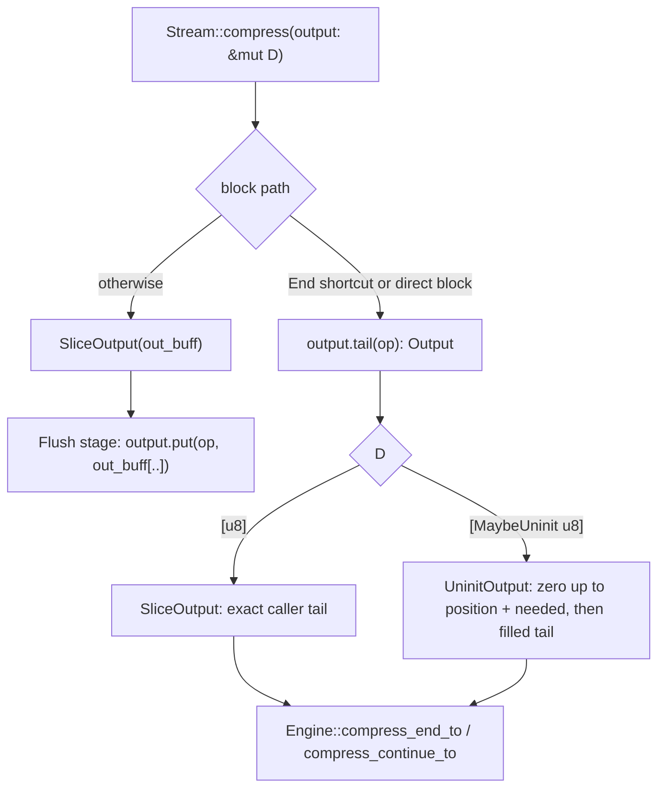

## Errors

`CoreError` mirrors the reference's error codes the encoder can raise
(`dstSize_tooSmall`, `srcSize_wrong`, `stage_wrong`, parameter errors, table
construction failures). It never leaves the crate: `EncodeError::from_core`
maps it, and sessions turn an unexpected `DstSizeTooSmall` (their internal
buffers are always large enough) into `EncodeError::Internal`.

## Invariants

- Indices are `u32` and wrap exactly as in C; `Addr` arithmetic is `i64` so
  that "pointer below the segment" states exist without overflow.
- Every table read is bounds-checked (safe Rust only); a bounds failure would
  be a panic, so the fuzz targets and differential tests double as checks
  that the reference's index invariants hold here too. Where an index is
  masked to its table size instead (finder hash tables, FSE state and symbol
  tables, Huffman tree nodes), the mask is the identity for every index the
  reference's invariants allow.
- Kernels never re-detect the SIMD level: the backend is fixed when the
  compressor is built and dispatched once per block.
- Parameters are validated before `begin`; the core assumes they are in
  range.

## Known gaps

- SIMD: the lazy finders compare row tags with one vector compare;
  fast/dfast and lazy search share the 128-byte match-length scan. The
  optimal parser and LDM use native-vector kernels (`opt_count`). The entropy
  coders run in the backend's feature context without explicit vector code.
  Histogram counting is scalar. Output is identical on every backend.
- See the [benchmarks](../docs/benchmarks/encoder-comparison.md) for the
  current end-to-end ratios. Text at the fast levels and the lazy levels
  6–12 still trails the reference. The fast kernel executes about 1.5x the
  reference's instructions on Alice (loop-carried positions spill, and
  each match costs about 140 instructions against 92, `store_seq_from`
  about 50 against 28); its speed comes from fewer branch mispredictions.
  The lazy finders now run at or below the reference's instruction count
  and remain 2–8% slower on text for reasons not yet attributed (no
  hardware counters under WSL2).
- Fast's branch-free candidate check costs about 5-8% on random 64 KiB
  input at levels -5 to 1 (still at or above the reference's speed there),
  where the validity branch it replaces predicts well; it is kept for its
  gain on text.
- The row finder issues the reference's row prefetches (`ZSTD_row_prefetch`
  from `ZSTD_row_fillHashCache` and `ZSTD_row_nextCachedHash`, 8 positions
  ahead) and its per-candidate prefetch through the `branches` crate's safe
  `prefetch_read_data`. The hash chain and binary tree have no prefetch
  points outside dictionary modes, so none are ported.
- A cold one-shot call's heap footprint sits close to glibc's dynamic trim
  threshold on 1 MiB inputs; growing per-call allocations by a few hundred
  KiB makes every call return and re-fault the heap top (see
  `fill_codes`).
- The reference also resets indices when it reallocates its workspace for
  larger parameters; mzstd resets them only on first use or near
  `ZSTD_CURRENT_MAX`. Frames are unaffected — a reused reference context
  writes the same bytes as a fresh one (`zstd-ffi/tests/reuse_probe.rs`),
  and so does a reused mzstd engine — but internal index values differ from
  a reused reference context's.
- Allocation sizes do not follow the reference's workspace accounting.
- Platform constants are the reference's 64-bit ones (`ZSTD_CURRENT_MAX`,
  `ZSTD_WINDOWLOG_MAX`). On 32-bit targets mzstd still writes what a 64-bit
  build of the reference writes; a 32-bit build of the reference caps the
  window at 2^30 and corrects overflow earlier, so their frames can differ
  for very large windows or inputs.
