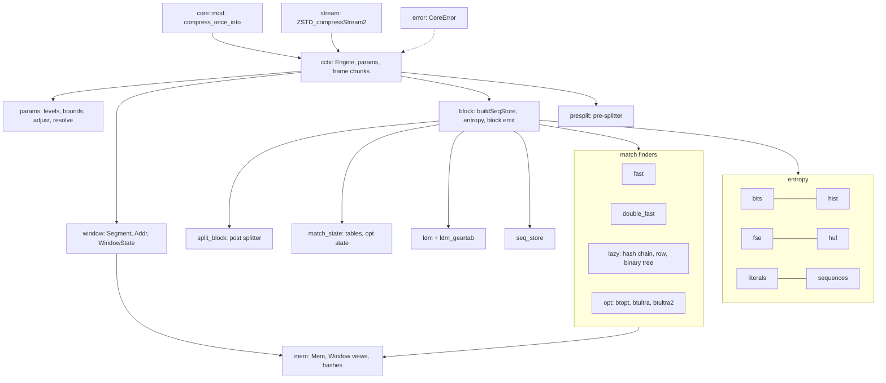
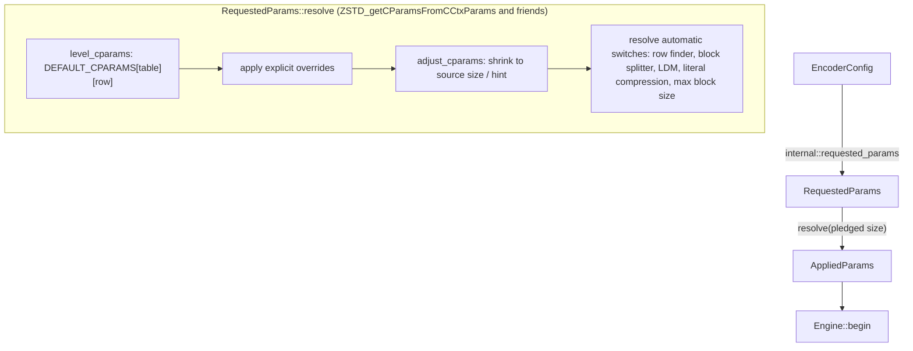
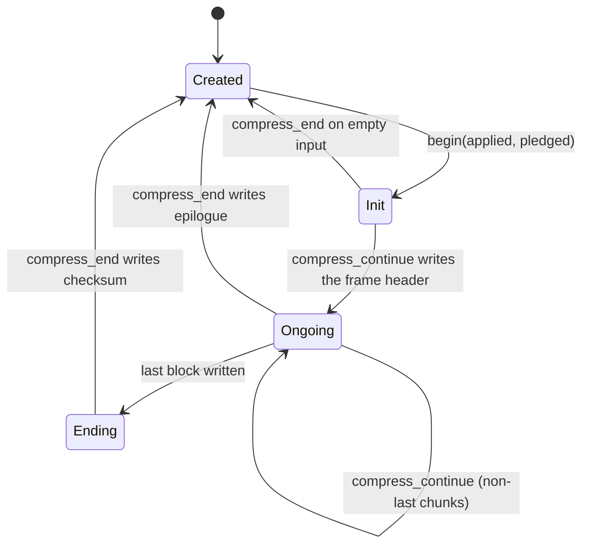
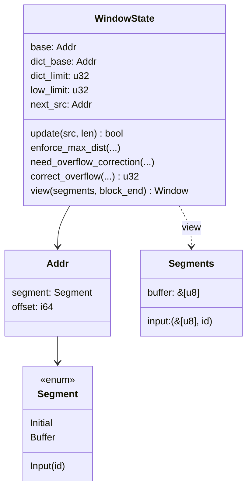
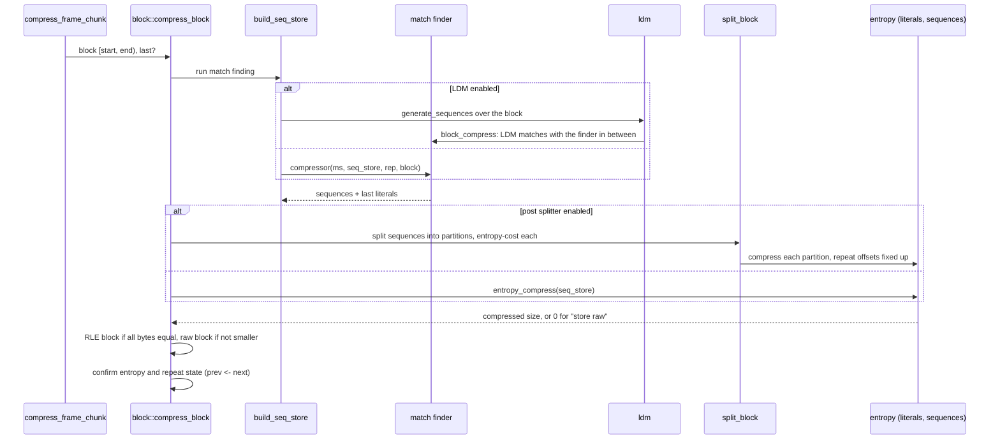
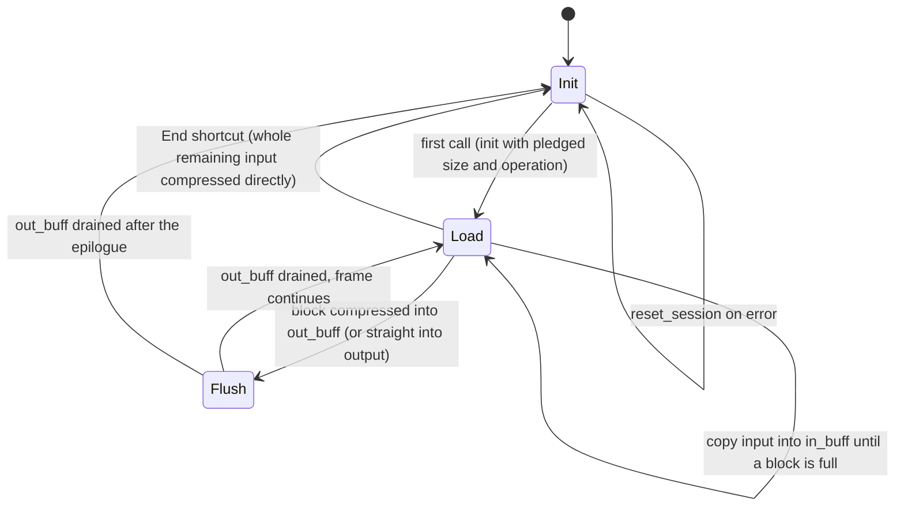

# Encoder core

`compressor::core` is a port of zstd 1.5.7's `lib/compress` restricted to
what mzstd exposes: no dictionaries, no multithreading, no external sequence
producers. Its one obligation is byte identity: for the same parameters,
input and call sequence it writes the bytes the reference writes. Every
function names its C counterpart in its doc comment, and control flow follows
the C code closely, including heuristics that look arbitrary, because any
deviation changes some frame.

## Module map

## Parameters

`params` holds the level tables from `clevels.h` (four tables by source size),
the parameter bounds, `ZSTD_adjustCParams_internal`, the cycle log and the
automatic switches. A size hint (`ZSTD_c_srcSizeHint`) and a pledged size feed
table selection and window shrinking exactly as in the reference; a level of
0 means 3, negative levels use the fast row with `target_length` as the
acceleration.

## Engine lifecycle

`cctx::Engine` is `ZSTD_CCtx` without the streaming buffers.

`begin` is `ZSTD_resetCCtx_internal`: it derives the block size from the
window and the pledged size, resets indices on first use or when they come
within 16 MiB of `ZSTD_CURRENT_MAX` (`ZSTD_indexTooCloseToMax`), sizes and
clears the match state's tables, and resets the entropy tables, the repeat
offsets, the checksum and the LDM state.

`compress_continue` is `ZSTD_compressContinue_internal`: it writes the
header once, updates the window, then `compress_frame_chunk` cuts the input
into blocks (optionally with the pre-splitter's block sizes), runs overflow
correction and `enforce_max_dist` before each block, and emits each block
through `block::compress_block`.

## Addresses and the window

The reference compares raw pointers into up to three regions: its own input
buffer, the caller's input and the static placeholder a fresh window starts
with. Safe Rust cannot, so `window` models them:

An `Addr` is a segment plus an offset that may lie outside the segment, as a
`base` pointer does. Indices (`u32`, as in C) are offsets from `base`; the
prefix is `[dict_limit, end)` relative to `base`, the extDict
`[low_limit, dict_limit)` relative to `dict_base`. `view` resolves both to
borrowed slices (`mem::Window`), whose `Mem` accessors take the reference's
indices directly, so match finders read `prefix.read32(index)` where C reads
`MEM_read32(base + index)`.

Window updates reproduce `ZSTD_window_update`: input contiguous with the
previous chunk (same segment, next offset) extends the prefix; anything else
turns the old prefix into the extDict and starts a new prefix. Overflow
correction (`ZSTD_window_correctOverflow`) rebases indices and
`MatchState::reduce_index` subtracts the correction from every table entry.
`OVERFLOW_CORRECT_FREQUENTLY`, set at build time by
`MZSTD_OVERFLOW_CORRECT_FREQUENTLY`, makes it run as early as the reference
built with `ZSTD_WINDOW_OVERFLOW_CORRECT_FREQUENTLY` (zstd-ffi's build script
reads the same variable), so the rarely reached path is testable.

## Block pipeline

- `block::select_block_compressor` is `ZSTD_selectBlockCompressor`: the
  strategy, whether the row finder is in use, and whether the window has an
  extDict pick one function pointer, chosen once per block outside the
  finder's inner loop.
- `seq_store` holds sequences in the reference's `SeqDef` form (offBase, a
  16-bit literal length and match length with one "long length" escape) and
  converts them to codes (`fill_codes`).
- `entropy` is the reference's FSE and Huffman encoders: histogram counting,
  normalization, table building, the cost estimates used to choose between
  predefined, repeat, RLE and new tables, and the backward bit streams.
- `presplit` (`ZSTD_splitBlock`, by fingerprint distance) chooses block sizes
  before match finding for the strategies that enable it; `split_block`
  (`ZSTD_compressBlock_splitBlock`) splits the sequences of a finished block
  for the ultra levels.
- After a block, `prev` and `next` swap (`confirm_block_state`) unless the
  block was stored raw or RLE, which keeps the previous entropy tables and
  demotes repeat-mode state as the reference does.

## Match finders

| Strategy | Finder | Tables | extDict variant |
| --- | --- | --- | --- |
| fast | `fast` | hash | yes |
| dfast | `double_fast` | long hash, short hash | yes |
| greedy, lazy, lazy2 | `lazy` hash chain, or row finder for windows above 16 KiB | hash, chain or tag rows | yes |
| btlazy2 | `lazy` with the DUBT binary tree | hash, tree | yes |
| btopt, btultra, btultra2 | `opt` with the binary tree and price model | hash, tree, hash3, opt arrays | yes |

`opt` is the optimal parser: it collects every match at each position
(`get_all_matches` with a `MatchQuery`), prices literals and matches from the
current statistics (`OptState`, initialized from the previous block or, for
btultra2's first block, by a throwaway first pass), and backtracks the
cheapest path. LDM candidates enter as extra matches.

`ldm` is long distance matching: a gear rolling hash (`ldm_geartab`) samples
positions, a bucketed table stores them, and matches found far back become
raw sequences that `block_compress` interleaves with the regular finder's
output. LDM keeps its own window (`LdmState::window`) over the same segments.

## Streaming

`stream::Stream` is `ZSTD_compressStream2` in buffered mode on top of the
engine.

The input buffer is a ring of window size plus one block; blocks are taken
from it, so its wrap-around is what makes the engine see an extDict. When
the reference's shortcut condition holds — an `End` call, an empty input
buffer, and an output with room for `compressBound` of the remaining input —
the input is compressed straight from the caller's memory into the caller's
output, which changes the bytes and is reproduced. A first call that is
already `End` also pledges the input size, so the header records it.
`StreamStep` reports bytes consumed, produced and still buffered.

## Errors

`CoreError` mirrors the reference's error codes the encoder can raise
(`dstSize_tooSmall`, `srcSize_wrong`, `stage_wrong`, parameter errors, table
construction failures). It never leaves the crate: `EncodeError::from_core`
maps it, and sessions turn an unexpected `DstSizeTooSmall` (their internal
buffers are always large enough) into `EncodeError::Internal`.

## Invariants

- Indices are `u32` and wrap exactly as in C; `Addr` arithmetic is `i64` so
  that "pointer below the segment" states exist without overflow.
- Every table read is bounds-checked (safe Rust only); a bounds failure would
  be a panic, so the fuzz targets and differential tests double as checks
  that the reference's index invariants hold here too.
- Parameters are validated before `begin`; the core assumes they are in
  range.

## Known gaps

- No SIMD: the reference's vectorized paths (row finder tag matching,
  histogram counting) are scalar here. Output is identical; speed is not a
  goal yet, and there is no runtime dispatch layer (`Backend`).
- The reference also resets indices when it reallocates its workspace for
  larger parameters; mzstd resets them only on first use or near
  `ZSTD_CURRENT_MAX`. Frames are unaffected — a reused reference context
  writes the same bytes as a fresh one (`zstd-ffi/tests/reuse_probe.rs`),
  and so does a reused mzstd engine — but internal index values differ from
  a reused reference context's.
- Allocation sizes do not follow the reference's workspace accounting.
- Platform constants are the reference's 64-bit ones (`ZSTD_CURRENT_MAX`,
  `ZSTD_WINDOWLOG_MAX`). On 32-bit targets mzstd still writes what a 64-bit
  build of the reference writes; a 32-bit build of the reference caps the
  window at 2^30 and corrects overflow earlier, so their frames can differ
  for very large windows or inputs.
