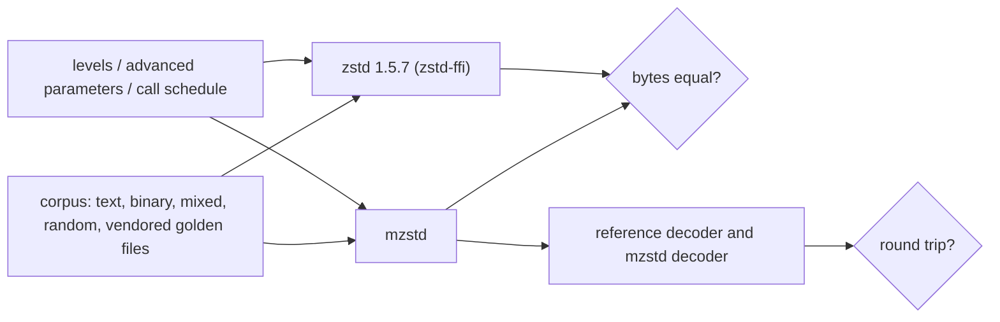

# Encoder verification

The encoder's contract is byte identity with zstd 1.5.7. The reference is
built from the vendored submodule by `zstd-ffi` and is used only in tests,
benchmarks and fuzzing. `zstd_ffi::oracle` wraps it in safe functions, and
`zstd_ffi::corpus` generates reproducible inputs.



## Oracle mapping

| mzstd | Reference |
| --- | --- |
| `Compressor::compress` and the other one-shot calls | `ZSTD_compress2` with the same `ZSTD_c_*` parameters (`oracle::compress2`, `compress2_capacity`) |
| `EncoderSession::process` sequences | `ZSTD_compressStream2` with the same chunks, output capacities and directives (`oracle::compress_stream`, `compress_stream_with_output`) |
| `mzstd_compress` | `ZSTD_compress` (`oracle::compress`, `compress_capacity`) |
| `mzstd_compress_bound`, `Compressor::max_compressed_size` | `ZSTD_compressBound` |
| entropy stages (unit tests) | `FSE_normalizeCount`, `FSE_optimalTableLog`, `HUF_buildCTable`, `HUF_optimalTableLog` through `zstd-ffi/shim/zstd_shim.c` |
| resolved parameters (unit tests) | `ZSTD_CCtxParams` after `ZSTD_CCtx_init_compressStream2`, through the shim |

## Suites

| Suite | What it establishes |
| --- | --- |
| `core::tests` | Levels 1 to 22 and -1, -2, -5, -100 and -131072 on the standard corpus match `ZSTD_compress2`. This exercises the pre-splitter, the post splitter, btultra2's first-block pass, and RLE and raw blocks. |
| `core::advanced_tests` | Random advanced configurations match (300 per release run; `MZSTD_CASES` and `MZSTD_SEED` widen and vary the run): window, hash, chain and search logs, minimum match, target length, strategy, LDM parameters, frame flags. Also LDM sequences cut at block boundaries. |
| `core::stream_tests` | Streams match `ZSTD_compressStream2` for random chunk and flush schedules, pledged sizes, windows that wrap (extDict), and small windows that select every hash-chain and binary-tree extDict finder. |
| Stage unit tests | Histogram, FSE and Huffman tables, the bit writer, sequence codes, parameter tables and bounds, window updates and overflow correction, index reduction, and frame header layout. |
| `tests/compressor_identity.rs` | The public API produces the reference's bytes for one-shot calls and sessions, including `Compressor::default`. |
| `tests/parallel.rs` | Parallel frames decode and do not depend on the task count or order; batch task failures, abandonment and leaks. |
| `tests/parallel_stream.rs` | Parallel sessions: byte identity with the batch for any chunking and window, the serial fallback, windows, ordered delivery, flushes, declared sizes, closed queues, abandoned tasks, `process_uninit` and the owned session. |
| `tests/parallel_io.rs` | `ParallelEncoderWriter` and `ParallelEncoderReader`: batch identity, flushes, short and refusing sinks, `FinishError` retries, source failures, closed queues and `into_parts`. |
| `zstd-ffi/tests/reuse_probe.rs` | A reused reference context writes the same frames as a fresh one, which justifies comparing a reused mzstd engine against fresh reference calls. |
| `mzstd-ffi/tests/c_abi.rs` | The C ABI matches `ZSTD_compress`, including short destinations. |
| fuzz targets | See [fuzzing](fuzzing.md). |

## Overflow correction mode

Index overflow correction normally needs gigabytes of input. Building with
`MZSTD_OVERFLOW_CORRECT_FREQUENTLY=1` makes both sides run it as early as
possible: mzstd through `window::OVERFLOW_CORRECT_FREQUENTLY`, and the C
library through `ZSTD_WINDOW_OVERFLOW_CORRECT_FREQUENTLY`, which zstd-ffi's
build script sets from the same variable. The same differential suites then
cover the correction path:

```sh
MZSTD_OVERFLOW_CORRECT_FREQUENTLY=1 CARGO_TARGET_DIR=target-ocf \
    cargo test --release --lib compressor::core
```

## Running

The suites are slow without optimizations. Run them with `--release`:

```sh
cargo test --workspace --release
CARGO_INCREMENTAL=1 cargo llvm-cov --workspace --release --summary-only --ignore-filename-regex '/zstd-ffi/|/vendor/'
```

`CARGO_INCREMENTAL=1` matters. Without incremental compilation, a release
build copies small functions into each test binary that calls them, and
calls through those copies are not credited to `src/`. The report then shows
public functions as missed even though tests call them.

## Known gaps

- Comparing against the reference catches any change in output. It cannot
  show that the reference's own heuristics are good.
- Inputs above a few megabytes are covered only by the parallel tests and
  the overflow-correction mode, not by the level matrix.
