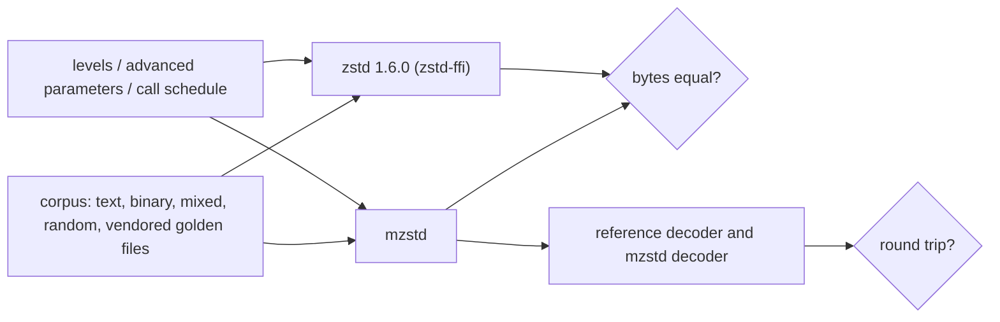
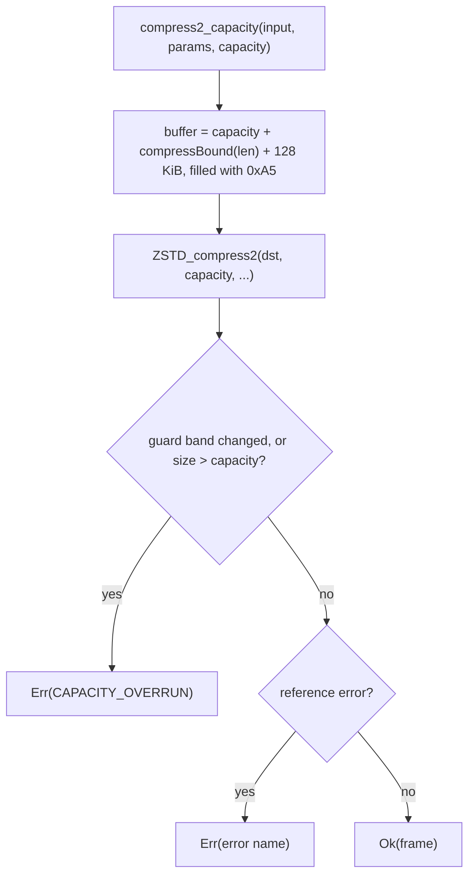

# Encoder verification

The encoder's contract is byte identity with zstd 1.6.0. The reference is
built from the vendored submodule by `zstd-ffi` and is used only in tests,
benchmarks and fuzzing. `zstd_ffi::oracle` wraps it in safe functions, and
`zstd_ffi::corpus` generates reproducible inputs.



## Oracle mapping

| mzstd | Reference |
| --- | --- |
| `Compressor::compress` and the other one-shot calls | `ZSTD_compress2` with the same `ZSTD_c_*` parameters (`oracle::compress2`, `compress2_capacity`) |
| `EncoderSession::process` sequences | `ZSTD_compressStream2` with the same chunks, output capacities and directives (`oracle::compress_stream`, `compress_stream_with_output`) |
| `mzstd_compress` | `ZSTD_compress` (`oracle::compress`, `compress_capacity`) |
| `mzstd_compress_bound`, `Compressor::max_compressed_size` | `ZSTD_compressBound` |
| entropy stages (unit tests) | `FSE_normalizeCount`, `FSE_optimalTableLog`, `HUF_buildCTable`, `HUF_optimalTableLog` through `zstd-ffi/shim/zstd_shim.c` |
| resolved parameters (unit tests) | `ZSTD_CCtxParams` after `ZSTD_CCtx_init_compressStream2`, through the shim |

## Suites

| Suite | What it establishes |
| --- | --- |
| `core::tests` | Levels 1 to 22 and -1, -2, -5, -100 and -131072 on the standard corpus match `ZSTD_compress2`. This exercises the pre-splitter, the post splitter, btultra2's first-block pass, and RLE and raw blocks. |
| `core::advanced_tests` | Random advanced configurations match (300 per release run; `MZSTD_CASES` and `MZSTD_SEED` widen and vary the run): window, hash, chain and search logs, minimum match, target length, strategy, LDM parameters, frame flags. Also LDM sequences cut at block boundaries. |
| `core::stream_tests` | Streams match `ZSTD_compressStream2` for random chunk and flush schedules, pledged sizes, windows that wrap (extDict), and small windows that select every hash-chain and binary-tree extDict finder. |
| Stage unit tests | Histogram, FSE and Huffman tables, the bit writer, sequence codes, parameter tables and bounds, window updates and overflow correction, index reduction, and frame header layout. |
| `tests/compressor_identity.rs` | The public API produces the reference's bytes for one-shot calls and sessions, including `Compressor::default`. |
| `tests/parallel.rs` | Parallel frames decode and do not depend on the task count or order; batch task failures, abandonment and leaks. |
| `tests/parallel_stream.rs` | Parallel sessions: byte identity with the batch for any chunking and window, the serial fallback, windows, ordered delivery, flushes, declared sizes, closed queues, abandoned tasks, `process_uninit` and the owned session. |
| `tests/parallel_io.rs` | `ParallelEncoderWriter` and `ParallelEncoderReader`: batch identity, flushes, short and refusing sinks, `FinishError` retries, source failures, closed queues and `into_parts`. |
| `zstd-ffi/tests/reuse_probe.rs` | A reused reference context writes the same frames as a fresh one, which justifies comparing a reused mzstd engine against fresh reference calls. |
| `mzstd-ffi/tests/c_abi.rs` | The C ABI matches `ZSTD_compress`, including short destinations. |
| fuzz targets | See [fuzzing](fuzzing.md). |

## Reference version

The oracle is whatever `zstd-ffi/vendor/zstd` pins (`zstd_ffi::UPSTREAM_VERSION`,
checked by `ZSTD_versionNumber` in `zstd-ffi/tests/smoke.rs`). The move from
1.5.7 to 1.6.0 changed single-threaded output in these places, each ported
and covered by a test that fails against the old behaviour (the last row is a
reference fix that mzstd already matched):

| 1.6.0 change | Frames affected | mzstd | Test |
| --- | --- | --- | --- |
| `ZSTD_ldm_gear_reset` keeps its hash | every LDM frame | `ldm::Gear::reset` | `lazy::tests::every_backend_matches_the_reference_with_long_distance_matching`, `advanced_tests`, `ldm::tests::gear_reset_keeps_the_hash_of_the_fed_bytes` |
| LDM hash log for `windowLog <= hashRateLog` | LDM with a small window and explicit hash rate | `cctx::LdmParams::adjust` | `cctx::tests::ldm_hash_log_of_a_window_within_the_hash_rate_is_the_minimum` |
| dictionary LL/ML tables over the full alphabet | btopt+ with a dictionary whose length tables leave out codes | `cdict::load_c_entropy` | `cdict::tests::partial_length_tables_price_absent_symbols_like_the_reference` |
| `ZSTD_freqFromBitCost` | btopt+ with a dictionary whose Huffman codes reach 12 bits | `opt::freq_from_bit_cost` | `cdict::tests::literal_codes_deeper_than_the_price_scale_take_the_minimum_frequency` |
| repeat offsets checked against a CDict's kept suffix | fast/dfast dictionaries over 2^24 - 2 bytes | `cdict::insert_dictionary` | `cdict::tests::repeat_offsets_past_a_truncated_dictionary_are_corrupted` |
| block split budget checked after the first half | blocks with more than 196 profitable splits | `split_block::derive_splits_helper` | `split_block::tests::many_short_matches_stop_at_the_split_budget` |
| chunk long length bound `< end` | none (code one past the chunk) | `SeqStore::chunk` | `split_block::tests::chunks_keep_a_long_length_only_inside_their_range` |
| sub-block writers check the room left (#4981) | `targetCBlockSize` into a destination smaller than the frame: 1.5.7 wrote past it, 1.6.0 fails or stores the block | already `superblock` (no change) | `compressor_target_block::capacities_the_reference_overran_fail_with_output_too_small`, `oracle_capacity_overrun` |

The rest of 1.6.0's `lib/compress` changes are multithreading, the
sequence-producer and `compressSequences*` APIs (not ported), memory
estimates, error checks for inputs mzstd's API cannot form, and SIMD
(SVE2, NEON, RVV) kernels whose results equal the scalar ones.

## Overflow correction mode

Index overflow correction normally needs gigabytes of input. Building with
`MZSTD_OVERFLOW_CORRECT_FREQUENTLY=1` makes both sides run it as early as
possible: mzstd through `window::OVERFLOW_CORRECT_FREQUENTLY`, and the C
library through `ZSTD_WINDOW_OVERFLOW_CORRECT_FREQUENTLY`, which zstd-ffi's
build script sets from the same variable. A fuzzing toolchain's
`-DFUZZING_BUILD_MODE_UNSAFE_FOR_PRODUCTION` does not turn it on, because
the build script undefines that macro in the oracle (see
[fuzzing](fuzzing.md#the-oracle-build-under-fuzzing-toolchains)). The same
differential suites then cover the correction path:

```sh
MZSTD_OVERFLOW_CORRECT_FREQUENTLY=1 CARGO_TARGET_DIR=target-ocf \
    cargo test --release --lib compressor::core
```

## Running

The suites are slow without optimizations. Run them with `--release`:

```sh
cargo test --workspace --release
CARGO_INCREMENTAL=1 cargo llvm-cov --workspace --release --summary-only --ignore-filename-regex '/zstd-ffi/|/vendor/'
```

`CARGO_INCREMENTAL=1` matters. Without incremental compilation, a release
build copies small functions into each test binary that calls them, and
calls through those copies are not credited to `src/`. The report then shows
public functions as missed even though tests call them.

## Destinations the reference overruns

zstd 1.5.7 did not always stay inside the destination of a one-shot call.
With `ZSTD_c_targetCBlockSize`, `ZSTD_compress2` compresses straight into
the caller's buffer, and the sub-block writer copied the Huffman and FSE
table descriptions without checking the room left; the writers after it
then saw a wrapped-around capacity. zstd 1.6.0 checks the room before each
copy (#4981) and returns `dstSize_tooSmall`, which
`ZSTD_compressBlock_targetCBlockSize_body` turns into a stored block or a
failure, as mzstd's `superblock` always did. `oracle::compress2_capacity` still
allocates the capacity plus a guard band of `ZSTD_compressBound(len)` and
one block, fills it with a marker byte, passes only the capacity to the
reference, and reports `CAPACITY_OVERRUN` when the band changed or the
reported size exceeds the capacity. Streaming calls are not affected: the
reference compresses into its own buffer unless the room left covers
`ZSTD_compressBound` of the input.



mzstd never writes past its destination. At every capacity 1.5.7 overran
it returns `EncodeError::OutputTooSmall`, and 1.6.0 now fails there too, so
the two agree at every capacity and no capacity overruns
(`tests/compressor_target_block.rs`,
`capacities_the_reference_overran_fail_with_output_too_small`, and
`zstd-ffi/tests/oracle_capacity_overrun.rs`). The comparisons still treat
an overrun as the reference failing, so a regression in the reference shows
up as a test failure rather than heap corruption.

## Known gaps

- Comparing against the reference catches any change in output. It cannot
  show that the reference's own heuristics are good.
- Inputs above a few megabytes are covered only by the parallel tests and
  the overflow-correction mode, not by the level matrix.

## OpenZL integration

`tests/openzl_binding.rs` compares the calls OpenZL's zstd node makes
(magicless frames, parameters by ID, the per-element flush stream, referenced
`ZSTD_CDict`s, `ZSTD_getCParams`, `ZSTD_compressBound`) with the oracle shim
`mzstd_shim_openzl_encode` byte for byte; see
[OpenZL integration](openzl-integration.md#verification).
