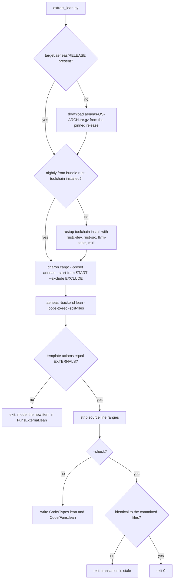
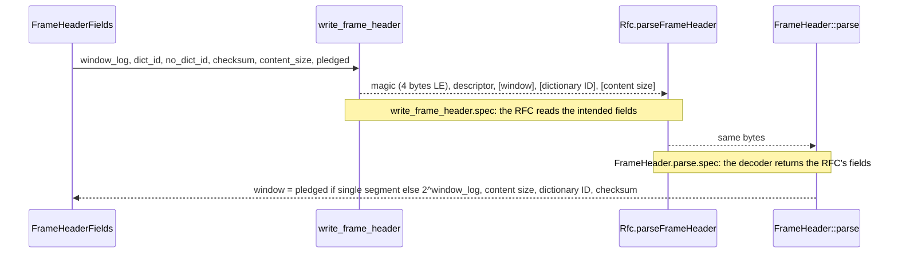
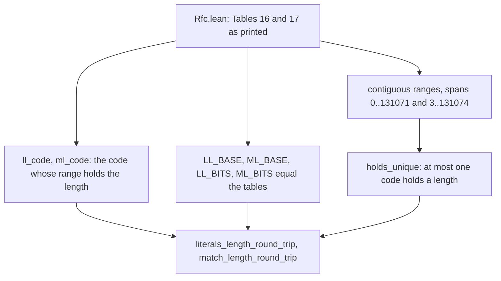
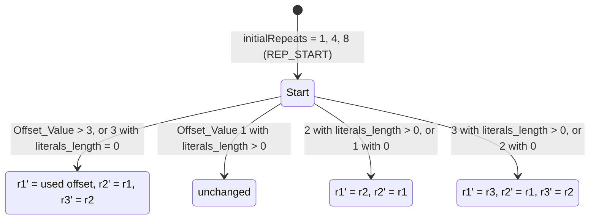
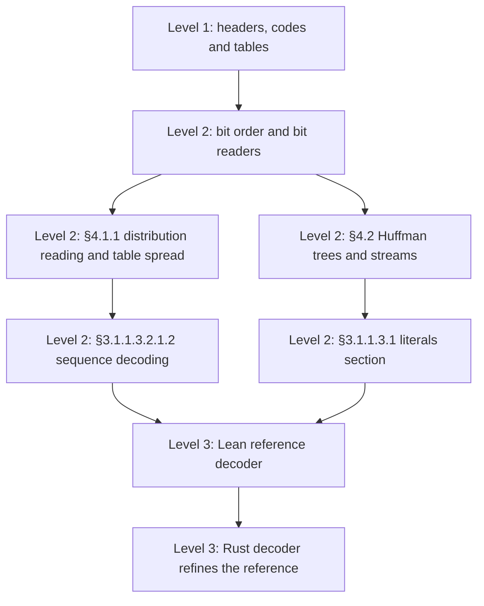

# Formal verification

Machine-checked Lean 4 proofs that parts of the Rust implementation follow
RFC 8878. The Rust source of selected items is translated into Lean by
[Charon](https://github.com/AeneasVerif/charon) and
[Aeneas](https://github.com/AeneasVerif/aeneas); hand-written theorems then
prove properties of that translation against a transcription of the RFC.

The specification is the RFC, never the C library. The encoder's contract of
byte identity with zstd 1.5.7 stays with the differential tests; the proofs
show something different and independent of it: that what both sides of the
codec compute is what RFC 8878 prescribes, that the encoder writes fields the
RFC's decoding reads back to the values it meant, and that the translated
code cannot panic or overflow on the inputs the specifications cover.

Today the proofs cover the frame and block headers (sections 3.1.1.1 and
3.1.1.2), `Number_of_Sequences` and the two-bit modes (3.1.1.3.2.1), the
literals length, match length and offset codes (3.1.1.3.2.1.1), the default
distributions (3.1.1.3.2.2), the repeat offsets (3.1.1.5), the magic numbers
(3.1.1, 3.1.2) and the FSE state transitions (4.1.1). This document describes
what is verified, how the translation stays tied to the Rust code, what the
proofs trust, and what is not covered.

## Ownership boundaries

| Path | Owner | Contents |
| --- | --- | --- |
| `scripts/extract_lean.py` | hand-written | Pins the Aeneas release, lists the translated items, regenerates or checks the translation |
| `verification/lean/Mzstd/Code/Types.lean`, `Code/Funs.lean` | generated, never edited | Aeneas translation of the listed Rust items |
| `verification/lean/Mzstd/Code/FunsExternal.lean` | hand-written model | The one standard-library function the translation calls and the Aeneas library does not model, `<[T]>::first` |
| `verification/lean/Mzstd/Rfc.lean` | hand-written transcription | RFC 8878 as printed: header fields and formulas, code tables, default distributions, repeat offset rules, Table 21, with consistency checks |
| `verification/lean/Mzstd/*.lean` (others) | hand-written proofs | Specifications of the generated functions, round-trip and uniqueness theorems, the axiom audit |
| `verification/lean/lakefile.lean`, `lean-toolchain`, `lake-manifest.json` | hand-written pins | Lean 4.35.0 and the Aeneas Lean library at the same commit as the binaries |

The Lean project is not part of the Cargo workspace and nothing in `src/` refers
to it: no attribute, feature or dependency was added to the crate. Charon
compiles the ordinary crate with its own nightly toolchain into
`target/charon/`, so the stable build is untouched.

```mermaid
graph TD
    Rust["src: shared/format.rs, compressor/core/{cctx, block, seq_store}.rs, decompressor/core/{frame, block, sequences, fse, literals}.rs"] -->|Charon: rustc MIR| LLBC[LLBC]
    LLBC -->|Aeneas -split-files| Code[Mzstd/Code/Types.lean, Funs.lean: generated]
    Ext[Mzstd/Code/FunsExternal.lean: std model] --> Code
    Script[scripts/extract_lean.py] -.drives and pins.-> LLBC
    Script -.--check compares.-> Code
    Script -.EXTERNALS must match.-> Ext
    AeneasLib[Aeneas Lean library: Result monad, scalar and slice models, step tactic] --> Code
    Mathlib[Mathlib] --> Rfc
    Rfc[Mzstd/Rfc.lean: RFC 8878 transcribed] --> Basic
    Code --> Basic[Mzstd/Basic.lean: platform facts, highbit32, little-endian bytes]
    Basic --> Tables[Mzstd/Tables.lean: constants and decoder tables]
    Tables --> Codes[Mzstd/SequenceCodes.lean: ll_code, ml_code, round trips]
    Tables --> Reps[Mzstd/RepeatOffsets.lean: offBase, update_rep]
    Basic --> Fse[Mzstd/Fse.lean: transition]
    Basic --> Block[Mzstd/BlockHeader.lean]
    Basic --> Count[Mzstd/SequenceCount.lean]
    Basic --> Frame[Mzstd/FrameHeader.lean: decoder]
    Basic --> Writer[Mzstd/FrameHeaderWriter.lean: encoder]
    Frame --> RT[Mzstd/FrameRoundTrip.lean]
    Writer --> RT
    Codes --> Audit[Mzstd/Audit.lean: axiom check]
    Reps --> Audit
    Fse --> Audit
    Block --> Audit
    Count --> Audit
    RT --> Audit
```

## Translation

`START` in the script names the items to translate, grouped by the RFC section
they implement; Charon follows everything they call. `EXCLUDE` is empty: every
item the list reaches translates.

Aeneas runs with `-split-files`, writing the types to `Code/Types.lean` and the
functions to `Code/Funs.lean`. Standard-library functions the Aeneas library
has no model for land in a template of axioms; the script compares their names
with `EXTERNALS` and fails if the set changes. Today there is one,
`<[T]>::first`, modelled in `Code/FunsExternal.lean` as the head of the list.
No axiom reaches the proofs.

Aeneas runs with `-loops-to-rec`. The translated code lives in Aeneas'
`Result` monad: every `+`, `-`, `*`, shift, cast and index becomes an operation
that fails on overflow, out-of-range shift or out-of-bounds index, exactly as a
debug build panics. `wrapping_*` calls are modelled as wrapping. A proof that a
function returns `ok` is therefore a proof that it cannot panic on those inputs.

Aeneas records each item's source line range; the script strips the ranges and
keeps the file name, so moving code without changing it leaves the
translation unchanged. `--check` regenerates into a temporary directory and
fails on any difference.

A few functions were reshaped so that they translate, without changing what
they compute: `FrameHeader::parse` reads its fields by index instead of
re-slicing in a branch and folding a reversed iterator (`read_le` is a `while`
loop, the descriptor's field sizes and window formula are `dictionary_id_size`
and `described_window_size`); `Number_of_Sequences` is read by
`sequences::sequence_count` and written by `block::write_sequence_count`, out
of `read_header` and the block compressor; the encoder's frame header is
written by the free function `cctx::write_frame_header` from a
`FrameHeaderFields` value. The unit and differential tests cover the
refactored code as before.



## Specification

`Mzstd/Rfc.lean` transcribes the RFC with natural numbers and lists, reading
multi-byte fields with `le`, the RFC's little-endian convention. Nothing in it
is derived from the Rust code or from zstd's C sources.

| Definition | RFC 8878 |
| --- | --- |
| `magicNumber`, `skippableMagic` | 3.1.1 `0xFD2FB528`; 3.1.2 `0x184D2A50` to `0x184D2A5F` |
| `fcsFlag`, `singleSegment`, `reservedBit`, `checksumFlag`, `didFlag` | 3.1.1.1.1, Table 3 |
| `fcsFieldSize`, `didFieldSize`, `windowDescriptorSize`, `headerSize` | Tables 4 and 5, 3.1.1.1.2 |
| `windowSize` | 3.1.1.1.2: `windowLog = 10 + Exponent`, `windowBase + (windowBase / 8) * Mantissa` |
| `frameContentSize` | 3.1.1.1.4: the 2-byte form adds 256 |
| `parseFrameHeader` | 3.1.1.1: the fields at their offsets, the reserved bit rejected, `Window_Size` = `Frame_Content_Size` with `Single_Segment_Flag` |
| `parseBlockHeader`, `blockType`, `blockMaximumSize`, `blockContentSize` | 3.1.1.2, Tables 9 and 10 |
| `compressionMode` | Table 15 |
| `numberOfSequences` | 3.1.1.3.2.1 |
| `literalsLengthCodes`, `matchLengthCodes`, `holds` | Tables 16 and 17 |
| `offsetValue`, `offset` | 3.1.1.3.2.1.1: `(1 << offsetCode) + readNBits(offsetCode)`, minus 3 above 3 |
| `literalsLengthDefault`, `matchLengthDefault`, `offsetDefault`, `points` | 3.1.1.3.2.2; 4.1.1 counts -1 as 1 |
| `initialRepeats`, `usedOffset`, `updateRepeats` | 3.1.1.5 |
| `nextPowerOfTwo`, `fseState` | 4.1.1, Table 21 |

The transcription checks itself, by `decide`:

- each length code table is contiguous (every code starts where the previous
  range ends) and spans the lengths the RFC states, 0 to 131071 and 3 to
  131074;
- each default distribution sums to its table size, counting -1 as 1, and the
  offset default reaches 536,870,908;
- `updateRepeats` reproduces Table 18 row by row and `fseState` reproduces
  Table 21.

RFC 8878 prints the last two rows of Table 18 inconsistently with its own text
(offset value 1 for the row that inserts `Repeated_Offset1 - 1`, and `3333`
instead of `1111` in the last row). The current Zstandard format document
corrects both; `updateRepeats` follows the prose, and the check uses the
corrected rows.

## Function specifications

Each theorem is tagged `@[step]` and states, in the `f args ⦃ r => P r ⦄`
form, that the generated function returns `ok r` (no panic, no overflow) and
that `r` satisfies `P`.

| Rust item | Preconditions | Result |
| --- | --- | --- |
| `shared::format::highbit32` | `value ≠ 0` | `Nat.log 2 value` |
| `shared::format` tables and constants | none | `LL_BITS`, `ML_BITS`, the three default distributions and their logs, `REP_START`, the magic numbers equal the RFC's |
| `decompressor::core::sequences::LL_BASE`, `ML_BASE` | none | entry `c` is the RFC `Baseline` of code `c` (the loop computes the running sum of `2 ^ Number_of_Bits`) |
| `decompressor::core::sequences::OF_BITS`, `OF_BASE` | none | `OF_BITS[c] = c`; for `c ≥ 2`, `OF_BASE[c] + extra = Offset_Value - 3`; entries 0 and 1 are 0 and 1 |
| `decompressor::core::literals::encoding_type` | none | the Table 15 mode of the two low bits |
| `compressor::core::seq_store::ll_code` | `length ≤ 131071` | a code below 36 whose Table 16 range holds the length |
| `compressor::core::seq_store::ml_code` | `ml_base ≤ 131071` | a code below 53 whose Table 17 range holds `ml_base + 3` |
| `offset_to_offbase`, `repcode_to_offbase`, `offbase_is_repcode`, `offbase_to_offset` | no overflow | the offBase sum type is `Offset_Value`: an offset is stored plus 3, repeat codes 1 to 3 as themselves |
| `compressor::core::seq_store::update_rep` | `off_base ≥ 1`; `Repeated_Offset1 ≥ 1` when it is decremented | `updateRepeats` of section 3.1.1.5 |
| `decompressor::core::fse::transition` | `table_log ≤ 15`, `1 ≤ p ≤ 2 ^ table_log`, `k < p`, counter `p + k` | `fseState table_log p k`, the pair of Table 21 |
| `decompressor::core::block::BlockHeader::parse` | none | `BlockType` for the reserved type, `BlockSize` above `block_max`, otherwise the Table 9 fields |
| `BlockHeader::content_size` | none | `blockContentSize`: one byte for RLE |
| `compressor::core::cctx::write_block_header` | 3 bytes of room, `kind ≤ 2`, `size < 2^21` | the three bytes read little-endian are `last + 2 kind + 8 size` |
| `decompressor::core::sequences::sequence_count` | none | `Err(SequencesSection)` exactly when `numberOfSequences` fails, otherwise its count and size |
| `compressor::core::block::write_sequence_count` | 3 bytes of room, fewer than `0x7F00 + 0x10000` sequences | the shortest RFC form, which `numberOfSequences` reads back |
| `decompressor::core::frame::dictionary_id_size`, `described_window_size`, `header_size` | none | Table 5, the window formula, the header size |
| `decompressor::core::frame::read_le` | at most 8 bytes | `le` of the bytes |
| `decompressor::core::frame::FrameHeader::parse` | none | `Err(FrameHeader)` exactly when `parseFrameHeader` fails, otherwise its fields |
| `compressor::core::cctx::write_frame_header` | 18 bytes of room, `10 ≤ window_log ≤ 31` | the magic number, then a header `parseFrameHeader` reads as the window, content size, dictionary ID and checksum flag the encoder asked for |

All statements hold for both 32- and 64-bit `usize`: the proofs only use
`32 ≤ System.Platform.numBits ≤ 64`.

## Headers

The frame and block headers are proved on both sides, and the round trip
composes them.



`FrameHeader.parse.spec` holds for every byte string: the result is
`Err(FrameHeader)` exactly when `parseFrameHeader` rejects the bytes, and the
RFC's fields otherwise, so the parse cannot panic on any input.
`write_frame_header_rfc` states the encoder side: with 18 bytes of room and
`10 ≤ window_log ≤ 31` (no condition on the pledged size), it returns the end
of the header, `4 < pos ≤ 18`; the first four bytes read little-endian are the
magic number, `parseFrameHeader` of bytes `4..pos` is `declared header`, and
the bytes past `pos` are untouched. `frame_header_round_trip` composes the two:
the decoder's `FrameHeader::parse` of those bytes returns the declared fields.

For the frame header the encoder writes the smallest `Dictionary_ID` field
that holds the ID, the single-segment form when the declared size fits the
window, and for the content size the one-byte form (single segment, below
256), the two-byte form for 256 to 65791, four bytes up to `0xFFFFFFFE` and
eight bytes above; each is a form RFC 8878 Table 7 allows. Its
`Window_Descriptor` has mantissa 0 and the unused and reserved bits are 0.

`block_header_round_trip` states that for every `last`, every type other
than the reserved one and every size up to `block_max` (and below `2^21`),
`BlockHeader::parse` of the three bytes `write_block_header` wrote returns
them. Block sizes are limited by the caller's `block_max`;
`FrameDecoder::begin` sets it to `min(Window_Size, 128 KiB)`, which is section
3.1.1.2.4's `Block_Maximum_Size`, but `begin` itself is not translated.

`Number_of_Sequences` follows the same pattern: `write_sequence_count` writes
the shortest of the three forms (`numberOfSequences_shortest`: no form the RFC
reads gives the same count in fewer bytes) and `sequence_count` reads every
form the RFC defines, so the decoder reads back the encoder's count and field
size (`sequence_count_round_trip`). The rule that nothing may follow a section
with no sequences is checked by `read_header`, which is not translated.

## Length and offset codes



`literals_length_round_trip`: for every literals length up to 131071, the
decoder's `LL_BASE` entry for the encoder's code is at most the length, the
extra field `length - Baseline` fits in `LL_BITS` of that code, and no other
code holds the length, so any encoder writes the same code.
`match_length_round_trip` says the same for match lengths 3 to 131074 through
`ML_BASE` and `ML_BITS`.

For offsets the decoder's tables give, for every code `c ≥ 2`,
`OF_BASE[c] + extra = Offset_Value - 3`, the offset of section
3.1.1.3.2.1.1, with `OF_BITS[c] = c` extra bits. The encoder's offset code is
`highbit32` of `Offset_Value` inside the sequence-code loop of
`seq_store.rs`, which is not translated.

## Repeat offsets

The encoder's "offBase" is `Offset_Value`: `offset_to_offbase` adds 3 and
`offbase_to_offset` subtracts it, repeat codes 1 to 3 are themselves.
`update_rep.spec` shows that the encoder's update after a sequence is
`updateRepeats`, the RFC's rule, for every offset value and both cases of the
literals length:



The only excluded input is decrementing a `Repeated_Offset1` of 0, which the
Rust code does with a wrapping subtraction and which no stream reaches: the
starting offsets are positive, every offset a sequence uses is, and the
decoder rejects a zero offset. The decoder's own update runs inside the
sequence loop of `decompressor/core/sequences.rs` and is not translated.

## FSE state transitions

Section 4.1.1 assigns each state of a symbol with probability `p` (in natural
order, `k = 0, 1, ...`) a `Number_of_Bits` and a `Baseline` (Table 21).
`SeqTable::fill_rows` visits the cells in natural order with a per-symbol counter
that starts at `p` and calls `transition(p + k, table_log)`.
`transition.spec` proves that the result is `fseState table_log p k`. The
proof goes through `fseState_eq`, which shows that the RFC's description by
shares and doubled states is the closed form `Accuracy_Log - log2 (p + k)` bits
and baseline `(p + k) * 2 ^ bits - 2 ^ Accuracy_Log`. A "less than 1" symbol
is the case `p = 1`: `Accuracy_Log` bits from baseline 0.

`Mzstd/Audit.lean` checks with `#guard_msgs` that the headline theorems depend
only on `propext`, `Classical.choice` and `Quot.sound`; a `sorry`,
`native_decide` or new axiom fails `lake build`.

## Trusted base

A theorem here is a statement about the Rust code only if these hold:

- Charon and Aeneas translate the MIR of the listed items faithfully, including
  overflow, shift and cast semantics;
- the Aeneas Lean models of the scalar and slice operations used
  (`leading_zeros`, shifts, casts, `wrapping_sub`, `to_le_bytes`,
  `from_le_bytes`, range indexing, `copy_from_slice`, `Option::ok_or`,
  `Option::unwrap_or`) match Rust;
- rustc's MIR for those items matches the code the release build runs (the
  translation is of the nightly MIR Charon sees, without optimizations);
- the model in `Code/FunsExternal.lean` of `<[T]>::first` matches the standard
  library;
- Lean's kernel and the three standard axioms;
- `Mzstd/Rfc.lean` transcribes RFC 8878 correctly. It is short enough to read
  against the RFC, quotes the sentence each definition encodes, and checks the
  tables' contiguity and sums and the RFC's two worked examples.

Finite facts (table contents, the 64- and 128-entry encoder code tables) are
checked with `decide +kernel`, which the kernel evaluates; no `native_decide`
is used.

Nothing relies on a hand-written restatement of the Rust code.

A mutation check confirms the coupling: changing the `+ 256` of the two-byte
`Frame_Content_Size` in `FrameHeader::parse` to `+ 255` makes
`extract_lean.py --check` fail, and after regeneration
`FrameHeader.parse.spec` no longer proves; changing `rep_code >= 2` to
`rep_code > 2` in `update_rep` breaks `update_rep.spec`.

## Checks

```sh
python3 scripts/extract_lean.py --check   # translation matches the Rust source
cd verification/lean && lake exe cache get && lake build   # proofs and axiom audit
```

`ci-lean.yml` runs both on every push to `main` and every pull request. The
proofs check in under a minute once Mathlib's prebuilt cache is present.

## Known gaps

### Inside the verified items

Open RFC items are tracked in the [coverage checklist](#coverage-checklist);
these are the limits of what is already proved.

- Callers are not translated. `FrameDecoder::begin`, which sets
  `block_max = min(Window_Size, 128 KiB)` and checks the dictionary ID, the
  stream state machine that reads the magic number and skippable frames, the
  engine method that fills `FrameHeaderFields`, and the parallel compressor's
  own frame header writer (`parallel::core`) are outside the proofs.
- `SeqTable::fill_rows` and `spread`, which call `transition` with the counter
  `p + k` and place the symbols with the section 4.1.1 step, use iterator
  adapters and const generics and are not translated; their spread is checked
  against Appendix A by unit tests.
- The encoder's offset code (`highbit32(Offset_Value)`) and the decoder's
  repeat offset update both run inside sequence loops that are not
  translated.
- Byte-for-byte agreement with zstd's C library is outside the proofs; it
  stays with the differential tests and fuzzing.

## Coverage checklist

Progress against RFC 8878, ticked when an item's theorems build and pass the
axiom audit. The RFC constrains the format and the decoder; the encoder only
has to emit what that decoder accepts and reads back, so match finding, block
splitting and cost models stay out of scope. Levels are ordered by cost; each
later level builds on the earlier ones.



### Level 1: headers, codes and tables

- [x] §3.1.1 and §3.1.2 magic numbers (`Tables.lean`).
- [x] §3.1.1.1 frame header: descriptor, window, dictionary ID and content
  size, decoder and encoder, round trip (`FrameHeader.lean`,
  `FrameHeaderWriter.lean`, `FrameRoundTrip.lean`).
- [x] §3.1.1.2 block header, decoder and encoder, round trip
  (`BlockHeader.lean`).
- [ ] §3.1.1.2.4 `Block_Maximum_Size` set by `FrameDecoder::begin`.
- [x] §3.1.1.3.1.1 and Table 15: two-bit block and mode types
  (`Tables.lean`).
- [ ] §3.1.1.3.1.1 `Literals_Section_Header` size formats, both sides
  (`literals.rs` on both sides; the decoder's is inline in a SIMD-generic
  function).
- [x] §3.1.1.3.2.1 `Number_of_Sequences`, both sides, round trip
  (`SequenceCount.lean`).
- [ ] §3.1.1.3.2.1 `Symbol_Compression_Modes` reserved bits and the
  `Repeat_Mode` rules in `read_header`.
- [x] §3.1.1.3.2.1.1 literals length and match length codes: tables, encoder
  codes, round trip and uniqueness (`Tables.lean`, `SequenceCodes.lean`).
- [x] §3.1.1.3.2.1.1 offset codes: decoder tables (`Tables.lean`).
- [ ] §3.1.1.3.2.1.1 the encoder's offset code.
- [x] §3.1.1.3.2.2 default distributions (`Tables.lean`).
- [x] §3.1.1.5 initial repeat offsets and the encoder's update
  (`Tables.lean`, `RepeatOffsets.lean`).
- [ ] §3.1.1.5 the decoder's repeat offset update and the zero-offset
  rejection.
- [x] §4.1.1 `Number_of_Bits` and `Baseline` of every state
  (`Fse.lean`).
- [ ] §4.2.1 Huffman weights: `Number_of_Bits = Max_Number_of_Bits + 1 -
  Weight`, the implied last weight, canonical code assignment.

### Level 2: stateful decoding

- [ ] Bit order: the forward and backward bit readers of
  `decompressor/core/bits.rs` read what the encoder's bit writers write,
  including the end marker of backward streams.
- [ ] §4.1.1 FSE distribution reading (`read_distribution`) and the cell
  spread (`spread`), against Appendix A.
- [ ] §4.2 Huffman tree descriptions, direct and FSE-compressed weights, and
  one- and four-stream literal decoding with the jump table.
- [ ] §3.1.1.3.2.1.2 sequence decoding order: offset, match length, literals
  length extra bits, then the state updates.
- [ ] §3.1.1.4 sequence execution: offsets within the window and the
  produced output.

### Level 3: the decoder as a whole

- [ ] A Lean reference decoder transcribing RFC 8878, compiled and used as a
  second oracle beside C in the fuzz targets and tests: evidence rather than
  proof, but independent of the C implementation.
- [ ] A refinement proof that the baseline path of the Rust decoder computes
  the reference decoder's output for any chunking of the input. SIMD paths,
  which Aeneas cannot translate, stay with the differential tests, Miri and
  AddressSanitizer.

Outside RFC coverage, the content checksum (XXH64), SIMD kernels, the parallel
and framed layers, match finding and the rest of the crate are not verified.
