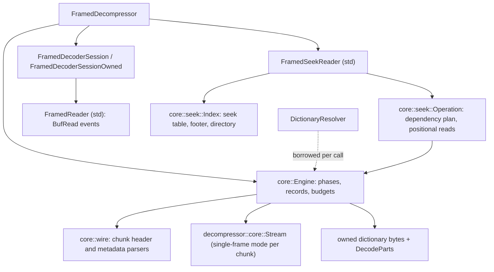
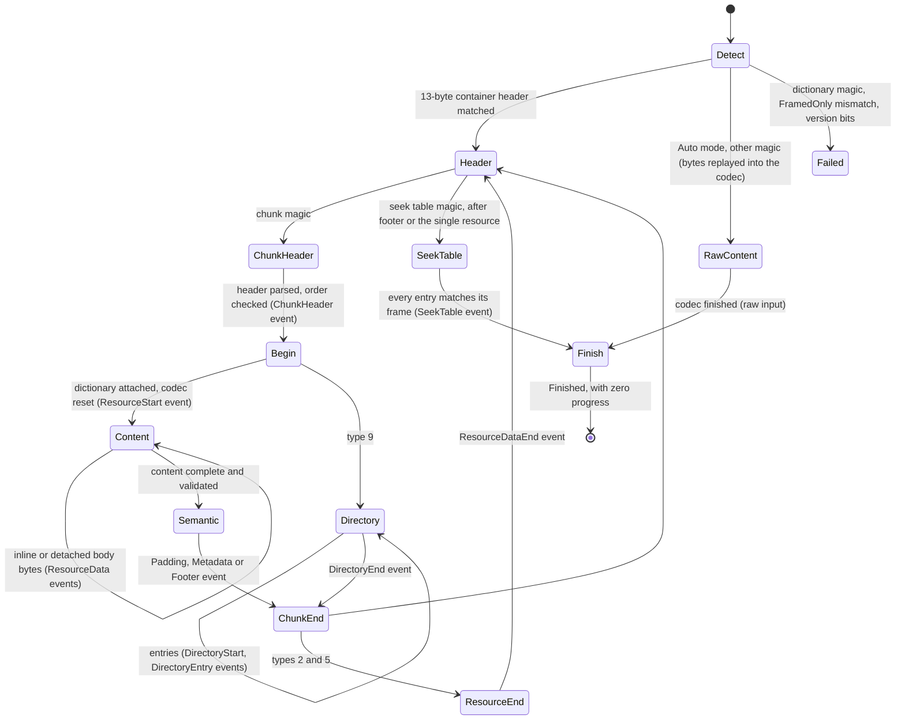
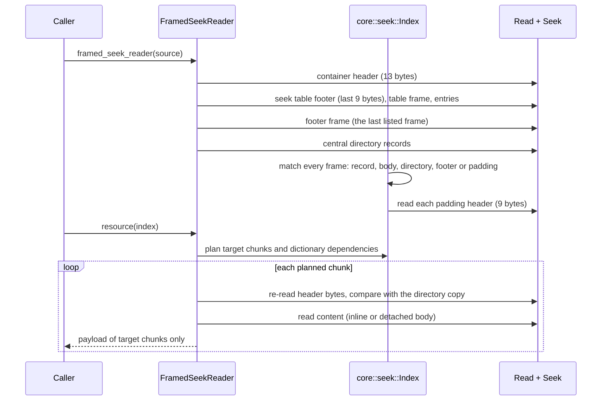

# Framed decoder and seek reader

`framed` with `decompression` exposes `FramedDecompressor`: one-shot
decoding into owned, appended or caller-sliced storage, incremental
sessions (borrowed and owned) that report one semantic event per call, a
std `FramedReader` over `BufRead`, and a std `FramedSeekReader` that reads
individual resources of a container through `Read + Seek`. The wire
format is specified in [framed containers](framing.md); this page covers
how it is validated and decoded.

## Ownership and modules

The engine stores no caller borrows: input, output and the resolver are
passed to every call. External dictionaries are copied into owned storage
when a chunk that references them begins, within `max_dictionary_bytes`,
and reused while consecutive chunks name the same references. The codec is
the decoder's own streaming `Stream`, so the framed decoder shares its
block decoding, SIMD dispatch (backend chosen once per owner, dispatched
once per block) and checksum verification.

## Sequential decoding

- **Detection.** The first four bytes decide: the Zstandard dictionary
  magic is `UnexpectedInputKind::SerializedDictionary`; the chunk magic
  starts a container, whose size field and `MZFR` signature must follow; any
  other input is `InvalidSignature`, or raw Zstandard frames in
  `InputMode::Auto`. Raw input is one resource decoded in concatenated-frame
  mode; the bytes read while detecting are replayed into the codec first.
- **Chunk headers** are accumulated byte by byte and parsed by
  `wire::header`, which never reads past the skippable frame's size and
  reports `None` until the header is complete.
- **Order.** As in RFC 9841: partial resources are contiguous, resource
  metadata precedes its resource, footer metadata follows one, repeats
  follow everything but precede the directory, and only the footer follows
  the directory. After the footer only the seek table may follow. A data
  chunk is detached exactly when its resource is visible.
- **Content.** Stored inline content is copied. Compressed content (inline
  or detached) goes through the codec in single-frame mode with an output
  ceiling fixed when the chunk begins: the tightest of the declared size,
  `max_decoded_bytes`, `max_output_bytes` or `max_metadata_bytes`,
  `max_resource_bytes`, and the stream's exact output size. Exceeding it
  maps back to `LimitExceeded` or `DeclaredSizeMismatch`. The frame must end
  exactly at the content's end, be a Zstandard (not skippable) frame, and
  decode to exactly its declared size.
- **Seek table.** Its size must list exactly one entry per frame read, each
  entry must equal the frame's compressed size and decompressed size, the
  frame count and magic must match, the descriptor must be zero (checksums
  are not part of this format), and a nonzero footer file size must equal
  the container's length. The call that reads the table's last byte
  reports `FramedEvent::SeekTable` (also recorded in
  `FramedLayout::seek_table`); the next call reports `Finished` without
  consuming or producing anything, so a container ends itself without a
  caller `Finish`.
- **Internal dictionary cache.** With `InternalDictionaryPolicy::Retain`,
  decoded resource payload is kept so later chunks can reference it. The
  cache grows within `max_dictionary_bytes` (and the workspace budget);
  once a growth would exceed them it stops for the rest of the object, and
  only a later reference to content it did not keep fails, with
  `LimitExceeded { kind: DictionaryBytes }`. Containers larger than the
  budget therefore decode with default limits.

Metadata, repeated metadata, the central directory and resource accounting
follow mbrotli's engine: repeated copies must match their originals on the
selected codes, the directory must list every content chunk's exact header
bytes in order, and the footer must name the directory.

Errors are terminal (`InvalidState` afterwards) and carry exact per-call
accepted and produced counts and the last written fragment. Budgets cover
input, output, decoded, resource, metadata, field, chunk and resource
counts, and owned framing, dictionary and workspace bytes; the codec's
retained history is checked against the workspace ceiling after each call.

## Seek reader

Opening requires the container profile and a directory
(`CentralDirectoryRequired` otherwise). The seek table locates every frame:
the sum of its compressed sizes must equal the table's offset, its first
entry is the container header, its last the 25-byte footer. Each directory
record must start at a listed frame, have that frame's size, and a
detached record's next entry must be its body with the declared size as
its decompressed size. Every other frame must be the directory or padding;
padding is recognized from its 9-byte header without reading its content.

Reading a resource plans its chunks plus the closure of dictionary
dependencies (earlier resources or chunks) in one backward pass; only
dependencies enter the retained cache. Each planned chunk's header is
re-read and compared with its directory copy (`DirectoryMismatch`) before
its content reaches the codec. Metadata is decoded lazily and cached.

## Verification

`tests/framed_decoder.rs` hand-assembles containers to reach every
validation error, decodes every input split and output size identically,
and compares random containers with `ZSTD_decompress` on every backend;
`tests/framed_decoder_owned_session.rs` covers owned sessions and
resolvers; `tests/framed_seek.rs` covers indexing, dependency plans,
header mismatches and failing sources against the contrib seekable
decoder. `benches/framed_decompress.rs` measures one-shot and seek reads
against `ZSTD_decompressDCtx` and the contrib seekable decoder.

## Known gaps

- Speed: on 1 MiB inputs at level 3 (Apple M5 Pro, loaded host,
  `cargo bench --features framed --bench framed_decompress`), one-shot
  framed decoding runs at 0.65-0.75x of `ZSTD_decompressDCtx` and of the
  contrib seekable decoder on compressible data. The engine decodes through
  the streaming codec into 8 KiB staging and resets it per chunk; it has not
  been profiled yet.
- Caller-supplied whole-resource checksums are recorded, not verified.
- Seek tables with checksums (descriptor bit 7) are rejected rather than
  verified.
- The seek reader decodes a resource from its first chunk; it does not seek
  to a decompressed offset inside a resource (the contrib seekable decoder
  can, through the seek table).
- Raw `InputMode::Auto` input is decoded as concatenated frames until the
  end of input; a protocol suffix after raw frames is an error.
