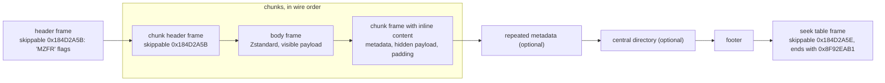
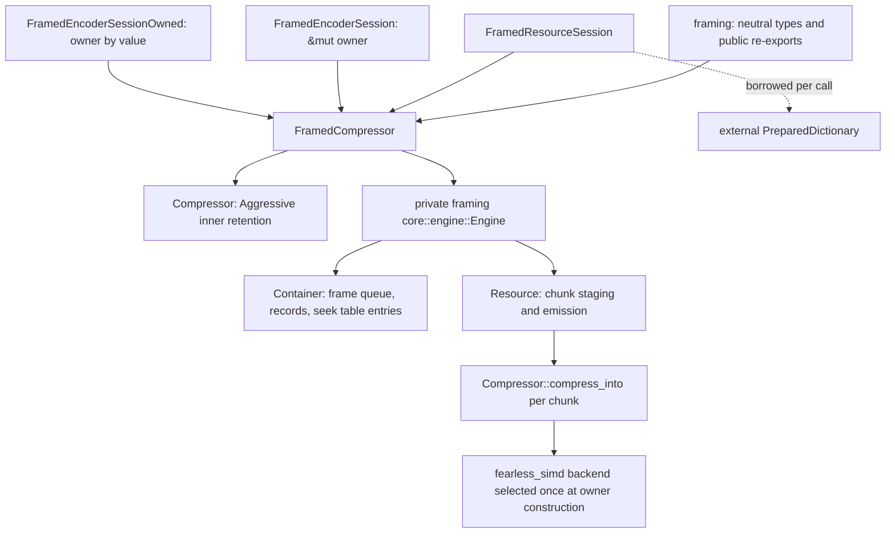
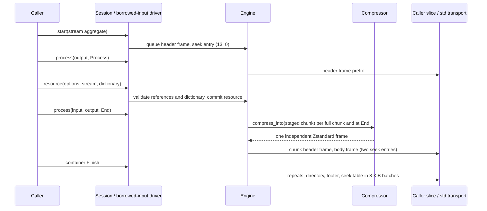
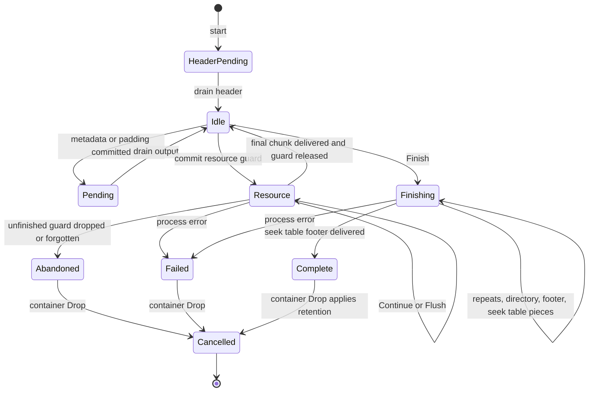
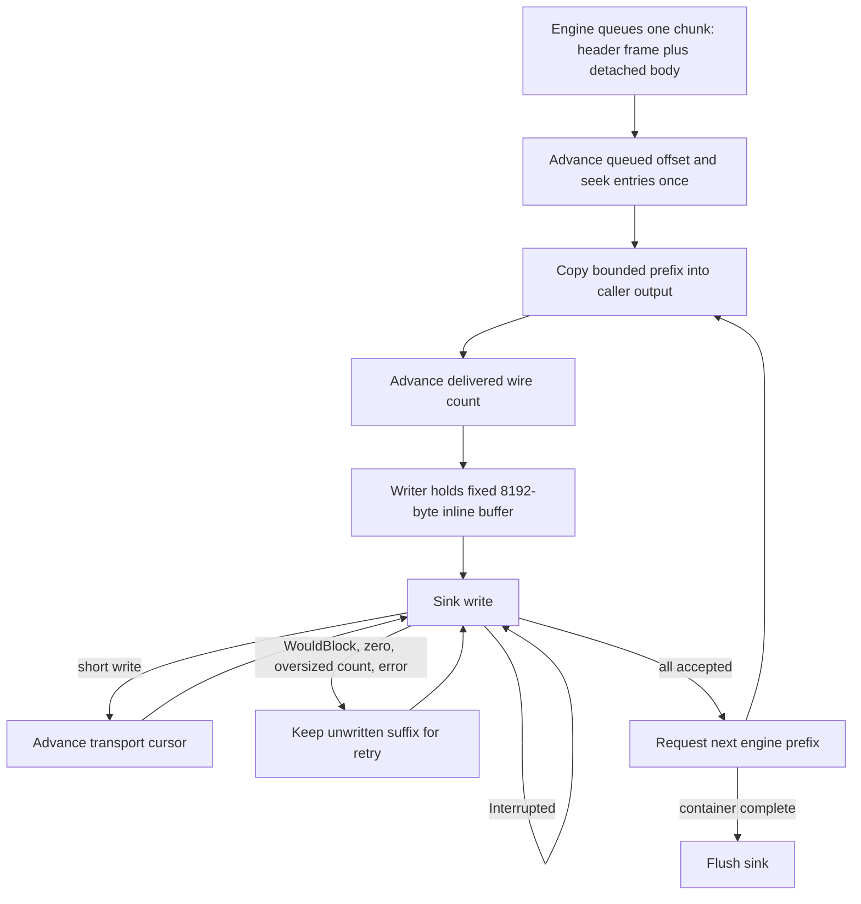

# Framed containers: wire format and compressor

`framed` with `compression` exposes a reusable `FramedCompressor`, its
configuration, borrowed structured input, one-shot operations and native
sessions with std or alloc. `no_std` excludes only `FramedWriter`,
`ResourceWriter`, `FramedEncoderReader` and transport errors. The decoder
side is described in [framed decoder](framed-decoder.md). The public API
mirrors mbrotli's RFC 9841 framing API one to one; the wire format is this
crate's own, built only from Zstandard frames.

## Wire format

A container is a sequence of Zstandard frames (RFC 8878). Skippable frames
carry every structure; regular Zstandard frames carry visible payload; the
last frame is a seek table in the layout of zstd's
[`contrib/seekable_format`](../zstd-ffi/vendor/zstd/contrib/seekable_format/zstd_seekable_compression_format.md).
Two consequences follow, and both are tested against the C library:

- any Zstandard decoder (`zstd -d`, `ZSTD_decompress`) skips the skippable
  frames and outputs exactly the concatenation of the visible resources;
- the contrib seekable decoder (`ZSTD_seekable_decompress`) maps every
  decompressed offset of that concatenation to its frame through the seek
  table, without reading the container.

All integers are little-endian. A varint is LEB128 of at most nine bytes
and 63 bits; decoders accept nonminimal encodings, which the directory
then compares byte for byte. Offsets are relative to the first byte of the
container header.

### Container header

| Bytes | Field |
| --- | --- |
| 4 | `0x184D2A5B`, the chunk magic (a skippable frame) |
| 4 | frame size, always 5 |
| 4 | signature `MZFR` |
| 1 | flags: bits 0-1 version (0), bit 2 container profile; other bits are preserved |

The full (container) profile allows any number of resources, metadata,
padding, an optional central directory, and ends with a footer. The
single-resource profile (bit 2 clear) holds exactly one resource and
optional padding, and has no footer. Both end with the seek table.

### Chunks

Each chunk starts with one skippable frame of magic `0x184D2A5B` whose
content is the chunk header followed by inline content. A frame of size 0
is padding without content. The chunk header is RFC 9841's header without
its leading length varint (the frame size takes its place):

| Field | Present for | Encoding |
| --- | --- | --- |
| type | every chunk | 0 padding, 1 resource metadata, 2 complete resource, 3/4/5 first/middle/last partial resource, 6 footer metadata, 7 global metadata, 8 repeated metadata, 9 central directory, 10 footer |
| codec | types 1-8 | 0 stored, 2 one Zstandard frame, 3 one Zstandard frame with dictionary references; 1 is reserved and invalid |
| declared size | codec 2, 3 | varint: decoded content bytes |
| references | codec 3 | count (1-16), then per reference a flag (0 prefix resource, 1 prefix chunk, 4 serialized resource: varint offset; 2 prefix id, 6 serialized id: byte 3 and 32 identity bytes) |
| flags | types 2-5 | bit 0 hidden (types 2, 3), bit 1 checksum (types 2, 5), bit 2 detached; other bits invalid |
| checksum | flag bit 1 | byte 3 and 32 bytes, recorded, never computed |
| body length | flag bit 2 | varint: size of the detached Zstandard frame |
| repeated kind | type 8 | 1 or 6 |

A detached chunk has no inline content: its content is the regular
Zstandard frame that immediately follows the header frame, exactly
`body length` bytes. The placement is canonical and the decoder enforces
it:

- every chunk of a visible resource is detached (codec 2 or 3), so its
  payload is a top-level frame; a visible `ResourceEncoding::Uncompressed`
  resource is written as a single-segment frame of raw blocks;
- every chunk of a hidden resource is inline: codec 0 stores the bytes,
  codec 2 or 3 nests a Zstandard frame inside the skippable frame;
- metadata is always inline, stored or compressed.

Every compressed content is exactly one complete Zstandard frame; a
skippable frame, trailing bytes or a short frame inside it is invalid. Each
chunk's frame is independent of every other chunk's (there is no decoder
continuation across chunks), which is what makes each seek table entry
decodable on its own.

A Zstandard frame takes one dictionary, so references name either a single
serialized (Zstandard-format) dictionary, or one to sixteen prefixes whose
contents, concatenated in order, form one raw-content dictionary. Internal
references address an earlier chunk (prefix chunk: its decoded content) or
the first chunk of an earlier complete resource (prefix or serialized
resource: its decoded payload). External references name a caller-managed
256-bit `DictionaryId` resolved by the decoder's `DictionaryResolver`.

Metadata content is RFC 9841's serialization: per field a two-byte code, a
varint length and the value. Uppercase codes may repeat; `id` (UTF-8) and
`mt` (eight bytes) appear at most once and only in resource metadata.

### Suffix

| Chunk | Content |
| --- | --- |
| repeated metadata (8) | a copy of every resource and footer metadata in order, optionally restricted to selected codes, each with its own encoding |
| central directory (9) | varint offset of the first repeat (0 for none), then per content chunk (types 1-8): varint offset, varint header length, the exact header bytes (skippable frame header and chunk header) |
| footer (10) | u64 directory offset (0 for none), u64 container size through the end of the seek table (0 unspecified) |

The seek table frame (magic `0x184D2A5E`, size `8n + 9`) lists every frame
from the container header through the footer: header frames and inline
chunks with decompressed size 0, body frames with their content size. Its
footer is the frame count, a zero descriptor (no checksums) and
`0x8F92EAB1`. Frames are at most 4 GiB and a table lists at most
`0x8000000` frames, the contrib limits.

## Ownership and dispatch

`FramedEncoderSession` borrows the owner and `FramedEncoderSessionOwned`
owns it; neither holds state of its own. Both go through the private
`begin_session` start path, the same `Engine` calls, and `cancel` on
release. The owner stores no sink, input slices or dictionary references:
resource guards hold the dictionary borrow, and the lazy input driver looks
up its borrowed description on each call.

Each chunk is compressed with one `Compressor::compress_into` (or
`compress_with_dictionary_into`) call on the staged chunk, so every body
frame is byte-identical to `ZSTD_compress2` of the chunk's bytes under the
same parameters, and the owner's backend is selected once and dispatched
once per block inside the encoder core. A dictionary must have been
prepared for the owner's encoder configuration; `begin` checks this before
any output (`EncodeError::DictionaryMismatch`).

## Public input and API

`FramedEncodeConfig` combines `EncoderConfig` and the public-field
`FramingConfig`; the builder selects backend and outer retention. Defaults
are a full container with a directory, no repeats, 65,536 bytes per chunk,
1 MiB metadata, 8 MiB framing storage, 10,000 resources and 1,000,000
chunks. Chunk size (1..=16 MiB, with four chunks plus 8 KiB of budget) and
profile combinations are validated before use.

`FramedInput` borrows an ordered slice of `FramedItem`: complete resources,
metadata or padding. `FramedResource` carries payload, visibility and
checksum, a `StreamConfig` size contract, and
`ResourceEncoding::{Uncompressed, Zstd, Shared}`. `compress`, append and
rollback `compress_into`, `compress_to_slice` and `framed_reader` share one
lazy `core::driver::Driver` that advances the same engine as native
sessions; no destination stages the whole container.

Container `process` consumes no payload. Its `NeedsInput` admits the next
command; `NeedsOutput` requires draining. Structural methods reject
`OutputPending` before commit. The container's exact size counts accepted
payload across all resources, hidden ones included, and excludes metadata
and padding.

## State, cancellation and retry

A full chunk stays staged until another byte, `Flush` or `End` decides
whether it is the last one, so an exact first-chunk fill followed by `End`
is a complete (type 2) chunk. Flush and End record their input boundary;
retries must keep the operation and remaining suffix. Repeated empty
`Flush` emits nothing. A resource is `Finished` once its final chunk was
delivered; the container is `Finished` once the seek table's last byte was.

Process errors are terminal, with exact per-call accepted/produced counts
and a location (resource index and input offset, structured item index,
delivered wire offset). Structural errors before commit do not poison the
engine. `FramingFinishError` retains a whole std writer for retry.

Normal container drop releases the owner for reuse. A forgotten guard
leaves abandoned protection until `recover`. Raw retention stays
Aggressive within a container; the owner's `ReleaseAll`/`Bounded` policy
applies at the container boundary.

## Memory

Framing allocations use fallible reservations and checked budgets: chunk
input and content staging, pending output, directory records, repeated
metadata copies, the repeat field selection and eight bytes of seek table
entry per frame. Records and entries scale with the number of chunks, so
there is no O(1) bound for a whole container. The seek table is emitted in
batches of 1,024 entries without a second copy. Raw encoder workspace,
external dictionaries and caller destinations are outside the framing
budget.

## Verification

`tests/framed_oracle.rs` checks containers against zstd's own decoders:
`ZSTD_decompress` must output the concatenated visible resources, and the
contrib seekable decoder (compiled into `zstd-ffi`) must read every range of
them. `tests/framed_encoder.rs` compares every way of writing a container
(native sessions at every output width and input split, one-shot,
append, slice, reader and writer, every backend), checks each body frame
byte for byte against `ZSTD_compress2` of its chunk, and walks every
container with an independent wire parser (`tests/framed_support`);
`tests/framed_encoder_owned_session.rs` and
`tests/framed_encoder_memory.rs` cover owned sessions, injected allocation
failures and retained bytes. The decoder suites are listed in
[framed decoder](framed-decoder.md). AFL targets `framed_encode`,
`framed_decode` and `framed_roundtrip` ([fuzzing](fuzzing.md)) drive random
command schedules and inputs. `benches/framed_compress.rs` compares owner
reuse with the contrib seekable compressor.

## Known gaps

- Speed: with 64 KiB chunks on 1 MiB inputs (Apple M5 Pro, loaded host,
  `cargo bench --features framed --bench framed_compress`), levels 1 and 3
  run at 0.75-0.9x of the contrib seekable compressor and level 19 at
  1.0-1.05x; sizes are within 0.4% of contrib's for large resources. Each
  chunk is staged, compressed into separate content storage and copied
  into the pending queue; those copies have not been profiled away. Many
  tiny resources cost about 47 bytes each of structure (header frame,
  directory record, seek entries).

- No checksum computation or verification of the caller-supplied
  whole-resource identity, and no seek table checksums.
- No automatic dictionary resolver or symbolic references; references are
  explicit offsets and identities.
- Compressing a chunk starts a fresh frame: there is no cross-chunk history
  (by design, so each frame decodes alone).
- The reader consumes borrowed complete slices; gradually arriving payload
  uses native guards or `ResourceWriter`.
- Retained-byte accounting is requested heap storage, not allocator
  overhead or an RSS ceiling.
