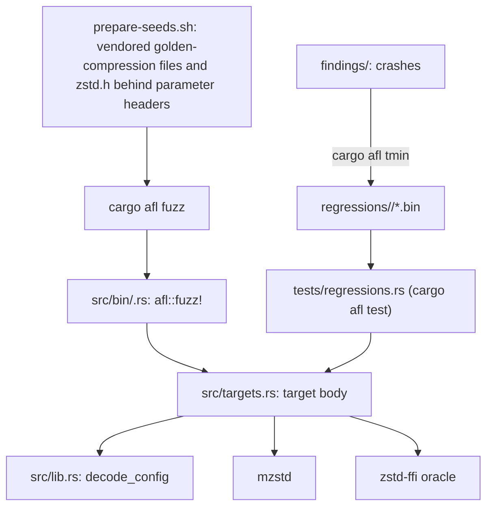
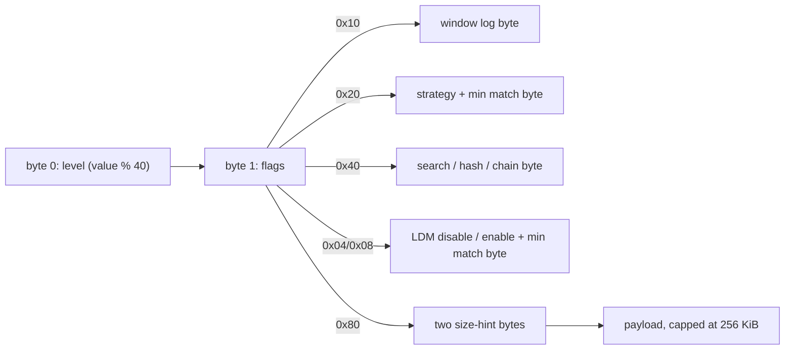

# Fuzzing

AFL++ targets live in `fuzz/afl`, a package excluded from the workspace
because its binaries link AFL's runtime. Target bodies are plain functions
in `src/targets.rs`; each binary in `src/bin/` is a three-line
`afl::fuzz!` adapter, so committed inputs replay through the same bodies
under `cargo afl test` without instrumentation.

## Input layout

`decode_config` turns the first bytes into an `EncoderConfig` and the
equivalent reference `Params`, so every target compares like with like.

Flags `1` and `2` set the checksum and clear the content size. Targets that
need more bytes (capacity, schedule, task count) take them from the start of
the payload, so every target shares one seed corpus.

## Targets

| Target | Oracle |
| --- | --- |
| `differential_c` | `Compressor::compress` equals `ZSTD_compress2` with the same parameters, and the frame decodes. |
| `output_capacity` | `compress_to_slice` into an arbitrary capacity returns the reference's frame, or `OutputTooSmall` exactly when `ZSTD_compress2` fails; `compress_to_uninit` into the same capacity returns the same result and frame. |
| `encoder_session` | A session driven by random chunks, flushes and output capacity, with calls alternating `process` and `process_uninit`, equals `ZSTD_compressStream2` driven the same way (`compress_stream_with_output`). |
| `compressor_lifecycle` | Reuse, `reconfigure` and `trim(ReleaseAll)` never change a frame. |
| `parallel` | Parallel frames decode with the reference and are identical for 1–8 tasks run in reverse order. A session (windows 1–4, an optional flush, calls alternating `process` and `process_uninit`, which must leave every byte past `produced` untouched) and the `ParallelEncoderWriter`/`ParallelEncoderReader` adapters (one executor thread each) decode; with a declared size, or an input within one segment, and no flush they equal the batch frame; the writer always equals the session driven with the same writes and flush. |
| `parameter_parsing` | Header decoding never panics; window logs are accepted exactly in `10..=31`. |
| `decompress` | Raw bytes: no panic; anything mzstd accepts, `ZSTD_decompressStream` accepts with the same output; `decompress_to_slice` agrees with `decompress`. |
| `decode_streaming` | Two piece sizes, then a frame: a session agrees with one-shot decoding and never over-reports progress. |
| `decode_roundtrip` | Parameter header: frames the reference writes with that configuration decode to the payload, one-shot and in pieces. |
| `decode_dictionary` | Two-byte dictionary length, a content-type byte (`% 3`: auto, raw, Zstandard), the dictionary, then frames: mzstd accepts the dictionary exactly when `ZSTD_DCtx_loadDictionary_advanced` does; whatever frames it then decodes, `ZSTD_decompressDCtx` with that dictionary decodes to the same output; `decompress_with_dictionary_to_slice` and a session fed pieces agree with one-shot decoding. |
| `compress_dictionary` | A parameter header, then a two-byte dictionary length, a byte for the content type (`% 3`) and the session's chunk size (`/ 3`), the dictionary and the payload: the dictionary is accepted exactly when the reference accepts it after `ZSTD_CCtx_loadDictionary_advanced`; `compress_with_dictionary` equals `ZSTD_compress2` and a session fed chunks equals `ZSTD_compressStream2`; frames decode with both decoders. |

Decoder targets cap output at 16 MiB, so a few run-length blocks cannot
exhaust memory. The decoder rejects some inputs the reference accepts (see
[decompressor](decompressor.md#compatibility-with-the-reference-decoder)),
so a rejection by mzstd is not compared with the reference.

The `experimental` feature is empty and gates no target yet. It exists so
that both configurations are checked as targets are added; the fuzz package's
dependencies never enable it.

## Corpora

`prepare-seeds.sh` builds `seeds/params` from upstream's
`tests/golden-compression` payloads and `lib/zstd.h`, each behind twelve
parameter headers, and `seeds/frames` from the golden decompression
fixtures. Campaigns use `seeds/frames` for `decompress`, the committed
regressions for `decode_streaming`, `decode_dictionary` and
`compress_dictionary`, and
`seeds/params` for every other target. Seeds and findings are local
artifacts and are gitignored. The committed `regressions/<target>/` hold
boundary inputs (empty, truncated header, all-ones header, every override)
and minimized findings. `regressions/decode_dictionary/` holds frames the
reference wrote with a small trained dictionary and with raw text, the
trained bytes read as raw content, a frame without a dictionary ID, and the
rejections: a truncated dictionary, a zero repeat offset and the wrong
dictionary ID. `regressions/compress_dictionary/` holds payloads with a
trained dictionary at several levels (also read as raw content, and with a
12-bit window at level 22), with raw text, an empty dictionary (which must
behave as none; this seed caught the first encoder mismatch) and the
rejections: raw bytes as the Zstandard format and a truncated dictionary.

## Campaigns

`campaign.sh [seconds] [targets…]` builds in release mode and runs one AFL
instance per target in parallel. It then reports crashes, hangs and AFL's
own statistics. Two 4-minute runs (the six encoder targets, then the three
decoder targets) found no crashes. They saved three timeouts, but each
replays in under 2 ms, including under `afl-showmap` with the same 20 s
limit. One was saved as AFL stopped the run at its time limit. The other two
were saved mid-run on a loaded macOS host, and are kept as regressions
named `afl-timeout-not-reproduced-*`.

The first decoder run also exposed a bug in the test oracle rather than in
mzstd: `oracle::decompress_stream` took the header hint returned by an extra
call after a frame ending exactly at a full output buffer as "truncated".
It now records only calls that made progress, and
`zstd-ffi/tests/oracle_stream_boundary.rs` covers both outcomes.

A 10-minute run of `decode_dictionary` from its committed regressions
(2026-10-15) found no crashes or hangs: 952 new corpus items, 40% map
coverage.

## Known gaps

- No target drives the `std::io` adapters or owned sessions with fuzzed
  input; the integration tests cover them.

The first 10-minute run of `compress_dictionary` (2026-10-15) found two
classes of crash, both kept as regressions: an empty dictionary with the
Zstandard content type, which the reference treats as no dictionary (fixed),
and frames at levels 16-22 with a dictionary whose literal and match length
tables omit their last symbols, where the reference reads uninitialized
memory and is not reproducible itself
([dictionaries](dictionaries.md#known-gaps)); the target now checks byte
identity only for dictionaries with complete length tables. A second
10-minute run of `compress_dictionary` and `decode_dictionary` found no
crashes or hangs (2093 and 922 new corpus items).
