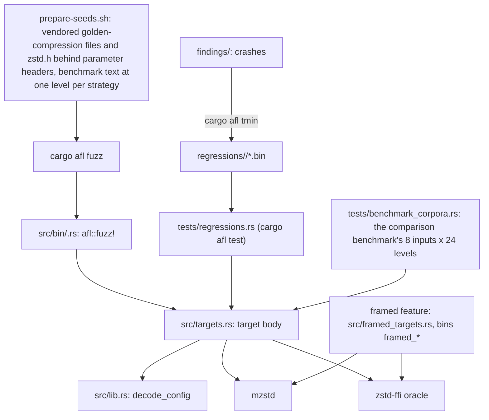
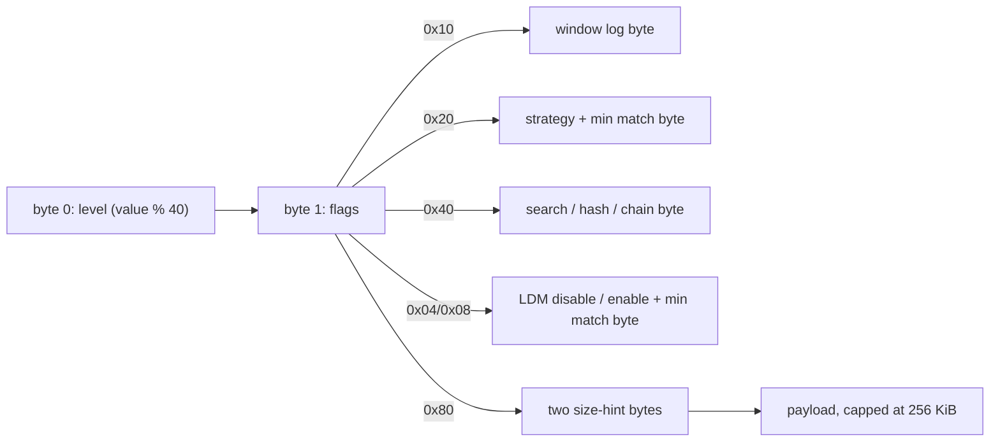
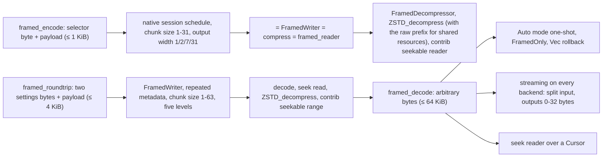

# Fuzzing

AFL++ targets live in `fuzz/afl`, a package excluded from the workspace
because its binaries link AFL's runtime. Target bodies are plain functions
in `src/targets.rs`; each binary in `src/bin/` is a three-line
`afl::fuzz!` adapter, so committed inputs replay through the same bodies
under `cargo afl test` without instrumentation.

## Input layout

`decode_config` turns the first bytes into an `EncoderConfig` and the
equivalent reference `Params`, so every target compares like with like.

Flags `1` and `2` set the checksum and clear the content size. Targets that
need more bytes (capacity, schedule, task count) take them from the start of
the payload, so every target shares one seed corpus.

## Targets

| Target | Oracle |
| --- | --- |
| `differential_c` | `Compressor::compress` equals `ZSTD_compress2` with the same parameters, and the frame decodes. |
| `output_capacity` | `compress_to_slice` into an arbitrary capacity returns the reference's frame, or `OutputTooSmall` exactly when `ZSTD_compress2` fails; `compress_to_uninit` into the same capacity returns the same result and frame. |
| `encoder_session` | A session driven by random chunks, flushes and output capacity, with calls alternating `process` and `process_uninit`, equals `ZSTD_compressStream2` driven the same way (`compress_stream_with_output`). |
| `compressor_lifecycle` | Reuse, `reconfigure` and `trim(ReleaseAll)` never change a frame. |
| `parallel` | Parallel frames decode with the reference and are identical for 1–8 tasks run in reverse order, whether the batch borrows the input or reads it from a `SeekSource` through `prepare_source` with each task on a detached thread. A session (windows 1–4, an optional flush, calls alternating `process` and `process_uninit`, which must leave every byte past `produced` untouched) and the `ParallelEncoderWriter`/`ParallelEncoderReader` adapters (one executor thread each) decode; with a declared size, or an input within one segment, and no flush they equal the batch frame; the writer always equals the session driven with the same writes and flush. |
| `parameter_parsing` | Header decoding never panics; window logs are accepted exactly in `10..=31`, and `0` restores the default. |
| `decompress` | Raw bytes: no panic; anything mzstd accepts, `ZSTD_decompressStream` accepts with the same output; `decompress_to_slice` agrees with `decompress`; `decompress_to_uninit` returns the same result and bytes as `decompress_to_slice` and leaves every byte past it untouched. |
| `decode_streaming` | Two piece sizes, then a frame: a session, with calls alternating `process` and `process_uninit` (which must leave every byte past `produced` untouched), agrees with one-shot decoding and never over-reports progress. `decode_roundtrip` and `decode_dictionary` drive their sessions the same way. |
| `decode_roundtrip` | Parameter header: frames the reference writes with that configuration decode to the payload, one-shot and in pieces. |
| `decode_dictionary` | Two-byte dictionary length, a content-type byte (`% 3`: auto, raw, Zstandard), the dictionary, then frames: mzstd accepts the dictionary exactly when `ZSTD_DCtx_loadDictionary_advanced` does; whatever frames it then decodes, `ZSTD_decompressDCtx` with that dictionary decodes to the same output; `decompress_with_dictionary_to_slice` and a session fed pieces agree with one-shot decoding. |
| `compress_dictionary` | A parameter header, then a two-byte dictionary length, a byte for the content type (`% 3`) and the session's chunk size (`/ 3`), the dictionary and the payload: the dictionary is accepted exactly when the reference accepts it after `ZSTD_CCtx_loadDictionary_advanced`; `compress_with_dictionary` equals `ZSTD_compress2` and a session fed chunks equals `ZSTD_compressStream2`; frames decode with both decoders. |

Decoder targets cap output at 16 MiB, so a few run-length blocks cannot
exhaust memory. The decoder rejects some inputs the reference accepts (see
[decompressor](decompressor.md#compatibility-with-the-reference-decoder)),
so a rejection by mzstd is not compared with the reference.

## Framed targets

The opt-in `framed` feature (`framed = ["mzstd/framed"]`) builds three more
targets from `src/framed_targets.rs`. Their binaries require the feature,
their module and their entries in `tests/regressions.rs` are gated on it
together, and `framed_targets_follow_feature_selection` checks, in both
configurations, that each binary requires `framed` and has committed
regressions. The fuzz package's dependencies never enable the feature, so the
stable configuration builds and replays without these targets.

| Target | Oracle |
| --- | --- |
| `framed_encode` | Byte 0 selects the chunk size (`% 31 + 1`), flush at the middle (bit 0), stored (bit 2) or prefix-dictionary (bit 3) encoding, hidden (bit 4), a checksum identity (bit 5), the output width (bits 6-7) and the backend. A native session (also checking `OutputPending`, a rejected lowercase global field and a dangling internal reference) equals `FramedWriter`, and without a flush `compress` and `framed_reader`. The container decodes back with a resolver; `ZSTD_decompress` outputs exactly the payload when visible and nothing when hidden; without a dictionary the contrib seekable reader agrees. |
| `framed_decode` | Arbitrary bytes, Auto mode with tight limits: no panic or zero-progress loop. Raw input decodes like `Decompressor`; a framed container without dictionaries decodes with `ZSTD_decompress` and the contrib seekable reader to its visible resources; `FramedOnly` accepts exactly the framed results; `decompress_into` rolls back; a session fed `stride` input bytes and 0-32 output bytes per call on every backend agrees with one-shot decoding, never over-reports progress, and finishes with zero progress; a seek reader over the same bytes, when it opens, returns every resource and its metadata exactly as the sequential decode. |
| `framed_roundtrip` | Two settings bytes (chunk size `% 63 + 1`, level among 1, 3, 9, 19, -5, checksum) and a payload through `FramedWriter` with resource metadata and repeated metadata: the decode, a seek read, `ZSTD_decompress` and a contrib seekable read from a third of the payload all return it; then the container goes through `framed_decode`. |

Their regressions hold boundary inputs (empty, a lone selector, a bare
container header, a dictionary magic, raw Zstandard frames, a truncated
container) and containers covering every chunk kind, hidden and stored
resources, external and internal dictionary references and the
single-resource profile, generated once with the encoder.
`campaign.sh` builds with `--features framed` and seeds these targets from
their regressions.

## Corpora

`prepare-seeds.sh` builds `seeds/params` from upstream's
`tests/golden-compression` payloads and `lib/zstd.h`, each behind twelve
parameter headers, the first 64 KiB of `testdata/alice29.txt` (the
comparison benchmark's text) at levels -5, 1, 3, 5, 6, 9, 13, 16, 19 and
22, and the committed `bench-*` regressions; and `seeds/frames` from the
golden decompression fixtures. Campaigns use `seeds/frames` for `decompress`, the committed
regressions for `decode_streaming`, `decode_dictionary` and
`compress_dictionary`, and
`seeds/params` for every other target. Seeds and findings are local
artifacts and are gitignored. The committed `regressions/<target>/` hold
boundary inputs (empty, truncated header, all-ones header, every override)
and minimized findings. `regressions/decode_dictionary/` holds frames the
reference wrote with a small trained dictionary and with raw text, the
trained bytes read as raw content, a frame without a dictionary ID, and the
rejections: a truncated dictionary, a zero repeat offset and the wrong
dictionary ID. `regressions/compress_dictionary/` holds payloads with a
trained dictionary at several levels (also read as raw content, and with a
12-bit window at level 22), with raw text, an empty dictionary (which must
behave as none; this seed caught the first encoder mismatch) and the
rejections: raw bytes as the Zstandard format and a truncated dictionary.

The [comparison benchmark](benchmarking.md)'s cases are regressions too.
`tests/benchmark_corpora.rs` generates its eight inputs with the
benchmark's own generators (`testdata/alice29.txt`, Alice cycled to 1 MiB,
the structured 64 KiB binary, xorshift data at 64 KiB and 1 MiB, 1 MiB of
`a`, the 44-byte text, empty input), puts each behind the header for each
of the benchmark's 24 levels (-5, -1 and 1 to 22, no flags), and replays
all 192 through `differential_c` (byte identity with `ZSTD_compress2`) and
`decode_roundtrip` (the reference's frames decode one-shot and in pieces).
The 1 MiB inputs are cut to the targets' 256 KiB cap, as any payload is.
The 44-byte text at every level is also committed as
`regressions/{differential_c,decode_roundtrip}/bench-tiny-text-l<level>.bin`,
and empty input at every level as
`regressions/differential_c/boundary-bench-empty-l<level>.bin`.

## Campaigns

`campaign.sh [seconds] [targets…]` builds in release mode and runs one AFL
instance per target in parallel. It then reports crashes, hangs and AFL's
own statistics. Two 4-minute runs (the six encoder targets, then the three
decoder targets) found no crashes. They saved three timeouts, but each
replays in under 2 ms, including under `afl-showmap` with the same 20 s
limit. One was saved as AFL stopped the run at its time limit. The other two
were saved mid-run on a loaded macOS host, and are kept as regressions
named `afl-timeout-not-reproduced-*`.

The first decoder run also exposed a bug in the test oracle rather than in
mzstd: `oracle::decompress_stream` took the header hint returned by an extra
call after a frame ending exactly at a full output buffer as "truncated".
It now records only calls that made progress, and
`zstd-ffi/tests/oracle_stream_boundary.rs` covers both outcomes.

A 10-minute run of `decode_dictionary` from its committed regressions
(2026-10-15) found no crashes or hangs: 952 new corpus items, 40% map
coverage.

A 10-minute run of all eleven targets (2026-10-18, after the 0.2.7
encoder and decoder optimizations, seeds including the benchmark inputs)
found no crashes or hangs: `differential_c` 1,470 new corpus items,
`output_capacity` 605, `encoder_session` 1,731, `compressor_lifecycle`
3,365, `parallel` 185, `parameter_parsing` 3,683, `decompress` 387,
`decode_streaming` 1,119, `decode_roundtrip` 226, `decode_dictionary`
1,174, `compress_dictionary` 2,746.

## Known gaps

- No target drives the `std::io` adapters or owned sessions with fuzzed
  input; the integration tests cover them.

The first 10-minute run of `compress_dictionary` (2026-10-15) found two
classes of crash, both kept as regressions: an empty dictionary with the
Zstandard content type, which the reference treats as no dictionary (fixed),
and frames at levels 16-22 with a dictionary whose literal and match length
tables omit their last symbols, where the reference reads uninitialized
memory and is not reproducible itself
([dictionaries](dictionaries.md#known-gaps)); the target now checks byte
identity only for dictionaries with complete length tables. A second
10-minute run of `compress_dictionary` and `decode_dictionary` found no
crashes or hangs (2093 and 922 new corpus items).
