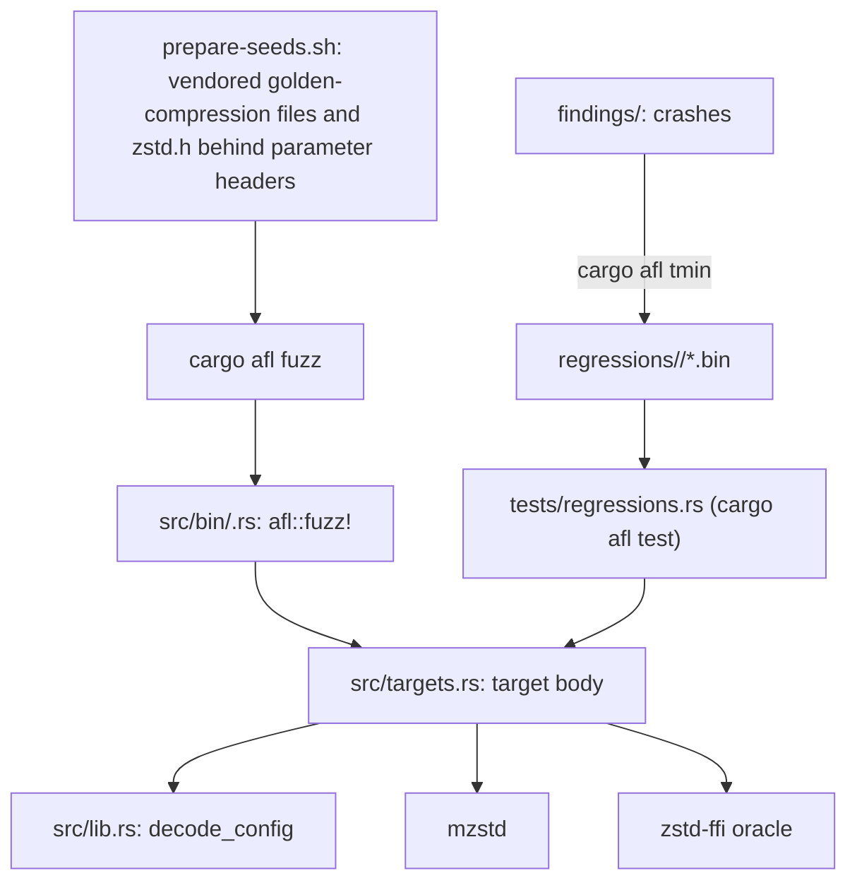
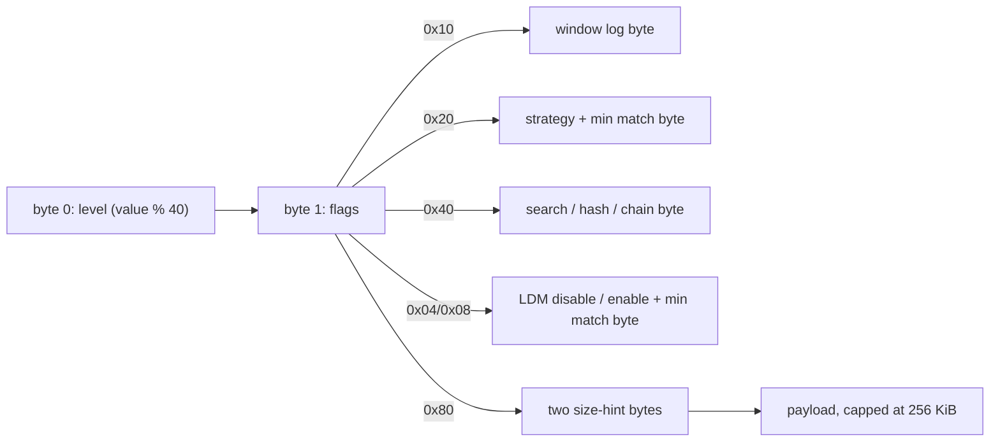

# Fuzzing

AFL++ targets live in `fuzz/afl`, a package excluded from the workspace
because its binaries link AFL's runtime. Target bodies are plain functions
in `src/targets.rs`; each binary in `src/bin/` is a three-line
`afl::fuzz!` adapter, so committed inputs replay through the same bodies
under `cargo afl test` without instrumentation.

## Input layout

`decode_config` turns the first bytes into an `EncoderConfig` and the
equivalent reference `Params`, so every target compares like with like.

Flags `1` and `2` set the checksum and clear the content size. Targets that
need more bytes (capacity, schedule, task count) take them from the start of
the payload, so every target shares one seed corpus.

## Targets

| Target | Oracle |
| --- | --- |
| `differential_c` | `Compressor::compress` equals `ZSTD_compress2` with the same parameters, and the frame decodes. |
| `output_capacity` | `compress_to_slice` into an arbitrary capacity returns the reference's frame, or `OutputTooSmall` exactly when `ZSTD_compress2` fails. |
| `encoder_session` | A session driven by random chunks, flushes and output capacity equals `ZSTD_compressStream2` driven the same way (`compress_stream_with_output`). |
| `compressor_lifecycle` | Reuse, `reconfigure` and `trim(ReleaseAll)` never change a frame. |
| `parallel` | Parallel frames decode with the reference and are identical for 1–8 tasks run in reverse order. |
| `parameter_parsing` | Header decoding never panics; window logs are accepted exactly in `10..=31`. |
| `decompress` | Raw bytes: no panic; anything mzstd accepts, `ZSTD_decompressStream` accepts with the same output; `decompress_to_slice` agrees with `decompress`. |
| `decode_streaming` | Two piece sizes, then a frame: a session agrees with one-shot decoding and never over-reports progress. |
| `decode_roundtrip` | Parameter header: frames the reference writes with that configuration decode to the payload, one-shot and in pieces. |

Decoder targets cap output at 16 MiB, so a few run-length blocks cannot
exhaust memory. The decoder rejects some inputs the reference accepts (see
[decompressor](decompressor.md#compatibility-with-the-reference-decoder)),
so a rejection by mzstd is not compared with the reference.

The `experimental` feature is empty and gates no target yet. It exists so
that both configurations are checked as targets are added; the fuzz package's
dependencies never enable it.

## Corpora

`prepare-seeds.sh` builds `seeds/params` from upstream's
`tests/golden-compression` payloads and `lib/zstd.h`, each behind twelve
parameter headers, and `seeds/frames` from the golden decompression
fixtures. Campaigns use `seeds/frames` for `decompress`, the committed
regressions for `decode_streaming`, and `seeds/params` for every other
target. Seeds and findings are local artifacts and are gitignored. The
committed `regressions/<target>/` hold boundary inputs (empty, truncated
header, all-ones header, every override) and minimized findings.

## Campaigns

`campaign.sh [seconds] [targets…]` builds in release mode and runs one AFL
instance per target in parallel. It then reports crashes, hangs and AFL's
own statistics. Two 4-minute runs (the six encoder targets, then the three
decoder targets) found no crashes. They saved three timeouts, but each
replays in under 2 ms, including under `afl-showmap` with the same 20 s
limit. One was saved as AFL stopped the run at its time limit. The other two
were saved mid-run on a loaded macOS host, and are kept as regressions
named `afl-timeout-not-reproduced-*`.

The first decoder run also exposed a bug in the test oracle rather than in
mzstd: `oracle::decompress_stream` took the header hint returned by an extra
call after a frame ending exactly at a full output buffer as "truncated".
It now records only calls that made progress, and
`zstd-ffi/tests/oracle_stream_boundary.rs` covers both outcomes.

## Known gaps

- No target drives the `std::io` adapters or owned sessions with fuzzed
  input; the integration tests cover them.
