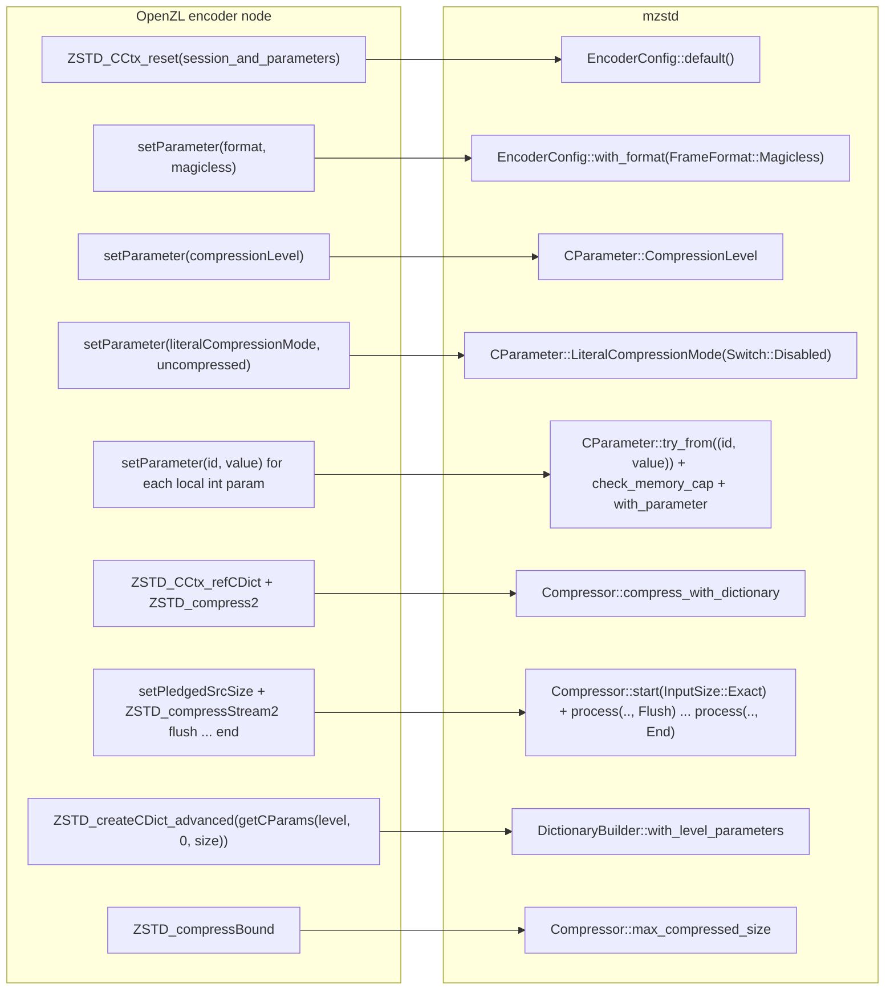
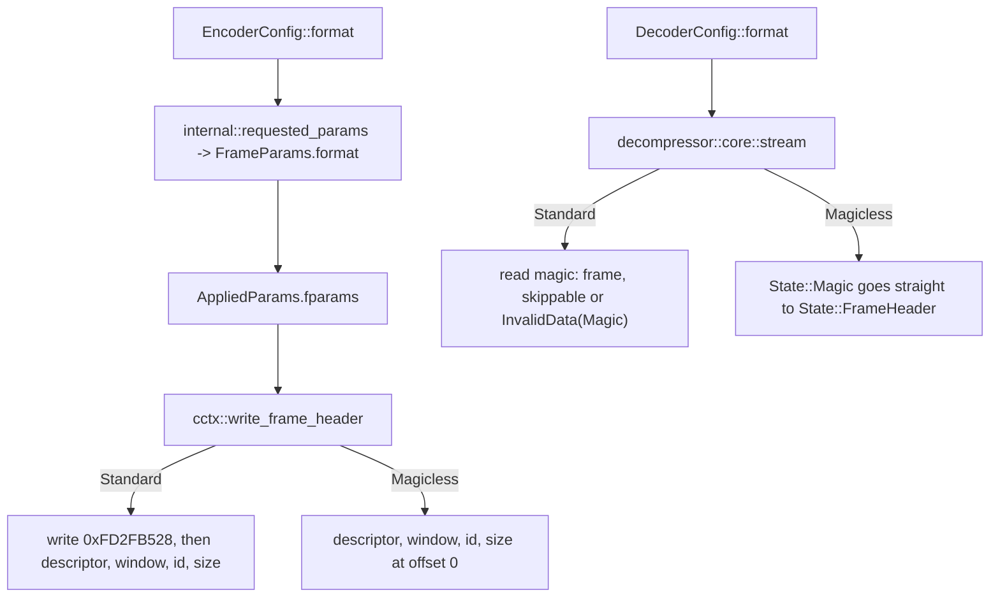
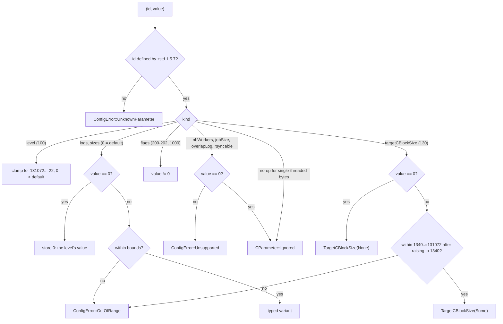
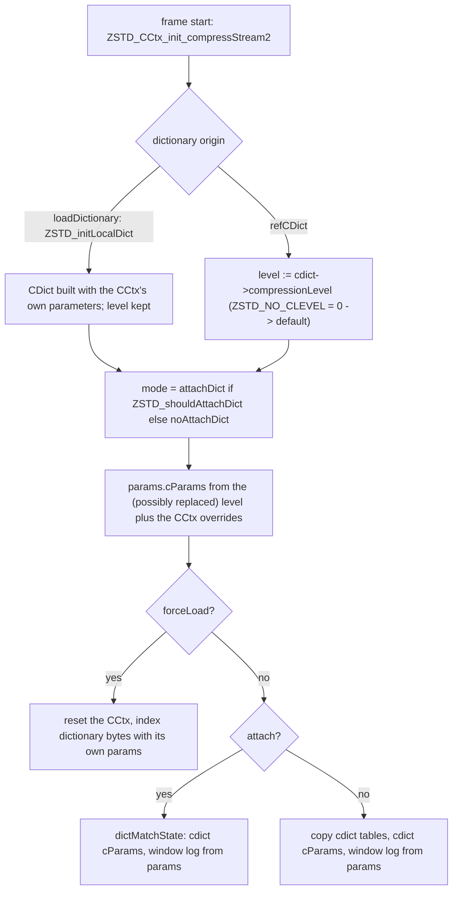
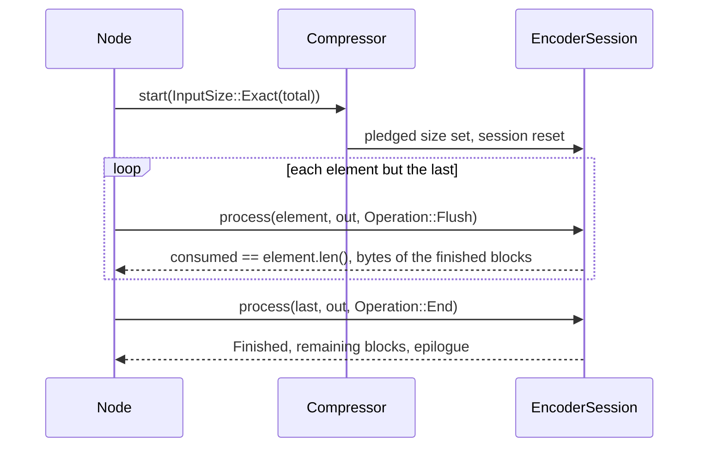

# OpenZL integration surface

OpenZL v0.3.0 drives zstd through a fixed set of calls
(`encode_zstd_binding.c`, `decode_zstd_binding.c`, `common_zstd.c`). This
specification maps each call to the mzstd API that reproduces it byte for
byte, and records the zstd 1.5.7 behaviours that shape the mapping. mzstd
itself knows nothing about OpenZL: every item is a general zstd feature, and
the "node" in the tests is a Rust transcription of the binding.

## Call map

| zstd call | mzstd |
| --- | --- |
| `ZSTD_CCtx_reset(.., session_and_parameters)` | Build a fresh `EncoderConfig::default()`. `ZSTD_reset_session_only` is what starting a new frame already does (`Compressor::start`, one-shot calls and `reconfigure` abandon an unfinished session). |
| `ZSTD_c_format` | `EncoderConfig::with_format` / `CParameter::Format`; decoder: `DecoderConfig::with_format`. |
| `ZSTD_CCtx_setParameter(id, value)` | `CParameter::try_from((id, value))`, then `EncoderConfig::with_parameter`. |
| `EI_zstd_parameter_valid` | `CParameter::check_memory_cap(3)`; the host refuses `Format` and `ContentSizeFlag` itself. |
| `ZSTD_compress2`, `ZSTD_CCtx_refCDict` | `Compressor::compress*` and `compress_with_dictionary*` with a standalone `PreparedDictionary`. |
| `ZSTD_CCtx_setPledgedSrcSize`, `ZSTD_compressStream2` | `Compressor::start(InputSize::Exact(n).into())` and `EncoderSession::process` with `Operation::Flush` / `Operation::End`. |
| `ZSTD_createCDict_advanced(.., ZSTD_getCParams(level, 0, size))` | `DictionaryBuilder::with_level_parameters(level)`; `CompressionParams::for_level` is `ZSTD_getCParams`. |
| `ZSTD_compressBound` | `Compressor::max_compressed_size`. |
| `ZSTD_createDDict_advanced(byCopy, auto)`, `ZSTD_decompress_usingDDict` | `DecodeDictionary::new(bytes, DictionaryContent::Auto)` (or `try_from`), `Decompressor::decompress_with_dictionary*`. |
| `ZSTD_getFrameHeader_advanced` | `decompressor::FrameHeaderInfo::parse(src, format)`. |
| `ZSTD_DCtx_reset`, `ZSTD_d_format` | A `Decompressor` built from `DecoderConfig::with_format`; a decoder holds no parameters between calls. |

## Frame format

`FrameFormat` is a crate-level enum (`Standard`, `Magicless`) shared by the
encoder and decoder configurations. It travels in
`core::cctx::FrameParams::format`, the same struct that carries the content
size, checksum and dictionary-ID switches, so `AppliedParams` already holds it
when the header is written.

- Nothing but the four magic bytes differs: blocks, the checksum and the
  window are the standard frame's, so a magicless frame equals the standard
  frame minus its first four bytes (asserted at every level in
  `tests/openzl_binding.rs`).
- A magicless decoder reads no skippable frames and has no magic to resync
  on; concatenated frames follow one another header to header. The format of
  a stream cannot be detected, so both ends must agree.
- `ParallelCompressor::new` and the framed compressor write their own
  headers, always with a magic number, and refuse the magicless format with
  `ConfigError::Unsupported`.

## Parameters by ID

`compressor::parameter::CParameter` is the validated form of one
`(ZSTD_cParameter, value)` pair. `TryFrom<(i32, i32)>` ports
`ZSTD_CCtx_setParameter` for a single-threaded build (the oracle is compiled
without `ZSTD_MULTITHREAD`):

`EncoderConfig::with_parameter` applies the variant to the matching option,
so "last value wins" and "0 restores the default" fall out of the option
types (`Option<u32>` for the numeric ones). Facts worth keeping in mind:

- Long distance matching keeps its sizes separately from its switch
  (`EncoderConfig::ldm`, `ldm_switch`), because the reference stores
  `ldmHashLog` and friends whatever `enableLongDistanceMatching` is; a later
  switch to `Enabled` or the automatic enabling at `btopt` and a 2^27 window
  uses them. The older `with_long_distance_matching` still resets the values.
- `ForceMaxWindow` is modelled completely: it turns attaching a dictionary
  off (`ZSTD_shouldAttachDict`) and makes a force-loaded dictionary obey the
  window (`loadedDictEnd = 0`).
- `TargetCBlockSize` is the superblock path of
  [target compressed block size](target-block-size.md). The reference
  raises any non-zero value, negative ones included, to 1340 before it checks
  the upper bound, and `ZSTD_CCtx_getParameter` returns the raised value;
  the typed parameter and its `(i32, i32)` pair do the same, so a container
  that stores the pair it read back replays the same frame.
- `Ignored` parameters are validated against their bounds and dropped:
  `enableDedicatedDictSearch` (any value; mzstd never builds dedicated
  tables), stable buffers, `blockDelimiters`, `validateSequences`,
  `deterministicRefPrefix`, `prefetchCDictTables`,
  `enableSeqProducerFallback`, `repcodeResolution` (only the sequence API
  reads it), and the multithreading parameters at `0`.
- `literalCompressionMode` is `Switch`: `Disabled` stores literals raw in
  every block (`ZSTD_lcm_uncompressed`); the optimal parser also prices
  literals as raw (`opt.rs`).

## Dictionaries: `refCDict` versus `loadDictionary`

zstd 1.5.7 treats a dictionary differently depending on how it reaches the
context, and OpenZL uses the `ZSTD_CDict` route:

- A `CDict` made by `ZSTD_createCDict_advanced` records `ZSTD_NO_CLEVEL`
  (0). On `refCDict` the context level is therefore replaced by the default
  level before the frame's parameters are resolved, whatever level the
  compressor requested; the dictionary's own tables use the `cParams` it was
  created with. A dictionary loaded with `loadDictionary` keeps the
  context's level and parameters.
- mzstd models the two as `PreparedDictionary`'s `standalone` flag.
  `DictionaryBuilder::with_level_parameters(level)` builds
  `EncoderConfig::default().with_params(CompressionParams::for_level(level,
  0, len))` and marks the dictionary standalone: any compressor accepts it
  (`PreparedDictionary::serves`), and `requested_for` swaps the compressor's
  level for the default one when resolving a frame. Everything else a
  compressor requests (window log, checksum, dictionary ID flag, attach
  preference, forced window) still applies, as it does to a referenced
  `ZSTD_CDict`.
- `ZSTD_getCParams(level, 0, size)` reads a source size of `0` as unknown
  (`ZSTD_CONTENTSIZE_UNKNOWN`), so the table row is selected as for an unknown
  source with a dictionary (`ZSTD_getCParamRowSize`);
  `CompressionParams::for_level` follows it.
- The dictionary is only ever built from `DictionaryContent::Auto`/`Raw`/`Zstd`
  bytes by copy; the type is detected from the leading magic number as
  `ZSTD_dct_auto` does, and an empty dictionary is accepted (and still
  replaces the level).
- The binding uses the dictionary only on its `ZSTD_compress2` route. When it
  cuts one block per element (element width of at least 1024 and at most 8
  elements) it streams without a dictionary.

## Streaming with a pledged size and flushes

The binding's loop calls `ZSTD_compressStream2` with a growing `ZSTD_inBuffer`
and `ZSTD_e_flush`, switching to `ZSTD_e_end` for the last element, after
`ZSTD_CCtx_setPledgedSrcSize(srcSize)`. The output buffer holds the whole
bound, so each call consumes its element fully. In mzstd:

`Operation::Flush` ends the current block early exactly where
`ZSTD_e_flush` does, which is what the per-element concatenation depends on
(`tests/openzl_binding.rs::the_encoder_node_writes_the_reference_bytes_at_every_level`
covers element counts 2 to 8 at widths from 1 KiB to 300 KB).

## Decoder side

- `DecoderConfig::with_format(FrameFormat::Magicless)` changes only the frame
  grammar (see above).
- `FrameHeaderInfo::parse(src, format)` is `ZSTD_getFrameHeader_advanced`:
  content size (`None` for unknown), window size, dictionary ID, checksum
  flag and header size, with the reference's early magic check on short
  input, skippable-frame headers, the reserved bit and the 2^31 window
  limit. `UnexpectedEndOfInput` stands for a positive "need more" result.
- `DecodeDictionary` with `DictionaryContent::Auto` is
  `ZSTD_createDDict_advanced(byCopy, auto)`; `ZSTD_decompress_usingDDict` is
  `decompress_with_dictionary` (every frame starts from the dictionary; a
  frame naming another ID is `DictionaryMismatch`).

## Known gaps

- Multithreaded modes and dedicated dictionary search are not implemented.
  The first is refused with `ConfigError::Unsupported`; dedicated dictionary
  search is accepted and ignored, so a dictionary that C would build with it
  differs. `ZSTD_c_targetCBlockSize` is implemented
  ([target compressed block size](target-block-size.md)).
- Magicless frames are written by `Compressor` only (not by the parallel or
  framed compressors) and are not in the C ABI.
- The oracle is single-threaded: the accepted set of the parameters
  `nbWorkers`, `jobSize`, `overlapLog` and `rsyncable` is the one of a build
  without `ZSTD_MULTITHREAD`.

## Verification

`tests/openzl_binding.rs` runs OpenZL's calls through the oracle shim
(`mzstd_shim_openzl_encode` / `_decode`, line-for-line ports of the binding's
zstd calls, with a reused `ZSTD_CCtx`) and through mzstd, and compares bytes:
levels -5 to 22 and 0, sizes 0 to several MiB, raw and Zstandard-format
dictionaries at several dictionary levels, attach preferences, forced window,
local parameter lists including the node's policy refusals, header queries on
every prefix and on random bytes, and the numeric acceptance of every
parameter ID against `ZSTD_CCtx_setParameter`. `tests/openzl_config.rs` and
the unit tests of `compressor::core::dict_tests` cover the option surface
and the forced-window dictionary behaviour.
