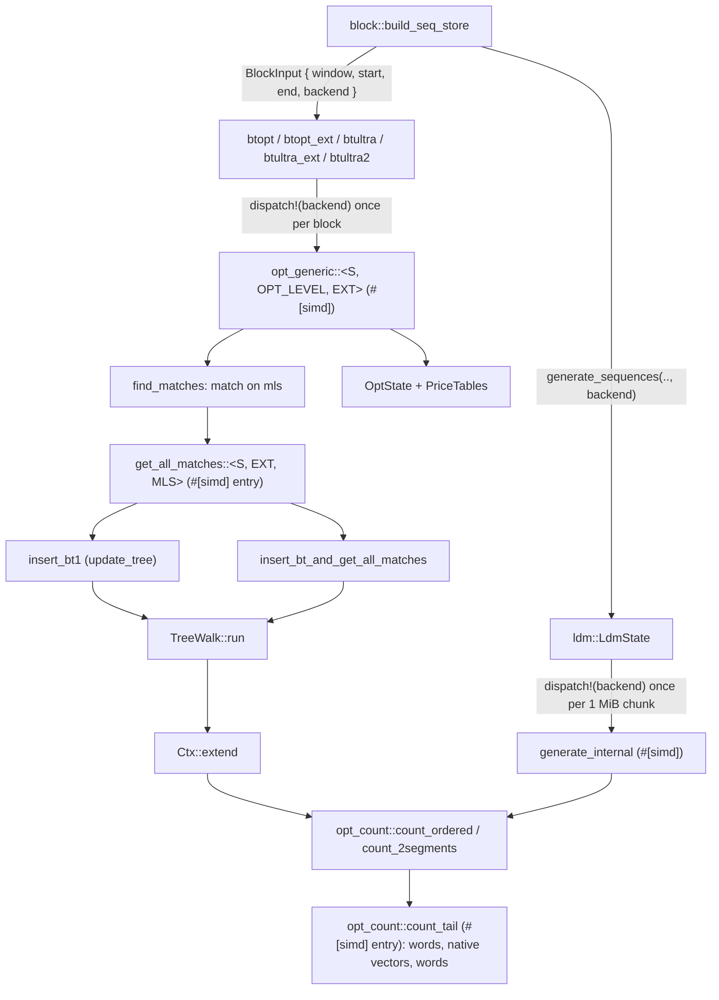
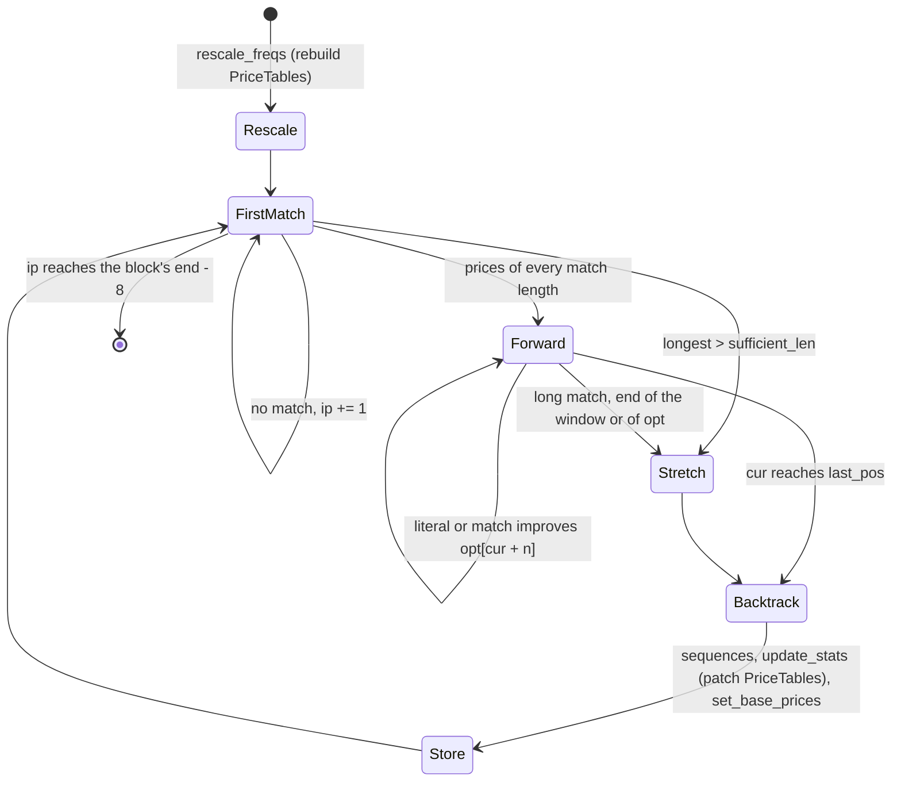
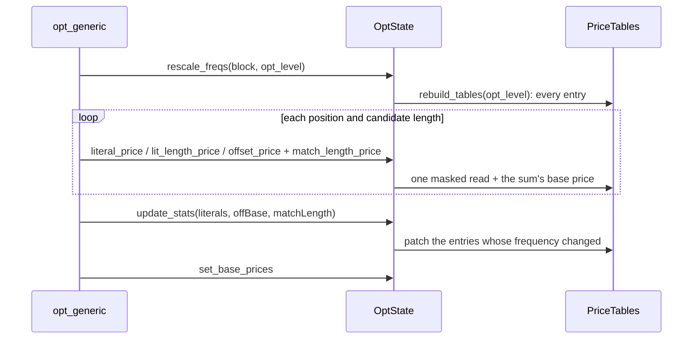
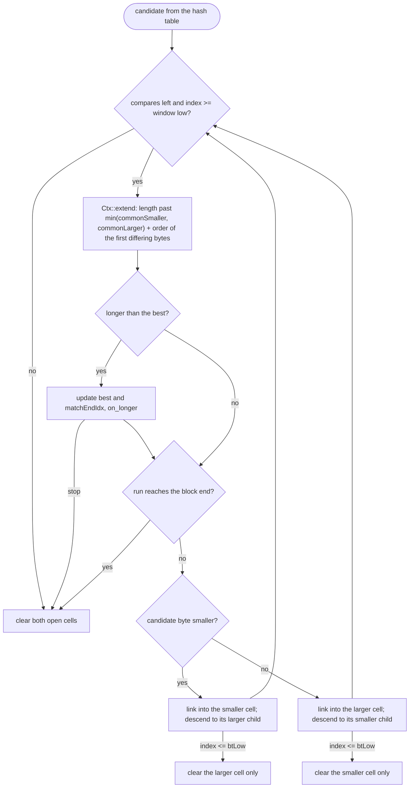

# Optimal parser and long distance matching

`compressor::core::opt` is zstd 1.5.7's `zstd_opt.c`: the `btopt`,
`btultra` and `btultra2` strategies (levels 16 to 22 by default), their
binary-tree match finder and their price model. `compressor::core::ldm` is
`zstd_ldm.c`. `compressor::core::opt_count` holds the match-length kernels
both use. All three are private to `compressor::core`. Their output is
byte-identical to the reference's, and the SIMD backend only changes how
many bytes a comparison covers per step.

## Module and dispatch map

`Backend` (the `fearless_simd` level chosen when the compressor is built)
reaches the parser through `BlockInput::backend` and the LDM through an
argument of `generate_sequences`. Each strategy entry dispatches once per
block; `opt_generic` is monomorphized over the SIMD token, the optimization
level (0 for btopt, 2 for the ultra strategies) and whether the window has
an external dictionary, which are the reference's template parameters.
`find_matches` picks the `get_all_matches` instance for the block's minimum
match length (`ZSTD_selectBtGetAllMatches`); the branch resolves the same
way for every position of a block. `get_all_matches` and `count_tail` are
`#[fearless_simd_macros::simd]` entries: their bodies run in the backend's
feature context, so the vector loads and compares inline into them.

## The parser

The control flow is `ZSTD_compressBlock_opt_generic` line for line. The
position table (`opt`, `ZSTD_optimal_t`) and the match buffer live in
`OptState` and are moved out for the block, as is the LDM candidate store
(lent by `ldm::block_compress` and handed back with its cursor unchanged,
which is what the reference's header copy amounts to). The reference carves
both tables uninitialized from its workspace; `OptState::reserve_positions`
grows them on the first block that needs them to `min(block length + 3,
ZSTD_OPT_SIZE)` entries, the most any position or match index reaches (a
match ends inside the block and below `ZSTD_OPT_NUM`; the list holds one
match per distinct length plus an LDM candidate). `OptState::allocate` at
frame start sizes only the frequency tables, so an empty frame never fills
them and a tiny one fills a few dozen entries instead of 4099.

### Prices

`OptState` keeps the reference's frequencies and sums. `PriceTables` folds
each frequency's `WEIGHT` with its symbol's extra bits:

| Table | Entry | Price |
| --- | --- | --- |
| `literal[256]` | `WEIGHT(litFreq[b])` | `litSumBasePrice - min(entry, litSumBasePrice - 256)` |
| `lit_length[64]` | `LL_bits[c] * 256 - WEIGHT(litLengthFreq[c])` | `entry + litLengthSumBasePrice` |
| `match_length[128]` | `ML_bits[c] * 256 - WEIGHT(matchLengthFreq[c]) + 51` | `entry + matchLengthSumBasePrice` |
| `off_code[32]` | `c * 256 - WEIGHT(offCodeFreq[c])` (+ handicap below level 2) | `entry + offCodeSumBasePrice` |

All sums wrap as the reference's `U32` sums do, so each price equals
`ZSTD_rawLiteralsCost`, `ZSTD_litLengthPrice` and `ZSTD_getMatchPrice`
computed from the frequencies. The offset and match-length parts of a match
price are computed apart; the offset part once per candidate match rather
than once per length. Every table is a power of two longer than any code
its index function can return, so the masked index needs no bounds check.
Predefined prices (`zop_predef`, blocks of at most eight bytes with fresh
statistics) bypass the tables.

A rescale runs at the start of every `opt_generic` call (twice for
btultra2's first block), so a tiny input pays for the rebuild on every
call. `weights` therefore computes a whole table's weights with a
vectorizable float form. For `stat + 1 < 2^24` the `f32` holding it is
exact: `bits >> 23` is `highbit32(stat + 1) + 127` and `bits >> 15`
additionally carries the eight bits of `(stat + 1) << 8 >> highbit`. If any
`stat + 1` reaches `2^24`, which the scaled frequencies never do (they stay
below 2^19), the table is redone with the integer form, which wraps exactly
as the reference's `stat << 8` does. `update_stats` patches literal weights
through a fixed 256-entry view of the frequencies, with the level's weight
form chosen once per sequence.

## The binary tree

`Ctx` holds a block's constants: the prefix and external-dictionary bytes
as plain slices (an index at or above `dict_limit` is an offset into the
prefix, one below it an offset from the end of the external segment), the
block end and the minimum match length. `TreeWalk::run` is the loop that
`ZSTD_insertBt1` and `ZSTD_insertBtAndGetAllMatches` share: it re-links the
tree around the inserted position and reports each candidate longer than
every earlier one through a closure (which records the match for the
search and does nothing for an insertion).

The tree is cut to its exact size, `2 * (btMask + 1)` cells, and every cell
index is masked with `2 * btMask + 1`. The cell indices are below that size
already, so the mask changes nothing, but it lets the compiler drop the
bounds checks from the walk. The reference parks a finished side on a dummy
cell; here that side is simply not cleared.

### Match-length kernels (`opt_count`)

`count_ordered` is the walk's comparison. It loads the first word of each
side, with one length test apiece. If they differ, it returns the length
from a trailing-zero count, and takes the order of the first differing
bytes (`match[len] < ip[len]`, which the walk branches on next) from the
same words. Up to `INLINE_WORDS` (2) words are compared this way inline;
measured with interleaved runs, two settle most runs on short inputs and
on text without growing the walk enough to slow the tiny-input path, while
four were faster on `http` but slower on tiny and binary inputs. A run
past them continues in `count_tail`, out of line: two more words, then
native vectors (the backend's 32 or 64 lanes, else 16; the scalar
fallback emulates them), then words, then one word ending at the limit that
overlaps bytes already known equal. `count` is `ZSTD_count` within one
segment and `count_2segments` is `ZSTD_count_2segments`; the repeat-offset
checks, the 3-byte hash candidate and the LDM's forward match length use
them. Every variant returns exactly the byte-by-byte length.

## Long distance matching

`generate_sequences` cuts its range into 1 MiB chunks and dispatches each
chunk's `generate_internal` to the backend. The gear hash feeds bytes into
a fixed batch of 64 split points (`ZSTD_ldm_gear_feed`). Each split is
hashed with a one-shot `XXH64`, the same digest as the frame checksum's
streaming hasher without its buffering. A candidate's forward length comes
from `opt_count` (both segments). Its backward length is a byte loop, as in
the reference. The rolling hash is a serial dependency chain (each step
shifts the previous state), so it stays scalar.

## Invariants

- Every byte the parser emits is the reference's. The SIMD level, the price
  tables and the specialized hashes change no decision. Each is
  differential-tested against the byte-by-byte count, the reference formulas
  or `mem::hash_ptr`, on every backend in `Backend::available()`.
- Tree cell indices are below the tree size. Window indices handed to `Ctx`
  are at least the window's low limit, and in the non-extDict variants at
  least `dict_limit`. A violation panics on a slice bound and never reads
  out of range.
- `PriceTables` is valid from the `rescale_freqs` at the start of each
  `opt_generic` call until the end of that call. Nothing outside `opt`
  reads it.

## Known gaps

- The tree walk still pays one length test for the candidate's word and one
  for the current position's per visited node, which the reference's
  pointer arithmetic does not. On text at level 16 the parser executes
  about 25% more instructions than the reference. Most of that is in the
  walk, whose time is dominated by cache misses, so the wall-clock gap is
  far smaller.
- `MatchState::reset` zeroes the hash, tree and 3-byte hash tables on every
  frame for these strategies, while the reference keeps them when indices
  continue. Every read here is checked against the window first: the hash
  and 3-byte candidates against the window low, and each inserted node
  rewrites both of its own cells. So the btopt..btultra2 tables could be
  kept as the fast and dfast ones are. On a 64-byte input that zeroing is
  about 4K of the roughly 80K instructions per call.
- The gear hash is scalar. A vector version would have to rebuild the
  rolling state from the last 64 bytes in every lane.
