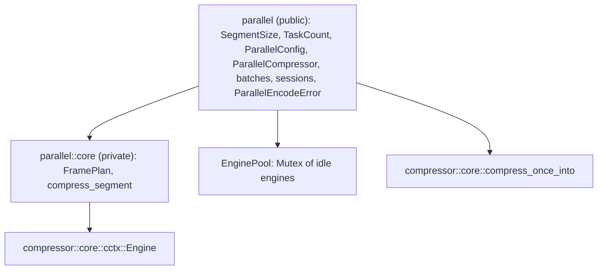
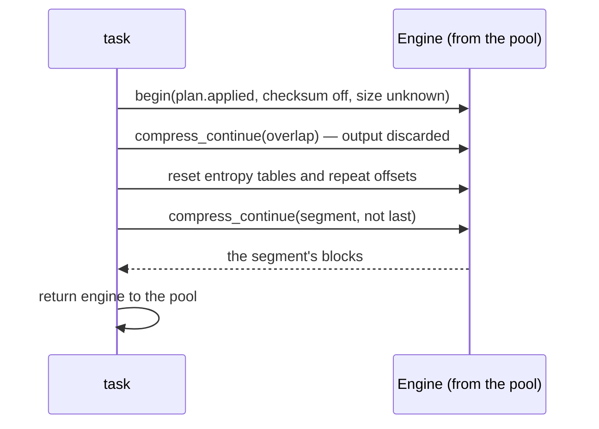
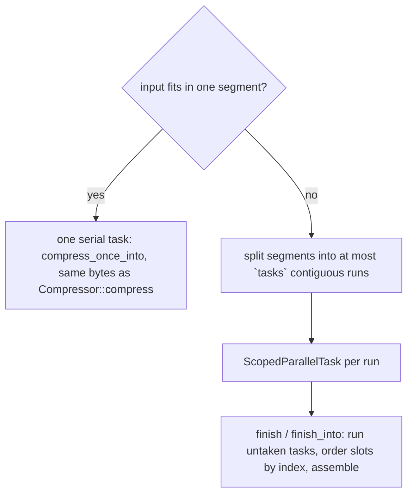
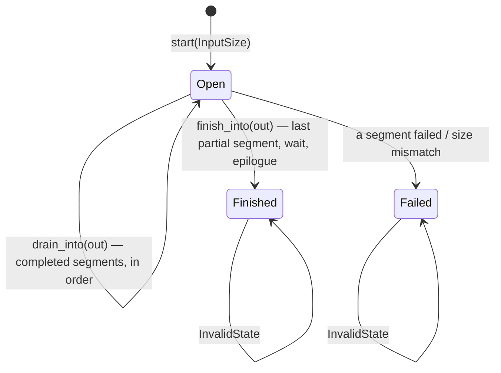

# Parallel compression

`compressor::parallel` (with `std`) compresses one frame with tasks the
caller runs on its own threads or executor. It does not spawn threads. The
frame is a standard Zstandard frame that any decoder accepts. Its bytes
depend only on the configuration and the segment size, not on the task count
or the order tasks run in. They are **not** the reference's: neither the
serial encoder's frame nor the frame of zstd's multithreaded mode (ZSTDMT).

## Modules

| Type | Role |
| --- | --- |
| `SegmentSize` | 64 KiB to 256 MiB, default 4 MiB: the input each segment covers. |
| `TaskCount` | 1 to 65536: how many tasks a slice batch is cut into. |
| `ParallelConfig` | The segment size. |
| `ParallelCompressor` | An `EncoderConfig`, a `ParallelConfig` and a pool of idle engines shared with its tasks. |
| `ScopedParallelBatch` / `ScopedParallelTask` | A whole input borrowed for a scope; each task compresses a run of consecutive segments. |
| `ParallelEncoderSession` / `ParallelTaskQueue` / `OwnedParallelTask` | Input that arrives in chunks; each full segment becomes an owned `'static` task in a queue. |

## Frame layout

`FramePlan::new` resolves the parameters once for the whole frame, with the
total size when it is known, so every segment shares the window, strategy
and block size. `header` is `ZSTD_writeFrameHeader` without a dictionary;
`epilogue` writes an empty last block and, if enabled, the checksum of the
whole input.

## Segments

A segment may reach back into the `overlap` bytes before it: an eighth of
the window, or the whole window for btultra and btultra2. The engine first
compresses the overlap and throws that output away, which fills its tables
and window with that history. Then it resets the entropy tables and repeat
offsets, so the segment's first block refers to nothing the decoder has not
seen: no repeated tables from discarded blocks, and no repeat offsets that
only existed there. Matches into the overlap remain valid, because the
decoder already holds those bytes as the previous segment's output.

## Scoped batches

`prepare_slice(input, tasks)` plans a whole borrowed input:

Each task pushes `(index, result)` into a shared slot list. `finish` runs any
task the caller did not take, checks that every slot is filled (a task that
panicked leaves its slot empty, which is reported as `InvalidState`), and
assembles the frame in index order. `compress` is `prepare_slice` with one
task, run on the calling thread by `finish`.

## Streaming sessions

The session gathers input into `pending` until a segment is full, keeps the
last `overlap` bytes of history in `overlap`, and queues an `OwnedParallelTask`
holding a copy of both. The caller takes tasks from the `ParallelTaskQueue`
(`next_task`) and runs them anywhere; `run_queued` runs the backlog on the
calling thread. The memory the caller holds is bounded by how many tasks it
lets queue up (`queued`) and how promptly it drains output. `drain_into`
writes the header once, then each segment's blocks as soon as every earlier
segment is delivered. `finish_into` queues the final partial segment, runs whatever is
still queued on the calling thread, waits on the queue's condition variable
for tasks running elsewhere, drains, and writes the epilogue. The checksum is
computed incrementally as input is pushed.

An `OwnedParallelTask` records its result through a `Completion` guard whose
`Drop` runs even when the task unwinds; a panicking task therefore reports
`EncodeError::Internal` instead of leaving `finish_into` waiting forever.

## Errors

`ParallelEncodeError` is `Encode(EncodeError)` for a failed segment,
`InputSizeMismatch` when a declared size is not met, and `InvalidState` for
operations after the session finished or failed, or for a batch whose tasks
did not all report.

## Invariants

- Segment boundaries depend only on the segment size, so the frame is the same
  for every task count and execution order. `tests/parallel.rs` and the
  `parallel` fuzz target check this, and they also check that the frame
  decodes with the reference decoder.
- Engines are reused through the pool; reuse does not change output (see
  [compressor](compressor.md#retention)).

## Known gaps

- The overlap is re-compressed rather than loaded as a prefix the way ZSTDMT
  loads it with `ZSTD_compressBegin_advanced_internal`. This costs CPU but
  not correctness.
- Frames are not ZSTDMT-identical, and there is no job-size or
  overlap-log parameter.
