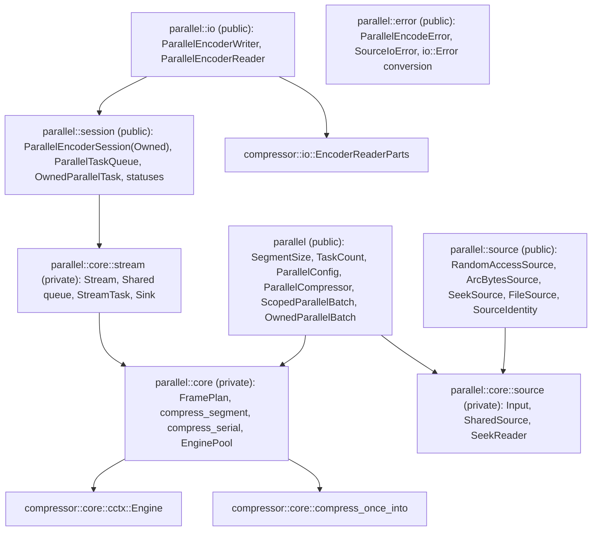
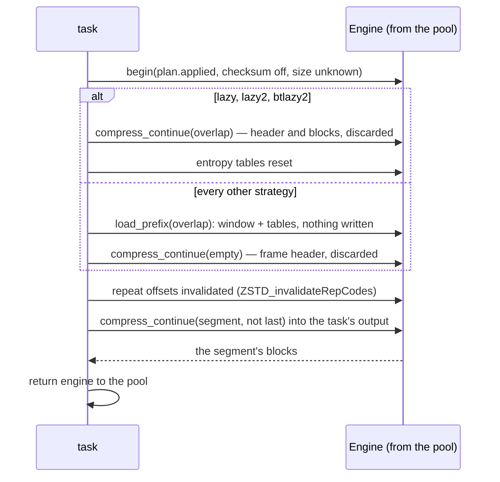
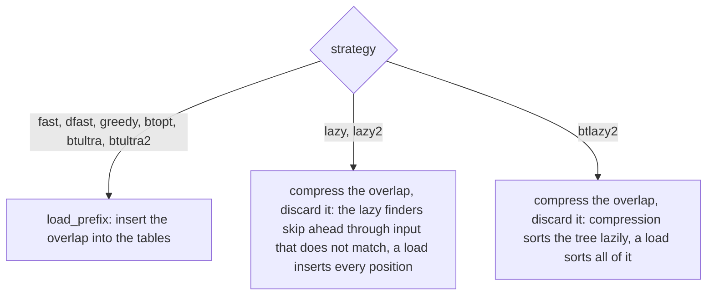
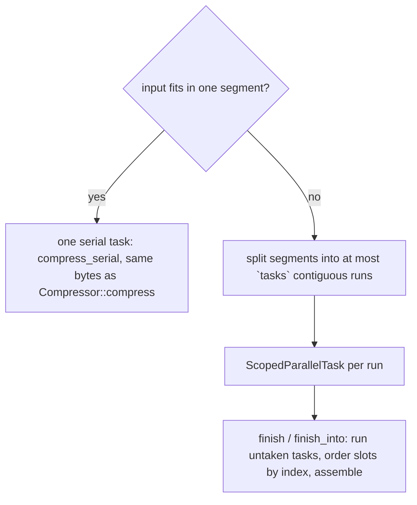
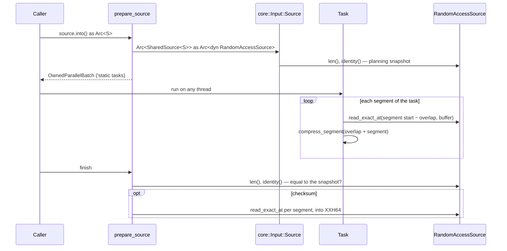
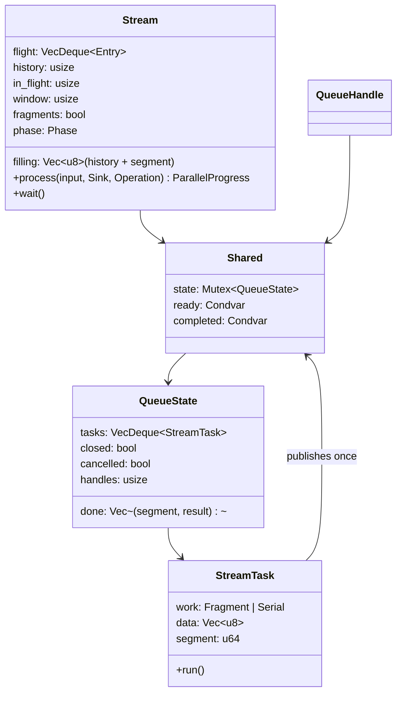
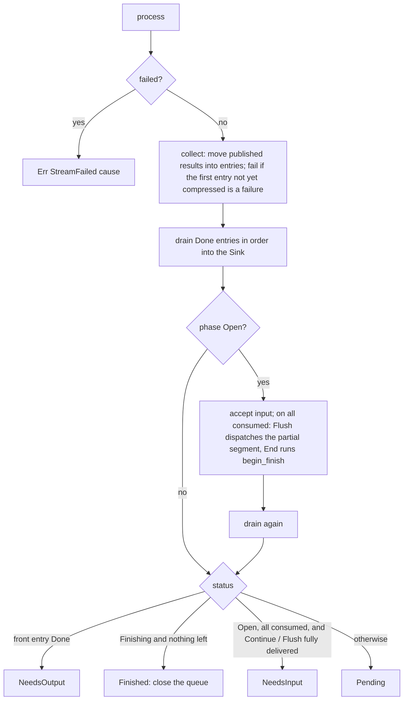
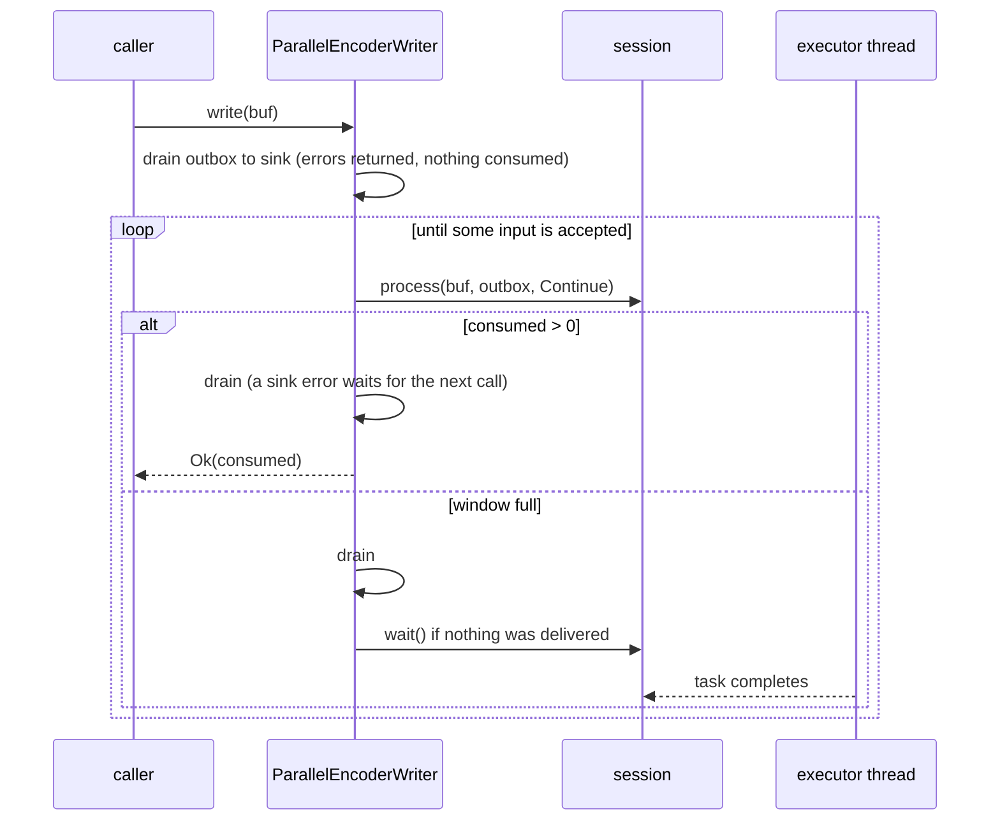

# Parallel compression

`compressor::parallel` (with `std`) compresses one frame with tasks the
caller runs on its own threads or executor. It does not spawn threads. The
frame is a standard Zstandard frame that any decoder accepts. Its bytes
depend only on the configuration, the segment size and, for streams, the
declared size and the flushes; not on the task count, the window or the order
tasks run in. They are **not** the reference's: neither the serial encoder's
frame nor the frame of zstd's multithreaded mode (ZSTDMT).

## Modules

| Type | Role |
| --- | --- |
| `SegmentSize` | 64 KiB to 256 MiB, default 4 MiB: the input each segment covers. |
| `TaskCount` | 1 to 65536: how many tasks a slice batch is cut into, or a stream's window. |
| `ParallelConfig` | The segment size. |
| `ParallelCompressor` | An `EncoderConfig`, a `ParallelConfig` and a pool of idle engines shared with its tasks. |
| `ScopedParallelBatch` / `ScopedParallelTask` | A whole input, borrowed for a scope or read from a source; each task compresses a run of consecutive segments. |
| `OwnedParallelBatch` | `ScopedParallelBatch<'static>`, from `prepare_source`: its tasks own a shared source handle and run on detached threads. |
| `RandomAccessSource` | `len`, `read_exact_at(offset, dst)` and an optional `identity`; `Send + Sync + 'static`. |
| `ArcBytesSource` / `SeekSource` / `FileSource` | Shared immutable bytes; a `Read + Seek` reader behind a mutex; a regular file read with positional reads. |
| `SourceIdentity` / `SourceIoError` | A source's version token; a source's `io::Error`, shared so `ParallelEncodeError` stays `Clone + Eq`. |
| `ParallelEncoderSession` / `ParallelEncoderSessionOwned` | Input that arrives in chunks; borrows or owns the compressor and wraps one `core::Stream`. |
| `ParallelTaskQueue` / `OwnedParallelTask` / `ParallelTasks` | The stream's queue handle, its `'static` tasks and the blocking iterator over them. |
| `ParallelEncoderStatus` / `ParallelProgress` | What one `process` call did and what the session needs next. |
| `ParallelEncoderWriter` / `ParallelEncoderReader` | `std::io` adapters over a borrowed session. |

## Frame layout

`FramePlan::new` resolves the parameters once for the whole frame, with the
total size when it is known, so every segment shares the window, strategy
and block size. `header` is `ZSTD_writeFrameHeader` without a dictionary;
`epilogue` writes an empty last block and, if enabled, the checksum of the
whole input. An input that fits in one segment is instead compressed by
`compress_serial` (`compress_once_into`), which is `Compressor::compress`.

## Segments

A segment may reach back into the `overlap` bytes before it: an eighth of
the window, or the whole window for btultra and btultra2, whose frames
gain the most from distant history. The overlap is not capped by the segment
size, so at level 22 (a 128 MiB window) a segment primes itself with up to
128 MiB of earlier input.

How a segment primes itself depends on the strategy
(`FramePlan::compresses_overlap`), chosen by measurement
(`benches/parallel.rs` `parallel-corpora`):

With four threads, 4 MiB segments and 16 MiB inputs (synthetic text,
binary, random and mixed data, and the 5 MiB of vendored zstd sources;
i7-13700KF), loading instead of compressing the overlap made levels 18-22
15-27% faster, with frames 0.01-0.09% larger (0.25-0.27% on the binary
corpus): a compressed overlap left the optimal parser's statistics primed
for the segment's first block, a loaded one does not. Levels 1-5 ran up to
27% faster (random input at level 1) and levels 16-17 1-7% faster, with
frames within 0.12% of compressing the overlap. Loading made lazy and lazy2
up to three times slower on random input and btlazy2 9% slower on text,
so those strategies keep compressing it. Fast and dfast load every third
position (`ZSTD_dtlm_fast`), as ZSTDMT does: the full load only fills empty
slots, so with the stale entries a pooled engine keeps it would make a
segment depend on the engine's history.

`Engine::load_prefix` loads the overlap the way ZSTDMT primes a job
(`ZSTD_compressBegin_advanced_internal` with a raw-content prefix,
`ZSTD_dtlm_fast` and `forceWindow`): `load_dictionary_content` makes the
bytes history in the window and inserts them into the match finder's tables
(and LDM's, when enabled) without compressing them, and the prefix remains
subject to the window like any input. Overlap and segment are one slice, so
the segment continues the prefix contiguously and the noDict finders run.
The segment starts with empty entropy tables and repeat offsets that match
nothing, so its first block refers to nothing the decoder has not seen;
matches into the overlap stay valid, because the decoder holds those bytes
as the previous segment's output.

## Scoped batches

`prepare_slice(input, tasks)` plans a whole borrowed input, and
`prepare_source(source, tasks)` one read from a `RandomAccessSource` (see
[sources](#sources)). Both go through one private `prepare` over a
`core::Input` (`Slice(&[u8])` or `Source(Arc<dyn RandomAccessSource>)`) and
its length:

Each task pushes `(index, result)` into a shared slot list exactly once: when
it runs, or from its `Drop` when it is dropped unrun (`TaskAbandoned`) or
unwinds while running (`TaskPanicked`; the panic still propagates, and the
engine it held is discarded instead of returned). `finish` runs any task the
caller did not take, orders the slots by index and assembles the frame; the
first failing slot becomes `BatchFailed(cause)` and leaves `out` untouched. A
slot count short of the task count (a task leaked with `mem::forget`) is
`InvalidState`. `compress` is `prepare_slice` with one task, run on the
calling thread by `finish`.

For a source, `finish` then checks that the source's length and identity
still equal those recorded at planning (`SourceChanged`, or
`SourceMetadata` when the length cannot be read), and, for a frame with a
checksum, reads the source once more in segment-sized chunks to hash it.
Both happen before `out` is touched, so a failure leaves it as it was.

## Sources

`prepare_source<S: RandomAccessSource + ?Sized, T: Into<Arc<S>>>` converts
the argument once. The private `SharedSource<S>` bridge lets an unsized `S`
(`dyn RandomAccessSource`) become the batch's
`Arc<dyn RandomAccessSource>`; tasks clone that handle, never the bytes. An
`Arc` argument or a custom conversion may need `S` named, because
`Into<Arc<S>>` admits more than one target.

A task reads each segment together with its overlap into one buffer, grown
with `Vec::resize` and reused across the task's segments, so a source batch
holds at most one overlap plus one segment per running task. The serial
fallback reads the whole (at most one-segment) source. A read failure is
`SourceRead { segment }`, reported as the task's result; a panic inside the
source unwinds the task like any other (`TaskPanicked`). The frame is
byte-identical to `prepare_slice` over the same bytes.

- `ArcBytesSource` wraps `Arc<[u8]>`; a range past the end is
  `UnexpectedEof`.
- `SeekSource<R>` (`R: Read + Seek + Send`, not `Sync`) holds the reader in
  `core::SeekReader`'s mutex: `len` seeks to the end, and each read seeks to
  its absolute offset and `read_exact`s under one lock, so tasks never see a
  cursor another task moved. A panic inside the reader poisons the mutex and
  later calls fail with an I/O error. It has no identity.
- `FileSource` reads with `FileExt::read_at` (Unix) or `seek_read`
  (Windows), retrying `Interrupted` and short reads; other platforms return
  `Unsupported`. It accepts regular files only. Its identity is the length,
  modification time and, on Unix, device, inode and change time — it catches
  most rewrites but not every in-place write.

## Streaming sessions

`start(stream, window)` and `into_session(stream, window)` build a
`core::Stream` and its first `QueueHandle`. The borrowed session holds the
compressor's borrow only as a `PhantomData`; the stream itself holds what it
needs (`RequestedParams`, the `FramePlan`, the segment size and a clone of
the engine pool), so both sessions share one state machine.

### Input and dispatch

`filling` starts with `history`, the last `overlap` bytes of earlier input,
followed by the segment being gathered. `accept` copies input until a segment
is full; a full segment becomes a `Fragment` task whose data is the whole
`filling` (moved, not copied), and the new `filling` is seeded with the tail
the next segment may reach into. The first fragment is preceded by the frame
header as an inline output entry. Dispatch stops when `in_flight` (parts with
a task that are queued, running or not fully delivered) reaches the window;
the rest of the input is left unconsumed.

A full **first** segment is not dispatched until a following byte or an `End`
arrives, because a frame that turns out to fit in one segment takes the
batch's serial fallback: `End` with no fragment queued compresses the whole
input as one `Serial` task, or inline when it is empty. This holds with and
without a declared size. Without a declared size, a multi-segment stream
resolves its plan for an unknown size, so its frame differs from the batch's.

### Ordered delivery and status

`process` never blocks. `Sink` is implemented for `[u8]` and
`[MaybeUninit<u8>]`, so `process` and `process_uninit` are two
instantiations of one function: same bytes, counts, statuses and errors, and
they may be mixed. Delivery only writes `output[..produced]`.

`begin_finish` checks a declared size, then chooses the serial fallback or
queues the last partial segment (retried by a later `End` if the window is
full) followed by the epilogue. `Flush` queues the partial segment early,
which moves every later segment boundary, and reports `NeedsInput` only when
nothing is gathered or in flight.

`wait` returns at once when a result was published since the last
collection or when nothing runs; otherwise it sleeps on `completed` until a
task publishes. Every task publishes exactly once, so a running part always
ends a wait.

### Lifecycle

```mermaid
stateDiagram-v2
    [*] --> Open: start / into_session (stream, window)
    Open --> Open: process Continue / Flush — accept, dispatch, deliver
    Open --> Finishing: End — last part and epilogue queued
    Open --> Failed: size mismatch, task failure, closed queue
    Finishing --> Finishing: deliver; Pending while parts run
    Finishing --> Finished: last byte delivered — queue closed
    Finishing --> Failed: task failure
    Failed --> Failed: every call returns StreamFailed(cause)
    Finished --> Finished: process returns Finished, consumes nothing
```

### Queue, cancellation and failures

`QueueHandle::recv` blocks on `ready` until a task is queued or the queue
closes; `try_recv` (`next_task`) does not block. The stream closes the queue
with `cancelled` set when it finishes, fails or is dropped: queued tasks are
dropped (each publishes `TaskAbandoned`, outside the lock), executors' loops
end, and a task taken before the close skips its work. Dropping the last
handle closes the queue without cancelling: queued tasks report
`TaskAbandoned`, and the next dispatch fails with `TaskQueueClosed`, so the
session fails instead of waiting forever. Tasks executors took before the
close remain theirs and must still be run or dropped; dropping every handle
cannot resolve a task held forever.

Stopping executors is not itself an error, and there is no timeout. If a
needed task stays queued, or is held by an executor without being run or
dropped, `wait` can block indefinitely. The blocking adapters wait the same
way, so the reader's `read` and the writer's `write`, `flush`, `try_finish`
and `finish` can block too. Executors must stay able to run until finishing
returns, and a bounded pool must leave capacity for the tasks instead of
filling every worker with callers waiting for them.

A `StreamTask` publishes from `run`, or from `Drop` with `TaskAbandoned`
(never ran) or `TaskPanicked` (unwound; its engine is dropped). `collect`
fails the stream only when the first entry that is not yet compressed is a
failure, so the reported cause is the first failing segment in input order,
whatever order tasks finished in. Failures are wrapped as
`StreamFailed(Arc<cause>)`, and every later call repeats it.

## I/O adapters

`ParallelCompressor::writer(sink, stream, window)` and
`reader(source, stream, window)` return the adapter beside the queue, as
`start` does. Both own only buffering; every decision belongs to the session,
so they produce the session's bytes.

- The writer keeps compressed bytes in a 128 KiB outbox until the sink takes
  them, so short writes, `Interrupted`, `WouldBlock` and sink errors lose
  nothing. `Write::flush` is `Operation::Flush` followed by the sink's flush;
  `try_finish` repeats `End`, waiting whenever a step delivered nothing, and
  `finish` returns the adapter inside `FinishError` for a retry. The session
  is boxed so `FinishError<Self>` stays small.
- The reader fills a 128 KiB buffer from the source, calls `process` with
  `Continue` (or `End` after the source's end) straight into the caller's
  slice, and waits when the session is `Pending` with nothing produced.
  `into_parts` returns the source and the bytes read but not accepted as
  `EncoderReaderParts`.
- Both block in `wait`, so the queue must run on other threads.

## Errors

`ParallelEncodeError` is `#[non_exhaustive]`:

| Variant | When |
| --- | --- |
| `Encode(EncodeError)` | A segment or serial frame failed in the engine (a core bug for valid input). |
| `InputSizeMismatch { declared, actual }` | A stream's input contradicts its declared size. |
| `InvalidState` | A batch task never reported (leaked). |
| `BatchFailed(Arc<cause>)` | A batch task failed; the first failing task's cause. |
| `StreamFailed(Arc<cause>)` | A stream failed, on this call or earlier. |
| `TaskQueueClosed` | Every queue handle was dropped and the stream had a task to queue. |
| `TaskAbandoned { segment }` | A task was dropped without running. |
| `TaskPanicked { segment }` | A task unwound while running. |
| `SourceMetadata(SourceIoError)` | A source's length could not be read, at `prepare_source` or at `finish`. |
| `SourceRead { segment, source }` | A source read failed in a task (inside `BatchFailed`) or while hashing for the checksum. |
| `SourceChanged` | A source's length or identity differs at `finish` from planning. |

`From<ParallelEncodeError> for io::Error` takes the kind of the root cause
through `StreamFailed` and `BatchFailed` (`InvalidInput` for size mismatches
and `Bound`, `WriteZero` for `OutputTooSmall`, a source failure's own kind,
`InvalidData` for `SourceChanged`, `Other` otherwise) and keeps
the error as the source. It never produces `Interrupted` or `WouldBlock`,
which `std::io` would retry. The wrapped cause's source in the chain is the
`Arc<ParallelEncodeError>` itself. `SourceIoError` is transparent: it
displays as its `io::Error`, which `AsRef` reaches, and two compare equal
when their kinds and messages do.

## Invariants

- Segment boundaries depend only on the segment size and the flushes, so the
  frame is the same for every task count, window, chunking and execution
  order. A stream with a declared size and no flush produces the batch frame;
  so does any stream whose input fits in one segment.
- Every task publishes exactly once (run, drop or unwind), so `wait` and
  batch assembly never wait for a task that cannot report.
- `in_flight <= window`; `filling` holds at most an overlap plus one segment,
  allocated once per segment at that size.
- `process` writes exactly `output[..produced]`.
- Engines are reused through the pool; reuse does not change output (see
  [compressor](compressor.md#retention)). An engine that unwound is never
  returned.
- `tests/parallel.rs`, `tests/parallel_stream.rs`, `tests/parallel_io.rs`
  and the `parallel` fuzz target check these, and that frames decode with the
  reference decoder.

## Known gaps

- Frames are not ZSTDMT-identical (segments are not ZSTDMT jobs, LDM runs
  per segment rather than serially, overlaps follow their own sizes, and
  lazy, lazy2 and btlazy2 compress their overlap instead of loading it),
  and there is no job-size or overlap-log parameter.
- Segment size does not follow the window as ZSTDMT's job size does: at
  levels 18-22 small segments each prime themselves with a whole window of
  earlier input, which can cost more than compressing the segment.
- The parallel compressor takes no dictionary.
- A stream copies its input into segments, and each part's blocks through
  the caller's buffer; the batch reads its slice in place, and a source
  batch copies each segment and its overlap into a per-task buffer.
- A source batch with a checksum reads the source twice. Length and
  identity checks cannot prove a source unchanged, and there is no option to
  skip them (mbrotli's `SourceConsistency`).
- A task held by the caller and never run or dropped blocks `wait` forever.
- There is no `wait` with a timeout.
