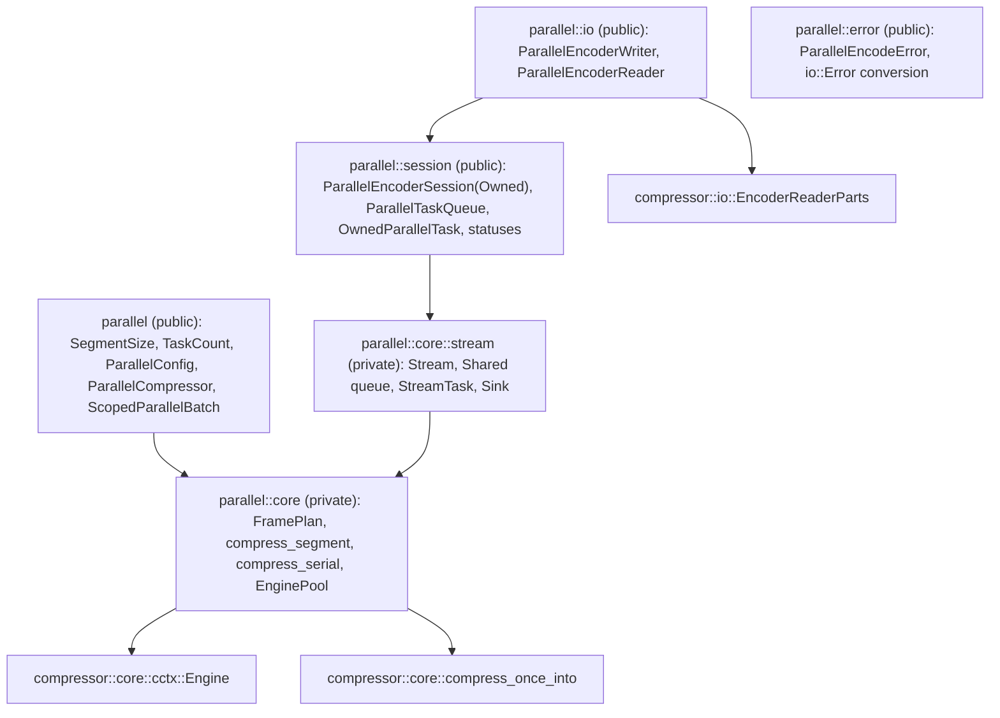
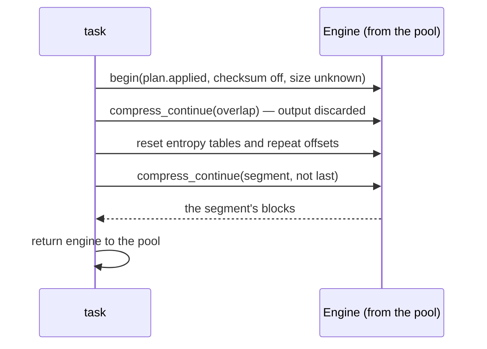
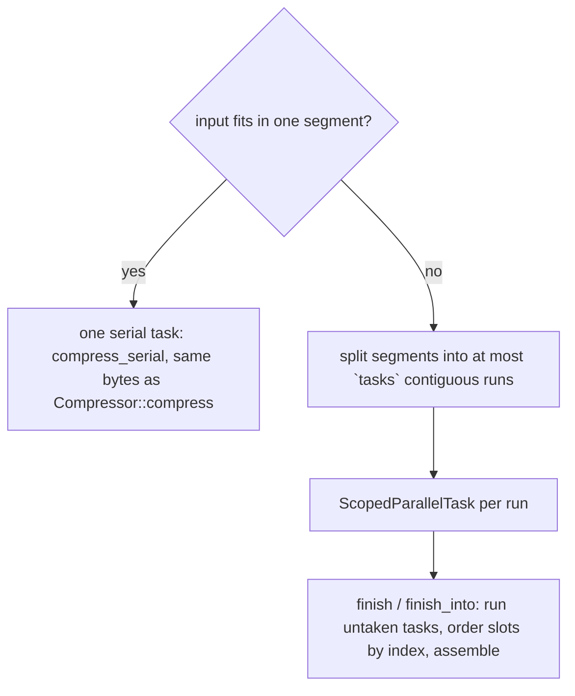
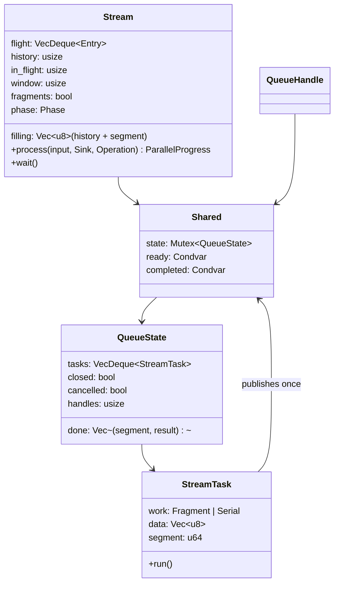
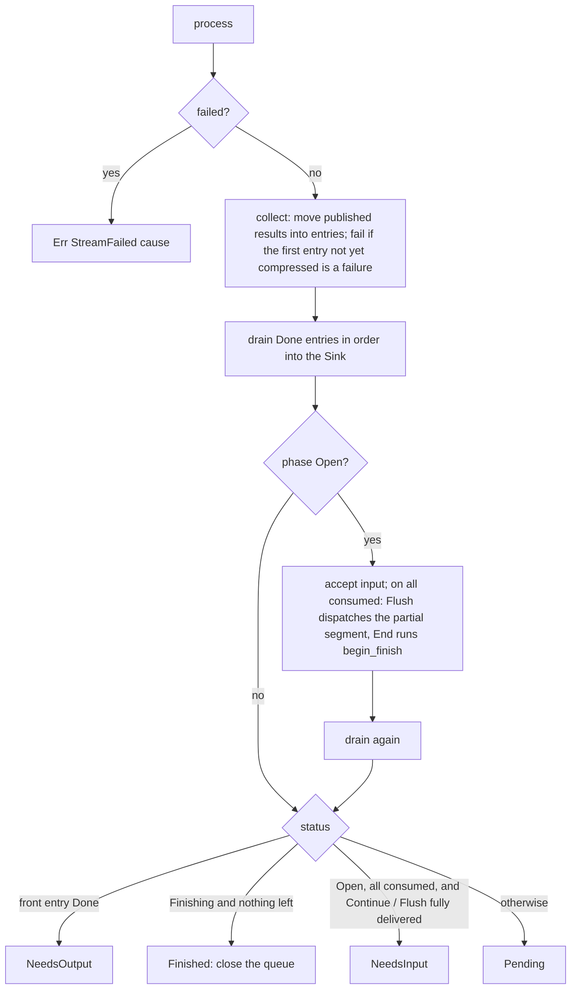
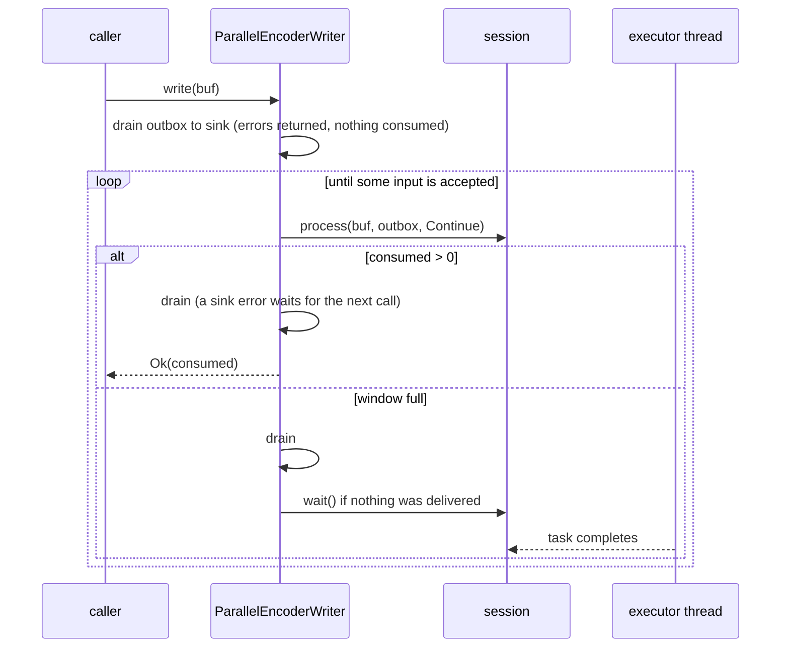

# Parallel compression

`compressor::parallel` (with `std`) compresses one frame with tasks the
caller runs on its own threads or executor. It does not spawn threads. The
frame is a standard Zstandard frame that any decoder accepts. Its bytes
depend only on the configuration, the segment size and, for streams, the
declared size and the flushes; not on the task count, the window or the order
tasks run in. They are **not** the reference's: neither the serial encoder's
frame nor the frame of zstd's multithreaded mode (ZSTDMT).

## Modules

| Type | Role |
| --- | --- |
| `SegmentSize` | 64 KiB to 256 MiB, default 4 MiB: the input each segment covers. |
| `TaskCount` | 1 to 65536: how many tasks a slice batch is cut into, or a stream's window. |
| `ParallelConfig` | The segment size. |
| `ParallelCompressor` | An `EncoderConfig`, a `ParallelConfig` and a pool of idle engines shared with its tasks. |
| `ScopedParallelBatch` / `ScopedParallelTask` | A whole input borrowed for a scope; each task compresses a run of consecutive segments. |
| `ParallelEncoderSession` / `ParallelEncoderSessionOwned` | Input that arrives in chunks; borrows or owns the compressor and wraps one `core::Stream`. |
| `ParallelTaskQueue` / `OwnedParallelTask` / `ParallelTasks` | The stream's queue handle, its `'static` tasks and the blocking iterator over them. |
| `ParallelEncoderStatus` / `ParallelProgress` | What one `process` call did and what the session needs next. |
| `ParallelEncoderWriter` / `ParallelEncoderReader` | `std::io` adapters over a borrowed session. |

## Frame layout

`FramePlan::new` resolves the parameters once for the whole frame, with the
total size when it is known, so every segment shares the window, strategy
and block size. `header` is `ZSTD_writeFrameHeader` without a dictionary;
`epilogue` writes an empty last block and, if enabled, the checksum of the
whole input. An input that fits in one segment is instead compressed by
`compress_serial` (`compress_once_into`), which is `Compressor::compress`.

## Segments

A segment may reach back into the `overlap` bytes before it: an eighth of
the window, or the whole window for btultra and btultra2. The engine first
compresses the overlap and throws that output away, which fills its tables
and window with that history. Then it resets the entropy tables and repeat
offsets, so the segment's first block refers to nothing the decoder has not
seen: no repeated tables from discarded blocks, and no repeat offsets that
only existed there. Matches into the overlap remain valid, because the
decoder already holds those bytes as the previous segment's output.

## Scoped batches

`prepare_slice(input, tasks)` plans a whole borrowed input:

Each task pushes `(index, result)` into a shared slot list exactly once: when
it runs, or from its `Drop` when it is dropped unrun (`TaskAbandoned`) or
unwinds while running (`TaskPanicked`; the panic still propagates, and the
engine it held is discarded instead of returned). `finish` runs any task the
caller did not take, orders the slots by index and assembles the frame; the
first failing slot becomes `BatchFailed(cause)` and leaves `out` untouched. A
slot count short of the task count (a task leaked with `mem::forget`) is
`InvalidState`. `compress` is `prepare_slice` with one task, run on the
calling thread by `finish`.

## Streaming sessions

`start(stream, window)` and `into_session(stream, window)` build a
`core::Stream` and its first `QueueHandle`. The borrowed session holds the
compressor's borrow only as a `PhantomData`; the stream itself holds what it
needs (`RequestedParams`, the `FramePlan`, the segment size and a clone of
the engine pool), so both sessions share one state machine.

### Input and dispatch

`filling` starts with `history`, the last `overlap` bytes of earlier input,
followed by the segment being gathered. `accept` copies input until a segment
is full; a full segment becomes a `Fragment` task whose data is the whole
`filling` (moved, not copied), and the new `filling` is seeded with the tail
the next segment may reach into. The first fragment is preceded by the frame
header as an inline output entry. Dispatch stops when `in_flight` (parts with
a task that are queued, running or not fully delivered) reaches the window;
the rest of the input is left unconsumed.

A full **first** segment is not dispatched until a following byte or an `End`
arrives, because a frame that turns out to fit in one segment takes the
batch's serial fallback: `End` with no fragment queued compresses the whole
input as one `Serial` task, or inline when it is empty. This holds with and
without a declared size. Without a declared size, a multi-segment stream
resolves its plan for an unknown size, so its frame differs from the batch's.

### Ordered delivery and status

`process` never blocks. `Sink` is implemented for `[u8]` and
`[MaybeUninit<u8>]`, so `process` and `process_uninit` are two
instantiations of one function: same bytes, counts, statuses and errors, and
they may be mixed. Delivery only writes `output[..produced]`.

`begin_finish` checks a declared size, then chooses the serial fallback or
queues the last partial segment (retried by a later `End` if the window is
full) followed by the epilogue. `Flush` queues the partial segment early,
which moves every later segment boundary, and reports `NeedsInput` only when
nothing is gathered or in flight.

`wait` returns at once when a result was published since the last
collection or when nothing runs; otherwise it sleeps on `completed` until a
task publishes. Every task publishes exactly once, so a running part always
ends a wait.

### Lifecycle

```mermaid
stateDiagram-v2
    [*] --> Open: start / into_session (stream, window)
    Open --> Open: process Continue / Flush — accept, dispatch, deliver
    Open --> Finishing: End — last part and epilogue queued
    Open --> Failed: size mismatch, task failure, closed queue
    Finishing --> Finishing: deliver; Pending while parts run
    Finishing --> Finished: last byte delivered — queue closed
    Finishing --> Failed: task failure
    Failed --> Failed: every call returns StreamFailed(cause)
    Finished --> Finished: process returns Finished, consumes nothing
```

### Queue, cancellation and failures

`QueueHandle::recv` blocks on `ready` until a task is queued or the queue
closes; `try_recv` (`next_task`) does not block. The stream closes the queue
with `cancelled` set when it finishes, fails or is dropped: queued tasks are
dropped (each publishes `TaskAbandoned`, outside the lock), executors' loops
end, and a task taken before the close skips its work. Dropping the last
handle closes the queue without cancelling: queued tasks report
`TaskAbandoned`, and the next dispatch fails with `TaskQueueClosed`, so the
session fails instead of waiting forever.

A `StreamTask` publishes from `run`, or from `Drop` with `TaskAbandoned`
(never ran) or `TaskPanicked` (unwound; its engine is dropped). `collect`
fails the stream only when the first entry that is not yet compressed is a
failure, so the reported cause is the first failing segment in input order,
whatever order tasks finished in. Failures are wrapped as
`StreamFailed(Arc<cause>)`, and every later call repeats it.

## I/O adapters

`ParallelCompressor::writer(sink, stream, window)` and
`reader(source, stream, window)` return the adapter beside the queue, as
`start` does. Both own only buffering; every decision belongs to the session,
so they produce the session's bytes.

- The writer keeps compressed bytes in a 128 KiB outbox until the sink takes
  them, so short writes, `Interrupted`, `WouldBlock` and sink errors lose
  nothing. `Write::flush` is `Operation::Flush` followed by the sink's flush;
  `try_finish` repeats `End`, waiting whenever a step delivered nothing, and
  `finish` returns the adapter inside `FinishError` for a retry. The session
  is boxed so `FinishError<Self>` stays small.
- The reader fills a 128 KiB buffer from the source, calls `process` with
  `Continue` (or `End` after the source's end) straight into the caller's
  slice, and waits when the session is `Pending` with nothing produced.
  `into_parts` returns the source and the bytes read but not accepted as
  `EncoderReaderParts`.
- Both block in `wait`, so the queue must run on other threads.

## Errors

`ParallelEncodeError` is `#[non_exhaustive]`:

| Variant | When |
| --- | --- |
| `Encode(EncodeError)` | A segment or serial frame failed in the engine (a core bug for valid input). |
| `InputSizeMismatch { declared, actual }` | A stream's input contradicts its declared size. |
| `InvalidState` | A batch task never reported (leaked). |
| `BatchFailed(Arc<cause>)` | A batch task failed; the first failing task's cause. |
| `StreamFailed(Arc<cause>)` | A stream failed, on this call or earlier. |
| `TaskQueueClosed` | Every queue handle was dropped and the stream had a task to queue. |
| `TaskAbandoned { segment }` | A task was dropped without running. |
| `TaskPanicked { segment }` | A task unwound while running. |

`From<ParallelEncodeError> for io::Error` takes the kind of the root cause
through `StreamFailed` and `BatchFailed` (`InvalidInput` for size mismatches
and `Bound`, `WriteZero` for `OutputTooSmall`, `Other` otherwise) and keeps
the error as the source. It never produces `Interrupted` or `WouldBlock`,
which `std::io` would retry. The wrapped cause's source in the chain is the
`Arc<ParallelEncodeError>` itself.

## Invariants

- Segment boundaries depend only on the segment size and the flushes, so the
  frame is the same for every task count, window, chunking and execution
  order. A stream with a declared size and no flush produces the batch frame;
  so does any stream whose input fits in one segment.
- Every task publishes exactly once (run, drop or unwind), so `wait` and
  batch assembly never wait for a task that cannot report.
- `in_flight <= window`; `filling` holds at most an overlap plus one segment.
- `process` writes exactly `output[..produced]`.
- Engines are reused through the pool; reuse does not change output (see
  [compressor](compressor.md#retention)). An engine that unwound is never
  returned.
- `tests/parallel.rs`, `tests/parallel_stream.rs`, `tests/parallel_io.rs`
  and the `parallel` fuzz target check these, and that frames decode with the
  reference decoder.

## Known gaps

- The overlap is re-compressed rather than loaded as a prefix the way ZSTDMT
  loads it with `ZSTD_compressBegin_advanced_internal`. This costs CPU but
  not correctness.
- Frames are not ZSTDMT-identical, and there is no job-size or
  overlap-log parameter.
- A stream copies its input into segments, and each part's blocks through
  the caller's buffer; the batch reads its slice in place.
- A task held by the caller and never run or dropped blocks `wait` forever.
- There is no `wait` with a timeout.
