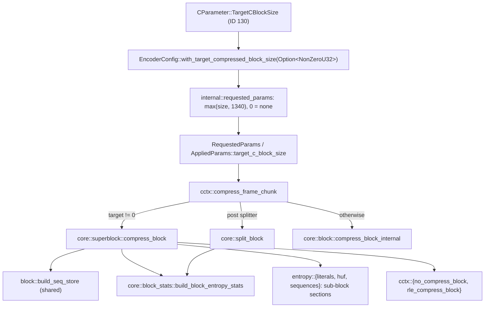
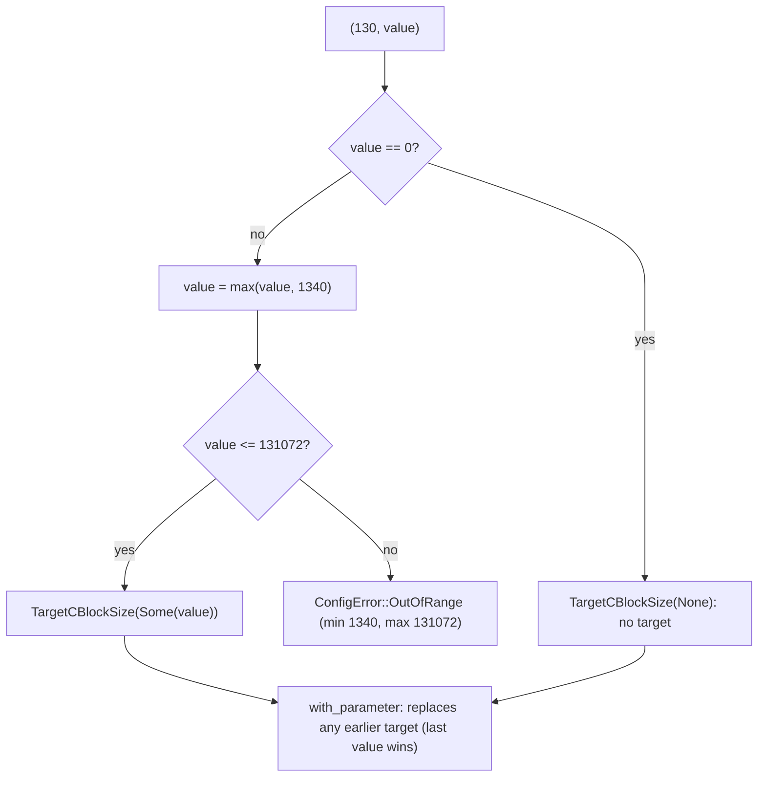
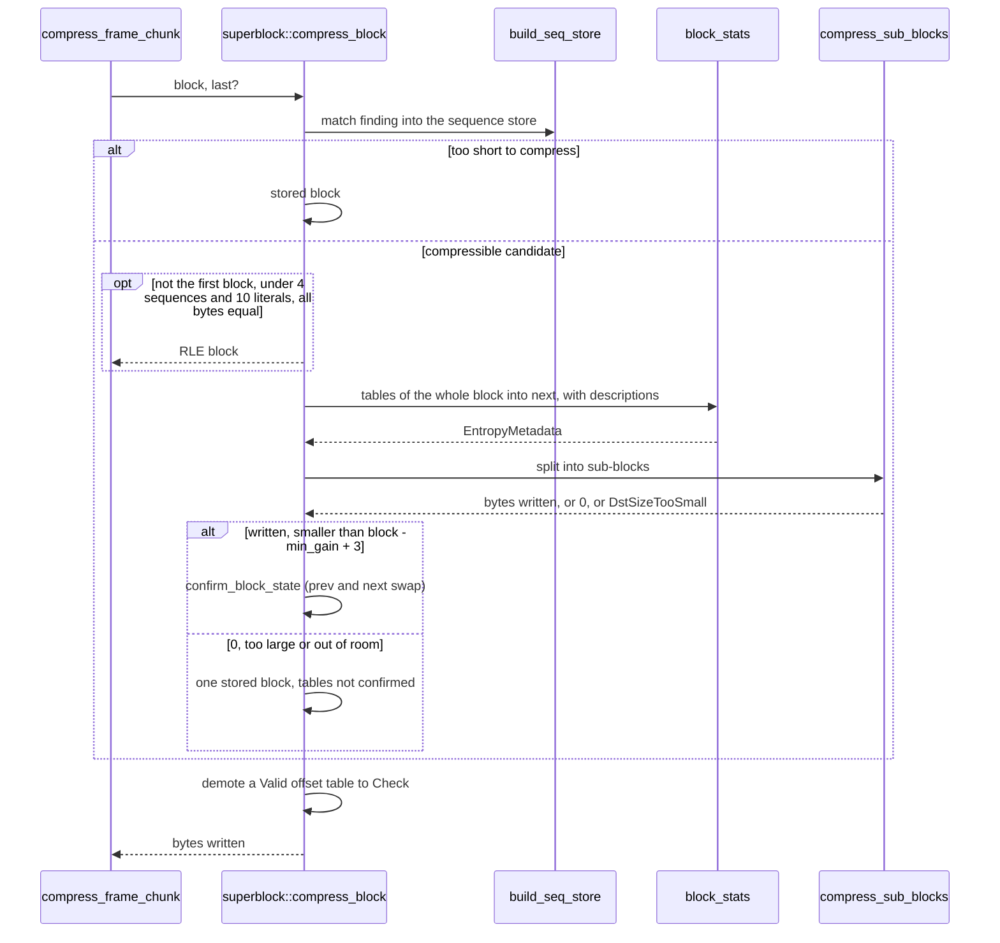
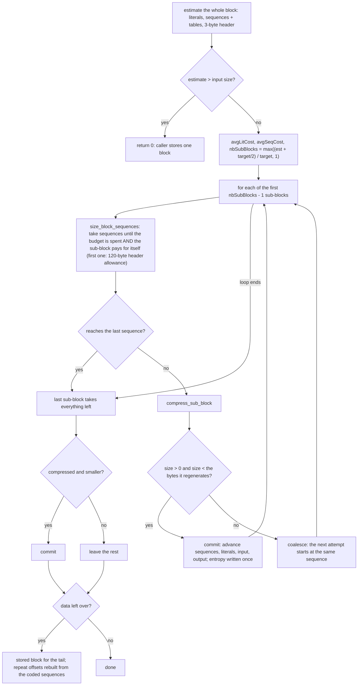
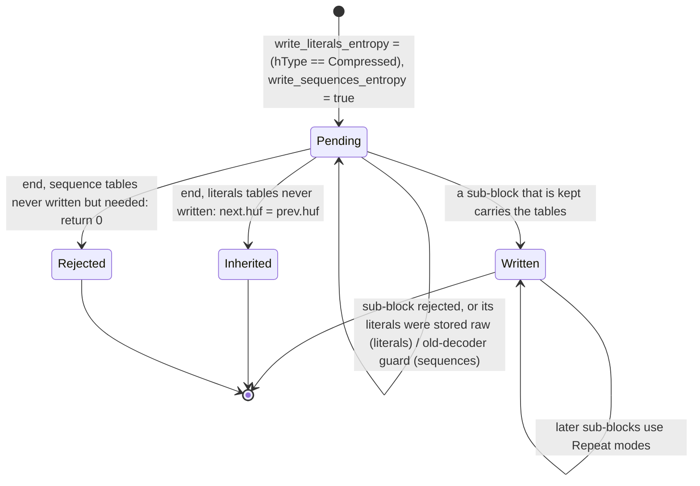
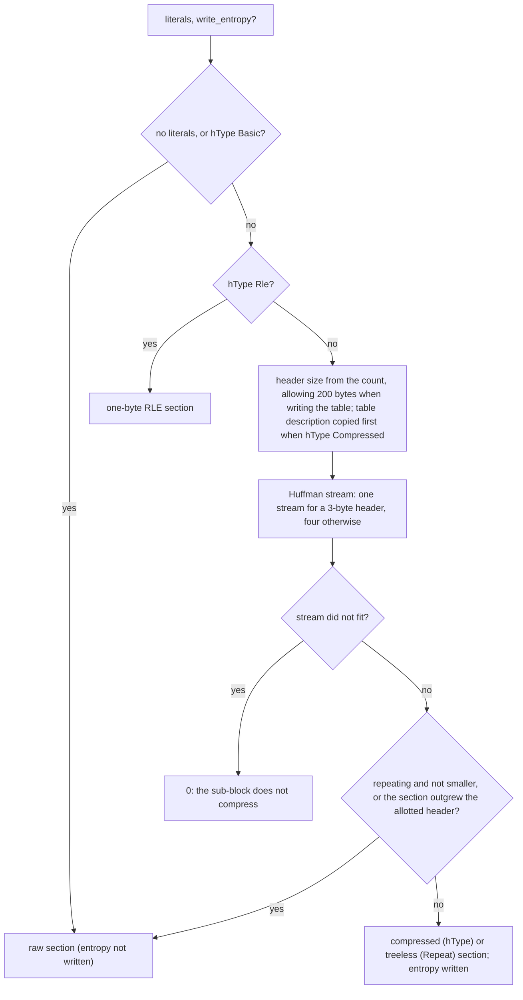

# Target compressed block size

`ZSTD_c_targetCBlockSize` (parameter 130, `EncoderConfig::with_target_compressed_block_size`)
asks the encoder for compressed blocks of about a given size, so a receiver
can start decoding long before a 128 KiB block has arrived. It is a port of
the superblock path of zstd 1.5.7: `ZSTD_compressBlock_targetCBlockSize` in
`zstd_compress.c` and `ZSTD_compressSuperBlock` in
`zstd_compress_superblock.c`. The frames are byte-identical to
`ZSTD_compress2` / `ZSTD_compressStream2` with the same parameter.

## Where it lives

The public module owns the option, its validation (`ConfigError::OutOfRange`
for a target above 131072) and the `CParameter` pair. Everything else is
private to `compressor::core`:

- `superblock` is the port of `zstd_compress_superblock.c` and of the
  `targetCBlockSize` functions of `zstd_compress.c`.
- `block_stats` is `ZSTD_buildBlockEntropyStats` and its two halves. They
  used to be private to `split_block`; the superblock also needs the
  descriptions they produce (`hufDesBuffer`, `fseTablesBuffer`,
  `lastCountSize`), so the metadata types keep them.
- `sequences::encode_slice` writes the bitstream for a run of a block's
  sequences and codes; `sequences::encode` is the whole block through it.
- `SeqStore::sequence_length` is `ZSTD_getSequenceLength`.

## Parameter semantics

`ZSTD_CCtx_setParameter` raises any non-zero value, negative ones included,
to `ZSTD_TARGETCBLOCKSIZE_MIN` (1340) and only then checks the upper bound
(`ZSTD_TARGETCBLOCKSIZE_MAX`, 131072). The typed parameter does the same and
`(i32, i32)::from` returns the raised value, which is what
`ZSTD_CCtx_getParameter` reports. `EncoderConfig` keeps the size as given and
raises it when lowering to the core, and rejects one above 131072 when the
compressor is built. `ZSTD_generateSequences`' refusal of a target has no
counterpart: mzstd has no such API.

The target takes the branch of `ZSTD_compress_frameChunk` before the
post-sequence block splitter, so with a target `with_post_block_splitter` has
no effect. The pre-matching splitter (`blockSplitterLevel`) still chooses the
block boundaries, and `with_max_block_size` still caps the block that is cut
into sub-blocks; the target's own bound is the format's 128 KiB either way.
Streaming, dictionaries, long distance matching and the checksum only reach
the superblock path through the blocks they hand it.

## One block

Errors other than `DstSizeTooSmall` (a table that cannot be built) propagate;
`DstSizeTooSmall` from the superblock, like a result of zero or one that does
not save `min_gain`, falls back to a stored block, and that block may itself
fail with `DstSizeTooSmall`. Nothing is confirmed on a fallback, so the next
block inherits the previous tables and repeat offsets.

## Splitting into sub-blocks

The tables of the whole superblock are built first (`next`); estimates come
from them and from the block's code histograms, in integer arithmetic scaled
by `BYTESCALE` (256).

The reference declares a budget supplement that is reset to zero on a commit
and never raised; the port omits the variable.

Each sub-block is a complete compressed block. Which tables its header carries
is state shared across the sub-blocks of a superblock:

A sub-block's literals section (`compress_sub_block_literals`):

A sub-block's sequences section writes the count, a head byte and, for the
first one, the table descriptions; later ones are `Repeat` in all three
streams. Two guards return 0 so the sub-block is merged or stored: the
reference's workaround for decoders up to 1.3.4 (a two-byte last table with a
one-byte bitstream) and for decoders up to 1.4.0 (a body under four bytes).

## Invariants

- The superblock's `next.entropy` is built once; a sub-block only reads it.
  `next.rep` is the repeat offsets after the whole block, unless a tail was
  stored, when it is rebuilt from `prev.rep` and the coded sequences.
- A sub-block is kept only when it is smaller than what it regenerates, so
  the output never grows by more than block headers and the stored tail.
- Sub-block boundaries fall between sequences; the literals that follow a
  sequence's match belong to the next sequence, the block's trailing
  literals to the last sub-block.
- The costs sizing a sub-block read the raw 16-bit `lit_length` and
  `ml_base` fields, the lengths summed for a decision read
  `SeqStore::sequence_length` (with the 16-bit overflow escape), exactly as
  the reference does.
- The destination handed to the superblock is the block's output slice: its
  capacity bounds every sub-block, as `dstCapacity` does in the reference.

## Verification

`tests/compressor_target_block.rs` compares frames with `ZSTD_compress2` and
`ZSTD_compressStream2`: levels -5 to 22 and 0; targets around 1, 1340,
2 KiB, 16 KiB, 64 KiB and 131072; sizes from 0 to 5 MiB around the block
boundaries; text, noise, constant, structured, mixed, binary and patchwork
inputs (blocks of different kinds in one frame); a randomized structured
corpus; one-shot, slice, uninitialized and `Vec` outputs and every output
capacity boundary; streaming with flushes, exact and unknown sizes and small
output buffers; dictionaries (every attach mode) in one shot and streaming;
long distance matching; the checksum and content size flags; the post and
pre block splitters and `maxBlockSize`; every available backend; and reuse.
`tests/openzl_binding.rs` checks every parameter ID and value, and the
node's parameter lists, against the reference. The `parameter_parsing` and
differential AFL targets cover the parameter through the header shared by
every target. Unit tests beside `superblock` and `block_stats` reach the
paths a corpus rarely produces: RLE and raw literals, expansion past the
allotted header, the two old-decoder guards, tables that were never written,
and the estimators' error arms.

## Known gaps

- The parallel compressor accepts a target and applies it inside every
  segment; its frames are valid, but like all parallel frames they are not
  those of the reference's multithreaded mode.
- Outputs that grow a `Vec` or zero uninitialized memory ahead of each block
  offer the superblock `compress_bound(block)` bytes, where `ZSTD_compress2`
  into a `ZSTD_compressBound` buffer offers the rest of the frame. A
  sub-block that is attempted, would be rejected for not shrinking, and does
  not fit in the smaller room would make this crate store the block where the
  reference writes sub-blocks. It needs a sub-block larger than the room a
  `compress_bound` margin leaves; no input among the tests, including the
  capacity-boundary sweeps and the randomized corpus, produces one.
