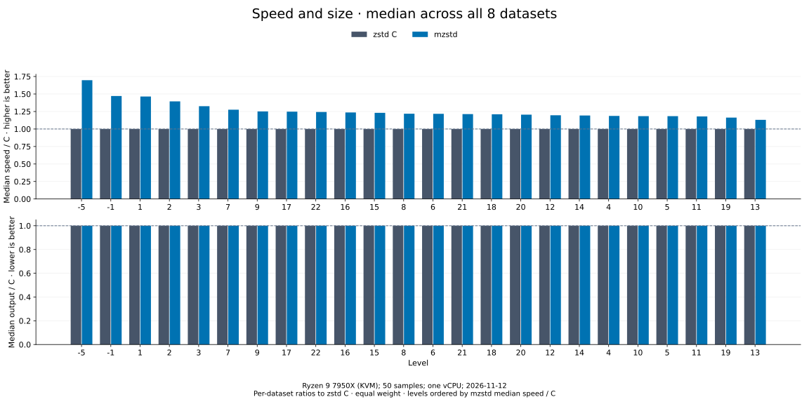
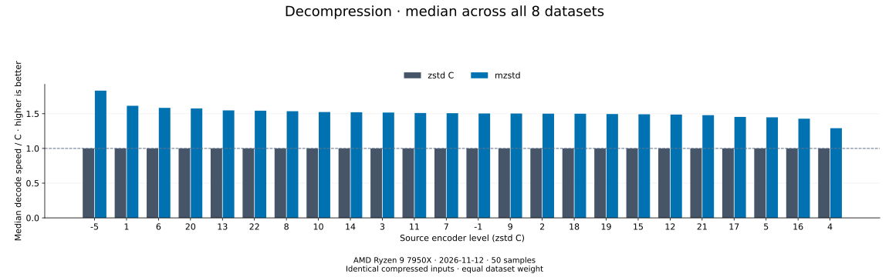

# Benchmark results

Two kinds of runs, both on an AMD Ryzen 9 7950X (Linux KVM guest with two
vCPUs, its host shared with other tenants): the cold library comparison of
mzstd 0.2.12 against zstd 1.5.7, recorded on **2026-11-09**, and lzbench on
`silesia.tar`. Every report identifies its measured sources, sampling
settings and limitations. Other tenants loaded the host during both: the
medians are stable, single cells are good to about ±10%.

| Compare | Results | Data |
| --- | --- | --- |
| Compression speed and size, 384 cold cases | [Levels -5 to 22](encoders/README.md), [report](encoder-comparison.md) | [CSV](encoder-comparison.csv), [environment](encoder-comparison-environment.json), [size manifest](encoder-comparison-2026-11-09/sizes.csv), [Criterion samples](encoder-comparison-2026-11-09/criterion-samples.json.gz) |
| Decompression speed on identical frames, 384 cold cases | [Source levels -5 to 22](decoders/README.md), [report](decoder-comparison.md) | [CSV](decoder-comparison.csv), [environment](decoder-comparison-environment.json), [size manifest](decoder-comparison-2026-11-09/sizes.csv), [Criterion samples](decoder-comparison-2026-11-09/criterion-samples.json.gz) |
| lzbench on `silesia.tar`, one frame | [Report](lzbench-2026-11-09.md) | Raw output of every round in the report |

## Compression

Each speed bar is the median of eight per-dataset ratios to C, timed in
the same process. Higher speed and lower size are better. Every mzstd frame
is byte-identical to zstd's, so the size ratio is 1× at every level. The
median over all 192 dataset/level pairs is **1.248×**, with lower mean
latency in **174 pairs** (2026-10-30: 1.256×, 179 pairs). The per-dataset
medians agree with that run to within a few percent: Alice 1.008×, cyclic
Alice 1.088×, structured binary 1.241×, repeated bytes 2.437×. The 18
slower pairs are Alice at ten levels, cyclic Alice at four and random data
at four, between 0.84× and 0.998×.
[Report](encoder-comparison.md) · [exact results and confidence bounds](encoders/README.md).

## Decompression

Both decoders restore the same C-written frames; level is the source
encoder's setting. The median over all 192 pairs is **1.517×**
(2026-10-30: 1.502×), faster in 151 pairs: tens of times faster on empty
and tiny frames, 3.2× on random 64 KiB, 1.53× on repeated bytes and 1.45×
on structured binary, but 0.948× on Alice and 0.937× on cyclic Alice, the
datasets of all 41 slower pairs.
[Report](decoder-comparison.md) · [exact results](decoders/README.md).

## lzbench

lzbench master `a6fa8aa` (2.4.1), gcc 15.2 with `-march=native`, `silesia.tar`
as one frame on one vCPU, the fastest of three rounds: mzstd 0.2.12 writes
byte-identical output to zstd 1.5.7 at every level, compresses 6.6-17.5%
faster at levels 15, 18 and 22, at zstd's speed at level 3 and 2.4-6.6%
slower at the other levels, and decompresses 4.7-7.2% slower at every
level. Against 0.2.11 in the same rounds, relative to zstd, decompression
gained 0.8-5 points at levels 1 to 22 and level 3 compression went from
0.973 to 1.011. Compression at level 2 and above moves by 3-21% between
rounds on this host.
[Command, environment, raw output of every round](lzbench-2026-11-09.md).

## How to interpret the results

The cold suites time construction, allocation, the call and disposal.
Empty and tiny inputs have equal weight with large inputs; medians describe
this corpus, not a production workload. C decoding knows the output
capacity from the frame header. The lowest mean is not necessarily a
statistically significant lead, and on this run's loaded host a single
cell's ratio can move by 10% between sweeps.

| Dataset | Input bytes | Content |
| --- | ---: | --- |
| empty | 0 | API overhead without input |
| tiny-text | 44 | Quick-brown-fox sentence |
| alice29 | 152,089 | *Alice in Wonderland* text ([`testdata/alice29.txt`](../../testdata/README.md)) |
| text-1m | 1,048,576 | Alice repeated cyclically |
| binary-64k | 65,536 | Structured binary bytes |
| random-64k | 65,536 | Prefix of the pseudorandom corpus |
| random-1m | 1,048,576 | Deterministic xorshift64 bytes |
| repeated-1m | 1,048,576 | Repeated `a` bytes |

The datasets, generators and seeds are mbrotli's, so the two projects'
comparisons describe one corpus.

## Reproduce

Use [benchmarking and profiling](../benchmarking.md) for validation, fresh
timings, the main branch's series, the Silesia sweep and the
report-generation commands.
