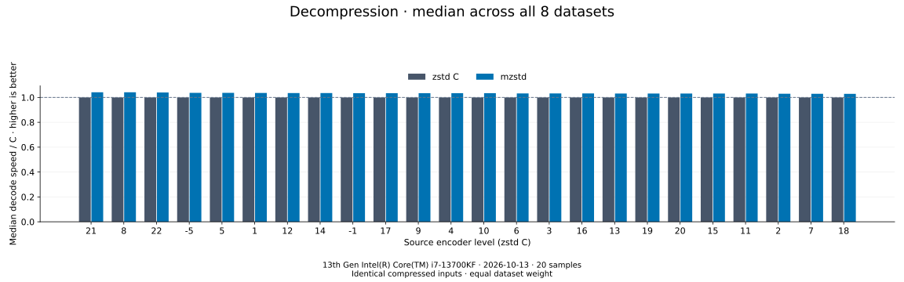
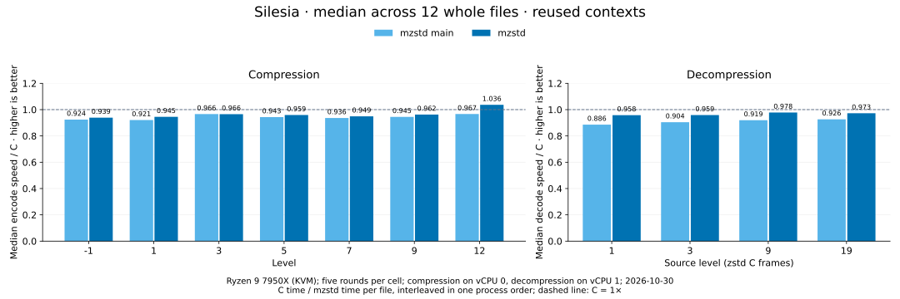

# Benchmark results

One run, recorded on **2026-10-30** on an AMD Ryzen 9 7950X (Linux KVM
guest, two dedicated vCPUs): the working tree on `0a4fd87` (mzstd 0.2.7
plus the Unreleased changes in the [changelog](../../CHANGELOG.md)) against
zstd 1.5.7 and against the main branch at `0a4fd87`. Every report identifies
its measured sources, sampling settings and limitations.

| Compare | Results | Data |
| --- | --- | --- |
| Compression speed and size, 384 cold cases | [Levels -5 to 22](encoders/README.md), [report](encoder-comparison.md) | [CSV](encoder-comparison.csv), [main's CSV](encoder-comparison-2026-10-30/main.csv), [environment](encoder-comparison-environment.json), [size manifest](encoder-comparison-2026-10-30/sizes.csv), [Criterion samples](encoder-comparison-2026-10-30/criterion-samples.json.gz) |
| Decompression speed on identical frames, 384 cold cases | [Source levels -5 to 22](decoders/README.md), [report](decoder-comparison.md) | [CSV](decoder-comparison.csv), [main's CSV](decoder-comparison-2026-10-30/main.csv), [environment](decoder-comparison-environment.json), [size manifest](decoder-comparison-2026-10-30/sizes.csv), [Criterion samples](decoder-comparison-2026-10-30/criterion-samples.json.gz) |
| Silesia, reused contexts, whole files | [Report](silesia.md) | [Rounds](silesia-2026-10-30/silesia.json.gz) |

## Compression

Each speed bar is the median of eight per-dataset ratios to C, each tree
against the C timings of its own process. Higher speed and lower size are
better. Every mzstd frame is byte-identical to zstd's, so the size ratio is
1× at every level. The median over all 192 dataset/level pairs is
**1.256×**, with lower mean latency in **179 pairs** (main: 1.254×, 178
pairs). The slower pairs are Alice at levels -1, 1, 2, 4-9, 11 and 12
(0.94–0.99×) and random 1 MiB at levels 3 and 4 (0.97–0.98×); Alice's
median across levels is 1.019× and cyclic Alice's 1.085×. Paired against
main process by process, the working tree is 0.7% faster on Alice (up to
9.2% at level -5) and 1.8% on cyclic Alice, and slower on empty input
(3.7%), on the 44-byte text at levels -5 to 10 (2-6%) and on random data at
the row levels (random 64 KiB level 10 11%).
[Report](encoder-comparison.md) · [exact results and confidence bounds](encoders/README.md).

## Decompression

Both decoders restore the same C-written frames; level is the source
encoder's setting. The median over all 192 pairs is **1.502×** (main
1.400×), faster in 143 pairs: tens of times faster on empty and tiny
frames, 3.1× on random 64 KiB, 1.51× on repeated bytes and 1.44× on
structured binary, but 0.94× on Alice and 0.97× on cyclic Alice, slower at
every level on both. Paired against main, it is 4.9% faster in the median
and faster in 139 of 192 cases: 5.5% on Alice, 6.4% on cyclic Alice, 30%
on repeated bytes.
[Report](decoder-comparison.md) · [exact results](decoders/README.md).

## Silesia

On whole Silesia files with reused contexts, in random-order rounds of C,
main and the working tree, compression runs at 0.94–0.97× C at levels -1
to 9 and 1.04× at level 12; decompression at 0.96–0.98×, slowest on
literal-heavy x-ray (0.85× at level 1). Against main, decompression is
7.4–10% faster and compression 1–2.6% at levels 1 and 5 to 9 and 7% at
level 12, with level -1 (1.006) and dfast level 3 (0.997) unchanged in the
median.
[Report](silesia.md).

## How to interpret the results

The cold suites time construction, allocation, the call and disposal.
Empty and tiny inputs have equal weight with large inputs; medians describe
this corpus, not a production workload. C decoding knows the output
capacity from the frame header. The lowest mean is not necessarily a
statistically significant lead. The main branch's cold series comes from a
second process beside the working tree's; at levels 13 and above and on
the 1 MiB inputs a case's ratio to C moves by up to 40% between processes,
so the [paired runs](encoder-comparison.md#against-the-main-branch)
measure the change from main.

| Dataset | Input bytes | Content |
| --- | ---: | --- |
| empty | 0 | API overhead without input |
| tiny-text | 44 | Quick-brown-fox sentence |
| alice29 | 152,089 | *Alice in Wonderland* text ([`testdata/alice29.txt`](../../testdata/README.md)) |
| text-1m | 1,048,576 | Alice repeated cyclically |
| binary-64k | 65,536 | Structured binary bytes |
| random-64k | 65,536 | Prefix of the pseudorandom corpus |
| random-1m | 1,048,576 | Deterministic xorshift64 bytes |
| repeated-1m | 1,048,576 | Repeated `a` bytes |

The datasets, generators and seeds are mbrotli's, so the two projects'
comparisons describe one corpus.

## Reproduce

Use [benchmarking and profiling](../benchmarking.md) for validation, fresh
timings, the main branch's series, the Silesia sweep and the
report-generation commands.
