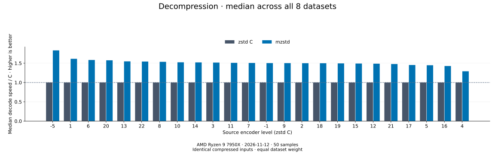

# Decompression comparison — 2026-11-12

[Benchmark index](README.md) · [All level pages](decoders/README.md) ·
[Published CSV](decoder-comparison.csv)

The published 384 rows cover two decoders on eight identical C-written
frames at each source level, recorded as `long-20261112` (mzstd 0.2.14, the
working tree on `2c15c38` with the v0.2.14 changes in the
[changelog](../../CHANGELOG.md), identified by the
[source hashes](decoder-comparison-environment.json), zstd 1.5.7). mzstd's
median speed relative to C is **1.521×** across all 192 dataset/level
pairs; mzstd is faster in 152 of them, and in 145 of those its 95% mean
timing interval lies wholly below C's. Empty and tiny inputs have the same
weight as large inputs. Per-workload results include cases where mzstd is
slower.

Other tenants load this host. Sampling is therefore 50 samples of 6 s
after a 3 s warmup, which keeps the medians stable but leaves a median 95%
interval of about 5% per case. Read single cells as ±10%.



Each bar is the median of eight C mean time / decoder mean time ratios, in
the same process. The [decoder overview](decoders/README.md) lists every
source level. Higher is faster; medians do not establish statistical
significance.

| Dataset | mzstd speed / C ↑ | 2026-11-09 | Range across levels |
| --- | ---: | ---: | ---: |
| empty | 47.5× | 53.4× | 44.0–52.5× |
| tiny-text | 33.2× | 39.8× | 28.3–36.7× |
| alice29 | 0.911× | 0.948× | 0.802–1.054× |
| text-1m | 0.963× | 0.937× | 0.758–1.112× |
| binary-64k | 1.438× | 1.453× | 0.992–1.937× |
| random-64k | 3.177× | 3.218× | 3.022–3.420× |
| random-1m | 1.135× | 1.142× | 1.093–1.189× |
| repeated-1m | 1.579× | 1.532× | 1.452–1.728× |

Empty and tiny frames decode tens of times faster because mzstd needs no
preallocated decoding context. Their ratios are lower than on 2026-11-09
(47.5× against 53.4× and 33.2× against 39.8×). Part of that is real: with
0.2.14's decoder changes the compiler no longer inlines `decode_into` and
`trim` into `Decompressor::decompress`, which adds 31 instructions to
every call (726 against 695 for the empty frame and 901 against 870 for
the 44-byte one, counted with `perf stat` through the comparison's
`profile` binary), about 4% of such a call. The rest of the difference is
not attributed; a call takes 40-60 ns here.

Compressible text still trails: 39 of the 40 slower pairs are Alice (20 of
24 levels, all but 7, 8, 17 and 18) and cyclic Alice (19 of 24, all but
-5, -1, 7, 9 and 10); the other is structured binary at level 4 (0.992×).
At level 1 Alice decodes at 1,400 MiB/s against C's 1,529 MiB/s; cyclic
Alice at 10,007 MiB/s against 10,829. Most of that gap is the Huffman
literal loop
([decoder fast paths](../../architecture/decoder-performance.md#known-gaps)).
Alice's median fell from 0.948× to 0.911× and cyclic Alice's rose from
0.937× to 0.963×, both well inside the spread their cases show across
levels in this run (0.80–1.05× and 0.76–1.11×). In absolute time C and
mzstd moved together on both (medians of +3% and +2% against the previous
run), and a direct count on Alice at level 3 shows the same cycles per
decode before and after those changes, so this run does not
show a change on text. They target frames of many megabytes
([lzbench](lzbench-2026-11-12.md)).

This suite times only `decompress`; `decompress_to_slice` and the streaming
sessions are measured by the root `decompress` benchmark, and
[lzbench](lzbench-2026-11-12.md) measures whole-archive throughput on
`silesia.tar`.

## Measurement contract

Cold one-shot APIs include construction, allocation, decoding and disposal: C
reads the frame's content size (`ZSTD_getFrameContentSize`) and decodes with
`ZSTD_decompress` into an uninitialized buffer of exactly that size; mzstd
runs `Decompressor::default().decompress`, which returns its own vector.
Throughput counts restored bytes. The shared frame sizes belong to the C
encoder, not to a decoder. Every case must restore the original bytes through
both decoders before timing.

The corpus is empty input, tiny text, Alice, cyclic Alice at 1 MiB, structured
binary at 64 KiB, random bytes at 64 KiB and 1 MiB, and repeated `a` at 1 MiB.
The host is an AMD Ryzen 9 7950X KVM guest with two vCPUs, its host shared
with other tenants; the decoder suite ran on vCPU 1 after the encoder suite,
with nothing CPU-heavy beside it in the guest. Sampling: 50 samples, 3 s warmup and 6 s
requested measurement per case (Criterion extends slow cases to collect
every sample). Rust 1.99.1, runtime AVX-512 dispatch with the block loops
at the AVX2 level; zstd built by `zstd-ffi` with GCC 15.2 `-O3`, without
its Huffman assembly.

## Provenance and limits

The [environment record](decoder-comparison-environment.json) hashes the
measured sources and binaries, the [size manifest](decoder-comparison-2026-11-12/sizes.csv)
lists every frame, and the raw
[Criterion samples and estimates](decoder-comparison-2026-11-12/criterion-samples.json.gz)
are archived. This is one sweep on one KVM guest; frequency, thermal state
and scheduling are not controlled. Other tenants load the host and no
load probe ran beside this sweep: the median case's 95% interval is 5.0%
(90th percentile 9.1%), and C's own timings moved by a median 5.7% against
the 2026-11-09 run of the same C library.

Reproduce from the repository root with a fresh baseline name:

```sh
cargo bench --manifest-path benchmarks/comparison/Cargo.toml --bench decoders --locked --no-run
cd benchmarks/comparison
taskset -c 1 target/release/deps/decoders-<hash> --bench --save-baseline my-decoders --sample-size 50 --warm-up-time 3 --measurement-time 6 --noplot
cd ../..
python3 benchmarks/comparison/report.py --decoding --baseline my-decoders --csv /tmp/my-decoders.csv
cp benchmarks/comparison/target/criterion-decoders/sizes.csv /tmp/my-decoders-sizes.csv
```

Use the [benchmark guide](../benchmarking.md#decoder-comparison) to regenerate
the published pages from the recorded CSV and environment metadata.
