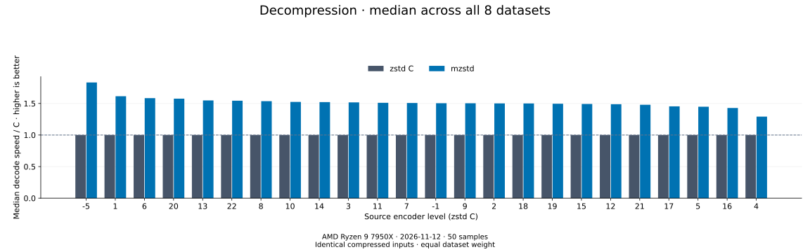

# Decoder comparison

[Benchmark index](../README.md)

Recorded run: **long-20261109** (2026-11-09).
[CSV](../decoder-comparison.csv) · [Environment](../decoder-comparison-environment.json) · [Methodology and limits](../decoder-comparison.md).

Each value is the median of C mean time / decoder mean time across all 8 datasets,
equally weighted. Higher is faster; 1× matches C.
Levels are ordered by mzstd median speed / C. Medians do not imply statistical significance.

Both decoders restore identical C-written frames. The level is an encoder setting,
not a decoder setting. Compressed sizes and ratios are properties of those shared inputs,
so there is no decoder size ranking.

| Source level | zstd C | mzstd |
| --- | ---: | ---: |
| [1](l1.md) | 1.000× | 1.676× |
| [2](l2.md) | 1.000× | 1.611× |
| [12](l12.md) | 1.000× | 1.591× |
| [5](l5.md) | 1.000× | 1.589× |
| [15](l15.md) | 1.000× | 1.573× |
| [-5](l-5.md) | 1.000× | 1.572× |
| [6](l6.md) | 1.000× | 1.565× |
| [11](l11.md) | 1.000× | 1.542× |
| [20](l20.md) | 1.000× | 1.539× |
| [-1](l-1.md) | 1.000× | 1.513× |
| [7](l7.md) | 1.000× | 1.506× |
| [14](l14.md) | 1.000× | 1.497× |
| [21](l21.md) | 1.000× | 1.496× |
| [13](l13.md) | 1.000× | 1.492× |
| [19](l19.md) | 1.000× | 1.457× |
| [10](l10.md) | 1.000× | 1.455× |
| [16](l16.md) | 1.000× | 1.453× |
| [3](l3.md) | 1.000× | 1.438× |
| [9](l9.md) | 1.000× | 1.435× |
| [22](l22.md) | 1.000× | 1.428× |
| [18](l18.md) | 1.000× | 1.407× |
| [8](l8.md) | 1.000× | 1.389× |
| [17](l17.md) | 1.000× | 1.348× |
| [4](l4.md) | 1.000× | 1.321× |

Open a source level for all datasets, compressed/restored byte counts,
mean latency, confidence bounds and throughput. Measurements include cold construction,
allocation, decoding and disposal. C receives the frame's declared output capacity.
See the linked methodology for reproducible commands and the limits of this single-host comparison.
