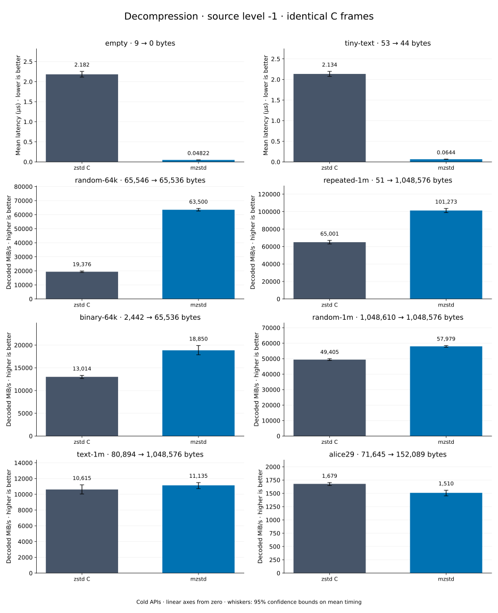

# Decompression of level -1 frames

[Decoder overview](README.md) · [Benchmark index](../README.md)

Recorded run: **long-20261109** (2026-11-09).
[CSV](../decoder-comparison.csv) · [Environment](../decoder-comparison-environment.json) · [Methodology and limits](../decoder-comparison.md).

Level belongs to the C encoder that prepared the frame; decoders have no level setting.
Both decoders restore the same bytes.

## Median speed across 8 datasets

Median of per-dataset C mean time / decoder mean time ratios, with equal weight.
Higher is faster; 1× matches C. No confidence interval
is inferred for this across-dataset median.

| Decoder | Median speed / C |
| --- | ---: |
| zstd C | 1.000× |
| mzstd | 1.513× |

Datasets are ranked by mzstd speed relative to C, highest first.
Throughput counts restored bytes; empty input has latency only. Whiskers and intervals
describe sampling uncertainty, not all host variation. Cold APIs include allocation
and disposal. C reads the frame's content size and decodes into a buffer of exactly
that size; mzstd returns its own vector.

## empty

Empty input; measures API overhead.

**9 compressed → 0 restored bytes; compressed / original: undefined.**

| Decoder | Mean µs | 95% mean interval µs | Decoded MiB/s | Speed / C |
| --- | ---: | ---: | ---: | ---: |
| zstd C | 1.965 | 1.947–1.985 | — | 1.000× |
| mzstd | 0.03796 | 0.03724–0.03895 | — | 51.750× |

## tiny-text

44-byte quick-brown-fox sentence.

**53 compressed → 44 restored bytes; compressed / original: 120.455%.**

| Decoder | Mean µs | 95% mean interval µs | Decoded MiB/s | Speed / C |
| --- | ---: | ---: | ---: | ---: |
| zstd C | 1.967 | 1.953–1.982 | 21.34 | 1.000× |
| mzstd | 0.05293 | 0.05079–0.05523 | 792.81 | 37.155× |

## random-64k

64 KiB prefix of the deterministic pseudorandom corpus.

**65,546 compressed → 65,536 restored bytes; compressed / original: 100.015%.**

| Decoder | Mean µs | 95% mean interval µs | Decoded MiB/s | Speed / C |
| --- | ---: | ---: | ---: | ---: |
| zstd C | 3.214 | 3.133–3.296 | 19,448.34 | 1.000× |
| mzstd | 1.02 | 1.009–1.031 | 61,266.25 | 3.150× |

## binary-64k

64 KiB of structured binary bytes: ((i / 16) XOR i) modulo 256.

**2,442 compressed → 65,536 restored bytes; compressed / original: 3.726%.**

| Decoder | Mean µs | 95% mean interval µs | Decoded MiB/s | Speed / C |
| --- | ---: | ---: | ---: | ---: |
| zstd C | 4.778 | 4.625–4.947 | 13,081.99 | 1.000× |
| mzstd | 3.125 | 3.009–3.253 | 20,000.69 | 1.529× |

## repeated-1m

1 MiB of repeated a bytes.

**51 compressed → 1,048,576 restored bytes; compressed / original: 0.005%.**

| Decoder | Mean µs | 95% mean interval µs | Decoded MiB/s | Speed / C |
| --- | ---: | ---: | ---: | ---: |
| zstd C | 14.14 | 13.97–14.34 | 70,738.35 | 1.000× |
| mzstd | 9.447 | 9.226–9.699 | 105,850.50 | 1.496× |

## random-1m

1 MiB of deterministic xorshift64 pseudorandom bytes.

**1,048,610 compressed → 1,048,576 restored bytes; compressed / original: 100.003%.**

| Decoder | Mean µs | 95% mean interval µs | Decoded MiB/s | Speed / C |
| --- | ---: | ---: | ---: | ---: |
| zstd C | 19.13 | 18.98–19.29 | 52,284.36 | 1.000× |
| mzstd | 16.84 | 16.67–17.02 | 59,387.92 | 1.136× |

## text-1m

Alice text repeated cyclically to 1 MiB.

**80,894 compressed → 1,048,576 restored bytes; compressed / original: 7.715%.**

| Decoder | Mean µs | 95% mean interval µs | Decoded MiB/s | Speed / C |
| --- | ---: | ---: | ---: | ---: |
| zstd C | 97.43 | 93.2–101.9 | 10,263.74 | 1.000× |
| mzstd | 100.4 | 95.58–105.4 | 9,961.54 | 0.971× |

## alice29

Alice in Wonderland text from the Canterbury corpus (`testdata/alice29.txt`).

**71,645 compressed → 152,089 restored bytes; compressed / original: 47.107%.**

| Decoder | Mean µs | 95% mean interval µs | Decoded MiB/s | Speed / C |
| --- | ---: | ---: | ---: | ---: |
| zstd C | 92.24 | 89.16–95.64 | 1,572.45 | 1.000× |
| mzstd | 96.49 | 92.71–101 | 1,503.17 | 0.956× |
