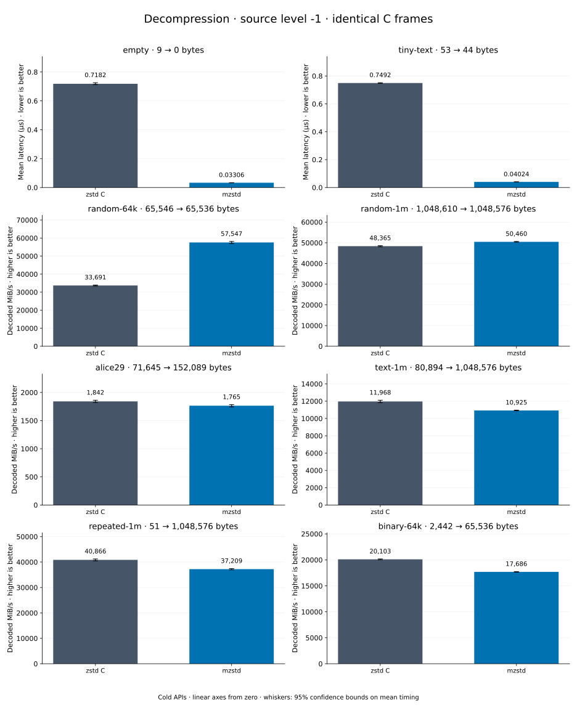

# Decompression of level -1 frames

[Decoder overview](README.md) · [Benchmark index](../README.md)

Recorded run: **dec-2026-10-13** (2026-10-13).
[CSV](../decoder-comparison.csv) · [Environment](../decoder-comparison-environment.json) · [Methodology and limits](../decoder-comparison.md).

Level belongs to the C encoder that prepared the frame; decoders have no level setting.
Both decoders restore the same bytes.

## Median speed across 8 datasets

Median of per-dataset C mean time / decoder mean time ratios, with equal weight.
Higher is faster; 1× matches C. No confidence interval
is inferred for this across-dataset median.

| Decoder | Median speed / C |
| --- | ---: |
| zstd C | 1.000× |
| mzstd | 1.034× |

Datasets are ranked by mzstd speed relative to C, highest first.
Throughput counts restored bytes; empty input has latency only. Whiskers and intervals
describe sampling uncertainty, not all host variation. Cold APIs include allocation
and disposal. C reads the frame's content size and decodes into a buffer of exactly
that size; mzstd returns its own vector.

## empty

Empty input; measures API overhead.

**9 compressed → 0 restored bytes; compressed / original: undefined.**

| Decoder | Mean µs | 95% mean interval µs | Decoded MiB/s | Speed / C |
| --- | ---: | ---: | ---: | ---: |
| zstd C | 0.7282 | 0.7261–0.7304 | — | 1.000× |
| mzstd | 0.02882 | 0.02871–0.02894 | — | 25.271× |

## tiny-text

44-byte quick-brown-fox sentence.

**53 compressed → 44 restored bytes; compressed / original: 120.455%.**

| Decoder | Mean µs | 95% mean interval µs | Decoded MiB/s | Speed / C |
| --- | ---: | ---: | ---: | ---: |
| zstd C | 0.7545 | 0.7535–0.7555 | 55.61 | 1.000× |
| mzstd | 0.03575 | 0.03558–0.03595 | 1,173.67 | 21.104× |

## random-64k

64 KiB prefix of the deterministic pseudorandom corpus.

**65,546 compressed → 65,536 restored bytes; compressed / original: 100.015%.**

| Decoder | Mean µs | 95% mean interval µs | Decoded MiB/s | Speed / C |
| --- | ---: | ---: | ---: | ---: |
| zstd C | 1.869 | 1.862–1.877 | 33,437.21 | 1.000× |
| mzstd | 1.085 | 1.08–1.091 | 57,601.70 | 1.723× |

## random-1m

1 MiB of deterministic xorshift64 pseudorandom bytes.

**1,048,610 compressed → 1,048,576 restored bytes; compressed / original: 100.003%.**

| Decoder | Mean µs | 95% mean interval µs | Decoded MiB/s | Speed / C |
| --- | ---: | ---: | ---: | ---: |
| zstd C | 19.95 | 19.89–20.01 | 50,117.78 | 1.000× |
| mzstd | 19.14 | 19.08–19.2 | 52,246.25 | 1.042× |

## repeated-1m

1 MiB of repeated a bytes.

**51 compressed → 1,048,576 restored bytes; compressed / original: 0.005%.**

| Decoder | Mean µs | 95% mean interval µs | Decoded MiB/s | Speed / C |
| --- | ---: | ---: | ---: | ---: |
| zstd C | 24.47 | 24.44–24.5 | 40,866.15 | 1.000× |
| mzstd | 23.85 | 23.8–23.9 | 41,935.02 | 1.026× |

## text-1m

Alice text repeated cyclically to 1 MiB.

**80,894 compressed → 1,048,576 restored bytes; compressed / original: 7.715%.**

| Decoder | Mean µs | 95% mean interval µs | Decoded MiB/s | Speed / C |
| --- | ---: | ---: | ---: | ---: |
| zstd C | 82.38 | 82.09–82.71 | 12,139.42 | 1.000× |
| mzstd | 93.46 | 93.25–93.69 | 10,699.84 | 0.881× |

## alice29

Alice in Wonderland text from the Canterbury corpus (`testdata/alice29.txt`).

**71,645 compressed → 152,089 restored bytes; compressed / original: 47.107%.**

| Decoder | Mean µs | 95% mean interval µs | Decoded MiB/s | Speed / C |
| --- | ---: | ---: | ---: | ---: |
| zstd C | 76.47 | 76.28–76.67 | 1,896.70 | 1.000× |
| mzstd | 87.27 | 86.52–88.05 | 1,661.92 | 0.876× |

## binary-64k

64 KiB of structured binary bytes: ((i / 16) XOR i) modulo 256.

**2,442 compressed → 65,536 restored bytes; compressed / original: 3.726%.**

| Decoder | Mean µs | 95% mean interval µs | Decoded MiB/s | Speed / C |
| --- | ---: | ---: | ---: | ---: |
| zstd C | 3.238 | 3.208–3.268 | 19,302.43 | 1.000× |
| mzstd | 3.798 | 3.755–3.84 | 16,458.15 | 0.853× |
