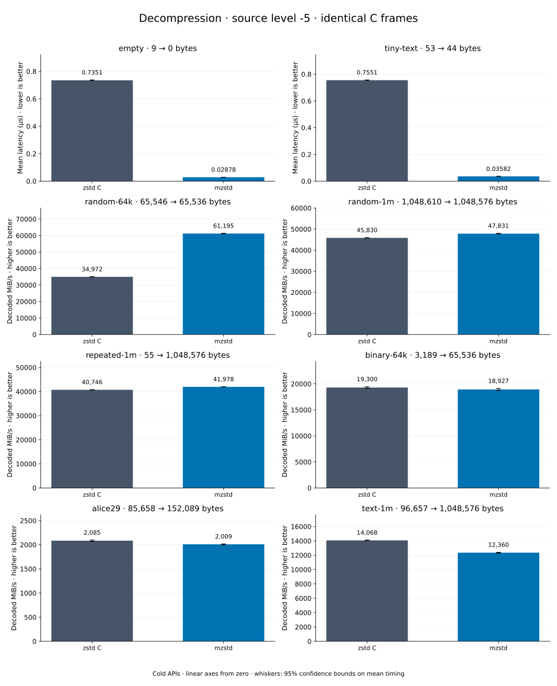

# Decompression of level -5 frames

[Decoder overview](README.md) · [Benchmark index](../README.md)

Recorded run: **dec-2026-10-13** (2026-10-13).
[CSV](../decoder-comparison.csv) · [Environment](../decoder-comparison-environment.json) · [Methodology and limits](../decoder-comparison.md).

Level belongs to the C encoder that prepared the frame; decoders have no level setting.
Both decoders restore the same bytes.

## Median speed across 8 datasets

Median of per-dataset C mean time / decoder mean time ratios, with equal weight.
Higher is faster; 1× matches C. No confidence interval
is inferred for this across-dataset median.

| Decoder | Median speed / C |
| --- | ---: |
| zstd C | 1.000× |
| mzstd | 1.037× |

Datasets are ranked by mzstd speed relative to C, highest first.
Throughput counts restored bytes; empty input has latency only. Whiskers and intervals
describe sampling uncertainty, not all host variation. Cold APIs include allocation
and disposal. C reads the frame's content size and decodes into a buffer of exactly
that size; mzstd returns its own vector.

## empty

Empty input; measures API overhead.

**9 compressed → 0 restored bytes; compressed / original: undefined.**

| Decoder | Mean µs | 95% mean interval µs | Decoded MiB/s | Speed / C |
| --- | ---: | ---: | ---: | ---: |
| zstd C | 0.7351 | 0.7329–0.7377 | — | 1.000× |
| mzstd | 0.02878 | 0.02866–0.02892 | — | 25.545× |

## tiny-text

44-byte quick-brown-fox sentence.

**53 compressed → 44 restored bytes; compressed / original: 120.455%.**

| Decoder | Mean µs | 95% mean interval µs | Decoded MiB/s | Speed / C |
| --- | ---: | ---: | ---: | ---: |
| zstd C | 0.7551 | 0.7533–0.7571 | 55.57 | 1.000× |
| mzstd | 0.03582 | 0.03566–0.03602 | 1,171.36 | 21.078× |

## random-64k

64 KiB prefix of the deterministic pseudorandom corpus.

**65,546 compressed → 65,536 restored bytes; compressed / original: 100.015%.**

| Decoder | Mean µs | 95% mean interval µs | Decoded MiB/s | Speed / C |
| --- | ---: | ---: | ---: | ---: |
| zstd C | 1.787 | 1.783–1.792 | 34,971.97 | 1.000× |
| mzstd | 1.021 | 1.019–1.024 | 61,195.23 | 1.750× |

## random-1m

1 MiB of deterministic xorshift64 pseudorandom bytes.

**1,048,610 compressed → 1,048,576 restored bytes; compressed / original: 100.003%.**

| Decoder | Mean µs | 95% mean interval µs | Decoded MiB/s | Speed / C |
| --- | ---: | ---: | ---: | ---: |
| zstd C | 21.82 | 21.75–21.88 | 45,830.05 | 1.000× |
| mzstd | 20.91 | 20.83–20.98 | 47,831.04 | 1.044× |

## repeated-1m

1 MiB of repeated a bytes.

**55 compressed → 1,048,576 restored bytes; compressed / original: 0.005%.**

| Decoder | Mean µs | 95% mean interval µs | Decoded MiB/s | Speed / C |
| --- | ---: | ---: | ---: | ---: |
| zstd C | 24.54 | 24.49–24.59 | 40,746.10 | 1.000× |
| mzstd | 23.82 | 23.79–23.85 | 41,977.66 | 1.030× |

## binary-64k

64 KiB of structured binary bytes: ((i / 16) XOR i) modulo 256.

**3,189 compressed → 65,536 restored bytes; compressed / original: 4.866%.**

| Decoder | Mean µs | 95% mean interval µs | Decoded MiB/s | Speed / C |
| --- | ---: | ---: | ---: | ---: |
| zstd C | 3.238 | 3.212–3.265 | 19,299.80 | 1.000× |
| mzstd | 3.302 | 3.268–3.336 | 18,926.75 | 0.981× |

## alice29

Alice in Wonderland text from the Canterbury corpus (`testdata/alice29.txt`).

**85,658 compressed → 152,089 restored bytes; compressed / original: 56.321%.**

| Decoder | Mean µs | 95% mean interval µs | Decoded MiB/s | Speed / C |
| --- | ---: | ---: | ---: | ---: |
| zstd C | 69.58 | 69.17–70.11 | 2,084.53 | 1.000× |
| mzstd | 72.21 | 71.91–72.56 | 2,008.61 | 0.964× |

## text-1m

Alice text repeated cyclically to 1 MiB.

**96,657 compressed → 1,048,576 restored bytes; compressed / original: 9.218%.**

| Decoder | Mean µs | 95% mean interval µs | Decoded MiB/s | Speed / C |
| --- | ---: | ---: | ---: | ---: |
| zstd C | 71.09 | 70.86–71.29 | 14,067.57 | 1.000× |
| mzstd | 80.91 | 80.58–81.35 | 12,359.65 | 0.879× |
