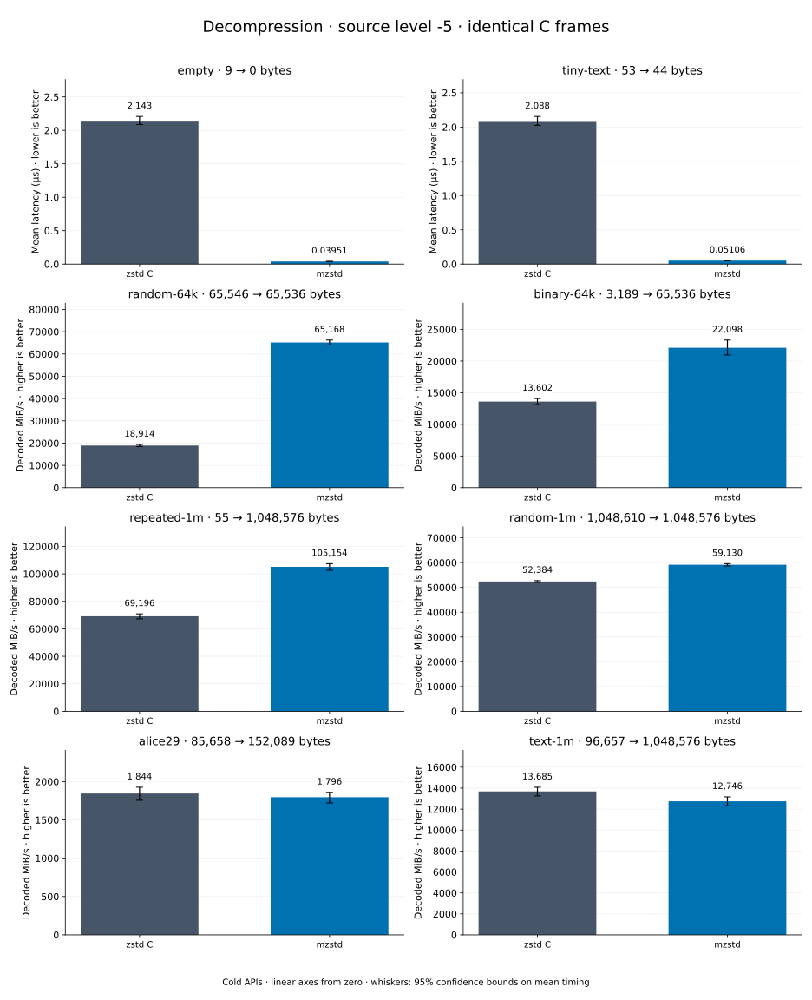

# Decompression of level -5 frames

[Decoder overview](README.md) · [Benchmark index](../README.md)

Recorded run: **long-20261109** (2026-11-09).
[CSV](../decoder-comparison.csv) · [Environment](../decoder-comparison-environment.json) · [Methodology and limits](../decoder-comparison.md).

Level belongs to the C encoder that prepared the frame; decoders have no level setting.
Both decoders restore the same bytes.

## Median speed across 8 datasets

Median of per-dataset C mean time / decoder mean time ratios, with equal weight.
Higher is faster; 1× matches C. No confidence interval
is inferred for this across-dataset median.

| Decoder | Median speed / C |
| --- | ---: |
| zstd C | 1.000× |
| mzstd | 1.572× |

Datasets are ranked by mzstd speed relative to C, highest first.
Throughput counts restored bytes; empty input has latency only. Whiskers and intervals
describe sampling uncertainty, not all host variation. Cold APIs include allocation
and disposal. C reads the frame's content size and decodes into a buffer of exactly
that size; mzstd returns its own vector.

## empty

Empty input; measures API overhead.

**9 compressed → 0 restored bytes; compressed / original: undefined.**

| Decoder | Mean µs | 95% mean interval µs | Decoded MiB/s | Speed / C |
| --- | ---: | ---: | ---: | ---: |
| zstd C | 2.143 | 2.086–2.207 | — | 1.000× |
| mzstd | 0.03951 | 0.03816–0.04109 | — | 54.242× |

## tiny-text

44-byte quick-brown-fox sentence.

**53 compressed → 44 restored bytes; compressed / original: 120.455%.**

| Decoder | Mean µs | 95% mean interval µs | Decoded MiB/s | Speed / C |
| --- | ---: | ---: | ---: | ---: |
| zstd C | 2.088 | 2.026–2.155 | 20.10 | 1.000× |
| mzstd | 0.05106 | 0.0493–0.05306 | 821.87 | 40.897× |

## random-64k

64 KiB prefix of the deterministic pseudorandom corpus.

**65,546 compressed → 65,536 restored bytes; compressed / original: 100.015%.**

| Decoder | Mean µs | 95% mean interval µs | Decoded MiB/s | Speed / C |
| --- | ---: | ---: | ---: | ---: |
| zstd C | 3.304 | 3.223–3.387 | 18,914.43 | 1.000× |
| mzstd | 0.9591 | 0.9433–0.9757 | 65,168.06 | 3.445× |

## binary-64k

64 KiB of structured binary bytes: ((i / 16) XOR i) modulo 256.

**3,189 compressed → 65,536 restored bytes; compressed / original: 4.866%.**

| Decoder | Mean µs | 95% mean interval µs | Decoded MiB/s | Speed / C |
| --- | ---: | ---: | ---: | ---: |
| zstd C | 4.595 | 4.44–4.765 | 13,601.76 | 1.000× |
| mzstd | 2.828 | 2.681–2.983 | 22,098.00 | 1.625× |

## repeated-1m

1 MiB of repeated a bytes.

**55 compressed → 1,048,576 restored bytes; compressed / original: 0.005%.**

| Decoder | Mean µs | 95% mean interval µs | Decoded MiB/s | Speed / C |
| --- | ---: | ---: | ---: | ---: |
| zstd C | 14.45 | 14.1–14.86 | 69,195.88 | 1.000× |
| mzstd | 9.51 | 9.305–9.736 | 105,153.73 | 1.520× |

## random-1m

1 MiB of deterministic xorshift64 pseudorandom bytes.

**1,048,610 compressed → 1,048,576 restored bytes; compressed / original: 100.003%.**

| Decoder | Mean µs | 95% mean interval µs | Decoded MiB/s | Speed / C |
| --- | ---: | ---: | ---: | ---: |
| zstd C | 19.09 | 18.96–19.23 | 52,383.77 | 1.000× |
| mzstd | 16.91 | 16.78–17.05 | 59,129.68 | 1.129× |

## alice29

Alice in Wonderland text from the Canterbury corpus (`testdata/alice29.txt`).

**85,658 compressed → 152,089 restored bytes; compressed / original: 56.321%.**

| Decoder | Mean µs | 95% mean interval µs | Decoded MiB/s | Speed / C |
| --- | ---: | ---: | ---: | ---: |
| zstd C | 78.66 | 75.31–82.58 | 1,844.04 | 1.000× |
| mzstd | 80.77 | 77.98–84.3 | 1,795.84 | 0.974× |

## text-1m

Alice text repeated cyclically to 1 MiB.

**96,657 compressed → 1,048,576 restored bytes; compressed / original: 9.218%.**

| Decoder | Mean µs | 95% mean interval µs | Decoded MiB/s | Speed / C |
| --- | ---: | ---: | ---: | ---: |
| zstd C | 73.07 | 71–75.41 | 13,685.07 | 1.000× |
| mzstd | 78.45 | 75.91–81.2 | 12,746.30 | 0.931× |
