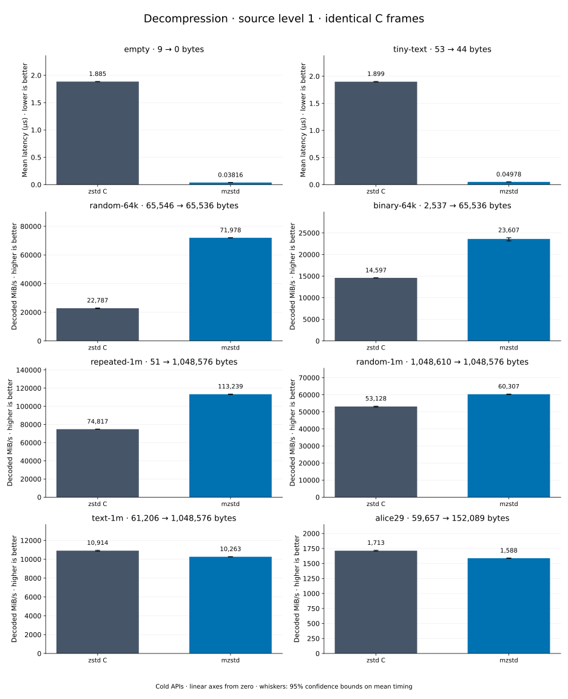

# Decompression of level 1 frames

[Decoder overview](README.md) · [Benchmark index](../README.md)

Recorded run: **dec-20261015c** (2026-10-15).
[CSV](../decoder-comparison.csv) · [Environment](../decoder-comparison-environment.json) · [Methodology and limits](../decoder-comparison.md).

Level belongs to the C encoder that prepared the frame; decoders have no level setting.
Both decoders restore the same bytes.

## Median speed across 8 datasets

Median of per-dataset C mean time / decoder mean time ratios, with equal weight.
Higher is faster; 1× matches C. No confidence interval
is inferred for this across-dataset median.

| Decoder | Median speed / C |
| --- | ---: |
| zstd C | 1.000× |
| mzstd | 0.983× |

Datasets are ranked by mzstd speed relative to C, highest first.
Throughput counts restored bytes; empty input has latency only. Whiskers and intervals
describe sampling uncertainty, not all host variation. Cold APIs include allocation
and disposal. C reads the frame's content size and decodes into a buffer of exactly
that size; mzstd returns its own vector.

## empty

Empty input; measures API overhead.

**9 compressed → 0 restored bytes; compressed / original: undefined.**

| Decoder | Mean µs | 95% mean interval µs | Decoded MiB/s | Speed / C |
| --- | ---: | ---: | ---: | ---: |
| zstd C | 0.7202 | 0.7151–0.7272 | — | 1.000× |
| mzstd | 0.03257 | 0.03241–0.03275 | — | 22.113× |

## tiny-text

44-byte quick-brown-fox sentence.

**53 compressed → 44 restored bytes; compressed / original: 120.455%.**

| Decoder | Mean µs | 95% mean interval µs | Decoded MiB/s | Speed / C |
| --- | ---: | ---: | ---: | ---: |
| zstd C | 0.7491 | 0.7448–0.7563 | 56.02 | 1.000× |
| mzstd | 0.04012 | 0.04–0.04027 | 1,045.79 | 18.670× |

## random-64k

64 KiB prefix of the deterministic pseudorandom corpus.

**65,546 compressed → 65,536 restored bytes; compressed / original: 100.015%.**

| Decoder | Mean µs | 95% mean interval µs | Decoded MiB/s | Speed / C |
| --- | ---: | ---: | ---: | ---: |
| zstd C | 1.812 | 1.794–1.831 | 34,497.45 | 1.000× |
| mzstd | 1.038 | 1.026–1.05 | 60,230.88 | 1.746× |

## random-1m

1 MiB of deterministic xorshift64 pseudorandom bytes.

**1,048,610 compressed → 1,048,576 restored bytes; compressed / original: 100.003%.**

| Decoder | Mean µs | 95% mean interval µs | Decoded MiB/s | Speed / C |
| --- | ---: | ---: | ---: | ---: |
| zstd C | 19.36 | 19.25–19.5 | 51,655.78 | 1.000× |
| mzstd | 18.69 | 18.62–18.77 | 53,494.92 | 1.036× |

## alice29

Alice in Wonderland text from the Canterbury corpus (`testdata/alice29.txt`).

**59,657 compressed → 152,089 restored bytes; compressed / original: 39.225%.**

| Decoder | Mean µs | 95% mean interval µs | Decoded MiB/s | Speed / C |
| --- | ---: | ---: | ---: | ---: |
| zstd C | 83.37 | 82.93–83.86 | 1,739.85 | 1.000× |
| mzstd | 89.51 | 89.15–89.91 | 1,620.41 | 0.931× |

## repeated-1m

1 MiB of repeated a bytes.

**51 compressed → 1,048,576 restored bytes; compressed / original: 0.005%.**

| Decoder | Mean µs | 95% mean interval µs | Decoded MiB/s | Speed / C |
| --- | ---: | ---: | ---: | ---: |
| zstd C | 24.23 | 24.17–24.29 | 41,262.73 | 1.000× |
| mzstd | 26.55 | 26.44–26.65 | 37,670.33 | 0.913× |

## binary-64k

64 KiB of structured binary bytes: ((i / 16) XOR i) modulo 256.

**2,537 compressed → 65,536 restored bytes; compressed / original: 3.871%.**

| Decoder | Mean µs | 95% mean interval µs | Decoded MiB/s | Speed / C |
| --- | ---: | ---: | ---: | ---: |
| zstd C | 3.046 | 3.035–3.059 | 20,517.75 | 1.000× |
| mzstd | 3.472 | 3.459–3.488 | 18,003.58 | 0.877× |

## text-1m

Alice text repeated cyclically to 1 MiB.

**61,206 compressed → 1,048,576 restored bytes; compressed / original: 5.837%.**

| Decoder | Mean µs | 95% mean interval µs | Decoded MiB/s | Speed / C |
| --- | ---: | ---: | ---: | ---: |
| zstd C | 95.69 | 95.4–95.99 | 10,450.34 | 1.000× |
| mzstd | 109.5 | 108.9–110.2 | 9,129.80 | 0.874× |
