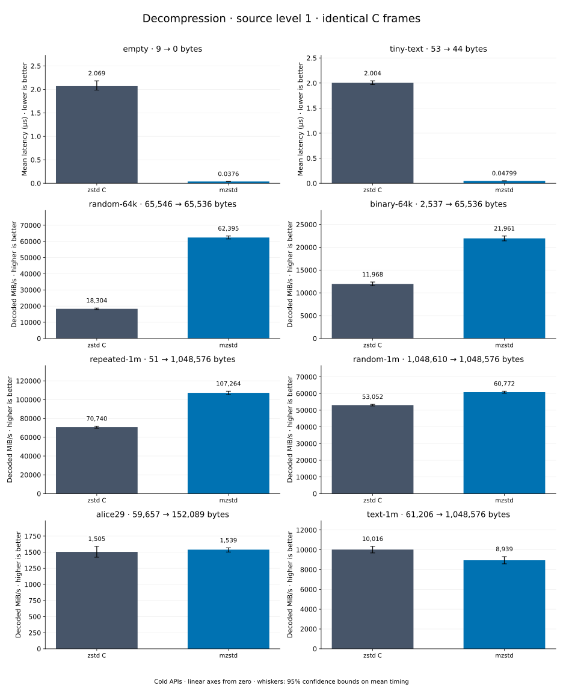

# Decompression of level 1 frames

[Decoder overview](README.md) · [Benchmark index](../README.md)

Recorded run: **long-20261112** (2026-11-12).
[CSV](../decoder-comparison.csv) · [Environment](../decoder-comparison-environment.json) · [Methodology and limits](../decoder-comparison.md).

Level belongs to the C encoder that prepared the frame; decoders have no level setting.
Both decoders restore the same bytes.

## Median speed across 8 datasets

Median of per-dataset C mean time / decoder mean time ratios, with equal weight.
Higher is faster; 1× matches C. No confidence interval
is inferred for this across-dataset median.

| Decoder | Median speed / C |
| --- | ---: |
| zstd C | 1.000× |
| mzstd | 1.614× |

Datasets are ranked by mzstd speed relative to C, highest first.
Throughput counts restored bytes; empty input has latency only. Whiskers and intervals
describe sampling uncertainty, not all host variation. Cold APIs include allocation
and disposal. C reads the frame's content size and decodes into a buffer of exactly
that size; mzstd returns its own vector.

## empty

Empty input; measures API overhead.

**9 compressed → 0 restored bytes; compressed / original: undefined.**

| Decoder | Mean µs | 95% mean interval µs | Decoded MiB/s | Speed / C |
| --- | ---: | ---: | ---: | ---: |
| zstd C | 2.009 | 1.96–2.065 | — | 1.000× |
| mzstd | 0.04097 | 0.04009–0.04201 | — | 49.044× |

## tiny-text

44-byte quick-brown-fox sentence.

**53 compressed → 44 restored bytes; compressed / original: 120.455%.**

| Decoder | Mean µs | 95% mean interval µs | Decoded MiB/s | Speed / C |
| --- | ---: | ---: | ---: | ---: |
| zstd C | 2.109 | 2.059–2.163 | 19.89 | 1.000× |
| mzstd | 0.06329 | 0.06184–0.06487 | 662.98 | 33.327× |

## random-64k

64 KiB prefix of the deterministic pseudorandom corpus.

**65,546 compressed → 65,536 restored bytes; compressed / original: 100.015%.**

| Decoder | Mean µs | 95% mean interval µs | Decoded MiB/s | Speed / C |
| --- | ---: | ---: | ---: | ---: |
| zstd C | 3.04 | 2.98–3.106 | 20,557.93 | 1.000× |
| mzstd | 0.9876 | 0.9763–0.9996 | 63,286.49 | 3.078× |

## binary-64k

64 KiB of structured binary bytes: ((i / 16) XOR i) modulo 256.

**2,537 compressed → 65,536 restored bytes; compressed / original: 3.871%.**

| Decoder | Mean µs | 95% mean interval µs | Decoded MiB/s | Speed / C |
| --- | ---: | ---: | ---: | ---: |
| zstd C | 4.92 | 4.777–5.073 | 12,703.70 | 1.000× |
| mzstd | 2.828 | 2.758–2.919 | 22,099.97 | 1.740× |

## repeated-1m

1 MiB of repeated a bytes.

**51 compressed → 1,048,576 restored bytes; compressed / original: 0.005%.**

| Decoder | Mean µs | 95% mean interval µs | Decoded MiB/s | Speed / C |
| --- | ---: | ---: | ---: | ---: |
| zstd C | 15.27 | 14.85–15.74 | 65,478.89 | 1.000× |
| mzstd | 10.26 | 9.993–10.53 | 97,480.45 | 1.489× |

## random-1m

1 MiB of deterministic xorshift64 pseudorandom bytes.

**1,048,610 compressed → 1,048,576 restored bytes; compressed / original: 100.003%.**

| Decoder | Mean µs | 95% mean interval µs | Decoded MiB/s | Speed / C |
| --- | ---: | ---: | ---: | ---: |
| zstd C | 19.58 | 19.45–19.73 | 51,062.25 | 1.000× |
| mzstd | 16.98 | 16.92–17.06 | 58,882.59 | 1.153× |

## text-1m

Alice text repeated cyclically to 1 MiB.

**61,206 compressed → 1,048,576 restored bytes; compressed / original: 5.837%.**

| Decoder | Mean µs | 95% mean interval µs | Decoded MiB/s | Speed / C |
| --- | ---: | ---: | ---: | ---: |
| zstd C | 92.34 | 91.68–93.16 | 10,829.05 | 1.000× |
| mzstd | 99.93 | 98.83–101.4 | 10,007.37 | 0.924× |

## alice29

Alice in Wonderland text from the Canterbury corpus (`testdata/alice29.txt`).

**59,657 compressed → 152,089 restored bytes; compressed / original: 39.225%.**

| Decoder | Mean µs | 95% mean interval µs | Decoded MiB/s | Speed / C |
| --- | ---: | ---: | ---: | ---: |
| zstd C | 94.88 | 91.39–98.64 | 1,528.73 | 1.000× |
| mzstd | 103.6 | 99.72–107.7 | 1,400.34 | 0.916× |
