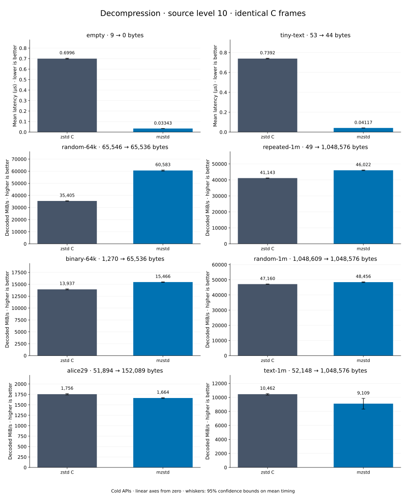

# Decompression of level 10 frames

[Decoder overview](README.md) · [Benchmark index](../README.md)

Recorded run: **dec-2026-10-13** (2026-10-13).
[CSV](../decoder-comparison.csv) · [Environment](../decoder-comparison-environment.json) · [Methodology and limits](../decoder-comparison.md).

Level belongs to the C encoder that prepared the frame; decoders have no level setting.
Both decoders restore the same bytes.

## Median speed across 8 datasets

Median of per-dataset C mean time / decoder mean time ratios, with equal weight.
Higher is faster; 1× matches C. No confidence interval
is inferred for this across-dataset median.

| Decoder | Median speed / C |
| --- | ---: |
| zstd C | 1.000× |
| mzstd | 1.034× |

Datasets are ranked by mzstd speed relative to C, highest first.
Throughput counts restored bytes; empty input has latency only. Whiskers and intervals
describe sampling uncertainty, not all host variation. Cold APIs include allocation
and disposal. C reads the frame's content size and decodes into a buffer of exactly
that size; mzstd returns its own vector.

## empty

Empty input; measures API overhead.

**9 compressed → 0 restored bytes; compressed / original: undefined.**

| Decoder | Mean µs | 95% mean interval µs | Decoded MiB/s | Speed / C |
| --- | ---: | ---: | ---: | ---: |
| zstd C | 0.7287 | 0.7277–0.7297 | — | 1.000× |
| mzstd | 0.02885 | 0.02872–0.029 | — | 25.261× |

## tiny-text

44-byte quick-brown-fox sentence.

**53 compressed → 44 restored bytes; compressed / original: 120.455%.**

| Decoder | Mean µs | 95% mean interval µs | Decoded MiB/s | Speed / C |
| --- | ---: | ---: | ---: | ---: |
| zstd C | 0.7547 | 0.7533–0.7563 | 55.60 | 1.000× |
| mzstd | 0.03632 | 0.03578–0.03703 | 1,155.22 | 20.778× |

## random-64k

64 KiB prefix of the deterministic pseudorandom corpus.

**65,546 compressed → 65,536 restored bytes; compressed / original: 100.015%.**

| Decoder | Mean µs | 95% mean interval µs | Decoded MiB/s | Speed / C |
| --- | ---: | ---: | ---: | ---: |
| zstd C | 1.79 | 1.787–1.794 | 34,906.87 | 1.000× |
| mzstd | 1.029 | 1.027–1.031 | 60,759.48 | 1.741× |

## random-1m

1 MiB of deterministic xorshift64 pseudorandom bytes.

**1,048,609 compressed → 1,048,576 restored bytes; compressed / original: 100.003%.**

| Decoder | Mean µs | 95% mean interval µs | Decoded MiB/s | Speed / C |
| --- | ---: | ---: | ---: | ---: |
| zstd C | 20.12 | 20.04–20.19 | 49,711.87 | 1.000× |
| mzstd | 19.38 | 19.3–19.47 | 51,604.03 | 1.038× |

## repeated-1m

1 MiB of repeated a bytes.

**49 compressed → 1,048,576 restored bytes; compressed / original: 0.005%.**

| Decoder | Mean µs | 95% mean interval µs | Decoded MiB/s | Speed / C |
| --- | ---: | ---: | ---: | ---: |
| zstd C | 24.48 | 24.41–24.56 | 40,845.67 | 1.000× |
| mzstd | 23.76 | 23.68–23.85 | 42,080.79 | 1.030× |

## binary-64k

64 KiB of structured binary bytes: ((i / 16) XOR i) modulo 256.

**1,270 compressed → 65,536 restored bytes; compressed / original: 1.938%.**

| Decoder | Mean µs | 95% mean interval µs | Decoded MiB/s | Speed / C |
| --- | ---: | ---: | ---: | ---: |
| zstd C | 4.534 | 4.52–4.551 | 13,785.69 | 1.000× |
| mzstd | 4.809 | 4.794–4.825 | 12,997.81 | 0.943× |

## alice29

Alice in Wonderland text from the Canterbury corpus (`testdata/alice29.txt`).

**51,894 compressed → 152,089 restored bytes; compressed / original: 34.121%.**

| Decoder | Mean µs | 95% mean interval µs | Decoded MiB/s | Speed / C |
| --- | ---: | ---: | ---: | ---: |
| zstd C | 86.35 | 85.11–88.03 | 1,679.77 | 1.000× |
| mzstd | 96.85 | 95.95–97.79 | 1,497.56 | 0.892× |

## text-1m

Alice text repeated cyclically to 1 MiB.

**52,148 compressed → 1,048,576 restored bytes; compressed / original: 4.973%.**

| Decoder | Mean µs | 95% mean interval µs | Decoded MiB/s | Speed / C |
| --- | ---: | ---: | ---: | ---: |
| zstd C | 95.21 | 94.97–95.47 | 10,503.49 | 1.000× |
| mzstd | 116.2 | 115.9–116.6 | 8,603.78 | 0.819× |
