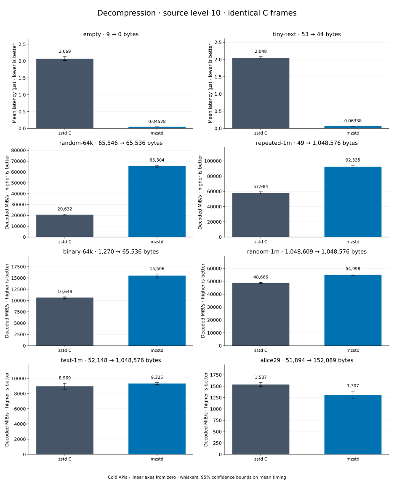

# Decompression of level 10 frames

[Decoder overview](README.md) · [Benchmark index](../README.md)

Recorded run: **long-20261112** (2026-11-12).
[CSV](../decoder-comparison.csv) · [Environment](../decoder-comparison-environment.json) · [Methodology and limits](../decoder-comparison.md).

Level belongs to the C encoder that prepared the frame; decoders have no level setting.
Both decoders restore the same bytes.

## Median speed across 8 datasets

Median of per-dataset C mean time / decoder mean time ratios, with equal weight.
Higher is faster; 1× matches C. No confidence interval
is inferred for this across-dataset median.

| Decoder | Median speed / C |
| --- | ---: |
| zstd C | 1.000× |
| mzstd | 1.524× |

Datasets are ranked by mzstd speed relative to C, highest first.
Throughput counts restored bytes; empty input has latency only. Whiskers and intervals
describe sampling uncertainty, not all host variation. Cold APIs include allocation
and disposal. C reads the frame's content size and decodes into a buffer of exactly
that size; mzstd returns its own vector.

## empty

Empty input; measures API overhead.

**9 compressed → 0 restored bytes; compressed / original: undefined.**

| Decoder | Mean µs | 95% mean interval µs | Decoded MiB/s | Speed / C |
| --- | ---: | ---: | ---: | ---: |
| zstd C | 2.069 | 2.013–2.131 | — | 1.000× |
| mzstd | 0.04528 | 0.04359–0.04712 | — | 45.691× |

## tiny-text

44-byte quick-brown-fox sentence.

**53 compressed → 44 restored bytes; compressed / original: 120.455%.**

| Decoder | Mean µs | 95% mean interval µs | Decoded MiB/s | Speed / C |
| --- | ---: | ---: | ---: | ---: |
| zstd C | 2.048 | 2.017–2.084 | 20.49 | 1.000× |
| mzstd | 0.06338 | 0.06198–0.06484 | 662.02 | 32.313× |

## random-64k

64 KiB prefix of the deterministic pseudorandom corpus.

**65,546 compressed → 65,536 restored bytes; compressed / original: 100.015%.**

| Decoder | Mean µs | 95% mean interval µs | Decoded MiB/s | Speed / C |
| --- | ---: | ---: | ---: | ---: |
| zstd C | 3.029 | 2.971–3.095 | 20,632.45 | 1.000× |
| mzstd | 0.9571 | 0.9446–0.9709 | 65,304.10 | 3.165× |

## repeated-1m

1 MiB of repeated a bytes.

**49 compressed → 1,048,576 restored bytes; compressed / original: 0.005%.**

| Decoder | Mean µs | 95% mean interval µs | Decoded MiB/s | Speed / C |
| --- | ---: | ---: | ---: | ---: |
| zstd C | 17.25 | 16.86–17.62 | 57,983.69 | 1.000× |
| mzstd | 10.83 | 10.61–11.04 | 92,335.09 | 1.592× |

## binary-64k

64 KiB of structured binary bytes: ((i / 16) XOR i) modulo 256.

**1,270 compressed → 65,536 restored bytes; compressed / original: 1.938%.**

| Decoder | Mean µs | 95% mean interval µs | Decoded MiB/s | Speed / C |
| --- | ---: | ---: | ---: | ---: |
| zstd C | 5.869 | 5.782–5.969 | 10,648.31 | 1.000× |
| mzstd | 4.031 | 3.934–4.166 | 15,506.02 | 1.456× |

## random-1m

1 MiB of deterministic xorshift64 pseudorandom bytes.

**1,048,609 compressed → 1,048,576 restored bytes; compressed / original: 100.003%.**

| Decoder | Mean µs | 95% mean interval µs | Decoded MiB/s | Speed / C |
| --- | ---: | ---: | ---: | ---: |
| zstd C | 20.55 | 20.34–20.76 | 48,666.36 | 1.000× |
| mzstd | 18.18 | 17.96–18.41 | 54,997.87 | 1.130× |

## text-1m

Alice text repeated cyclically to 1 MiB.

**52,148 compressed → 1,048,576 restored bytes; compressed / original: 4.973%.**

| Decoder | Mean µs | 95% mean interval µs | Decoded MiB/s | Speed / C |
| --- | ---: | ---: | ---: | ---: |
| zstd C | 111.5 | 106.8–116.7 | 8,968.96 | 1.000× |
| mzstd | 107.2 | 105.9–108.9 | 9,324.67 | 1.040× |

## alice29

Alice in Wonderland text from the Canterbury corpus (`testdata/alice29.txt`).

**51,894 compressed → 152,089 restored bytes; compressed / original: 34.121%.**

| Decoder | Mean µs | 95% mean interval µs | Decoded MiB/s | Speed / C |
| --- | ---: | ---: | ---: | ---: |
| zstd C | 94.39 | 91.87–97.34 | 1,536.69 | 1.000× |
| mzstd | 111 | 104.1–118.5 | 1,306.76 | 0.850× |
