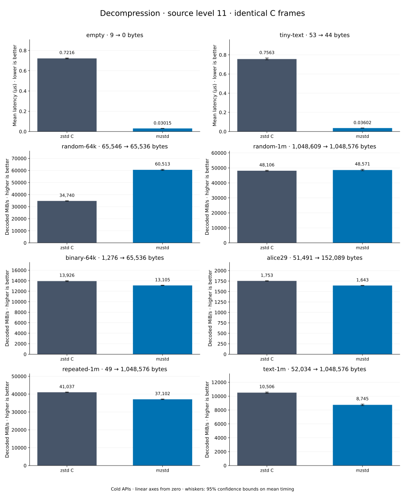

# Decompression of level 11 frames

[Decoder overview](README.md) · [Benchmark index](../README.md)

Recorded run: **dec-2026-10-13** (2026-10-13).
[CSV](../decoder-comparison.csv) · [Environment](../decoder-comparison-environment.json) · [Methodology and limits](../decoder-comparison.md).

Level belongs to the C encoder that prepared the frame; decoders have no level setting.
Both decoders restore the same bytes.

## Median speed across 8 datasets

Median of per-dataset C mean time / decoder mean time ratios, with equal weight.
Higher is faster; 1× matches C. No confidence interval
is inferred for this across-dataset median.

| Decoder | Median speed / C |
| --- | ---: |
| zstd C | 1.000× |
| mzstd | 1.031× |

Datasets are ranked by mzstd speed relative to C, highest first.
Throughput counts restored bytes; empty input has latency only. Whiskers and intervals
describe sampling uncertainty, not all host variation. Cold APIs include allocation
and disposal. C reads the frame's content size and decodes into a buffer of exactly
that size; mzstd returns its own vector.

## empty

Empty input; measures API overhead.

**9 compressed → 0 restored bytes; compressed / original: undefined.**

| Decoder | Mean µs | 95% mean interval µs | Decoded MiB/s | Speed / C |
| --- | ---: | ---: | ---: | ---: |
| zstd C | 0.7291 | 0.7282–0.7302 | — | 1.000× |
| mzstd | 0.02879 | 0.02869–0.02892 | — | 25.323× |

## tiny-text

44-byte quick-brown-fox sentence.

**53 compressed → 44 restored bytes; compressed / original: 120.455%.**

| Decoder | Mean µs | 95% mean interval µs | Decoded MiB/s | Speed / C |
| --- | ---: | ---: | ---: | ---: |
| zstd C | 0.7576 | 0.7562–0.7592 | 55.39 | 1.000× |
| mzstd | 0.03594 | 0.03575–0.03615 | 1,167.62 | 21.081× |

## random-64k

64 KiB prefix of the deterministic pseudorandom corpus.

**65,546 compressed → 65,536 restored bytes; compressed / original: 100.015%.**

| Decoder | Mean µs | 95% mean interval µs | Decoded MiB/s | Speed / C |
| --- | ---: | ---: | ---: | ---: |
| zstd C | 1.795 | 1.79–1.799 | 34,828.08 | 1.000× |
| mzstd | 1.027 | 1.025–1.029 | 60,861.06 | 1.747× |

## random-1m

1 MiB of deterministic xorshift64 pseudorandom bytes.

**1,048,609 compressed → 1,048,576 restored bytes; compressed / original: 100.003%.**

| Decoder | Mean µs | 95% mean interval µs | Decoded MiB/s | Speed / C |
| --- | ---: | ---: | ---: | ---: |
| zstd C | 20.23 | 20.18–20.29 | 49,422.00 | 1.000× |
| mzstd | 19.49 | 19.45–19.53 | 51,302.19 | 1.038× |

## repeated-1m

1 MiB of repeated a bytes.

**49 compressed → 1,048,576 restored bytes; compressed / original: 0.005%.**

| Decoder | Mean µs | 95% mean interval µs | Decoded MiB/s | Speed / C |
| --- | ---: | ---: | ---: | ---: |
| zstd C | 24.54 | 24.5–24.59 | 40,749.92 | 1.000× |
| mzstd | 23.95 | 23.87–24.06 | 41,752.69 | 1.025× |

## binary-64k

64 KiB of structured binary bytes: ((i / 16) XOR i) modulo 256.

**1,276 compressed → 65,536 restored bytes; compressed / original: 1.947%.**

| Decoder | Mean µs | 95% mean interval µs | Decoded MiB/s | Speed / C |
| --- | ---: | ---: | ---: | ---: |
| zstd C | 4.531 | 4.515–4.551 | 13,793.89 | 1.000× |
| mzstd | 4.825 | 4.803–4.857 | 12,952.71 | 0.939× |

## alice29

Alice in Wonderland text from the Canterbury corpus (`testdata/alice29.txt`).

**51,491 compressed → 152,089 restored bytes; compressed / original: 33.856%.**

| Decoder | Mean µs | 95% mean interval µs | Decoded MiB/s | Speed / C |
| --- | ---: | ---: | ---: | ---: |
| zstd C | 86.54 | 85.77–87.28 | 1,675.95 | 1.000× |
| mzstd | 94.03 | 93.65–94.43 | 1,542.60 | 0.920× |

## text-1m

Alice text repeated cyclically to 1 MiB.

**52,034 compressed → 1,048,576 restored bytes; compressed / original: 4.962%.**

| Decoder | Mean µs | 95% mean interval µs | Decoded MiB/s | Speed / C |
| --- | ---: | ---: | ---: | ---: |
| zstd C | 94.47 | 94.22–94.82 | 10,585.78 | 1.000× |
| mzstd | 115.6 | 115–116.2 | 8,653.37 | 0.817× |
