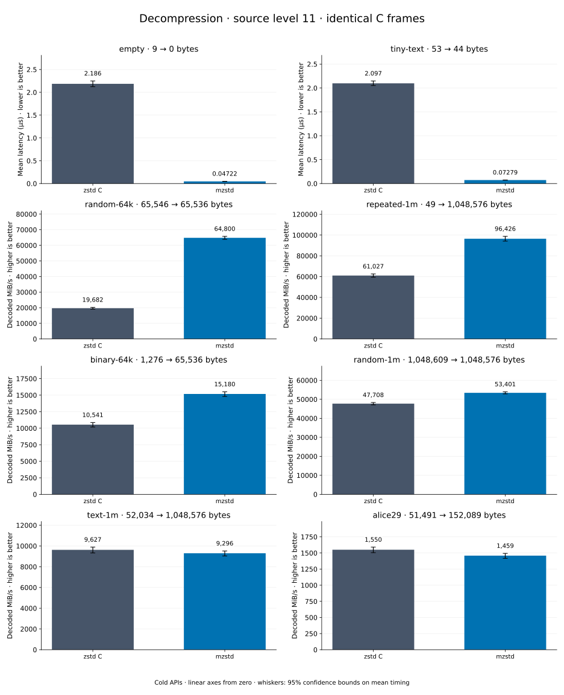

# Decompression of level 11 frames

[Decoder overview](README.md) · [Benchmark index](../README.md)

Recorded run: **long-20261109** (2026-11-09).
[CSV](../decoder-comparison.csv) · [Environment](../decoder-comparison-environment.json) · [Methodology and limits](../decoder-comparison.md).

Level belongs to the C encoder that prepared the frame; decoders have no level setting.
Both decoders restore the same bytes.

## Median speed across 8 datasets

Median of per-dataset C mean time / decoder mean time ratios, with equal weight.
Higher is faster; 1× matches C. No confidence interval
is inferred for this across-dataset median.

| Decoder | Median speed / C |
| --- | ---: |
| zstd C | 1.000× |
| mzstd | 1.542× |

Datasets are ranked by mzstd speed relative to C, highest first.
Throughput counts restored bytes; empty input has latency only. Whiskers and intervals
describe sampling uncertainty, not all host variation. Cold APIs include allocation
and disposal. C reads the frame's content size and decodes into a buffer of exactly
that size; mzstd returns its own vector.

## empty

Empty input; measures API overhead.

**9 compressed → 0 restored bytes; compressed / original: undefined.**

| Decoder | Mean µs | 95% mean interval µs | Decoded MiB/s | Speed / C |
| --- | ---: | ---: | ---: | ---: |
| zstd C | 2.07 | 2.023–2.123 | — | 1.000× |
| mzstd | 0.04046 | 0.03937–0.04168 | — | 51.172× |

## tiny-text

44-byte quick-brown-fox sentence.

**53 compressed → 44 restored bytes; compressed / original: 120.455%.**

| Decoder | Mean µs | 95% mean interval µs | Decoded MiB/s | Speed / C |
| --- | ---: | ---: | ---: | ---: |
| zstd C | 2.105 | 2.049–2.165 | 19.93 | 1.000× |
| mzstd | 0.05286 | 0.05085–0.05507 | 793.86 | 39.825× |

## random-64k

64 KiB prefix of the deterministic pseudorandom corpus.

**65,546 compressed → 65,536 restored bytes; compressed / original: 100.015%.**

| Decoder | Mean µs | 95% mean interval µs | Decoded MiB/s | Speed / C |
| --- | ---: | ---: | ---: | ---: |
| zstd C | 2.937 | 2.867–3.018 | 21,283.04 | 1.000× |
| mzstd | 0.9627 | 0.9522–0.9741 | 64,923.89 | 3.050× |

## binary-64k

64 KiB of structured binary bytes: ((i / 16) XOR i) modulo 256.

**1,276 compressed → 65,536 restored bytes; compressed / original: 1.947%.**

| Decoder | Mean µs | 95% mean interval µs | Decoded MiB/s | Speed / C |
| --- | ---: | ---: | ---: | ---: |
| zstd C | 7.224 | 6.885–7.562 | 8,651.43 | 1.000× |
| mzstd | 4.538 | 4.334–4.761 | 13,772.72 | 1.592× |

## repeated-1m

1 MiB of repeated a bytes.

**49 compressed → 1,048,576 restored bytes; compressed / original: 0.005%.**

| Decoder | Mean µs | 95% mean interval µs | Decoded MiB/s | Speed / C |
| --- | ---: | ---: | ---: | ---: |
| zstd C | 15.26 | 14.84–15.71 | 65,533.34 | 1.000× |
| mzstd | 10.23 | 9.961–10.52 | 97,718.67 | 1.491× |

## random-1m

1 MiB of deterministic xorshift64 pseudorandom bytes.

**1,048,609 compressed → 1,048,576 restored bytes; compressed / original: 100.003%.**

| Decoder | Mean µs | 95% mean interval µs | Decoded MiB/s | Speed / C |
| --- | ---: | ---: | ---: | ---: |
| zstd C | 19.98 | 19.78–20.2 | 50,044.73 | 1.000× |
| mzstd | 17.96 | 17.76–18.15 | 55,690.81 | 1.113× |

## text-1m

Alice text repeated cyclically to 1 MiB.

**52,034 compressed → 1,048,576 restored bytes; compressed / original: 4.962%.**

| Decoder | Mean µs | 95% mean interval µs | Decoded MiB/s | Speed / C |
| --- | ---: | ---: | ---: | ---: |
| zstd C | 111.5 | 107.3–116 | 8,965.69 | 1.000× |
| mzstd | 108 | 104.9–111.9 | 9,256.13 | 1.032× |

## alice29

Alice in Wonderland text from the Canterbury corpus (`testdata/alice29.txt`).

**51,491 compressed → 152,089 restored bytes; compressed / original: 33.856%.**

| Decoder | Mean µs | 95% mean interval µs | Decoded MiB/s | Speed / C |
| --- | ---: | ---: | ---: | ---: |
| zstd C | 92.44 | 89.81–95.56 | 1,569.03 | 1.000× |
| mzstd | 99.8 | 96.2–104 | 1,453.36 | 0.926× |
