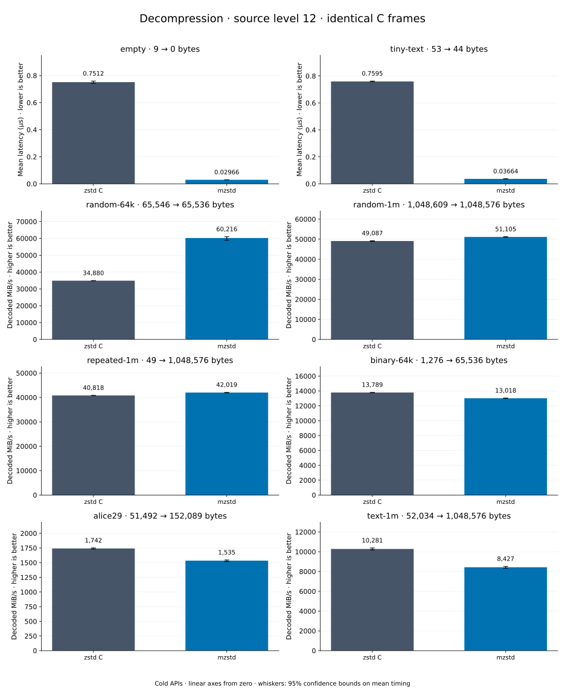

# Decompression of level 12 frames

[Decoder overview](README.md) · [Benchmark index](../README.md)

Recorded run: **dec-2026-10-13** (2026-10-13).
[CSV](../decoder-comparison.csv) · [Environment](../decoder-comparison-environment.json) · [Methodology and limits](../decoder-comparison.md).

Level belongs to the C encoder that prepared the frame; decoders have no level setting.
Both decoders restore the same bytes.

## Median speed across 8 datasets

Median of per-dataset C mean time / decoder mean time ratios, with equal weight.
Higher is faster; 1× matches C. No confidence interval
is inferred for this across-dataset median.

| Decoder | Median speed / C |
| --- | ---: |
| zstd C | 1.000× |
| mzstd | 1.035× |

Datasets are ranked by mzstd speed relative to C, highest first.
Throughput counts restored bytes; empty input has latency only. Whiskers and intervals
describe sampling uncertainty, not all host variation. Cold APIs include allocation
and disposal. C reads the frame's content size and decodes into a buffer of exactly
that size; mzstd returns its own vector.

## empty

Empty input; measures API overhead.

**9 compressed → 0 restored bytes; compressed / original: undefined.**

| Decoder | Mean µs | 95% mean interval µs | Decoded MiB/s | Speed / C |
| --- | ---: | ---: | ---: | ---: |
| zstd C | 0.7512 | 0.7429–0.7595 | — | 1.000× |
| mzstd | 0.02966 | 0.02939–0.02993 | — | 25.327× |

## tiny-text

44-byte quick-brown-fox sentence.

**53 compressed → 44 restored bytes; compressed / original: 120.455%.**

| Decoder | Mean µs | 95% mean interval µs | Decoded MiB/s | Speed / C |
| --- | ---: | ---: | ---: | ---: |
| zstd C | 0.7595 | 0.757–0.7621 | 55.25 | 1.000× |
| mzstd | 0.03664 | 0.03647–0.03685 | 1,145.13 | 20.726× |

## random-64k

64 KiB prefix of the deterministic pseudorandom corpus.

**65,546 compressed → 65,536 restored bytes; compressed / original: 100.015%.**

| Decoder | Mean µs | 95% mean interval µs | Decoded MiB/s | Speed / C |
| --- | ---: | ---: | ---: | ---: |
| zstd C | 1.792 | 1.789–1.795 | 34,880.46 | 1.000× |
| mzstd | 1.038 | 1.025–1.062 | 60,216.17 | 1.726× |

## random-1m

1 MiB of deterministic xorshift64 pseudorandom bytes.

**1,048,609 compressed → 1,048,576 restored bytes; compressed / original: 100.003%.**

| Decoder | Mean µs | 95% mean interval µs | Decoded MiB/s | Speed / C |
| --- | ---: | ---: | ---: | ---: |
| zstd C | 20.37 | 20.31–20.44 | 49,087.39 | 1.000× |
| mzstd | 19.57 | 19.52–19.63 | 51,105.28 | 1.041× |

## repeated-1m

1 MiB of repeated a bytes.

**49 compressed → 1,048,576 restored bytes; compressed / original: 0.005%.**

| Decoder | Mean µs | 95% mean interval µs | Decoded MiB/s | Speed / C |
| --- | ---: | ---: | ---: | ---: |
| zstd C | 24.5 | 24.46–24.54 | 40,818.19 | 1.000× |
| mzstd | 23.8 | 23.75–23.85 | 42,019.27 | 1.029× |

## binary-64k

64 KiB of structured binary bytes: ((i / 16) XOR i) modulo 256.

**1,276 compressed → 65,536 restored bytes; compressed / original: 1.947%.**

| Decoder | Mean µs | 95% mean interval µs | Decoded MiB/s | Speed / C |
| --- | ---: | ---: | ---: | ---: |
| zstd C | 4.532 | 4.523–4.542 | 13,789.48 | 1.000× |
| mzstd | 4.801 | 4.79–4.814 | 13,018.39 | 0.944× |

## alice29

Alice in Wonderland text from the Canterbury corpus (`testdata/alice29.txt`).

**51,492 compressed → 152,089 restored bytes; compressed / original: 33.856%.**

| Decoder | Mean µs | 95% mean interval µs | Decoded MiB/s | Speed / C |
| --- | ---: | ---: | ---: | ---: |
| zstd C | 83.28 | 82.85–83.78 | 1,741.63 | 1.000× |
| mzstd | 94.51 | 93.83–95.58 | 1,534.61 | 0.881× |

## text-1m

Alice text repeated cyclically to 1 MiB.

**52,034 compressed → 1,048,576 restored bytes; compressed / original: 4.962%.**

| Decoder | Mean µs | 95% mean interval µs | Decoded MiB/s | Speed / C |
| --- | ---: | ---: | ---: | ---: |
| zstd C | 97.27 | 96.31–98.25 | 10,280.88 | 1.000× |
| mzstd | 118.7 | 117.3–120 | 8,427.29 | 0.820× |
